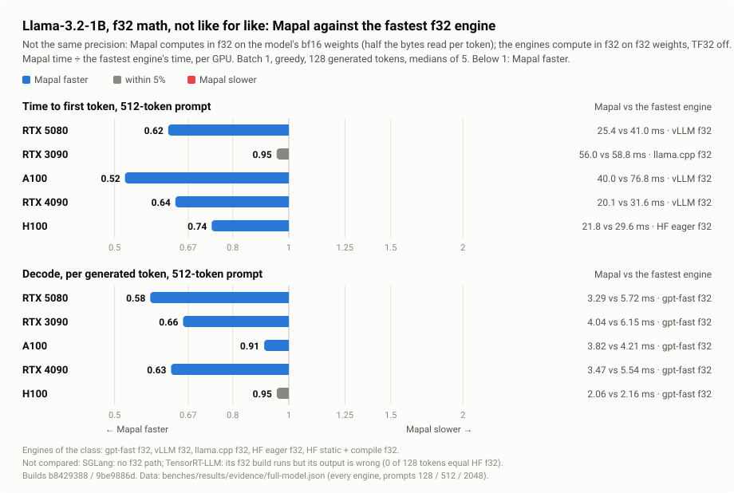
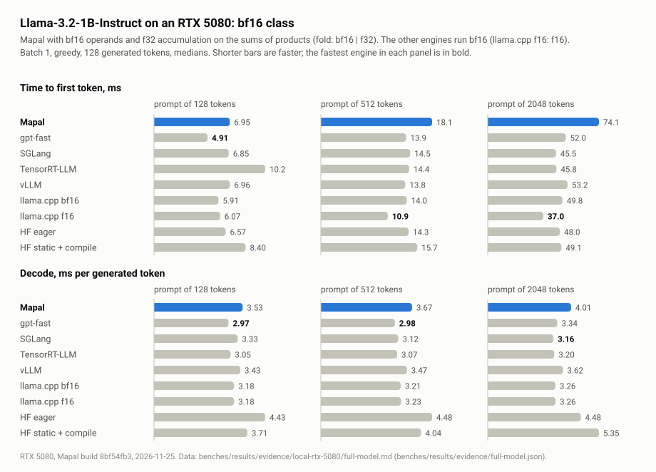
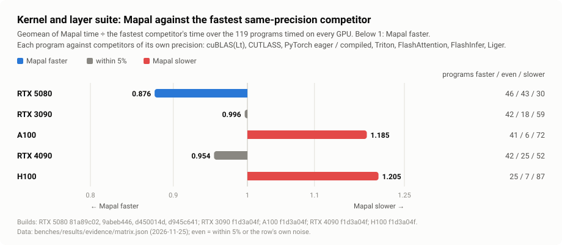

<!-- markdownlint-disable MD033 MD041 -->
<div align = center>


<br>

[![Badge Workflow]][Workflow]
[![Badge License]][License]
![Badge Language]
[![Badge Pull Requests]][Pull Requests]
[![Badge Issues]][Issues]
![Badge Numerics]<br>

<br>

**Describe how data flows. Mapal places it where it runs best, on any hardware.**

</div>

## A first look

```flow
// softmax: turn scores into probabilities that add up to 1.
fn softmax<n>(scores: [f32; n]) -> [f32; n] {
    n -> iota -> positions;
    (scores[0], positions) -> fold {
        top, i -> (scores[i] > top) -> {
            -true-> scores[i];
            -false-> top;
        }
    } -> largest;
    positions -> map {
        i -> scores[i] - largest -> exp
    } -> weights;
    (0.0, positions) -> fold {
        sum, i -> sum + weights[i]
    } -> total;
    positions -> map {
        i -> weights[i] / total
    } -> ret;
}

fn main() {
    [1.0, 2.0, 3.0, 4.0] -> softmax -> probabilities;
    probabilities[3] -> println;    // 0.6439143
}
```

`a -> f -> b` means "a flows through f and becomes b". A `map` does something to every item, and the items are
independent. A `fold` combines many values into one. That is all the program says, so the compiler is free to decide
the rest: what runs in parallel, where the data lives, and whether it runs on the CPU, the GPU or both. There are no
threads, kernels or tile sizes in the source.

A whole language model, Llama-3.2-1B, is one readable file:
[`examples/llama.mapal`](examples/llama.mapal).

## The ideas

- **The program is the flow.** You describe the data and how it moves, not the steps a machine should take.
- **Data composes like mathematics.** Values and the transformations between them are built on category theory, so
  the compiler can reason about a program exactly.
- **Describing the flow beats describing control.** Code that spells out the control is tuned for one machine. Code
  that states the flow can be compiled well for each machine.
- **The compiler knows both sides.** It knows your program (what depends on what) and the hardware (where data can
  live, what can compute it), and it matches the two. A new chip only needs to be described, not reprogrammed for.
- **Correct within a stated error.** Results are guaranteed within a precision you can see, not bit for bit, which
  leaves the compiler free to choose the fastest correct way.
- **Readable code is the target.** If the natural version of a program runs slower, the compiler gets fixed.

## Results

The Llama-3.2-1B model above, against the fastest of gpt-fast, vLLM, SGLang, TensorRT-LLM, llama.cpp and Hugging
Face on five NVIDIA GPUs, each compared at the same precision. A bar below 1.0 means Mapal is faster.

<picture>
  <source media="(prefers-color-scheme: dark)" srcset="benches/results/charts/llm-f32-dark.svg">
  
</picture>

<picture>
  <source media="(prefers-color-scheme: dark)" srcset="benches/results/charts/llm-bf16-dark.svg">
  
</picture>

- **Full precision (f32):** the fastest on all five GPUs at generating text, and for prompts of 512 tokens or more.
- **Half precision (bf16):** mostly still behind the fastest engine: within 5–15% on the RTX 5080, further behind on
  the other GPUs. On the H100 it is now faster for short prompts; work is in progress.
- **Memory:** 2.7–3.5 GB of GPU memory, level with the leanest engines and far below the serving engines.

Across 119 kernels and model layers (matrix products, attention, convolution, reductions and more), Mapal is
faster on average than the best library or compiler on three of the five GPUs.

<picture>
  <source media="(prefers-color-scheme: dark)" srcset="benches/results/charts/suite-gpus-dark.svg">
  
</picture>

All numbers, how they were measured, and every engine: [`docs/performance/results.md`](docs/performance/results.md).

## Where it stands

Working today: the language, an interpreter that defines it, a CPU backend, an NVIDIA GPU backend, and editor
support for Neovim and VS Code. Next: a model of the hardware the compiler places programs on, an AMD backend, a
PyTorch importer, and then hardware design (ASICs) from the same programs. A research compiler; no packaged release
yet. Details: [`docs/STATUS.md`](docs/STATUS.md) and [`docs/roadmap.md`](docs/roadmap.md).

## Try it

```sh
cargo build --release -p mapal-cli -p mapal-rt
target/release/mapal run examples/softmax.mapal
```

More, including the GPU, the tests and editor setup: [`docs/getting-started.md`](docs/getting-started.md).

## Learn more

- [The Language Exposition](https://lesscomplexity.github.io/mapal/language-exposition.html): Mapal by examples, then how the compiler works
- [Architecture Map](https://lesscomplexity.github.io/mapal/architecture-map.html): the compiler as data — every component, its categories and transformations, each linked to its code
- [Syntax](docs/syntax.md): the language, form by form
- [Decisions](docs/decisions/README.md): every design decision and what it replaced
- [Contributing](CONTRIBUTING.md)

## License

[Apache License 2.0 with the LLVM exception](LICENSE), the license LLVM and Swift use.

<!----------------------------------{ Badges }---------------------------------->

<!-- The license badge is static because GitHub classifies Apache-2.0 WITH
     LLVM-exception as NOASSERTION, so shields' dynamic one renders the words
     "not identifiable by github". The exception is real; the badge says so. -->

[Badge Workflow]: https://github.com/LessComplexity/mapal/actions/workflows/ci.yml/badge.svg
[Badge License]: https://img.shields.io/badge/license-Apache--2.0_WITH_LLVM--exception-blue
[Badge Language]: https://img.shields.io/github/languages/top/LessComplexity/mapal
[Badge Pull Requests]: https://img.shields.io/github/issues-pr/LessComplexity/mapal
[Badge Issues]: https://img.shields.io/github/issues/LessComplexity/mapal
[Badge Numerics]: https://img.shields.io/badge/numerics-bounded-14b8a6

<!-----------------------------------{ Links }----------------------------------->

[Workflow]: https://github.com/LessComplexity/mapal/actions/workflows/ci.yml
[License]: LICENSE
[Pull Requests]: https://github.com/LessComplexity/mapal/pulls
[Issues]: https://github.com/LessComplexity/mapal/issues
