# Mapal Architecture Map

The compiler seen as the data that defines it: kinds of data (categories), the things and arrows inside them, and the transformations between them. 15 components, 17 categories, 294 objects, 207 arrows, 199 transformations, 42 guarantees, 151 algorithms, data structures and patterns. Every item links to the line of code that defines it. A richer, interactive version with the diagrams pre-drawn is [architecture-map.html](architecture-map.html).

Contents: [Data](#data) · [Memory](#memory) · [Components](#components) · [Guarantees](#guarantees) · [Index](#index)

<a id="data"></a>

## The compiler as data

Each box is a **category**: a kind of data (text, tokens, the Flow graph, facts, machine code, a running program). Each arrow is a **transformation**: a stage of the compiler that turns one kind of data into another. Boxes are grouped by the component that defines them; click a box to see its objects.

Inside a category, the things are **objects** and the ways of getting from one to another are **arrows** (morphisms). A **functor** maps a whole category into another, a **process** is one step with inputs and outputs, and a **guarantee** (natural transformation) says that two routes between the same ends give the same result.

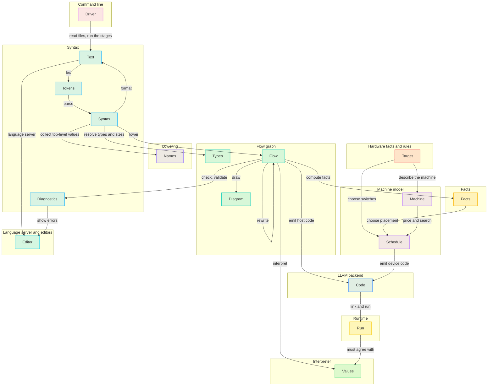

| Category | Defined under | What it holds | Size |
|---|---|---|---|
| [Text](#cat-Text) | [Syntax](#c-syntax) | Source text and positions in it: .mapal files, strings, spans, line tables. | 6 objects, 6 arrows |
| [Tokens](#cat-Tokens) | [Syntax](#c-syntax) | The flat list of words and symbols the lexer cuts the text into. | 5 objects, 2 arrows |
| [Syntax](#cat-Syntax) | [Syntax](#c-syntax) | The parse tree: items, functions, chains of stages, expressions. | 15 objects, 7 arrows |
| [Diagnostics](#cat-Diagnostics) | [Syntax](#c-syntax) | Error and warning messages with the place they refer to, whichever stage found them. | 9 objects, 9 arrows |
| [Names](#cat-Names) | [Lowering](#c-lower) | What names mean while lowering: top-level values, effects, generic sizes. | 6 objects, 4 arrows |
| [Types](#cat-Types) | [Flow graph](#c-flow) | Mapal's types and number formats, as lowering resolves them and the graph stores them. | 17 objects, 15 arrows |
| [Flow](#cat-Flow) | [Flow graph](#c-flow) | The dataflow graph of a program: objects (values) and morphisms (operations) in sealed functions. | 20 objects, 28 arrows |
| [Diagram](#cat-Diagram) | [Flow graph](#c-flow) | Pictures of a graph (Mermaid text): the flow view, category diagrams and string diagrams. | 3 objects, 2 arrows |
| [Facts](#cat-Facts) | [Facts](#c-facts) | Everything the compiler has proven about a graph, stored on the graph and read by every later stage. | 30 objects, 7 arrows |
| [Values](#cat-Values) | [Interpreter](#c-interp) | What a program computes: scalars, arrays and records, and the error bound of a result. | 11 objects, 5 arrows |
| [Target](#cat-Target) | [Hardware facts and rules](#c-hardware) | A chip as measurable properties (SM count, cache sizes, rates) plus the calibration lines that measured them. | 13 objects, 14 arrows |
| [Machine](#cat-Machine) | [Machine model](#c-machine) | The abstract machine the placement search prices: levels of memory, rates, latencies. | 14 objects, 8 arrows |
| [Schedule](#cat-Schedule) | [Machine model](#c-machine) | A way of running a piece of work: tile shapes, launch geometry, residency, placement picks. | 51 objects, 44 arrows |
| [Code](#cat-Code) | [LLVM backend](#c-llvm) | Generated programs: LLVM text, device modules, PTX, object files and executables. | 42 objects, 17 arrows |
| [Run](#cat-Run) | [Runtime](#c-runtime) | A running program: host memory, tasks, device memory, output and exit code. | 32 objects, 28 arrows |
| [Driver](#cat-Driver) | [Command line](#c-cli) | How the command line drives the stages: arguments, side files, sessions. | 5 objects, 2 arrows |
| [Editor](#cat-Editor) | [Language server and editors](#c-lsp) | What an editor sees: requests, answers, colors, plugin files. | 15 objects, 9 arrows |

<a id="memory"></a>

## Where data lives

The same objects exist in different places as the program goes from text to a running kernel. Each box below holds the main objects that live there; click one for its definition.


| Place | What is kept there | Main objects (with where they are defined) |
|---|---|---|
| **The compiler's memory** | Everything the compiler builds while it runs: trees, graphs, facts, plans, generated text. | [Program](#o-Syntax.program) [`crates/mapal-syntax/src/ast.rs:28`](../crates/mapal-syntax/src/ast.rs#L28)<br>[CategoryIr (sealed graph)](#o-Flow.categoryir-sealed-graph) [`crates/mapal-ir/src/graph.rs:288`](../crates/mapal-ir/src/graph.rs#L288)<br>[FuncFacts / Facts (fact store)](#o-Facts.funcfacts-facts-fact-store) [`crates/mapal-ir/src/facts.rs:25`](../crates/mapal-ir/src/facts.rs#L25)<br>[TargetProfile](#o-Target.targetprofile) [`crates/backends/llvm/src/profile/target.rs:8`](../crates/backends/llvm/src/profile/target.rs#L8)<br>[ResidentPlan](#o-Schedule.residentplan) [`crates/backends/llvm/src/func/resident.rs:377`](../crates/backends/llvm/src/func/resident.rs#L377)<br>[Emission](#o-Code.emission) [`crates/backends/llvm/src/opts.rs:198`](../crates/backends/llvm/src/opts.rs#L198)<br> |
| **Files on disk** | What the compiler reads and writes: sources, generated text, the program, measurements. | [Source file (.mapal)](#o-Text.source-file-mapal) [`crates/mapal-cli/src/main.rs:215`](../crates/mapal-cli/src/main.rs#L215)<br>[PTX file](#o-Code.ptx-file) [`crates/mapal-cli/src/main.rs:378`](../crates/mapal-cli/src/main.rs#L378)<br>[Executable](#o-Code.executable) [`crates/mapal-cli/src/main.rs:378`](../crates/mapal-cli/src/main.rs#L378)<br>[libmapal_rt.a](#o-Code.libmapal-rt-a) [`crates/mapal-rt/Cargo.toml:1`](../crates/mapal-rt/Cargo.toml#L1)<br>[Wisdom file line](#o-Schedule.wisdom-file-line) [`crates/mapal-rt/gpu/mapal_choice.h:138`](../crates/mapal-rt/gpu/mapal_choice.h#L138)<br>[calibration line](#o-Target.calibration-line) [`benches/results/evidence/local-rtx-5080/calib/rtx-5080.calib:1`](../benches/results/evidence/local-rtx-5080/calib/rtx-5080.calib#L1)<br> |
| **The running program: host memory** | The CPU side of a compiled program: frames, arrays, task queues, and the tables it picks kernels from. | [ArenaBlock (ARENA)](#o-Run.arenablock-arena) [`crates/mapal-rt/src/mem.rs:55`](../crates/mapal-rt/src/mem.rs#L55)<br>[FrameSlot (FRAME)](#o-Run.frameslot-frame) [`crates/mapal-rt/src/mem.rs:149`](../crates/mapal-rt/src/mem.rs#L149)<br>[heap array buffer](#o-Run.heap-array-buffer) [`crates/backends/llvm/src/func/core/ptrs.rs:367`](../crates/backends/llvm/src/func/core/ptrs.rs#L367)<br>[Pool](#o-Run.pool) [`crates/mapal-rt/src/sched.rs:145`](../crates/mapal-rt/src/sched.rs#L145)<br>[mapal_cand](#o-Schedule.mapal-cand) [`crates/mapal-rt/gpu/mapal_choice.h:41`](../crates/mapal-rt/gpu/mapal_choice.h#L41)<br>[choice_memo](#o-Schedule.choice-memo) [`crates/mapal-rt/gpu/mapal_choice.h:125`](../crates/mapal-rt/gpu/mapal_choice.h#L125)<br> |
| **GPU global memory** | Device buffers a GPU program allocates, copies to and from, and shares between kernels. | [Arena (device)](#o-Run.arena-device) [`crates/mapal-rt/gpu/mapal_gpu_memory.inc:42`](../crates/mapal-rt/gpu/mapal_gpu_memory.inc#L42)<br>[device arena slab](#o-Run.device-arena-slab) [`crates/backends/llvm/src/func/resident.rs:461`](../crates/backends/llvm/src/func/resident.rs#L461)<br>[loop buffer](#o-Run.loop-buffer) [`crates/backends/cuda/src/loops.rs:61`](../crates/backends/cuda/src/loops.rs#L61)<br>[mapal_dev_trap word](#o-Run.mapal-dev-trap-word) [`crates/mapal-rt/gpu/mapal_gpu_emu_host.inc:48`](../crates/mapal-rt/gpu/mapal_gpu_emu_host.inc#L48)<br> |
| **GPU shared memory and registers** | On-chip storage inside one kernel: tile staging, accumulators and per-thread values. | [tile registers / shared memory](#o-Run.tile-registers-shared-memory) [`crates/backends/llvm/src/func/gpu/kernel_geom.rs:580`](../crates/backends/llvm/src/func/gpu/kernel_geom.rs#L580)<br>[device twin](#o-Run.device-twin) [`crates/backends/cuda/src/kernel.rs:461`](../crates/backends/cuda/src/kernel.rs#L461)<br> |

<a id="components"></a>

## Components, in pipeline order

Every component lists the categories it defines (its data), then the transformations it makes between categories, then its guarantees and the algorithms, data structures and design patterns it uses. Every code reference is a link to the line, shown as `path:line` so you can also open it with `nvim path +line`.

[Syntax](#c-syntax) · [Lowering](#c-lower) · [Checker](#c-check) · [Flow graph](#c-flow) · [Facts](#c-facts) · [Rewrites](#c-rewrite) · [Interpreter](#c-interp) · [Hardware facts and rules](#c-hardware) · [Machine model](#c-machine) · [LLVM backend](#c-llvm) · [CUDA backend](#c-cuda) · [Verilog backend](#c-verilog) · [Runtime](#c-runtime) · [Command line](#c-cli) · [Language server and editors](#c-lsp)

<a id="c-syntax"></a>

### Syntax

Reads Mapal source text and gives back tokens, a parse tree and error messages. It also formats source files.

**Reads **[Text](#cat-Text)**  →  produces **[Tokens](#cat-Tokens), [Syntax](#cat-Syntax), [Diagnostics](#cat-Diagnostics)

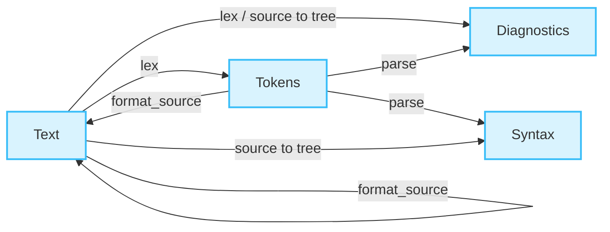

**Guarantees: **[Formatting keeps the tree](#g-syn-nat-format), [Lexing and parsing never fail](#g-syn-nat-total)

<details>
<summary>Files (9)</summary>

[`crates/mapal-syntax/src/loc.rs:1`](../crates/mapal-syntax/src/loc.rs#L1)  
[`crates/mapal-syntax/src/token.rs:1`](../crates/mapal-syntax/src/token.rs#L1)  
[`crates/mapal-syntax/src/lexer.rs:1`](../crates/mapal-syntax/src/lexer.rs#L1)  
[`crates/mapal-syntax/src/ast.rs:1`](../crates/mapal-syntax/src/ast.rs#L1)  
[`crates/mapal-syntax/src/parser.rs:1`](../crates/mapal-syntax/src/parser.rs#L1)  
[`crates/mapal-syntax/src/parser/tests.rs:1`](../crates/mapal-syntax/src/parser/tests.rs#L1)  
[`crates/mapal-syntax/src/diag.rs:1`](../crates/mapal-syntax/src/diag.rs#L1)  
[`crates/mapal-syntax/src/format.rs:1`](../crates/mapal-syntax/src/format.rs#L1)  
[`crates/mapal-syntax/src/lib.rs:1`](../crates/mapal-syntax/src/lib.rs#L1)

</details>

<a id="cat-Text"></a>

#### Category Text

Source text and positions in it: .mapal files, strings, spans, line tables.

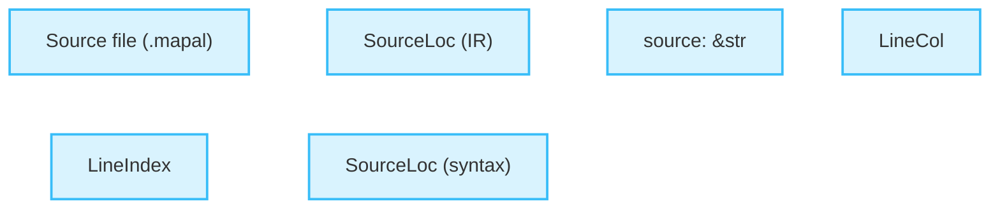

<details open>
<summary>Objects (6)</summary>

| Object | What it is | Defined at | Lives in | Provided by |
|---|---|---|---|---|
| <a id="o-Text.source-file-mapal"></a>**Source file (.mapal)** | The program text. | [`crates/mapal-cli/src/main.rs:215`](../crates/mapal-cli/src/main.rs#L215) | disk, then a String on the compiler heap | [Command line](#c-cli) |
| <a id="o-Text.sourceloc-ir"></a>**SourceLoc (IR)** | A byte range in the source file, copied onto every object and morphism so errors point back to text. | [`crates/mapal-ir/src/loc.rs:13`](../crates/mapal-ir/src/loc.rs#L13) | compiler heap: field of Object, Morphism, FuncDef | [Facts](#c-facts), [Flow graph](#c-flow) |
| <a id="o-Text.source-str"></a>**source: &str** | The whole program text, the single source of truth; tokens and names only point into it. | [`crates/mapal-syntax/src/lexer.rs:23`](../crates/mapal-syntax/src/lexer.rs#L23) | compiler process heap: a String read from the .mapal file (or the editor buffer), borrowed by every later stage |  |
| <a id="o-Text.linecol"></a>**LineCol** | A 1-based line and column, used only for display. | [`crates/mapal-syntax/src/loc.rs:49`](../crates/mapal-syntax/src/loc.rs#L49) | stack value, made on demand |  |
| <a id="o-Text.lineindex"></a>**LineIndex** | A table of where each line starts, so an offset can be turned into a line and column. | [`crates/mapal-syntax/src/loc.rs:59`](../crates/mapal-syntax/src/loc.rs#L59) | compiler process heap: a Vec of line-start offsets borrowing the source |  |
| <a id="o-Text.sourceloc-syntax"></a>**SourceLoc (syntax)** | A byte range {start, end} in the source; every token and tree node carries one. | [`crates/mapal-syntax/src/loc.rs:12`](../crates/mapal-syntax/src/loc.rs#L12) | two u32 values, copied inline inside Token, tree nodes and Diagnostic |  |

</details>

<details open>
<summary>Arrows (6)</summary>

| Arrow | From → to | What it does | Defined at |
|---|---|---|---|
| **at** | `file, LineIndex, byte offset` → `'file:line:col' string` | Format a position for a message. | [`crates/mapal-cli/src/main.rs:194`](../crates/mapal-cli/src/main.rs#L194) |
| **source_dir** | `file path` → `absolute directory` | The folder a relative read path resolves against, recorded in the IR. | [`crates/mapal-cli/src/main.rs:202`](../crates/mapal-cli/src/main.rs#L202) |
| **SourceLoc::len / empty_at** | `SourceLoc` → `u32 / SourceLoc` | Length of a span; a zero-width span at a point (for synthesized nodes). | [`crates/mapal-ir/src/loc.rs:18`](../crates/mapal-ir/src/loc.rs#L18) |
| **LineIndex::line_col** | `offset (u32)` → `LineCol` | A byte offset becomes its line and column. | [`crates/mapal-syntax/src/loc.rs:93`](../crates/mapal-syntax/src/loc.rs#L93) |
| **SourceLoc::new / empty_at** | `u32 offsets` → `SourceLoc` | Build a span from two offsets, or an empty span at one point. | [`crates/mapal-syntax/src/loc.rs:21`](../crates/mapal-syntax/src/loc.rs#L21) |
| **slice by span** | `SourceLoc` → `&str` | A span gives back its text as source[start..end]; names and tokens keep no text of their own. | [`crates/mapal-syntax/src/parser.rs:171`](../crates/mapal-syntax/src/parser.rs#L171) |

</details>

<a id="cat-Tokens"></a>

#### Category Tokens

The flat list of words and symbols the lexer cuts the text into.

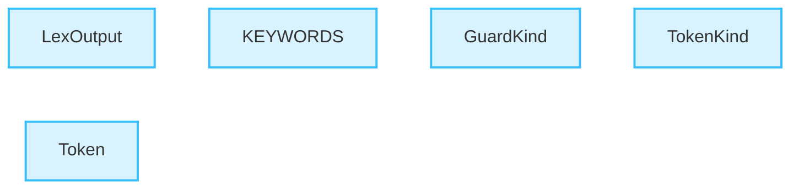

<details open>
<summary>Objects (5)</summary>

| Object | What it is | Defined at | Lives in |
|---|---|---|---|
| <a id="o-Tokens.lexoutput"></a>**LexOutput** | The token list (always ending in an end-of-file token) together with the lexer's errors. | [`crates/mapal-syntax/src/lexer.rs:14`](../crates/mapal-syntax/src/lexer.rs#L14) | compiler heap: Vec<Token> + Vec<Diagnostic> |
| <a id="o-Tokens.keywords"></a>**KEYWORDS** | The fixed list of reserved words. | [`crates/mapal-syntax/src/token.rs:113`](../crates/mapal-syntax/src/token.rs#L113) | a constant table in the compiler binary |
| <a id="o-Tokens.guardkind"></a>**GuardKind** | Which guard arrow it is: -true->, -false->, -_-> or -42->; the number sits inside the arrow lexeme. | [`crates/mapal-syntax/src/token.rs:19`](../crates/mapal-syntax/src/token.rs#L19) | payload of the Guard token kind |
| <a id="o-Tokens.tokenkind"></a>**TokenKind** | What a token is: name, literal, keyword, punctuation, operator, guard arrow, error, end of file. | [`crates/mapal-syntax/src/token.rs:33`](../crates/mapal-syntax/src/token.rs#L33) | one small tag inside each Token |
| <a id="o-Tokens.token"></a>**Token** | A kind plus its span; the text is not copied. | [`crates/mapal-syntax/src/token.rs:11`](../crates/mapal-syntax/src/token.rs#L11) | compiler heap: element of Vec<Token>, a Copy value |

</details>

<details open>
<summary>Arrows (2)</summary>

| Arrow | From → to | What it does | Defined at |
|---|---|---|---|
| **keyword lookup** | `&str` → `TokenKind` | A word's text is checked against the reserved list to become a keyword token or a plain name. | [`crates/mapal-syntax/src/token.rs:113`](../crates/mapal-syntax/src/token.rs#L113) |
| **unescape_string** | `Token (string lexeme)` → `String` | A string lexeme becomes its real text with escapes resolved. | [`crates/mapal-syntax/src/token.rs:155`](../crates/mapal-syntax/src/token.rs#L155) |

</details>

<a id="cat-Syntax"></a>

#### Category Syntax

The parse tree: items, functions, chains of stages, expressions.

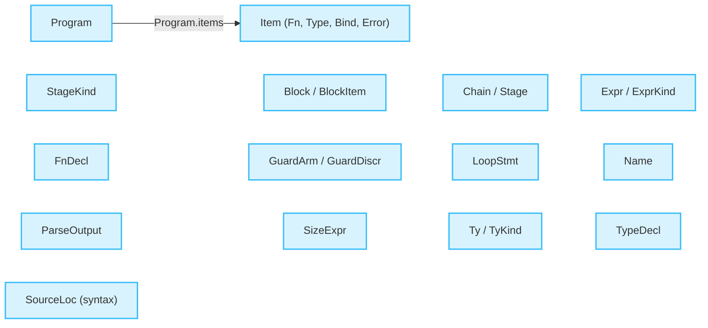

<details>
<summary>Objects (15)</summary>

| Object | What it is | Defined at | Lives in | Provided by |
|---|---|---|---|---|
| <a id="o-Syntax.item-fn-type-bind-error"></a>**Item (Fn, Type, Bind, Error)** | One top-level declaration: a function, a type, a top-level value, or a parse error. | [`crates/mapal-syntax/src/ast.rs:40`](../crates/mapal-syntax/src/ast.rs#L40) | compiler heap, inside Program | [Lowering](#c-lower) |
| <a id="o-Syntax.stagekind"></a>**StageKind** | What one stage of a chain does: map, fold, call, bind, guard, fan-out and so on. | [`crates/mapal-syntax/src/ast.rs:303`](../crates/mapal-syntax/src/ast.rs#L303) | compiler heap |  |
| <a id="o-Syntax.block-blockitem"></a>**Block / BlockItem** | A braced body: statements, then an optional final chain that is the value. | [`crates/mapal-syntax/src/ast.rs:215`](../crates/mapal-syntax/src/ast.rs#L215) | compiler heap |  |
| <a id="o-Syntax.chain-stage"></a>**Chain / Stage** | A pipeline written with arrows: a start value flowing through stages such as map, fold, call, bind or fan-out. | [`crates/mapal-syntax/src/ast.rs:286`](../crates/mapal-syntax/src/ast.rs#L286) | compiler heap |  |
| <a id="o-Syntax.expr-exprkind"></a>**Expr / ExprKind** | An expression: literal, name, operator, index, member, struct literal. | [`crates/mapal-syntax/src/ast.rs:393`](../crates/mapal-syntax/src/ast.rs#L393) | compiler heap |  |
| <a id="o-Syntax.fndecl"></a>**FnDecl** | A function: name, size and format parameters, parameters, return type and body. | [`crates/mapal-syntax/src/ast.rs:62`](../crates/mapal-syntax/src/ast.rs#L62) | compiler heap |  |
| <a id="o-Syntax.guardarm-guarddiscr"></a>**GuardArm / GuardDiscr** | One arm of a conditional (guard) with the case it matches. | [`crates/mapal-syntax/src/ast.rs:365`](../crates/mapal-syntax/src/ast.rs#L365) | compiler heap |  |
| <a id="o-Syntax.loopstmt"></a>**LoopStmt** | A loop statement with its label. | [`crates/mapal-syntax/src/ast.rs:253`](../crates/mapal-syntax/src/ast.rs#L253) | compiler heap |  |
| <a id="o-Syntax.name"></a>**Name** | A bare span; its text is read from the source. | [`crates/mapal-syntax/src/ast.rs:141`](../crates/mapal-syntax/src/ast.rs#L141) | a SourceLoc inline |  |
| <a id="o-Syntax.parseoutput"></a>**ParseOutput** | The program tree plus every lexer and parser error, sorted by position. | [`crates/mapal-syntax/src/ast.rs:21`](../crates/mapal-syntax/src/ast.rs#L21) | compiler heap, handed to lowering, the checker, the formatter-free tools and the language server |  |
| <a id="o-Syntax.program"></a>**Program** | The whole parse tree: a list of items. | [`crates/mapal-syntax/src/ast.rs:28`](../crates/mapal-syntax/src/ast.rs#L28) | compiler process heap, produced by the parser and borrowed by lower | [Lowering](#c-lower) |
| <a id="o-Syntax.sizeexpr"></a>**SizeExpr** | A size written as arithmetic over numbers and size names, such as tokens * hidden. | [`crates/mapal-syntax/src/ast.rs:186`](../crates/mapal-syntax/src/ast.rs#L186) | compiler heap |  |
| <a id="o-Syntax.ty-tykind"></a>**Ty / TyKind** | A written type: a primitive, a named type, an array with a size, or a tuple. | [`crates/mapal-syntax/src/ast.rs:147`](../crates/mapal-syntax/src/ast.rs#L147) | compiler heap |  |
| <a id="o-Syntax.typedecl"></a>**TypeDecl** | A named record type with fields. | [`crates/mapal-syntax/src/ast.rs:122`](../crates/mapal-syntax/src/ast.rs#L122) | compiler heap |  |
| <a id="o-Syntax.sourceloc-syntax"></a>**SourceLoc (syntax)** | A byte range in the source text; lower keys many tables by its (start,end). | [`crates/mapal-syntax/src/loc.rs:12`](../crates/mapal-syntax/src/loc.rs#L12) | compiler heap, 8 bytes inline in every node | [Lowering](#c-lower) |

</details>

<details open>
<summary>Arrows (7)</summary>

| Arrow | From → to | What it does | Defined at |
|---|---|---|---|
| **ir_loc** | `syntax SourceLoc` → `IR SourceLoc` | Carries a source span across from the parse tree to the IR so graph nodes remember where they came from. | [`crates/mapal-lower/src/tys.rs:19`](../crates/mapal-lower/src/tys.rs#L19) |
| **name_text** | `Name` → `&str` | A name node to its text in the source. | [`crates/mapal-lower/src/tys.rs:211`](../crates/mapal-lower/src/tys.rs#L211) |
| **src_slice** | `SourceLoc` → `&str` | A span to the source text it covers. | [`crates/mapal-lower/src/tys.rs:216`](../crates/mapal-lower/src/tys.rs#L216) |
| **Block to its items and tail** | `Block` → `BlockItem / Chain` | A body to its statements and its final value chain. | [`crates/mapal-syntax/src/ast.rs:215`](../crates/mapal-syntax/src/ast.rs#L215) |
| **Chain.stages** | `Chain` → `Stage` | A chain to the ordered stages the value flows through. | [`crates/mapal-syntax/src/ast.rs:286`](../crates/mapal-syntax/src/ast.rs#L286) |
| **Program.items** | `Program` → `Item` | A program to its top-level items. | [`crates/mapal-syntax/src/ast.rs:28`](../crates/mapal-syntax/src/ast.rs#L28) |
| **every node's span** | `any tree node` → `SourceLoc` | Each tree node maps to the source range it covers, so any error or tool can point back at the text. | [`crates/mapal-syntax/src/parser.rs:193`](../crates/mapal-syntax/src/parser.rs#L193) |

</details>

<a id="cat-Diagnostics"></a>

#### Category Diagnostics

Error and warning messages with the place they refer to, whichever stage found them.

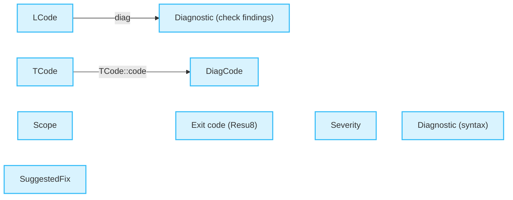

<details open>
<summary>Objects (9)</summary>

| Object | What it is | Defined at | Lives in | Provided by |
|---|---|---|---|---|
| <a id="o-Diagnostics.tcode"></a>**TCode** | The check stage's error catalogue: T0101 multiple return writers, T0201 effect in a fan-out. | [`crates/mapal-check/src/diag.rs:15`](../crates/mapal-check/src/diag.rs#L15) | a tag value, becomes a &'static str code | [Checker](#c-check) |
| <a id="o-Diagnostics.diagnostic-check-findings"></a>**Diagnostic (check findings)** | The same Diagnostic type as syntax, always severity Error with no fix. | [`crates/mapal-check/src/diag.rs:33`](../crates/mapal-check/src/diag.rs#L33) | compiler heap: Vec<Diagnostic>, in the order exclusivity findings then effect findings | [Checker](#c-check) |
| <a id="o-Diagnostics.scope"></a>**Scope** | The set of names bound so far while walking the tree, used to tell a local value from a callee. | [`crates/mapal-check/src/effects.rs:77`](../crates/mapal-check/src/effects.rs#L77) | compiler heap: stack of name sets, temporary during the walk | [Checker](#c-check) |
| <a id="o-Diagnostics.exit-code-res-u8"></a>**Exit code (Res<u8>)** | 0 ok, 1 failure, 2 usage, 3 toolchain missing; from the program: 101 trap, 102 driver failure, 103 read failure. | [`crates/mapal-cli/src/main.rs:55`](../crates/mapal-cli/src/main.rs#L55) | the process exit status | [Command line](#c-cli) |
| <a id="o-Diagnostics.lcode"></a>**LCode** | The catalogue of lowering error kinds, each with a stable L-code. | [`crates/mapal-lower/src/diag.rs:15`](../crates/mapal-lower/src/diag.rs#L15) | compiler heap, Copy tag | [Lowering](#c-lower) |
| <a id="o-Diagnostics.severity"></a>**Severity** | Error or warning. | [`crates/mapal-syntax/src/diag.rs:17`](../crates/mapal-syntax/src/diag.rs#L17) | one tag |  |
| <a id="o-Diagnostics.diagcode"></a>**DiagCode** | A stable code string: L#### lexer, P#### parser, T#### check. | [`crates/mapal-syntax/src/diag.rs:13`](../crates/mapal-syntax/src/diag.rs#L13) | a &'static str constant |  |
| <a id="o-Diagnostics.diagnostic-syntax"></a>**Diagnostic (syntax)** | An error with a span, code and message, shared with the parser. | [`crates/mapal-syntax/src/diag.rs:32`](../crates/mapal-syntax/src/diag.rs#L32) | compiler heap Vec<Diagnostic> | [Lowering](#c-lower) |
| <a id="o-Diagnostics.suggestedfix"></a>**SuggestedFix** | Replace this span with this text, with a label. | [`crates/mapal-syntax/src/diag.rs:24`](../crates/mapal-syntax/src/diag.rs#L24) | compiler heap, inside a Diagnostic |  |

</details>

<details open>
<summary>Arrows (9)</summary>

| Arrow | From → to | What it does | Defined at |
|---|---|---|---|
| **diag** | `(TCode, SourceLoc, message)` → `Diagnostic` | A code, a span and a message become a Diagnostic. | [`crates/mapal-check/src/diag.rs:33`](../crates/mapal-check/src/diag.rs#L33) |
| **TCode::code** | `TCode` → `DiagCode string` | A check error kind to its stable code string. | [`crates/mapal-check/src/diag.rs:22`](../crates/mapal-check/src/diag.rs#L22) |
| **to_syntax** | `mapal_ir SourceLoc` → `SourceLoc` | A source location of the flow graph converts to the syntax span type. | [`crates/mapal-check/src/exclusivity.rs:18`](../crates/mapal-check/src/exclusivity.rs#L18) |
| **report** | `Diagnostic list` → `stderr lines` | Print 'file:line:col error[code] (stage) message'. | [`crates/mapal-cli/src/main.rs:215`](../crates/mapal-cli/src/main.rs#L215) |
| **diag** | `LCode x SourceLoc x message` → `Diagnostic` | Builds a diagnostic. | [`crates/mapal-lower/src/diag.rs:211`](../crates/mapal-lower/src/diag.rs#L211) |
| **LCode::code** | `LCode` → `&str` | The code string such as L1201. | [`crates/mapal-lower/src/diag.rs:113`](../crates/mapal-lower/src/diag.rs#L113) |
| **ir_err** | `IrError x SourceLoc` → `Diagnostic` | Translates a builder refusal or seal failure into a source-located error. | [`crates/mapal-lower/src/emit.rs:149`](../crates/mapal-lower/src/emit.rs#L149) |
| **Diagnostic::error / with_fix** | `(code, SourceLoc, message)` → `Diagnostic` | Build an error at a span, optionally attach a fix. | [`crates/mapal-syntax/src/diag.rs:43`](../crates/mapal-syntax/src/diag.rs#L43) |
| **Parser::diag / diag_fix** | `(code, SourceLoc, message)` → `Diagnostic` | The parser records an error, with a cooldown so one mistake does not cascade into many. | [`crates/mapal-syntax/src/parser.rs:249`](../crates/mapal-syntax/src/parser.rs#L249) |

</details>

<details open>
<summary>Transformations (4)</summary>

| Name | From → to | Kind | What it does | Defined at | Lives in |
|---|---|---|---|---|---|
| <a id="t-syn-lex"></a>**lex** | [Text](#cat-Text)<br>→ [Tokens](#cat-Tokens)<br>[Diagnostics](#cat-Diagnostics) | functor | Cuts the text into tokens. It is total: unknown input becomes an Error token plus a diagnostic and scanning goes on; guard arrows are single tokens recognised by adjacency and statement-start context. | [`crates/mapal-syntax/src/lexer.rs:23`](../crates/mapal-syntax/src/lexer.rs#L23) | compiler heap; runs once per source on the main thread |
| <a id="t-syn-parse"></a>**parse** | [Tokens](#cat-Tokens)<br>→ [Syntax](#cat-Syntax)<br>[Diagnostics](#cat-Diagnostics) | functor | Builds the parse tree from the tokens by recursive descent, recovering at statement and item borders. It merges lexer and parser errors and sorts them by position. | [`crates/mapal-syntax/src/parser.rs:43`](../crates/mapal-syntax/src/parser.rs#L43) | compiler heap; recursion depth capped by DEPTH_LIMIT so deep nesting reports an error instead of overflowing the stack |
| <a id="t-syn-format"></a>**format_source** | [Text](#cat-Text)<br>[Tokens](#cat-Tokens)<br>→ [Text](#cat-Text) | process | Re-prints source in the one canonical layout (four spaces, multiline braces) by walking the token stream and re-spacing it, keeping comments. It refuses input that has syntax errors. | [`crates/mapal-syntax/src/format.rs:11`](../crates/mapal-syntax/src/format.rs#L11) | compiler heap: output String; used by `mapal fmt` and the editors' format action |
| <a id="t-syn-parse-full"></a>**source to tree** | [Text](#cat-Text)<br>→ [Syntax](#cat-Syntax)<br>[Diagnostics](#cat-Diagnostics) | process | The two steps above in order: lex then parse.<br>**made of: **[lex](#t-syn-lex), [parse](#t-syn-parse) | [`crates/mapal-syntax/src/parser.rs:43`](../crates/mapal-syntax/src/parser.rs#L43) | compiler heap |

</details>

<details open>
<summary>Algorithms, data structures and design patterns (7)</summary>

| Name | Kind | What it is | Defined at | Used by |
|---|---|---|---|---|
| **Hand-written recursive-descent parser with depth limit** | algorithm | One function per grammar rule, a cursor over the token array, and a recursion cap that turns runaway nesting into an error. | [`crates/mapal-syntax/src/parser.rs:62`](../crates/mapal-syntax/src/parser.rs#L62) | [parse](#t-syn-parse) |
| **Error recovery with cooldown** | design pattern | After an error the parser skips to a safe point and mutes follow-up errors for a short while. | [`crates/mapal-syntax/src/parser.rs:241`](../crates/mapal-syntax/src/parser.rs#L241) | [parse](#t-syn-parse) |
| **Context-sensitive guard-arrow scan** | algorithm | A guard arrow like -42-> is one lexeme only when adjacent and at statement start; otherwise it is minus, number, arrow. | [`crates/mapal-syntax/src/lexer.rs:30`](../crates/mapal-syntax/src/lexer.rs#L30) | [lex](#t-syn-lex) |
| **Spans instead of copied text** | design pattern | Tokens and names hold only offsets, and text is cut from the one source string when needed. | [`crates/mapal-syntax/src/token.rs:11`](../crates/mapal-syntax/src/token.rs#L11) | [lex](#t-syn-lex), [parse](#t-syn-parse), [format_source](#t-syn-format) |
| **Line-start index with binary search** | data structure | Line starts are stored once, and an offset is found by search. | [`crates/mapal-syntax/src/loc.rs:59`](../crates/mapal-syntax/src/loc.rs#L59) | [lex](#t-syn-lex) |
| **Token-stream pretty printer** | algorithm | The formatter walks tokens, tracks a stack of brace frames and decides spacing and line breaks from neighbouring token kinds. | [`crates/mapal-syntax/src/format.rs:52`](../crates/mapal-syntax/src/format.rs#L52) | [format_source](#t-syn-format) |
| **Renderer-free diagnostics** | design pattern | Diagnostics are plain data with no Display; only the CLI and the language server turn them into text or editor messages. | [`crates/mapal-syntax/src/diag.rs:32`](../crates/mapal-syntax/src/diag.rs#L32) | [lex](#t-syn-lex), [parse](#t-syn-parse) |

</details>

<a id="cg-syntax"></a>

#### Guarantees of Syntax

| Guarantee (natural transformation) | What must agree | Checked in |
|---|---|---|
| [Formatting keeps the tree](#g-syn-nat-format) | Parsing the formatted text gives the same tree as parsing the original (apart from positions), and formatting twice changes nothing. | [`crates/mapal-syntax/tests/format.rs:171`](../crates/mapal-syntax/tests/format.rs#L171) |
| [Lexing and parsing never fail](#g-syn-nat-total) | For every input string, even invalid, lexing and parsing return a result and never panic; bad input shows up only as diagnostics. | [`crates/mapal-syntax/tests/proptest_lexer.rs:40`](../crates/mapal-syntax/tests/proptest_lexer.rs#L40)<br>[`crates/mapal-syntax/tests/proptest_parser.rs:310`](../crates/mapal-syntax/tests/proptest_parser.rs#L310)<br>[`crates/mapal-syntax/tests/proptest_parser.rs:404`](../crates/mapal-syntax/tests/proptest_parser.rs#L404) |

<a id="c-lower"></a>

### Lowering

Turns the parse tree into the Flow graph: it resolves names, works out types and sizes, and builds the graph.

**Reads **[Syntax](#cat-Syntax)**  →  produces **[Names](#cat-Names), [Types](#cat-Types), [Flow](#cat-Flow), [Diagnostics](#cat-Diagnostics)

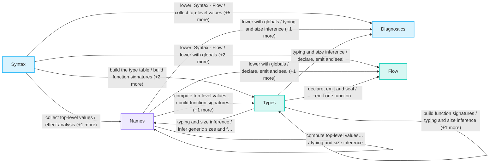

**Guarantees: **[The lowered graph means what the program means](#g-nt-ir-agrees)

<details>
<summary>Files (11)</summary>

[`crates/mapal-lower/src/lib.rs:1`](../crates/mapal-lower/src/lib.rs#L1)  
[`crates/mapal-lower/src/globals.rs:1`](../crates/mapal-lower/src/globals.rs#L1)  
[`crates/mapal-lower/src/effects.rs:1`](../crates/mapal-lower/src/effects.rs#L1)  
[`crates/mapal-lower/src/tys.rs:1`](../crates/mapal-lower/src/tys.rs#L1)  
[`crates/mapal-lower/src/formats.rs:1`](../crates/mapal-lower/src/formats.rs#L1)  
[`crates/mapal-lower/src/sizes.rs:1`](../crates/mapal-lower/src/sizes.rs#L1)  
[`crates/mapal-lower/src/typing.rs:1`](../crates/mapal-lower/src/typing.rs#L1)  
[`crates/mapal-lower/src/emit.rs:1`](../crates/mapal-lower/src/emit.rs#L1)  
[`crates/mapal-lower/src/scope.rs:1`](../crates/mapal-lower/src/scope.rs#L1)  
[`crates/mapal-lower/src/convert.rs:1`](../crates/mapal-lower/src/convert.rs#L1)  
[`crates/mapal-lower/src/diag.rs:1`](../crates/mapal-lower/src/diag.rs#L1)

</details>

<a id="cat-Names"></a>

#### Category Names

What names mean while lowering: top-level values, effects, generic sizes.

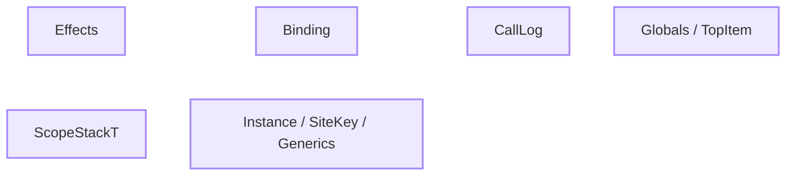

<details open>
<summary>Objects (6)</summary>

| Object | What it is | Defined at | Lives in |
|---|---|---|---|
| <a id="o-Names.effects"></a>**Effects** | Which functions are (transitively) effectful, i.e. print, clock or read something. | [`crates/mapal-lower/src/effects.rs:19`](../crates/mapal-lower/src/effects.rs#L19) | compiler heap: BTreeMap<String,bool> |
| <a id="o-Names.binding"></a>**Binding** | What a surface name stands for during emission: its graph object, type, mutability and declaration order. | [`crates/mapal-lower/src/emit.rs:72`](../crates/mapal-lower/src/emit.rs#L72) | compiler heap, payload of ScopeStack<Binding> |
| <a id="o-Names.calllog"></a>**CallLog** | What emission saw at generic calls: bindings per site, instances called and requested, and widen checks to prove. | [`crates/mapal-lower/src/emit.rs:61`](../crates/mapal-lower/src/emit.rs#L61) | compiler heap in a RefCell shared by rounds |
| <a id="o-Names.globals-topitem"></a>**Globals / TopItem** | The program's top-level values, who reads whom, which are computed before running. | [`crates/mapal-lower/src/globals.rs:71`](../crates/mapal-lower/src/globals.rs#L71) | compiler heap, built in lower() |
| <a id="o-Names.scopestack-t"></a>**ScopeStack<T>** | A stack of lexical scopes mapping a name to what it stands for; supports poisoning (a name unreadable after a loop) and loop-exit bindings. | [`crates/mapal-lower/src/scope.rs:36`](../crates/mapal-lower/src/scope.rs#L36) | compiler heap: Vec of BTreeMaps; one per function being typed or emitted |
| <a id="o-Names.instance-sitekey-generics"></a>**Instance / SiteKey / Generics** | One instance of a generic function at concrete sizes/formats, the call site that asked for it, and the table of generic declarations. | [`crates/mapal-lower/src/sizes.rs:68`](../crates/mapal-lower/src/sizes.rs#L68) | compiler heap, rebuilt each monomorphization round |

</details>

<details open>
<summary>Arrows (4)</summary>

| Arrow | From → to | What it does | Defined at |
|---|---|---|---|
| **is_effectful** | `fn name` → `bool` | Whether a call to this function carries the IO token. | [`crates/mapal-lower/src/effects.rs:26`](../crates/mapal-lower/src/effects.rs#L26) |
| **Globals::used_by** | `FnDecl` → `top-level items` | Which top-level values a function reads. | [`crates/mapal-lower/src/globals.rs:95`](../crates/mapal-lower/src/globals.rs#L95) |
| **ScopeStack::poison** | `name` → `unreadable name` | Marks a name unreadable (reading it later is an error). | [`crates/mapal-lower/src/scope.rs:135`](../crates/mapal-lower/src/scope.rs#L135) |
| **ScopeStack::resolve** | `name` → `Binding` | Finds what a name stands for, innermost scope first. | [`crates/mapal-lower/src/scope.rs:104`](../crates/mapal-lower/src/scope.rs#L104) |

</details>

<details open>
<summary>Transformations (13)</summary>

| Name | From → to | Kind | What it does | Defined at | Lives in |
|---|---|---|---|---|---|
| <a id="t-lower-functor"></a>**lower: Syntax -> Flow** | [Syntax](#cat-Syntax)<br>→ [Flow](#cat-Flow)<br>[Diagnostics](#cat-Diagnostics) | functor | The whole component as one partial map: each parse-tree form goes to its graph realization, or to a diagnostic where the form is outside the core language. Entry point; handles programs with top-level values by first computing them.<br>**made of: **[collect top-level values](#t-globals-collect), [compute top-level values before the program runs](#t-globals-eval), [lower with globals](#t-lower-with) | [`crates/mapal-lower/src/lib.rs:52`](../crates/mapal-lower/src/lib.rs#L52) |  |
| <a id="t-globals-collect"></a>**collect top-level values** | [Syntax](#cat-Syntax)<br>→ [Names](#cat-Names)<br>[Diagnostics](#cat-Diagnostics) | process | Finds top-level bindings, who reads whom, and rejects effects or cycles among them. | [`crates/mapal-lower/src/globals.rs:340`](../crates/mapal-lower/src/globals.rs#L340) | compiler heap; pure |
| <a id="t-globals-eval"></a>**compute top-level values before the program runs** | [Names](#cat-Names)<br>→ [Names](#cat-Names)<br>[Types](#cat-Types) | process | Lowers a small synthetic program and runs its top-level scalars on the interpreter, so they become literals/sizes. | [`crates/mapal-lower/src/lib.rs:117`](../crates/mapal-lower/src/lib.rs#L117) | compiler heap; uses the interpreter and a work budget |
| <a id="t-lower-with"></a>**lower with globals** | [Syntax](#cat-Syntax)<br>[Names](#cat-Names)<br>→ [Flow](#cat-Flow)<br>[Diagnostics](#cat-Diagnostics) | process | The staged pipeline: structural checks, types, effects, signatures, then monomorphization rounds of typing + emission + seal.<br>**made of: **[effect analysis](#t-effects-analyze), [build the type table](#t-types-build), [build function signatures](#t-fn-sigs), [typing and size inference](#t-type-round), [declare, emit and seal](#t-emit-program), [prove widen exactness](#t-widen-check) | [`crates/mapal-lower/src/lib.rs:378`](../crates/mapal-lower/src/lib.rs#L378) |  |
| <a id="t-effects-analyze"></a>**effect analysis** | [Syntax](#cat-Syntax)<br>→ [Names](#cat-Names)<br>[Diagnostics](#cat-Diagnostics) | process | Walks the call graph to mark effectful functions and reports recursion. | [`crates/mapal-lower/src/effects.rs:35`](../crates/mapal-lower/src/effects.rs#L35) | compiler heap; pure |
| <a id="t-types-build"></a>**build the type table** | [Syntax](#cat-Syntax)<br>→ [Types](#cat-Types)<br>[Diagnostics](#cat-Diagnostics) | functor | Resolves every declared type, rejecting cycles, bad sizes and duplicates. | [`crates/mapal-lower/src/tys.rs:87`](../crates/mapal-lower/src/tys.rs#L87) | compiler heap; pure |
| <a id="t-fn-sigs"></a>**build function signatures** | [Syntax](#cat-Syntax)<br>[Types](#cat-Types)<br>[Names](#cat-Names)<br>→ [Types](#cat-Types) | functor | Gives every function its declared signature, flagged effectful or generic. | [`crates/mapal-lower/src/typing/sigs.rs:53`](../crates/mapal-lower/src/typing/sigs.rs#L53) | compiler heap; pure |
| <a id="t-type-round"></a>**typing and size inference** | [Syntax](#cat-Syntax)<br>[Types](#cat-Types)<br>[Names](#cat-Names)<br>→ [Types](#cat-Types)<br>[Names](#cat-Names)<br>[Diagnostics](#cat-Diagnostics) | process | Per function (or generic instance): types literals by unification, infers sizes and formats of generic calls, computes captures, and records which instances are needed.<br>**made of: **[type one function](#t-analyze-fn), [infer generic sizes and formats](#t-infer-sizes) | [`crates/mapal-lower/src/lib.rs:599`](../crates/mapal-lower/src/lib.rs#L599) | compiler heap; pure per round |
| <a id="t-analyze-fn"></a>**type one function** | [Syntax](#cat-Syntax)<br>[Types](#cat-Types)<br>→ [Types](#cat-Types) | process | Walks a function, unifies literal widths, types map/fold blocks and computes their captures. | [`crates/mapal-lower/src/typing.rs:229`](../crates/mapal-lower/src/typing.rs#L229) | compiler heap; WTy variables and union-find per function |
| <a id="t-infer-sizes"></a>**infer generic sizes and formats** | [Types](#cat-Types)<br>→ [Names](#cat-Names) | process | Solves the size equations of a generic call to choose its instance. | [`crates/mapal-lower/src/sizes/infer.rs:229`](../crates/mapal-lower/src/sizes/infer.rs#L229) | compiler heap |
| <a id="t-emit-program"></a>**declare, emit and seal** | [Syntax](#cat-Syntax)<br>[Types](#cat-Types)<br>[Names](#cat-Names)<br>→ [Flow](#cat-Flow)<br>[Diagnostics](#cat-Diagnostics) | process | Declares each function and body, emits statements and chains through the IR builder, then seals the graph.<br>**made of: **[emit one function](#t-emit-fn) | [`crates/mapal-lower/src/emit.rs:216`](../crates/mapal-lower/src/emit.rs#L216) | compiler heap; builder arena |
| <a id="t-emit-fn"></a>**emit one function** | [Syntax](#cat-Syntax)<br>[Types](#cat-Types)<br>[Names](#cat-Names)<br>→ [Flow](#cat-Flow) | process | Binds parameters, threads the IO token for effectful functions, emits the body and return, fail-fast on the first error. | [`crates/mapal-lower/src/emit/decl.rs:260`](../crates/mapal-lower/src/emit/decl.rs#L260) | compiler heap; FnBuilder |
| <a id="t-widen-check"></a>**prove widen exactness** | [Flow](#cat-Flow)<br>→ [Diagnostics](#cat-Diagnostics) | process | After sealing, uses the facts to check that each int-to-f32 widen stays within the exact range. | [`crates/mapal-lower/src/convert.rs:35`](../crates/mapal-lower/src/convert.rs#L35) | compiler heap; reads facts stored on the sealed graph |

</details>

<details open>
<summary>Algorithms, data structures and design patterns (10)</summary>

| Name | Kind | What it is | Defined at | Used by |
|---|---|---|---|---|
| **Staged pipeline with fail-fast emission** | design pattern | Checks run in stages and are collected; once emission starts the first error stops that function. | [`crates/mapal-lower/src/lib.rs:378`](../crates/mapal-lower/src/lib.rs#L378) | [lower with globals](#t-lower-with), [declare, emit and seal](#t-emit-program) |
| **Fixed-point rounds (monomorphization)** | algorithm | Repeat typing and emission up to 32 rounds until every called generic instance was declared. | [`crates/mapal-lower/src/lib.rs:40`](../crates/mapal-lower/src/lib.rs#L40) | [lower with globals](#t-lower-with), [typing and size inference](#t-type-round) |
| **Union-find over literal types** | algorithm | Integer/float literals of unknown width are variables merged into groups, then pinned to a type. | [`crates/mapal-lower/src/typing/walk_core.rs:376`](../crates/mapal-lower/src/typing/walk_core.rs#L376) | [type one function](#t-analyze-fn) |
| **Size equation solving (inversion, monotone search, divisor enumeration)** | algorithm | Solves expressions like n*2 = 8 for n by inverting or searching. | [`crates/mapal-lower/src/sizes/infer.rs:477`](../crates/mapal-lower/src/sizes/infer.rs#L477) | [infer generic sizes and formats](#t-infer-sizes) |
| **Cycle detection by iterative DFS** | algorithm | Finds recursive types and recursive calls with an explicit stack frame. | [`crates/mapal-lower/src/tys.rs:222`](../crates/mapal-lower/src/tys.rs#L222) | [build the type table](#t-types-build), [effect analysis](#t-effects-analyze) |
| **Scope stack with poison marks** | data structure | Lexical scopes as a stack, with names marked unreadable after a loop. | [`crates/mapal-lower/src/scope.rs:36`](../crates/mapal-lower/src/scope.rs#L36) | [type one function](#t-analyze-fn), [emit one function](#t-emit-fn) |
| **Token threading for effects** | design pattern | Effectful functions take and return an IO token so order of print/clock is explicit data. | [`crates/mapal-lower/src/emit/exprs.rs:444`](../crates/mapal-lower/src/emit/exprs.rs#L444) | [emit one function](#t-emit-fn), [effect analysis](#t-effects-analyze) |
| **Capture analysis (struct captures flattened to fields)** | algorithm | Finds which outer values a map/fold body reads and passes them as leading inputs. | [`crates/mapal-lower/src/typing.rs:90`](../crates/mapal-lower/src/typing.rs#L90) | [type one function](#t-analyze-fn), [emit one function](#t-emit-fn) |
| **Prelude of parsed conversion signatures** | design pattern | to/widen are declared as ordinary generic functions in a prelude parsed once; calls are realized by the builtin the format pair admits. | [`crates/mapal-lower/src/formats.rs:201`](../crates/mapal-lower/src/formats.rs#L201) | [emit one function](#t-emit-fn), [build function signatures](#t-fn-sigs) |
| **Typed diagnostic catalogue** | design pattern | Every error is one LCode variant with a stable code string. | [`crates/mapal-lower/src/diag.rs:15`](../crates/mapal-lower/src/diag.rs#L15) | [lower: Syntax -> Flow](#t-lower-functor) |

</details>

<a id="cg-lower"></a>

#### Guarantees of Lowering

| Guarantee (natural transformation) | What must agree | Checked in |
|---|---|---|
| [The lowered graph means what the program means](#g-nt-ir-agrees) | For every program, interpreting the lowered graph gives what interpreting the parse tree gives. | [`crates/mapal-lower/tests/top_level.rs:43`](../crates/mapal-lower/tests/top_level.rs#L43)<br>[`crates/mapal-lower/tests/proptests.rs:43`](../crates/mapal-lower/tests/proptests.rs#L43) |

<a id="c-check"></a>

### Checker

Checks rules the Flow graph must follow after lowering (one return value, no effects racing each other).

**Reads **[Flow](#cat-Flow)**  →  produces **[Diagnostics](#cat-Diagnostics)

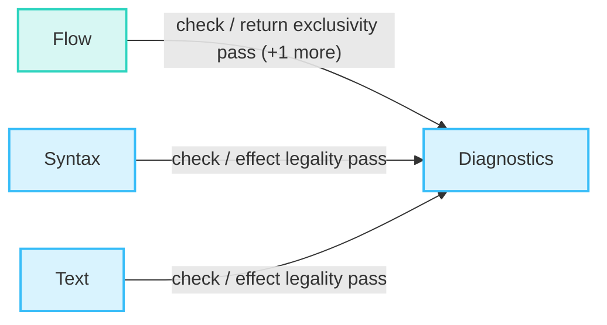

**Guarantees: **[Accepted means the interpreter's assumptions hold](#g-chk-nat-accept)

<details>
<summary>Files (4)</summary>

[`crates/mapal-check/src/lib.rs:1`](../crates/mapal-check/src/lib.rs#L1)  
[`crates/mapal-check/src/exclusivity.rs:1`](../crates/mapal-check/src/exclusivity.rs#L1)  
[`crates/mapal-check/src/effects.rs:1`](../crates/mapal-check/src/effects.rs#L1)  
[`crates/mapal-check/src/diag.rs:1`](../crates/mapal-check/src/diag.rs#L1)

</details>

<details open>
<summary>Transformations (3)</summary>

| Name | From → to | Kind | What it does | Defined at | Lives in |
|---|---|---|---|---|---|
| <a id="t-chk-check"></a>**check** | [Flow](#cat-Flow)<br>[Syntax](#cat-Syntax)<br>[Text](#cat-Text)<br>→ [Diagnostics](#cat-Diagnostics) | process | Takes the sealed flow graph, the parse tree and the source, runs both passes, and returns a list of errors; an empty list means accept. No HashMap is used, so the same input always gives the same list. | [`crates/mapal-check/src/lib.rs:41`](../crates/mapal-check/src/lib.rs#L41) | compiler heap; the result is a Vec<Diagnostic> |
| <a id="t-chk-excl"></a>**return exclusivity pass** | [Flow](#cat-Flow)<br>→ [Diagnostics](#cat-Diagnostics) | process | For every function in the flow graph, counts the writers feeding its return value; each beyond the first becomes T0101 at the writing operation's location. | [`crates/mapal-check/src/exclusivity.rs:26`](../crates/mapal-check/src/exclusivity.rs#L26) | reads the sealed CategoryIr on the compiler heap |
| <a id="t-chk-effects"></a>**effect legality pass** | [Syntax](#cat-Syntax)<br>[Flow](#cat-Flow)<br>[Text](#cat-Text)<br>→ [Diagnostics](#cat-Diagnostics) | process | Walks the parse tree; inside a parallel fan-out branch, any print, clock read or file read becomes T0201. A nested sequential block stays inside the illegal zone.<br>**made of: **[return exclusivity pass](#t-chk-excl) | [`crates/mapal-check/src/effects.rs:34`](../crates/mapal-check/src/effects.rs#L34) | compiler heap: a Walk with a Scope stack |

</details>

<details open>
<summary>Algorithms, data structures and design patterns (4)</summary>

| Name | Kind | What it is | Defined at | Used by |
|---|---|---|---|---|
| **Tree walk keyed by node kind with sticky context** | design pattern | A fan-out opens the illegal context, and a sequential block inside it inherits it. | [`crates/mapal-check/src/effects.rs:104`](../crates/mapal-check/src/effects.rs#L104) | [effect legality pass](#t-chk-effects) |
| **Lexical scope stack** | data structure | Push on entering a block, pop on leaving, to know whether a name is a local binding. | [`crates/mapal-check/src/effects.rs:77`](../crates/mapal-check/src/effects.rs#L77) | [effect legality pass](#t-chk-effects) |
| **In-edge count on the graph** | algorithm | Counts non-pair edges into the return object to find a second writer. | [`crates/mapal-check/src/exclusivity.rs:26`](../crates/mapal-check/src/exclusivity.rs#L26) | [return exclusivity pass](#t-chk-excl) |
| **Deterministic ordering** | design pattern | No hash maps; findings come in a fixed order so two runs agree exactly. | [`crates/mapal-check/src/lib.rs:41`](../crates/mapal-check/src/lib.rs#L41) | [check](#t-chk-check) |

</details>

<a id="cg-check"></a>

#### Guarantees of Checker

| Guarantee (natural transformation) | What must agree | Checked in |
|---|---|---|
| [Accepted means the interpreter's assumptions hold](#g-chk-nat-accept) | For every program the checker accepts, what the interpreter assumes (one return writer, no effect racing in a fan-out) is true. | [`crates/mapal-check/tests/acceptance.rs:65`](../crates/mapal-check/tests/acceptance.rs#L65)<br>[`crates/mapal-check/tests/acceptance.rs:110`](../crates/mapal-check/tests/acceptance.rs#L110)<br>[`crates/mapal-check/tests/exclusivity.rs:44`](../crates/mapal-check/tests/exclusivity.rs#L44)<br>[`crates/mapal-check/tests/effects.rs:25`](../crates/mapal-check/tests/effects.rs#L25) |

<a id="c-flow"></a>

### Flow graph

The one data structure every later stage shares: Mapal's types and the dataflow graph, with its builder, validator and pictures.

**Reads **[Types](#cat-Types), [Flow](#cat-Flow)**  →  produces **[Flow](#cat-Flow), [Diagram](#cat-Diagram), [Diagnostics](#cat-Diagnostics)

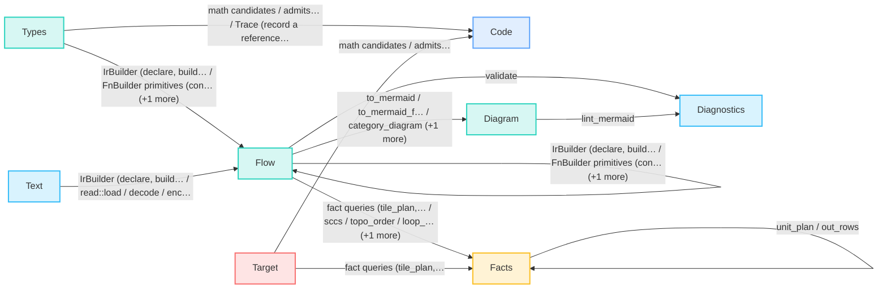

**Guarantees: **[A sealed graph is always valid](#g-ir.nat.sealed-valid), [Pictures are stable](#g-ir.nat.golden), [Graph algorithms agree with loop structure](#g-ir.nat.algos)

<details>
<summary>Files (20)</summary>

[`crates/mapal-ir/src/graph.rs:1`](../crates/mapal-ir/src/graph.rs#L1)  
[`crates/mapal-ir/src/ty.rs:1`](../crates/mapal-ir/src/ty.rs#L1)  
[`crates/mapal-ir/src/loc.rs:1`](../crates/mapal-ir/src/loc.rs#L1)  
[`crates/mapal-ir/src/builder.rs:1`](../crates/mapal-ir/src/builder.rs#L1)  
[`crates/mapal-ir/src/validate.rs:1`](../crates/mapal-ir/src/validate.rs#L1)  
[`crates/mapal-ir/src/facts.rs:1`](../crates/mapal-ir/src/facts.rs#L1)  
[`crates/mapal-ir/src/algo.rs:1`](../crates/mapal-ir/src/algo.rs#L1)  
[`crates/mapal-ir/src/access.rs:1`](../crates/mapal-ir/src/access.rs#L1)  
[`crates/mapal-ir/src/residence.rs:1`](../crates/mapal-ir/src/residence.rs#L1)  
[`crates/mapal-ir/src/unit.rs:1`](../crates/mapal-ir/src/unit.rs#L1)  
[`crates/mapal-ir/src/math.rs:1`](../crates/mapal-ir/src/math.rs#L1)  
[`crates/mapal-ir/src/exp.rs:1`](../crates/mapal-ir/src/exp.rs#L1)  
[`crates/mapal-ir/src/split.rs:1`](../crates/mapal-ir/src/split.rs#L1)  
[`crates/mapal-ir/src/narrow.rs:1`](../crates/mapal-ir/src/narrow.rs#L1)  
[`crates/mapal-ir/src/read.rs:1`](../crates/mapal-ir/src/read.rs#L1)  
[`crates/mapal-ir/src/mermaid.rs:1`](../crates/mapal-ir/src/mermaid.rs#L1)  
[`crates/mapal-ir/src/mermaid_flow.rs:1`](../crates/mapal-ir/src/mermaid_flow.rs#L1)  
[`crates/mapal-ir/src/mermaid_cat.rs:1`](../crates/mapal-ir/src/mermaid_cat.rs#L1)  
[`crates/mapal-ir/src/mermaid_string.rs:1`](../crates/mapal-ir/src/mermaid_string.rs#L1)  
[`crates/mapal-ir/src/mermaid_diagram.rs:1`](../crates/mapal-ir/src/mermaid_diagram.rs#L1)

</details>

<a id="cat-Types"></a>

#### Category Types

Mapal's types and number formats, as lowering resolves them and the graph stores them.

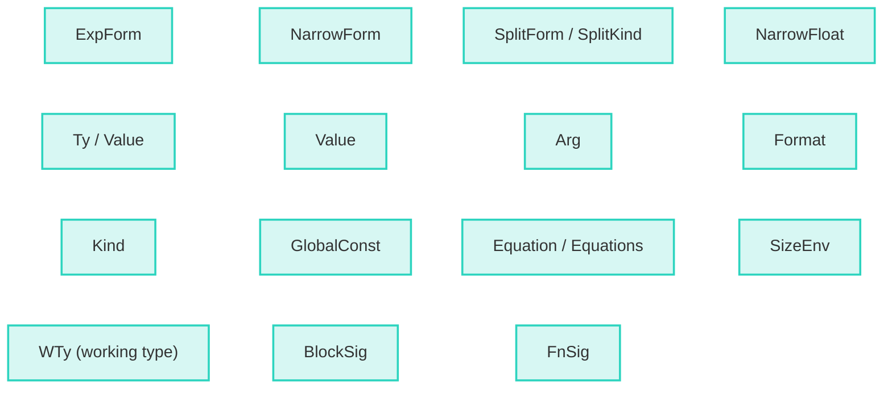

<details>
<summary>Objects (17)</summary>

| Object | What it is | Defined at | Lives in | Provided by |
|---|---|---|---|---|
| <a id="o-Types.expform"></a>**ExpForm** | One exp realization: its algorithm constants and error bound per float width. | [`crates/mapal-ir/src/exp.rs:30`](../crates/mapal-ir/src/exp.rs#L30) | consts F32 / F64 in the binary |  |
| <a id="o-Types.narrowform"></a>**NarrowForm** | Facts of one narrow format: precision bits, exponent range, unit round-off, largest value, whether it saturates. | [`crates/mapal-ir/src/narrow.rs:30`](../crates/mapal-ir/src/narrow.rs#L30) | computed on demand (NarrowForm::of), no storage |  |
| <a id="o-Types.splitform-splitkind"></a>**SplitForm / SplitKind** | A way to run an f32 product on a matrix unit by cutting operands into exact parts, with its a-priori error coefficient. | [`crates/mapal-ir/src/split.rs:62`](../crates/mapal-ir/src/split.rs#L62) | computed on demand; chosen at compile time by the backend |  |
| <a id="o-Types.narrowfloat"></a>**NarrowFloat** | The narrow float formats bf16, f16, f8e4m3, f8e5m2. | [`crates/mapal-ir/src/ty.rs:192`](../crates/mapal-ir/src/ty.rs#L192) | compiler heap | [Facts](#c-facts) |
| <a id="o-Types.ty-value"></a>**Ty / Value** | A Mapal type: Int, Float, Narrow, Bool, Unit, Str, IoToken, Tuple, Struct, Array{elem,size}. | [`crates/mapal-ir/src/ty.rs:23`](../crates/mapal-ir/src/ty.rs#L23) | compiler heap: field of each Object | [Facts](#c-facts) |
| <a id="o-Types.value"></a>**Value** | A constant: i32, i64, u8, f32, f64, narrow bits, bool, string, unit. | [`crates/mapal-ir/src/ty.rs:241`](../crates/mapal-ir/src/ty.rs#L241) | compiler heap: Object.value for Constant objects; constant tables in emitted code later |  |
| <a id="o-Types.arg"></a>**Arg** | One generic argument: a size or a format. | [`crates/mapal-lower/src/formats.rs:184`](../crates/mapal-lower/src/formats.rs#L184) | compiler heap | [Lowering](#c-lower) |
| <a id="o-Types.format"></a>**Format** | One concrete number format (f32, bf16, i32, ...), the unit of format generics. | [`crates/mapal-lower/src/formats.rs:20`](../crates/mapal-lower/src/formats.rs#L20) | compiler heap, Copy value | [Lowering](#c-lower) |
| <a id="o-Types.kind"></a>**Kind** | A class of formats a generic parameter may range over (number, float, int, precision, ...). | [`crates/mapal-lower/src/formats.rs:111`](../crates/mapal-lower/src/formats.rs#L111) | compiler heap, Copy value | [Lowering](#c-lower) |
| <a id="o-Types.globalconst"></a>**GlobalConst** | A top-level number computed before the program runs (int, float or bool). | [`crates/mapal-lower/src/globals.rs:42`](../crates/mapal-lower/src/globals.rs#L42) | compiler heap, inside Globals.consts | [Lowering](#c-lower) |
| <a id="o-Types.equation-equations"></a>**Equation / Equations** | The size equations one call gives (declared dimension = actual length) that inference solves. | [`crates/mapal-lower/src/sizes/infer.rs:24`](../crates/mapal-lower/src/sizes/infer.rs#L24) | compiler heap, temporary per call | [Lowering](#c-lower) |
| <a id="o-Types.sizeenv"></a>**SizeEnv** | The values of size names and format names in scope (n=4, t=bf16). | [`crates/mapal-lower/src/sizes.rs:34`](../crates/mapal-lower/src/sizes.rs#L34) | compiler heap: BTreeMap<String,u64> + BTreeMap<String,Format> | [Lowering](#c-lower) |
| <a id="o-Types.wty-working-type"></a>**WTy (working type)** | A type that may still be an unknown literal width, resolved by unification. | [`crates/mapal-lower/src/typing.rs:125`](../crates/mapal-lower/src/typing.rs#L125) | compiler heap, only during typing of one function | [Lowering](#c-lower) |
| <a id="o-Types.blocksig"></a>**BlockSig** | The signature of one map/fold body: its input, output and the outer values it captures. | [`crates/mapal-lower/src/typing.rs:65`](../crates/mapal-lower/src/typing.rs#L65) | compiler heap, inside TypeInfo.blocks | [Lowering](#c-lower) |
| <a id="o-Types.fnsig"></a>**FnSig** | A function's declared signature (parameter types, return type, effectful?, generic?). | [`crates/mapal-lower/src/typing.rs:215`](../crates/mapal-lower/src/typing.rs#L215) | compiler heap: BTreeMap<String, FnSig> | [Lowering](#c-lower) |
| <a id="o-Types.typeinfo"></a>**TypeInfo** | What typing found for one function: the type of each literal and the signature of each map/fold block, keyed by span. | [`crates/mapal-lower/src/typing.rs:56`](../crates/mapal-lower/src/typing.rs#L56) | compiler heap, handed from typing to emission | [Lowering](#c-lower) |
| <a id="o-Types.typetable"></a>**TypeTable** | All declared Mapal types, resolved to fixed-size IR types, with generic declarations kept for instantiation. | [`crates/mapal-lower/src/tys.rs:28`](../crates/mapal-lower/src/tys.rs#L28) | compiler heap: BTreeMap<String, Ty> plus the declarations | [Lowering](#c-lower) |

</details>

<details>
<summary>Arrows (15)</summary>

| Arrow | From → to | What it does | Defined at |
|---|---|---|---|
| **bf16_from_f32 / f8_from_f32** | `f32` → `narrow bits` | Concrete roundings to bf16 and fp8. | [`crates/mapal-ir/src/narrow.rs:205`](../crates/mapal-ir/src/narrow.rs#L205) |
| **narrow::round / widen** | `f64 / f32 / u16 bits` → `u16 bits / f32` | Round a number into a narrow format and read it back. | [`crates/mapal-ir/src/narrow.rs:138`](../crates/mapal-ir/src/narrow.rs#L138) |
| **narrow::widen / round** | `NarrowFloat bits` → `f32` | Exact widening and round-to-nearest-even narrowing, the oracle's conversions. | [`crates/mapal-ir/src/narrow.rs:294`](../crates/mapal-ir/src/narrow.rs#L294) |
| **tf32_parts / bf16_parts** | `f32` → `[f32] parts` | Cut an f32 into parts a matrix instruction multiplies exactly. | [`crates/mapal-ir/src/split.rs:278`](../crates/mapal-ir/src/split.rs#L278) |
| **Ty::Array elem** | `Ty (array)` → `Ty (element)` | An array type points to its element type; product types point to their components. | [`crates/mapal-ir/src/ty.rs:23`](../crates/mapal-ir/src/ty.rs#L23) |
| **ty_label** | `Ty` → `String` | Plain-text name of a type for pictures. | [`crates/mapal-ir/src/ty.rs:405`](../crates/mapal-ir/src/ty.rs#L405) |
| **Value::ty** | `Value` → `Ty` | The type of a constant. | [`crates/mapal-ir/src/ty.rs:257`](../crates/mapal-ir/src/ty.rs#L257) |
| **admit** | `Verb x Format x Format` → `Realize` | Decides how a to<target>/widen<target> conversion is realized, or why it is refused. | [`crates/mapal-lower/src/formats.rs:303`](../crates/mapal-lower/src/formats.rs#L303) |
| **embeds** | `Format x Format` → `bool` | Whether every value of one format is exactly a value of another (so widening is lossless). | [`crates/mapal-lower/src/formats.rs:288`](../crates/mapal-lower/src/formats.rs#L288) |
| **Format::of / Format::ty** | `IR Ty` → `Format` | Moves between a format name and its IR scalar type. | [`crates/mapal-lower/src/formats.rs:79`](../crates/mapal-lower/src/formats.rs#L79) |
| **Kind::admits** | `Kind x Format` → `bool` | Whether a format belongs to a generic parameter's class. | [`crates/mapal-lower/src/formats.rs:142`](../crates/mapal-lower/src/formats.rs#L142) |
| **eval (size)** | `SizeExpr x SizeEnv` → `u64` | Computes a size expression's number or reports why it cannot. | [`crates/mapal-lower/src/sizes.rs:262`](../crates/mapal-lower/src/sizes.rs#L262) |
| **resolve_tykind** | `surface Ty` → `IR Ty` | Turns a written type into a resolved type with known sizes. | [`crates/mapal-lower/src/tys.rs:334`](../crates/mapal-lower/src/tys.rs#L334) |
| **default_of** | `Ty` → `Ty` | A struct with a default field `_` is read as that field when its context needs it. | [`crates/mapal-lower/src/tys.rs:57`](../crates/mapal-lower/src/tys.rs#L57) |
| **TypeTable::instance** | `generic TypeDecl + [Arg]` → `IR Ty` | Instantiates a generic type at given sizes. | [`crates/mapal-lower/src/tys.rs:652`](../crates/mapal-lower/src/tys.rs#L652) |

</details>

<a id="cat-Flow"></a>

#### Category Flow

The dataflow graph of a program: objects (values) and morphisms (operations) in sealed functions.

<a id="flow-category"></a>

#### Flow as Mapal's own category: values and operations

The Flow graph is itself a category: its objects are typed values and its morphisms are the operations below, each from one kind of value to another.

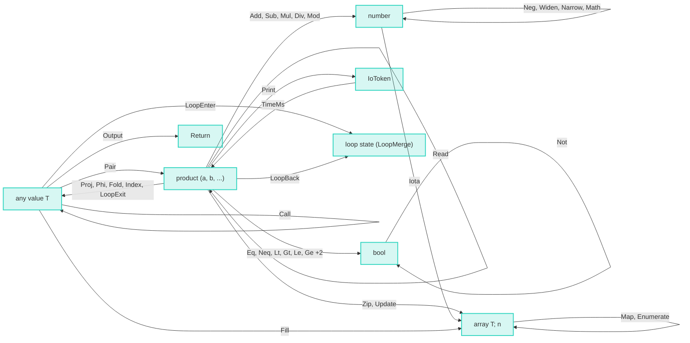

| Product, coproduct, loop | What it is | Where it lives |
|---|---|---|
| **Products** | Several values held together are one object, a product. Pair builds it, Proj takes a part out, and every binary operation reads a pair. | [`crates/mapal-ir/src/graph.rs:63`](../crates/mapal-ir/src/graph.rs#L63)<br>[`crates/mapal-ir/src/graph.rs:68`](../crates/mapal-ir/src/graph.rs#L68)<br>[`crates/mapal-ir/src/ty.rs:23`](../crates/mapal-ir/src/ty.rs#L23) |
| **Coproducts (guards)** | A choice between two branches is a coproduct: Phi picks one value by a condition, and the facts record which work belongs to which arm. | [`crates/mapal-ir/src/graph.rs:91`](../crates/mapal-ir/src/graph.rs#L91)<br>[`crates/mapal-ir/src/algo.rs:271`](../crates/mapal-ir/src/algo.rs#L271) |
| **Loops (traced feedback)** | A loop is a cycle in the graph: LoopEnter feeds the start value into the loop state, LoopBack feeds the next state back, and LoopExit leaves. There is no loop node. | [`crates/mapal-ir/src/graph.rs:158`](../crates/mapal-ir/src/graph.rs#L158)<br>[`crates/mapal-ir/src/graph.rs:160`](../crates/mapal-ir/src/graph.rs#L160)<br>[`crates/mapal-ir/src/graph.rs:162`](../crates/mapal-ir/src/graph.rs#L162)<br>[`crates/mapal-ir/src/graph.rs:38`](../crates/mapal-ir/src/graph.rs#L38)<br>[`crates/mapal-ir/src/algo.rs:80`](../crates/mapal-ir/src/algo.rs#L80) |

<details>
<summary>Operations, the morphisms of Flow (37)</summary>

| Operation | From → to | What it does | Defined at |
|---|---|---|---|
| <a id="op-Pair"></a>**Pair** | `any value T` → `product (a, b, ...)` | Puts a value into slot i of a product of n slots. | [`crates/mapal-ir/src/graph.rs:63`](../crates/mapal-ir/src/graph.rs#L63) |
| <a id="op-Proj"></a>**Proj** | `product (a, b, ...)` → `any value T` | Takes component i out of a product. | [`crates/mapal-ir/src/graph.rs:68`](../crates/mapal-ir/src/graph.rs#L68) |
| <a id="op-Add"></a>**Add** | `product (a, b, ...)` → `number` | Adds the two numbers of its pair. | [`crates/mapal-ir/src/graph.rs:72`](../crates/mapal-ir/src/graph.rs#L72) |
| <a id="op-Sub"></a>**Sub** | `product (a, b, ...)` → `number` | Subtracts. | [`crates/mapal-ir/src/graph.rs:73`](../crates/mapal-ir/src/graph.rs#L73) |
| <a id="op-Mul"></a>**Mul** | `product (a, b, ...)` → `number` | Multiplies. | [`crates/mapal-ir/src/graph.rs:74`](../crates/mapal-ir/src/graph.rs#L74) |
| <a id="op-Div"></a>**Div** | `product (a, b, ...)` → `number` | Divides (a zero integer divisor traps). | [`crates/mapal-ir/src/graph.rs:75`](../crates/mapal-ir/src/graph.rs#L75) |
| <a id="op-Mod"></a>**Mod** | `product (a, b, ...)` → `number` | Remainder. | [`crates/mapal-ir/src/graph.rs:76`](../crates/mapal-ir/src/graph.rs#L76) |
| <a id="op-Neg"></a>**Neg** | `number` → `number` | Negates a number. | [`crates/mapal-ir/src/graph.rs:78`](../crates/mapal-ir/src/graph.rs#L78) |
| <a id="op-Eq"></a>**Eq** | `product (a, b, ...)` → `bool` | Equal. | [`crates/mapal-ir/src/graph.rs:80`](../crates/mapal-ir/src/graph.rs#L80) |
| <a id="op-Neq"></a>**Neq** | `product (a, b, ...)` → `bool` | Not equal. | [`crates/mapal-ir/src/graph.rs:81`](../crates/mapal-ir/src/graph.rs#L81) |
| <a id="op-Lt"></a>**Lt** | `product (a, b, ...)` → `bool` | Less than. | [`crates/mapal-ir/src/graph.rs:82`](../crates/mapal-ir/src/graph.rs#L82) |
| <a id="op-Gt"></a>**Gt** | `product (a, b, ...)` → `bool` | Greater than. | [`crates/mapal-ir/src/graph.rs:83`](../crates/mapal-ir/src/graph.rs#L83) |
| <a id="op-Le"></a>**Le** | `product (a, b, ...)` → `bool` | At most. | [`crates/mapal-ir/src/graph.rs:84`](../crates/mapal-ir/src/graph.rs#L84) |
| <a id="op-Ge"></a>**Ge** | `product (a, b, ...)` → `bool` | At least. | [`crates/mapal-ir/src/graph.rs:85`](../crates/mapal-ir/src/graph.rs#L85) |
| <a id="op-And"></a>**And** | `product (a, b, ...)` → `bool` | Both true. | [`crates/mapal-ir/src/graph.rs:86`](../crates/mapal-ir/src/graph.rs#L86) |
| <a id="op-Or"></a>**Or** | `product (a, b, ...)` → `bool` | Either true. | [`crates/mapal-ir/src/graph.rs:87`](../crates/mapal-ir/src/graph.rs#L87) |
| <a id="op-Not"></a>**Not** | `bool` → `bool` | Negates a truth value. | [`crates/mapal-ir/src/graph.rs:88`](../crates/mapal-ir/src/graph.rs#L88) |
| <a id="op-Phi"></a>**Phi** | `product (a, b, ...)` → `any value T` | Picks one of two values by a condition: the coproduct (guard) of two branches. | [`crates/mapal-ir/src/graph.rs:91`](../crates/mapal-ir/src/graph.rs#L91) |
| <a id="op-Call"></a>**Call** | `any value T` → `any value T` | Calls a named function. | [`crates/mapal-ir/src/graph.rs:94`](../crates/mapal-ir/src/graph.rs#L94) |
| <a id="op-Map"></a>**Map** | `array [T; n]` → `array [T; n]` | Applies a function body to every element (with optional captured values broadcast to all). | [`crates/mapal-ir/src/graph.rs:99`](../crates/mapal-ir/src/graph.rs#L99) |
| <a id="op-Fold"></a>**Fold** | `product (a, b, ...)` → `any value T` | Folds an array into one value from a start value with a function body. | [`crates/mapal-ir/src/graph.rs:107`](../crates/mapal-ir/src/graph.rs#L107) |
| <a id="op-Index"></a>**Index** | `product (a, b, ...)` → `any value T` | Reads one element of an array; out of range traps. | [`crates/mapal-ir/src/graph.rs:113`](../crates/mapal-ir/src/graph.rs#L113) |
| <a id="op-Zip"></a>**Zip** | `product (a, b, ...)` → `array [T; n]` | Pairs two arrays of the same length element by element. | [`crates/mapal-ir/src/graph.rs:117`](../crates/mapal-ir/src/graph.rs#L117) |
| <a id="op-Enumerate"></a>**Enumerate** | `array [T; n]` → `array [T; n]` | Pairs every element with its index. | [`crates/mapal-ir/src/graph.rs:120`](../crates/mapal-ir/src/graph.rs#L120) |
| <a id="op-Iota"></a>**Iota** | `number` → `array [T; n]` | The array 0, 1, ..., n-1. | [`crates/mapal-ir/src/graph.rs:125`](../crates/mapal-ir/src/graph.rs#L125) |
| <a id="op-Fill"></a>**Fill** | `any value T` → `array [T; n]` | An array of n copies of one value. | [`crates/mapal-ir/src/graph.rs:129`](../crates/mapal-ir/src/graph.rs#L129) |
| <a id="op-Update"></a>**Update** | `product (a, b, ...)` → `array [T; n]` | A copy of an array with one element replaced. | [`crates/mapal-ir/src/graph.rs:134`](../crates/mapal-ir/src/graph.rs#L134) |
| <a id="op-Print"></a>**Print** | `product (a, b, ...)` → `IoToken` | Prints a value and passes the token on. | [`crates/mapal-ir/src/graph.rs:138`](../crates/mapal-ir/src/graph.rs#L138) |
| <a id="op-TimeMs"></a>**TimeMs** | `IoToken` → `product (a, b, ...)` | Reads the clock; gives the next token and the milliseconds. | [`crates/mapal-ir/src/graph.rs:145`](../crates/mapal-ir/src/graph.rs#L145) |
| <a id="op-Read"></a>**Read** | `product (a, b, ...)` → `product (a, b, ...)` | Reads a file into an array; gives the next token and the array. | [`crates/mapal-ir/src/graph.rs:155`](../crates/mapal-ir/src/graph.rs#L155) |
| <a id="op-LoopEnter"></a>**LoopEnter** | `any value T` → `loop state (LoopMerge)` | Feeds the loop's start value into the loop state. | [`crates/mapal-ir/src/graph.rs:158`](../crates/mapal-ir/src/graph.rs#L158) |
| <a id="op-LoopBack"></a>**LoopBack** | `product (a, b, ...)` → `loop state (LoopMerge)` | The back edge: sends the next state to the loop state when the condition says continue. | [`crates/mapal-ir/src/graph.rs:160`](../crates/mapal-ir/src/graph.rs#L160) |
| <a id="op-LoopExit"></a>**LoopExit** | `product (a, b, ...)` → `any value T` | Sends the loop state out when the condition says stop. | [`crates/mapal-ir/src/graph.rs:162`](../crates/mapal-ir/src/graph.rs#L162) |
| <a id="op-Output"></a>**Output** | `any value T` → `Return` | Sends a value to the function's return. | [`crates/mapal-ir/src/graph.rs:164`](../crates/mapal-ir/src/graph.rs#L164) |
| <a id="op-Widen"></a>**Widen** | `number` → `number` | Exact numeric widening (i32 to i64, f32 to f64, ...). | [`crates/mapal-ir/src/graph.rs:168`](../crates/mapal-ir/src/graph.rs#L168) |
| <a id="op-Narrow"></a>**Narrow** | `number` → `number` | Rounds once to a narrow float format (bf16, f16). | [`crates/mapal-ir/src/graph.rs:173`](../crates/mapal-ir/src/graph.rs#L173) |
| <a id="op-Math"></a>**Math** | `number` → `number` | A math builtin on a float: exp, sqrt, sin or cos. | [`crates/mapal-ir/src/graph.rs:179`](../crates/mapal-ir/src/graph.rs#L179) |

</details>

<details open>
<summary>Kinds of object (5)</summary>

| Kind | What it is | Defined at |
|---|---|---|
| **Parameter** | A function input. | [`crates/mapal-ir/src/graph.rs:30`](../crates/mapal-ir/src/graph.rs#L30) |
| **Temporary** | A computed intermediate. | [`crates/mapal-ir/src/graph.rs:32`](../crates/mapal-ir/src/graph.rs#L32) |
| **Constant** | A literal. | [`crates/mapal-ir/src/graph.rs:34`](../crates/mapal-ir/src/graph.rs#L34) |
| **Return** | The function's output. | [`crates/mapal-ir/src/graph.rs:36`](../crates/mapal-ir/src/graph.rs#L36) |
| **LoopMerge** | The value a loop carries between trips (the feedback point). | [`crates/mapal-ir/src/graph.rs:38`](../crates/mapal-ir/src/graph.rs#L38) |

</details>

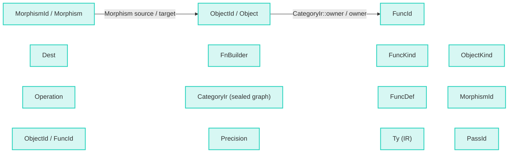

<details>
<summary>Objects (20)</summary>

| Object | What it is | Defined at | Lives in | Provided by |
|---|---|---|---|---|
| <a id="o-Flow.dest"></a>**Dest** | Where the next operation writes: a fresh object, the return slot, or an existing one. | [`crates/mapal-ir/src/builder.rs:37`](../crates/mapal-ir/src/builder.rs#L37) | compiler heap, argument only | [Lowering](#c-lower) |
| <a id="o-Flow.fnbuilder"></a>**FnBuilder** | The open builder of one function; emission adds objects and operations through it. | [`crates/mapal-ir/src/builder.rs:438`](../crates/mapal-ir/src/builder.rs#L438) | compiler heap, short-lived per function | [Lowering](#c-lower) |
| <a id="o-Flow.funckind"></a>**FuncKind** | Named, MapBody or FoldBody. | [`crates/mapal-ir/src/graph.rs:264`](../crates/mapal-ir/src/graph.rs#L264) | field of FuncDef |  |
| <a id="o-Flow.objectkind"></a>**ObjectKind** | Role of a value: Parameter, Temporary, Constant, Return or LoopMerge. | [`crates/mapal-ir/src/graph.rs:28`](../crates/mapal-ir/src/graph.rs#L28) | field of Object |  |
| <a id="o-Flow.operation"></a>**Operation** | The kind of one graph edge: Map, Fold, Pair, Proj, Phi, Widen, Narrow, ... | [`crates/mapal-ir/src/graph.rs:60`](../crates/mapal-ir/src/graph.rs#L60) | compiler heap, tag on each morphism | [Facts](#c-facts), [Lowering](#c-lower) |
| <a id="o-Flow.categoryir-sealed-graph"></a>**CategoryIr (sealed graph)** | The whole graph, frozen after construction; it also carries the fact store, the per-product precision sets and the data directory for file reads. | [`crates/mapal-ir/src/graph.rs:288`](../crates/mapal-ir/src/graph.rs#L288) | compiler heap; created by IrBuilder::seal | [Command line](#c-cli), [Facts](#c-facts), [Lowering](#c-lower), [Rewrites](#c-rewrite) |
| <a id="o-Flow.funcdef"></a>**FuncDef** | A function (named, map body or fold body): one input object, one output object and its list of morphisms. | [`crates/mapal-ir/src/graph.rs:277`](../crates/mapal-ir/src/graph.rs#L277) | compiler heap: SlotMap<FuncId, FuncDef> inside CategoryIr | [Facts](#c-facts) |
| <a id="o-Flow.funcid"></a>**FuncId** | Handle naming one function (named function, map body or fold body). | [`crates/mapal-ir/src/graph.rs:23`](../crates/mapal-ir/src/graph.rs#L23) | compiler heap: key into SlotMap<FuncId, FuncDef> |  |
| <a id="o-Flow.morphismid-morphism"></a>**MorphismId / Morphism** | One operation (an edge) from a source object to a target object, tagged with its Operation and source location. | [`crates/mapal-ir/src/graph.rs:191`](../crates/mapal-ir/src/graph.rs#L191) | compiler heap: SlotMap<MorphismId, Morphism> inside CategoryIr | [Facts](#c-facts) |
| <a id="o-Flow.morphismid"></a>**MorphismId** | Typed handle naming one operation edge. | [`crates/mapal-ir/src/graph.rs:21`](../crates/mapal-ir/src/graph.rs#L21) | compiler heap: key into SlotMap<MorphismId, Morphism> |  |
| <a id="o-Flow.objectid-object"></a>**ObjectId / Object** | One typed value in the graph (parameter, temporary, constant, return, loop merge) with its type, optional constant value, name and source location. | [`crates/mapal-ir/src/graph.rs:43`](../crates/mapal-ir/src/graph.rs#L43) | compiler heap: SlotMap<ObjectId, Object> inside CategoryIr | [Facts](#c-facts) |
| <a id="o-Flow.objectid-funcid"></a>**ObjectId / FuncId** | Typed handle (slotmap key) naming one value in the graph. | [`crates/mapal-ir/src/graph.rs:19`](../crates/mapal-ir/src/graph.rs#L19) | compiler heap, index into the arena | [Lowering](#c-lower) |
| <a id="o-Flow.precision"></a>**Precision** | The set of number formats a float multiplication is allowed to use (full f32, tf32, bf16, f16). | [`crates/mapal-ir/src/graph.rs:206`](../crates/mapal-ir/src/graph.rs#L206) | compiler heap: SecondaryMap<MorphismId, Precision> in CategoryIr | [Facts](#c-facts) |
| <a id="o-Flow.ty-ir"></a>**Ty (IR)** | The IR type of a value: number format, array, struct, token. | [`crates/mapal-ir/src/ty.rs:23`](../crates/mapal-ir/src/ty.rs#L23) | compiler heap | [Lowering](#c-lower) |
| <a id="o-Flow.passid"></a>**PassId** | The seven passes: ConstFold, Cse, Dce, MapFusion, Inline, LiftLoops, Unroll. | [`crates/mapal-rewrite/src/driver.rs:28`](../crates/mapal-rewrite/src/driver.rs#L28) | compiler stack | [Rewrites](#c-rewrite) |
| <a id="o-Flow.rewriteresult-rewritereport"></a>**RewriteResult / RewriteReport** | The new graph with rounds taken, how often each pass applied, and whether the graph was skipped as non-canonical. | [`crates/mapal-rewrite/src/driver.rs:50`](../crates/mapal-rewrite/src/driver.rs#L50) | compiler heap | [Rewrites](#c-rewrite) |
| <a id="o-Flow.naturalitylaw"></a>**NaturalityLaw** | A catalogue of Zip/Enumerate naturality equalities, recorded as data with no pass yet. | [`crates/mapal-rewrite/src/naturality.rs:10`](../crates/mapal-rewrite/src/naturality.rs#L10) | a const table in the compiler binary | [Rewrites](#c-rewrite) |
| <a id="o-Flow.fusionspec-liftspec-liftkind"></a>**FusionSpec / LiftSpec / LiftKind** | What to fuse (two map bodies) and what to lift (a counted loop into a captured Fold or Map). | [`crates/mapal-rewrite/src/plan.rs:45`](../crates/mapal-rewrite/src/plan.rs#L45) | compiler heap: values inside RewritePlan | [Rewrites](#c-rewrite) |
| <a id="o-Flow.rewriteplan"></a>**RewritePlan** | The read-only product of an analysis, with channels alias, constify, drop, fuse, inline, lift, embed, drop_loops, unroll, keyed by the input graph's ids. | [`crates/mapal-rewrite/src/plan.rs:65`](../crates/mapal-rewrite/src/plan.rs#L65) | compiler heap: SecondaryMaps, dropped after replay | [Rewrites](#c-rewrite) |
| <a id="o-Flow.staticreport"></a>**StaticReport** | What compile-time evaluation replaced. | [`crates/mapal-rewrite/src/statics.rs:19`](../crates/mapal-rewrite/src/statics.rs#L19) | compiler heap | [Rewrites](#c-rewrite) |

</details>

<details>
<summary>Arrows (28)</summary>

| Arrow | From → to | What it does | Defined at |
|---|---|---|---|
| **to_mermaid / _flow / _category / _string (+ condensed)** | `CategoryIr` → `Mermaid text` | The dump-ir --mermaid views. | [`crates/mapal-cli/src/main.rs:651`](../crates/mapal-cli/src/main.rs#L651) |
| **Pair{slot,arity}** | `Object (component)` → `Object (product)` | Put one value into slot k of a tuple, struct or array object; products are built edge by edge. | [`crates/mapal-ir/src/graph.rs:60`](../crates/mapal-ir/src/graph.rs#L60) |
| **Proj{index}** | `Object (product)` → `Object (component)` | Take component k out of a product. | [`crates/mapal-ir/src/graph.rs:60`](../crates/mapal-ir/src/graph.rs#L60) |
| **Add/Sub/Mul/Div/Mod/Neg, Eq/Lt/.., And/Or/Not** | `Object (operand tuple)` → `Object (number or bool)` | Arithmetic, comparison and logic; binary ones read a 2-tuple product. | [`crates/mapal-ir/src/graph.rs:60`](../crates/mapal-ir/src/graph.rs#L60) |
| **Phi** | `Object (condition and two arms)` → `Object (chosen value)` | A guard: pick one of two arms by a condition (only the chosen arm's work runs). | [`crates/mapal-ir/src/graph.rs:60`](../crates/mapal-ir/src/graph.rs#L60) |
| **Map{body,captures}** | `Object (array and captured values)` → `Object (array)` | Apply a body function to every element. | [`crates/mapal-ir/src/graph.rs:60`](../crates/mapal-ir/src/graph.rs#L60) |
| **Fold{body,captures}** | `Object (array, start, captures)` → `Object (accumulated value)` | Combine all elements with a body function into one value. | [`crates/mapal-ir/src/graph.rs:60`](../crates/mapal-ir/src/graph.rs#L60) |
| **Call(FuncId)** | `Object (argument)` → `Object (result)` | Call a named function. | [`crates/mapal-ir/src/graph.rs:60`](../crates/mapal-ir/src/graph.rs#L60) |
| **Index / Update / Zip / Enumerate / Iota / Fill** | `Object (array, index...)` → `Object (element or array)` | Collection operations: read an element, write one, pair up, number, generate. | [`crates/mapal-ir/src/graph.rs:60`](../crates/mapal-ir/src/graph.rs#L60) |
| **LoopEnter / LoopBack / LoopExit** | `Object (state)` → `Object (LoopMerge or exit value)` | A loop is a real cycle: enter into the merge, a back edge returns the next state, exit leaves it. | [`crates/mapal-ir/src/graph.rs:60`](../crates/mapal-ir/src/graph.rs#L60) |
| **Print / TimeMs / Read** | `Object (IoToken and payload)` → `Object (IoToken and result)` | Effects: output, clock, file read; ordered by threading a world token. | [`crates/mapal-ir/src/graph.rs:60`](../crates/mapal-ir/src/graph.rs#L60) |
| **Widen / Narrow** | `Object (number)` → `Object (number)` | Convert between a narrow float format and f32, and back with rounding. | [`crates/mapal-ir/src/graph.rs:60`](../crates/mapal-ir/src/graph.rs#L60) |
| **Math(MathFn) (Exp, Sqrt, Sin, Cos)** | `Object (float)` → `Object (float)` | A math builtin, realized later by a target-specific form. | [`crates/mapal-ir/src/graph.rs:60`](../crates/mapal-ir/src/graph.rs#L60) |
| **CategoryIr::out_edges / in_edges** | `ObjectId` → `[MorphismId]` | Adjacency: which arrows leave and enter a value. | [`crates/mapal-ir/src/graph.rs:348`](../crates/mapal-ir/src/graph.rs#L348) |
| **CategoryIr::owner** | `ObjectId` → `FuncId` | Which function a value belongs to. | [`crates/mapal-ir/src/graph.rs:359`](../crates/mapal-ir/src/graph.rs#L359) |
| **out_edges / in_edges** | `ObjectId` → `Vec<MorphismId>` | From a value to the operations that read it, or the one that makes it. | [`crates/mapal-ir/src/graph.rs:288`](../crates/mapal-ir/src/graph.rs#L288) |
| **owner** | `ObjectId` → `FuncId` | Which function a value belongs to. | [`crates/mapal-ir/src/graph.rs:288`](../crates/mapal-ir/src/graph.rs#L288) |
| **Morphism source / target** | `MorphismId` → `ObjectId` | The two ends of an operation. | [`crates/mapal-ir/src/graph.rs:191`](../crates/mapal-ir/src/graph.rs#L191) |
| **Morphism{source,target,op}** | `ObjectId` → `ObjectId` | The edge record itself: source object, target object, which operation, source span. | [`crates/mapal-ir/src/graph.rs:191`](../crates/mapal-ir/src/graph.rs#L191) |
| **Emitter::emit_convert** | `to/widen call` → `Widen / Narrow morphism` | Emits a number-format conversion by what the format pair admits. | [`crates/mapal-lower/src/emit/collections.rs:275`](../crates/mapal-lower/src/emit/collections.rs#L275) |
| **Emitter::emit_expr_dest** | `Expr` → `ObjectId` | Emits one expression as an operation writing to a destination. | [`crates/mapal-lower/src/emit/exprs.rs:14`](../crates/mapal-lower/src/emit/exprs.rs#L14) |
| **Emitter::emit_loop** | `LoopStmt` → `LoopMerge / LoopBack / LoopExit` | Emits a loop with carried state, merge, back edge and exits. | [`crates/mapal-lower/src/emit/loops.rs:8`](../crates/mapal-lower/src/emit/loops.rs#L8) |
| **Emitter::emit_map_fold** | `map/fold stage` → `Map or Fold morphism` | Emits a map or fold whose body is a separately built function with captures as leading inputs. | [`crates/mapal-lower/src/emit/collections.rs:9`](../crates/mapal-lower/src/emit/collections.rs#L9) |
| **Emitter::emit_print / emit_time / emit_read** | `print/time/read call` → `token-threaded morphism` | Emits effects as operations that take and return the IO token. | [`crates/mapal-lower/src/emit/exprs.rs:458`](../crates/mapal-lower/src/emit/exprs.rs#L458) |
| **Emitter::emit_stage** | `Stage` → `ObjectId` | Emits one stage of a chain, feeding it the previous stage's value. | [`crates/mapal-lower/src/emit/chains.rs:161`](../crates/mapal-lower/src/emit/chains.rs#L161) |
| **Emitter::emit_value_match** | `guard arms` → `right-folded Phi chain` | Emits a match on values as nested Phi choices with the default innermost. | [`crates/mapal-lower/src/emit/guards.rs:141`](../crates/mapal-lower/src/emit/guards.rs#L141) |
| **RewritePlan::resolve_alias** | `ObjectId` → `ObjectId` | Follows alias chains to the object a value now stands for. | [`crates/mapal-rewrite/src/plan.rs:121`](../crates/mapal-rewrite/src/plan.rs#L121) |
| **old id to new id remap** | `ObjectId (old graph)` → `ObjectId (new graph)` | The map built while replaying each object through the builder. | [`crates/mapal-rewrite/src/replay.rs:67`](../crates/mapal-rewrite/src/replay.rs#L67) |

</details>

<a id="cat-Diagram"></a>

#### Category Diagram

Pictures of a graph (Mermaid text): the flow view, category diagrams and string diagrams.


<details open>
<summary>Objects (3)</summary>

| Object | What it is | Defined at | Lives in |
|---|---|---|---|
| <a id="o-Diagram.dnode-dedge-nodekind-edgekind"></a>**DNode / DEdge / NodeKind / EdgeKind** | One box, one arrow, and their style. | [`crates/mapal-ir/src/mermaid_diagram.rs:43`](../crates/mapal-ir/src/mermaid_diagram.rs#L43) | inside Diagram |
| <a id="o-Diagram.diagram"></a>**Diagram** | Nodes, subgraphs and edges, ready to be printed as Mermaid. | [`crates/mapal-ir/src/mermaid_diagram.rs:75`](../crates/mapal-ir/src/mermaid_diagram.rs#L75) | compiler heap, short-lived; ends as a String |
| <a id="o-Diagram.flowgraph-flowanchor"></a>**FlowGraph / FlowAnchor** | The plain-values view of the flow: nodes are values or prints, edges are steps, paths are chains. | [`crates/mapal-ir/src/mermaid_flow.rs:33`](../crates/mapal-ir/src/mermaid_flow.rs#L33) | compiler heap, short-lived |

</details>

<details open>
<summary>Arrows (2)</summary>

| Arrow | From → to | What it does | Defined at |
|---|---|---|---|
| **Diagram::render** | `Diagram` → `String` | Print the Mermaid text. | [`crates/mapal-ir/src/mermaid_diagram.rs:143`](../crates/mapal-ir/src/mermaid_diagram.rs#L143) |
| **FlowGraph::edge_label** | `FlowGraph edge` → `String` | Label an arrow in source words. | [`crates/mapal-ir/src/mermaid_flow.rs:99`](../crates/mapal-ir/src/mermaid_flow.rs#L99) |

</details>

<details open>
<summary>Transformations (14)</summary>

| Name | From → to | Kind | What it does | Defined at | Lives in |
|---|---|---|---|---|---|
| <a id="t-ir.build"></a>**IrBuilder (declare, build_fn, FnBuilder ops, seal)** | [Flow](#cat-Flow): `(empty`<br>[Types](#cat-Types)<br>[Text](#cat-Text)<br>→ [Flow](#cat-Flow): `(CategoryIr` | process | The only way to make a graph: one method per operation that checks types and shape rules and refuses ill-formed edges, then seal freezes it. Called by the lowering stage. | [`crates/mapal-ir/src/builder.rs:172`](../crates/mapal-ir/src/builder.rs#L172) | builder holds growing SlotMaps on the compiler heap; seal moves them into CategoryIr and creates the empty Facts |
| <a id="t-ir.fnbuild"></a>**FnBuilder primitives (constant, pack, binop, phi, map, fold, begin_loop/loop_back/loop_exit, output, read)** | [Flow](#cat-Flow): `(partial`<br>[Types](#cat-Types)<br>→ [Flow](#cat-Flow): `(partial` | process | Each call appends an object and edge; rejection matrix is IrError. | [`crates/mapal-ir/src/builder.rs:438`](../crates/mapal-ir/src/builder.rs#L438) | compiler heap |
| <a id="t-ir.seal"></a>**seal** | [Flow](#cat-Flow): `(partial`<br>→ [Flow](#cat-Flow): `(CategoryIr` | process | Freeze: global checks then immutable graph.<br>**made of: **[FnBuilder primitives (constant, pack, binop, phi, map, fold, begin_loop/loop_back/loop_exit, output, read)](#t-ir.fnbuild) | [`crates/mapal-ir/src/builder.rs:266`](../crates/mapal-ir/src/builder.rs#L266) | compiler heap |
| <a id="t-ir.validate"></a>**validate** | [Flow](#cat-Flow)<br>→ [Diagnostics](#cat-Diagnostics): `(IrViolation list` | functor | An independent re-check of every graph rule (ownership, edge types, tokens, loops, references); used as the test oracle. | [`crates/mapal-ir/src/validate.rs:98`](../crates/mapal-ir/src/validate.rs#L98) | returns Vec<IrViolation> on the heap |
| <a id="t-ir.facts"></a>**fact queries (tile_plan, loop_plan, last_use_plan, path_plan, precision_plan, elem_plan, access_plan, residence_plan, ...)** | [Flow](#cat-Flow)<br>[Target](#cat-Target): `(capacities where asked`<br>→ [Facts](#cat-Facts) | functor | Each query reads the sealed graph and the facts it depends on and stores its answer once on the graph. | [`crates/mapal-ir/src/algo/site_plans.rs:198`](../crates/mapal-ir/src/algo/site_plans.rs#L198) | cached in CategoryIr.facts OnceLock slots; per-function |
| <a id="t-ir.scc"></a>**sccs / topo_order / loop_structure** | [Flow](#cat-Flow)<br>→ [Facts](#cat-Facts) | process | Find the cycles (loops) and a legal execution order, without recursion. | [`crates/mapal-ir/src/algo/loops.rs:13`](../crates/mapal-ir/src/algo/loops.rs#L13) | compiler heap: Vec<Vec<ObjectId>>, Vec<MorphismId> |
| <a id="t-ir.mermaid"></a>**to_mermaid / to_mermaid_flow / to_mermaid_category / to_mermaid_string** | [Flow](#cat-Flow)<br>→ [Diagram](#cat-Diagram) | functor | Three views of the graph (flow, category, string diagram), each condensed or full, printed as Mermaid. | [`crates/mapal-ir/src/mermaid_flow.rs:232`](../crates/mapal-ir/src/mermaid_flow.rs#L232) | short-lived Diagram then String |
| <a id="t-ir.mermaid.cat"></a>**category_diagram** | [Flow](#cat-Flow)<br>→ [Diagram](#cat-Diagram) | functor | Objects as boxes and morphisms as labelled arrows. | [`crates/mapal-ir/src/mermaid_cat.rs:104`](../crates/mapal-ir/src/mermaid_cat.rs#L104) | short-lived |
| <a id="t-ir.mermaid.string"></a>**string_diagram** | [Flow](#cat-Flow)<br>→ [Diagram](#cat-Diagram) | functor | String-diagram view (wires and boxes). | [`crates/mapal-ir/src/mermaid_string.rs:121`](../crates/mapal-ir/src/mermaid_string.rs#L121) | short-lived |
| <a id="t-ir.lint"></a>**lint_mermaid** | [Diagram](#cat-Diagram)<br>→ [Diagnostics](#cat-Diagnostics) | process | Check that Mermaid text will render. | [`crates/mapal-ir/src/mermaid.rs:200`](../crates/mapal-ir/src/mermaid.rs#L200) | Vec<String> |
| <a id="t-ir.math.choose"></a>**math candidates / admits / choose** | [Types](#cat-Types): `(MathFn`<br>[Target](#cat-Target): `(units`<br>→ [Code](#cat-Code): `(Choice, Def` | process | For a builtin and a target's available units, list realizations, admit those within the stated error, pick the cheapest by cost, never by target name. | [`crates/mapal-ir/src/math/target.rs:502`](../crates/mapal-ir/src/math/target.rs#L502) | compiler heap, decided at compile time; Choice later printed by a backend |
| <a id="t-ir.math.trace"></a>**Trace (record a reference definition as data)** | [Types](#cat-Types): `(MathFn`<br>→ [Code](#cat-Code): `(Def: list of Steps` | functor | The reference definition of exp/sqrt/sin/cos is written once over plain operations; running it with Trace records the steps so a backend can print them, running it with Native computes numbers. | [`crates/mapal-ir/src/math/trace.rs:58`](../crates/mapal-ir/src/math/trace.rs#L58) | Vec<Step> on compiler heap; printed as LLVM text or C |
| <a id="t-ir.read"></a>**read::load / decode / encode** | [Types](#cat-Types): `(array type`<br>[Text](#cat-Text): `(path`<br>→ [Flow](#cat-Flow): `constants / Values` | process | Load a binary file as an array of the declared element type, with exact-size checks and friendly messages. | [`crates/mapal-ir/src/read.rs:154`](../crates/mapal-ir/src/read.rs#L154) | file bytes into a Vec<u8> then Vec<Value> on host heap |
| <a id="t-ir.unitplan"></a>**unit_plan / out_rows** | [Flow](#cat-Flow)<br>[Facts](#cat-Facts)<br>→ [Facts](#cat-Facts) | functor | Group sites into row blocks and colour on-chip buffers by death. | [`crates/mapal-ir/src/unit.rs:250`](../crates/mapal-ir/src/unit.rs#L250) | cached in FuncFacts |

</details>

<details open>
<summary>Algorithms, data structures and design patterns (12)</summary>

| Name | Kind | What it is | Defined at | Used by |
|---|---|---|---|---|
| **Arena with typed ids (slotmap)** | data structure | Objects, morphisms and functions live in slot arenas; a typed id cannot be confused with another kind, and side tables are SecondaryMaps keyed by the same id. | [`crates/mapal-ir/src/graph.rs:288`](../crates/mapal-ir/src/graph.rs#L288) | [IrBuilder (declare, build_fn, FnBuilder ops, seal)](#t-ir.build), [fact queries (tile_plan, loop_plan, last_use_plan, path_plan, precision_plan, elem_plan, access_plan, residence_plan, ...)](#t-ir.facts), [validate](#t-ir.validate) |
| **Gatekeeper builder + sealing (ill-formed is unconstructible)** | design pattern | The only mutable form is IrBuilder; sealing returns an immutable graph, and an independent validator double-checks. | [`crates/mapal-ir/src/builder.rs:172`](../crates/mapal-ir/src/builder.rs#L172) | [IrBuilder (declare, build_fn, FnBuilder ops, seal)](#t-ir.build), [seal](#t-ir.seal), [validate](#t-ir.validate) |
| **Fact cache stored on the sealed graph (compute once, read after)** | design pattern | One OnceLock per fact and function; dependent facts read stored inputs; never recomputed per call site. | [`crates/mapal-ir/src/facts.rs:25`](../crates/mapal-ir/src/facts.rs#L25) | [fact queries (tile_plan, loop_plan, last_use_plan, path_plan, precision_plan, elem_plan, access_plan, residence_plan, ...)](#t-ir.facts) |
| **Iterative Tarjan strongly connected components** | algorithm | Finds loops as cycles with an explicit work stack, no recursion. | [`crates/mapal-ir/src/algo/loops.rs:13`](../crates/mapal-ir/src/algo/loops.rs#L13) | [sccs / topo_order / loop_structure](#t-ir.scc) |
| **Kahn topological order** | algorithm | A legal order of operations by a worklist, with loop back edges cut. | [`crates/mapal-ir/src/algo/loops.rs:162`](../crates/mapal-ir/src/algo/loops.rs#L162) | [sccs / topo_order / loop_structure](#t-ir.scc) |
| **Deterministic containers (no HashMap)** | design pattern | Insertion-ordered Vecs and slot maps so dumps, orders and snapshots are byte-stable. | [`crates/mapal-ir/src/lib.rs:1`](../crates/mapal-ir/src/lib.rs#L1) | [IrBuilder (declare, build_fn, FnBuilder ops, seal)](#t-ir.build), [to_mermaid / to_mermaid_flow / to_mermaid_category / to_mermaid_string](#t-ir.mermaid) |
| **Depth guard on types** | design pattern | Type walks are iterative or capped at 64 levels so a hostile deep type cannot overflow the stack. | [`crates/mapal-ir/src/ty.rs:276`](../crates/mapal-ir/src/ty.rs#L276) | [validate](#t-ir.validate) |
| **Definition as data (tagless-final Arith trait: run or record)** | design pattern | One generic definition of exp/sqrt/sin/cos runs natively (interpreter) or is traced into steps a backend prints. | [`crates/mapal-ir/src/math.rs:178`](../crates/mapal-ir/src/math.rs#L178) | [Trace (record a reference definition as data)](#t-ir.math.trace), [math candidates / admits / choose](#t-ir.math.choose) |
| **Cost-based choice over declared units** | design pattern | Realizations are data (Unit, TargetDef) filtered by error bound and ranked by issue cost. | [`crates/mapal-ir/src/math/target.rs:138`](../crates/mapal-ir/src/math/target.rs#L138) | [math candidates / admits / choose](#t-ir.math.choose) |
| **Forward error analysis (gamma, bound_coef)** | algorithm | A-priori rounding error of a sum of products, per site and per precision member. | [`crates/mapal-ir/src/algo/precision.rs:83`](../crates/mapal-ir/src/algo/precision.rs#L83) | [fact queries (tile_plan, loop_plan, last_use_plan, path_plan, precision_plan, elem_plan, access_plan, residence_plan, ...)](#t-ir.facts) |
| **Lifetime colouring of buffers** | algorithm | Values that die before another is born share a colour (a buffer). | [`crates/mapal-ir/src/unit.rs:43`](../crates/mapal-ir/src/unit.rs#L43) | [unit_plan / out_rows](#t-ir.unitplan) |
| **Plain-function rendering, no Display** | design pattern | Values stay free of printing code; text comes from plain functions like ty_label. | [`crates/mapal-ir/src/ty.rs:405`](../crates/mapal-ir/src/ty.rs#L405) | [to_mermaid / to_mermaid_flow / to_mermaid_category / to_mermaid_string](#t-ir.mermaid) |

</details>

<a id="cg-flow"></a>

#### Guarantees of Flow graph

| Guarantee (natural transformation) | What must agree | Checked in |
|---|---|---|
| [A sealed graph is always valid](#g-ir.nat.sealed-valid) | Every program the builder accepts passes validation, and every rule validate has has a matching rejection in the builder. | [`crates/mapal-ir/tests/proptest_builder.rs:87`](../crates/mapal-ir/tests/proptest_builder.rs#L87)<br>[`crates/mapal-ir/tests/builder_rejections.rs:51`](../crates/mapal-ir/tests/builder_rejections.rs#L51) |
| [Pictures are stable](#g-ir.nat.golden) | Every example graph draws to byte-identical Mermaid text (stored snapshots) and passes the lint. | [`crates/mapal-ir/tests/golden_mermaid.rs:22`](../crates/mapal-ir/tests/golden_mermaid.rs#L22)<br>[`crates/mapal-ir/tests/golden_mermaid.rs:91`](../crates/mapal-ir/tests/golden_mermaid.rs#L91) |
| [Graph algorithms agree with loop structure](#g-ir.nat.algos) | Every loop is exactly one non-trivial cycle holding its merge, and loop-back edges are exactly the cycle breakers. | [`crates/mapal-ir/tests/algos/scc.rs:59`](../crates/mapal-ir/tests/algos/scc.rs#L59)<br>[`crates/mapal-ir/tests/algos/scc.rs:85`](../crates/mapal-ir/tests/algos/scc.rs#L85) |

<a id="c-facts"></a>

### Facts

Computes, once per graph, what is true of it (loops, lifetimes, tiles, bounds, ...). Every later decision reads these facts.

**Reads **[Flow](#cat-Flow)**  →  produces **[Facts](#cat-Facts)

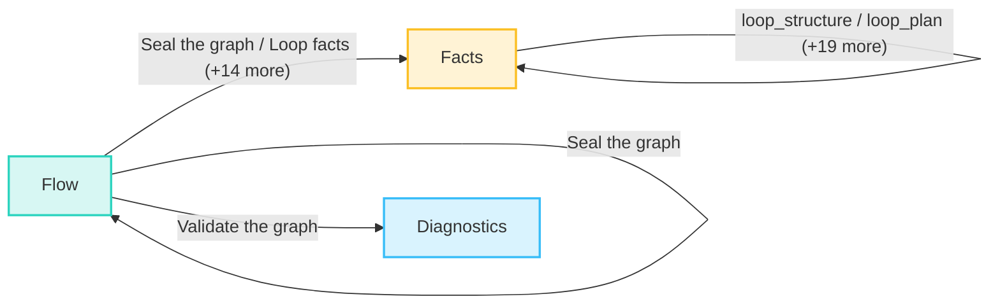

**Guarantees: **[Facts agree with the interpreter](#g-nat_facts_hold)

<details>
<summary>Files (10)</summary>

[`crates/mapal-ir/src/algo.rs:1`](../crates/mapal-ir/src/algo.rs#L1)  
[`crates/mapal-ir/src/facts.rs:1`](../crates/mapal-ir/src/facts.rs#L1)  
[`crates/mapal-ir/src/access.rs:1`](../crates/mapal-ir/src/access.rs#L1)  
[`crates/mapal-ir/src/residence.rs:1`](../crates/mapal-ir/src/residence.rs#L1)  
[`crates/mapal-ir/src/unit.rs:1`](../crates/mapal-ir/src/unit.rs#L1)  
[`crates/mapal-ir/src/split.rs:1`](../crates/mapal-ir/src/split.rs#L1)  
[`crates/mapal-ir/src/exp.rs:1`](../crates/mapal-ir/src/exp.rs#L1)  
[`crates/mapal-ir/src/narrow.rs:1`](../crates/mapal-ir/src/narrow.rs#L1)  
[`crates/mapal-ir/src/read.rs:1`](../crates/mapal-ir/src/read.rs#L1)  
[`crates/mapal-ir/src/validate.rs:1`](../crates/mapal-ir/src/validate.rs#L1)

</details>

<a id="cat-Facts"></a>

#### Category Facts

Everything the compiler has proven about a graph, stored on the graph and read by every later stage.

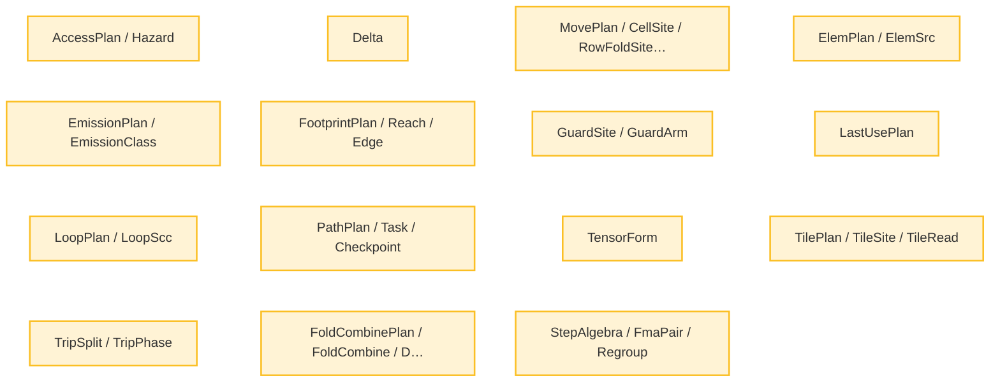

<details>
<summary>Objects (30)</summary>

| Object | What it is | Defined at | Lives in | Provided by |
|---|---|---|---|---|
| <a id="o-Facts.accessplan-hazard"></a>**AccessPlan / Hazard** | The bytes each operation reads and writes, shared-buffer classes, and the read-after-write, write-after-read, write-after-write ordering edges. | [`crates/mapal-ir/src/access.rs:43`](../crates/mapal-ir/src/access.rs#L43) | compiler heap: FuncFacts.access_plan | [Flow graph](#c-flow) |
| <a id="o-Facts.delta"></a>**Delta** | Which cells of a carried array one loop trip writes: a row range or a repeating set of pieces. | [`crates/mapal-ir/src/algo.rs:106`](../crates/mapal-ir/src/algo.rs#L106) | compiler heap: SecondaryMap<ObjectId, Delta> in FuncFacts.write_delta |  |
| <a id="o-Facts.moveplan-cellsite-rowfoldsite-linearsite"></a>**MovePlan / CellSite / RowFoldSite / LinearSite** | Data-move sites, per-cell map sites, one-value-per-row folds and sums of tile sites. | [`crates/mapal-ir/src/algo/tile_types.rs:336`](../crates/mapal-ir/src/algo/tile_types.rs#L336) | compiler heap: FuncFacts.move_plan, cell_plan, trap_cell_plan, row_fold, whole_fold, linear_plan |  |
| <a id="o-Facts.elemplan-elemsrc"></a>**ElemPlan / ElemSrc** | Each array's element as a closed function of its index (index itself, broadcast, load, pair, apply). | [`crates/mapal-ir/src/algo/plan_types.rs:301`](../crates/mapal-ir/src/algo/plan_types.rs#L301) | compiler heap: FuncFacts.elem_plan | [Flow graph](#c-flow) |
| <a id="o-Facts.emissionplan-emissionclass"></a>**EmissionPlan / EmissionClass** | Which objects need bytes, which dissolve into views, and how many consumers each has. | [`crates/mapal-ir/src/algo/plan_types.rs:153`](../crates/mapal-ir/src/algo/plan_types.rs#L153) | compiler heap: FuncFacts.emission_plan |  |
| <a id="o-Facts.footprintplan-reach-edge"></a>**FootprintPlan / Reach / Edge** | What cells of a producer each consumer cell reads, so edges can be checked as staying within rows. | [`crates/mapal-ir/src/algo/tile_types.rs:412`](../crates/mapal-ir/src/algo/tile_types.rs#L412) | compiler heap: FuncFacts.footprint_plan |  |
| <a id="o-Facts.guardsite-guardarm"></a>**GuardSite / GuardArm** | Each conditional select with the work exclusive to each arm and whether the arm must be gated (it may trap or is heavy). | [`crates/mapal-ir/src/algo.rs:271`](../crates/mapal-ir/src/algo.rs#L271) | compiler heap: Vec<GuardSite> in FuncFacts.guard_plan and guard_structure |  |
| <a id="o-Facts.lastuseplan"></a>**LastUsePlan** | Each value's position, death point, whether it escapes into the output, and whether a loop back edge carries it. | [`crates/mapal-ir/src/algo/last_use.rs:15`](../crates/mapal-ir/src/algo/last_use.rs#L15) | compiler heap: FuncFacts.last_use_plan | [Flow graph](#c-flow) |
| <a id="o-Facts.loopplan-loopscc"></a>**LoopPlan / LoopScc** | A loop cycle and its canonical shape: initial value, merge, the step that decides to continue, the step that advances, the exit. | [`crates/mapal-ir/src/algo.rs:80`](../crates/mapal-ir/src/algo.rs#L80) | compiler heap (fact slots) | [Flow graph](#c-flow), [Rewrites](#c-rewrite) |
| <a id="o-Facts.pathplan-task-checkpoint"></a>**PathPlan / Task / Checkpoint** | Independent parallel tasks, which are splittable bulk operations, and where the host must wait for them. | [`crates/mapal-ir/src/algo.rs:205`](../crates/mapal-ir/src/algo.rs#L205) | compiler heap: FuncFacts.path_plan | [Flow graph](#c-flow) |
| <a id="o-Facts.tensorform"></a>**TensorForm** | A tile operand described as a dense tensor of at most three axes. | [`crates/mapal-ir/src/algo/tile_types.rs:124`](../crates/mapal-ir/src/algo/tile_types.rs#L124) | compiler heap: computed on demand from a TileRead (TileRead::tensor_form) |  |
| <a id="o-Facts.tileplan-tilesite-tileread"></a>**TilePlan / TileSite / TileRead** | A sum-of-products (matrix-like) site: its rows, columns, depth, the two operand reads, seed, epilogue and narrow formats. | [`crates/mapal-ir/src/algo/tile_types.rs:501`](../crates/mapal-ir/src/algo/tile_types.rs#L501) | compiler heap: FuncFacts.tile_plan, tile_plan_strided, tile_plan_post, tile_plan_narrow, tile_plan_radix | [Flow graph](#c-flow) |
| <a id="o-Facts.tripsplit-tripphase"></a>**TripSplit / TripPhase** | For a counted loop, the trip intervals cut by guards on the counter and the state each interval carries. | [`crates/mapal-ir/src/algo/plan_types.rs:53`](../crates/mapal-ir/src/algo/plan_types.rs#L53) | compiler heap: Vec<TripSplit> in FuncFacts.trip_split |  |
| <a id="o-Facts.foldcombineplan-foldcombine-deplaw"></a>**FoldCombinePlan / FoldCombine / DepLaw** | How a fold over blocks of its axis combines partial results, and how each per-row value it reads (factor, shift, rescale, phase) is applied. | [`crates/mapal-ir/src/algo/algebra.rs:377`](../crates/mapal-ir/src/algo/algebra.rs#L377) | compiler heap: FuncFacts.fold_combine |  |
| <a id="o-Facts.stepalgebra-fmapair-regroup"></a>**StepAlgebra / FmaPair / Regroup** | Which multiply-add pairs may fuse into one rounding and which fold steps may be regrouped into lane partials plus a tree. | [`crates/mapal-ir/src/algo/algebra.rs:61`](../crates/mapal-ir/src/algo/algebra.rs#L61) | compiler heap: FuncFacts.step_algebra |  |
| <a id="o-Facts.boundsproof"></a>**BoundsProof** | Which Index reads are proven inside their array, and the integer range of each index. | [`crates/mapal-ir/src/algo/bounds.rs:49`](../crates/mapal-ir/src/algo/bounds.rs#L49) | compiler heap: FuncFacts.bounds_proof |  |
| <a id="o-Facts.precisionplan-narrowstore"></a>**PrecisionPlan / NarrowStore** | The precisions each product admits, where rounding happens once, and each site's error bound. | [`crates/mapal-ir/src/algo/precision.rs:16`](../crates/mapal-ir/src/algo/precision.rs#L16) | compiler heap: FuncFacts.precision_plan | [Flow graph](#c-flow) |
| <a id="o-Facts.radixform-digit-radixtile"></a>**RadixForm / Digit / RadixTile** | An integer index split into digits (x divided by a stride, modulo a radix), which lets convolution and attention reads count as tiles. | [`crates/mapal-ir/src/algo/radix.rs:33`](../crates/mapal-ir/src/algo/radix.rs#L33) | compiler heap: SecondaryMap<ObjectId, RadixForm> in FuncFacts.radix_plan |  |
| <a id="o-Facts.finiteplan"></a>**FinitePlan** | Which float values are proven free of infinity and NaN by interval arithmetic. | [`crates/mapal-ir/src/algo/range.rs:65`](../crates/mapal-ir/src/algo/range.rs#L65) | compiler heap: FuncFacts.finite_plan |  |
| <a id="o-Facts.staticplan-staticroot-realize"></a>**StaticPlan / StaticRoot / Realize** | Which values are computable before the program runs and whether each is embedded as bytes, attempted, or computed at run time. | [`crates/mapal-ir/src/algo/statics.rs:90`](../crates/mapal-ir/src/algo/statics.rs#L90) | compiler heap: FuncFacts.static_plan | [Flow graph](#c-flow) |
| <a id="o-Facts.streamplan-streamgroup-streamguard-guardbox"></a>**StreamPlan / StreamGroup / StreamGuard / GuardBox** | A group proven to run in one pass over windows of an axis (attention style), with each member's role and the mask as a box. | [`crates/mapal-ir/src/algo/stream.rs:71`](../crates/mapal-ir/src/algo/stream.rs#L71) | compiler heap: FuncFacts.stream_plan |  |
| <a id="o-Facts.streamplan-streamgroup"></a>**StreamPlan / StreamGroup** | One pass over windows of an axis (attention-like): the role of each member. | [`crates/mapal-ir/src/algo/stream.rs:412`](../crates/mapal-ir/src/algo/stream.rs#L412) | cached in FuncFacts | [Flow graph](#c-flow) |
| <a id="o-Facts.unchangedplan-callkeep"></a>**UnchangedPlan / CallKeep** | For each loop-body array the cells that may differ from the previous trip, and for each call the arguments that are the same every time. | [`crates/mapal-ir/src/algo/unchanged.rs:48`](../crates/mapal-ir/src/algo/unchanged.rs#L48) | compiler heap: FuncFacts.unchanged_plan and call_keep |  |
| <a id="o-Facts.expform-narrowform-mathform"></a>**ExpForm / NarrowForm / MathForm** | The contract of the exponential and of each narrow float format (algorithm constants, error bound, exactness). | [`crates/mapal-ir/src/exp.rs:30`](../crates/mapal-ir/src/exp.rs#L30) | compiler heap: plain values; NarrowForm in narrow.rs |  |
| <a id="o-Facts.factarms"></a>**FactArms** | Switches that turn individual fact rules off, used only to compare against the older behaviour (all on by default). | [`crates/mapal-ir/src/facts.rs:73`](../crates/mapal-ir/src/facts.rs#L73) | compiler heap: field of Facts, set by CategoryIr::refacted | [Flow graph](#c-flow) |
| <a id="o-Facts.funcfacts-facts-fact-store"></a>**FuncFacts / Facts (fact store)** | One write-once slot per function per fact (OnceLock); a query fills its slot on first use and every later call reads it. | [`crates/mapal-ir/src/facts.rs:25`](../crates/mapal-ir/src/facts.rs#L25) | compiler heap: SecondaryMap<FuncId, FuncFacts> inside CategoryIr.facts | [Flow graph](#c-flow) |
| <a id="o-Facts.residenceplan-residence"></a>**ResidencePlan / Residence** | Per array its bytes and peak live bytes between producer and last reader, giving Chip, L2 or DRAM against a cache size. | [`crates/mapal-ir/src/residence.rs:34`](../crates/mapal-ir/src/residence.rs#L34) | compiler heap: FuncFacts.residence_plan | [Flow graph](#c-flow) |
| <a id="o-Facts.splitform-accmodel"></a>**SplitForm / AccModel** | A way to do an f32 product on a matrix instruction by cutting operands into exact parts, with its error coefficient. | [`crates/mapal-ir/src/split.rs:62`](../crates/mapal-ir/src/split.rs#L62) | compiler heap: plain values built by SplitForm::of |  |
| <a id="o-Facts.unitplan-unitgroup-unitmember-rowmap"></a>**UnitPlan / UnitGroup / UnitMember / RowMap** | Groups of sites that share a block of rows so intermediates stay on chip, each member's role and row mapping. | [`crates/mapal-ir/src/unit.rs:120`](../crates/mapal-ir/src/unit.rs#L120) | compiler heap: FuncFacts.unit_plan |  |
| <a id="o-Facts.unitplan-unitgroup"></a>**UnitPlan / UnitGroup** | Row-block groups of sites that can run together on chip. | [`crates/mapal-ir/src/unit.rs:157`](../crates/mapal-ir/src/unit.rs#L157) | cached in FuncFacts | [Flow graph](#c-flow) |

</details>

<details open>
<summary>Arrows (7)</summary>

| Arrow | From → to | What it does | Defined at |
|---|---|---|---|
| **Hazard edges within a loop trip** | `MorphismId` → `MorphismId` | Which operation must wait for which, with the kind of conflict. | [`crates/mapal-ir/src/access.rs:96`](../crates/mapal-ir/src/access.rs#L96) |
| **Fact query by object** | `ObjectId` → `Fact entry` | Every fact answers per-object or per-morphism questions: death, delta, residence, finite, class. | [`crates/mapal-ir/src/algo/last_use.rs:50`](../crates/mapal-ir/src/algo/last_use.rs#L50) |
| **LastUsePlan::death / position / carried_by** | `ObjectId / MorphismId` → `position / ObjectId` | Where a value dies; the order of an edge; which loop state carries a value across trips. | [`crates/mapal-ir/src/algo/last_use.rs:50`](../crates/mapal-ir/src/algo/last_use.rs#L50) |
| **fact(f, slot, compute)** | `FuncId` → `Fact value` | Look a fact up in the function's slot and compute it only if the slot is empty. | [`crates/mapal-ir/src/facts.rs:226`](../crates/mapal-ir/src/facts.rs#L226) |
| **CategoryIr::fact** | `(FuncId, slot)` → `plan value` | Return the stored fact, or compute it once from stored inputs and keep it. | [`crates/mapal-ir/src/facts.rs:226`](../crates/mapal-ir/src/facts.rs#L226) |
| **CategoryIr::refacted** | `CategoryIr` → `CategoryIr` | Copy the graph with an empty fact store and different arms. | [`crates/mapal-ir/src/facts.rs:203`](../crates/mapal-ir/src/facts.rs#L203) |
| **ResidencePlan::at** | `ObjectId` → `Residence` | Place of a value given a cache capacity. | [`crates/mapal-ir/src/residence.rs:53`](../crates/mapal-ir/src/residence.rs#L53) |

</details>

<details>
<summary>Transformations (30)</summary>

| Name | From → to | Kind | What it does | Defined at | Lives in |
|---|---|---|---|---|---|
| <a id="t-seal"></a>**Seal the graph** | [Flow](#cat-Flow)<br>→ [Flow](#cat-Flow)<br>[Facts](#cat-Facts) | process | Freezes the builder's graph and pre-allocates one empty fact slot per function. | [`crates/mapal-ir/src/builder.rs:266`](../crates/mapal-ir/src/builder.rs#L266) | compiler heap, once per graph |
| <a id="t-validate"></a>**Validate the graph** | [Flow](#cat-Flow)<br>→ [Diagnostics](#cat-Diagnostics) | process | Independently re-checks the graph's shape rules and lists violations; the test oracle for every pass. | [`crates/mapal-ir/src/validate.rs:98`](../crates/mapal-ir/src/validate.rs#L98) | compiler heap, returns Vec<IrViolation> |
| <a id="t-loops"></a>**Loop facts** | [Flow](#cat-Flow)<br>→ [Facts](#cat-Facts) | functor | Finds cycles, orders the graph, and reads each loop's canonical shape, trip splits and per-trip array writes.<br>**made of: **[sccs](#t-sccs), [topo_order](#t-topo_order), [loop_structure](#t-loop_structure), [loop_plan](#t-loop_plan), [trip_split](#t-trip_split), [write_delta](#t-write_delta) | [`crates/mapal-ir/src/algo/loops.rs:425`](../crates/mapal-ir/src/algo/loops.rs#L425) | FuncFacts slots |
| <a id="t-sccs"></a>**sccs** | [Flow](#cat-Flow)<br>→ [Facts](#cat-Facts) | process | Strongly connected sets of objects, which are the loops. | [`crates/mapal-ir/src/algo/loops.rs:13`](../crates/mapal-ir/src/algo/loops.rs#L13) | FuncFacts.sccs |
| <a id="t-topo_order"></a>**topo_order** | [Flow](#cat-Flow)<br>→ [Facts](#cat-Facts) | process | A deterministic evaluation order of a function's operations. | [`crates/mapal-ir/src/algo/loops.rs:162`](../crates/mapal-ir/src/algo/loops.rs#L162) | FuncFacts.topo_order |
| <a id="t-loop_structure"></a>**loop_structure** | [Facts](#cat-Facts)<br>→ [Facts](#cat-Facts) | process | Lists each loop and its merge objects. | [`crates/mapal-ir/src/algo/loops.rs:385`](../crates/mapal-ir/src/algo/loops.rs#L385) | FuncFacts.loop_structure |
| <a id="t-loop_plan"></a>**loop_plan** | [Facts](#cat-Facts)<br>→ [Facts](#cat-Facts) | process | Names init, back route, exit and the decide/advance order of each canonical loop. | [`crates/mapal-ir/src/algo/loops.rs:425`](../crates/mapal-ir/src/algo/loops.rs#L425) | FuncFacts.loop_plans |
| <a id="t-trip_split"></a>**trip_split** | [Facts](#cat-Facts)<br>→ [Facts](#cat-Facts) | process | Cuts a counted loop's trips where guards on the counter change behaviour. | [`crates/mapal-ir/src/algo/site_plans.rs:336`](../crates/mapal-ir/src/algo/site_plans.rs#L336) | FuncFacts.trip_split |
| <a id="t-write_delta"></a>**write_delta** | [Facts](#cat-Facts)<br>→ [Facts](#cat-Facts) | process | The contiguous rows or pieces of a carried array that each trip writes. | [`crates/mapal-ir/src/algo/write_delta.rs:36`](../crates/mapal-ir/src/algo/write_delta.rs#L36) | FuncFacts.write_delta |
| <a id="t-unchanged_plan"></a>**unchanged_plan and call_keep** | [Facts](#cat-Facts)<br>→ [Facts](#cat-Facts) | process | Carries write deltas through row-local maps to say what stays the same between trips and calls. | [`crates/mapal-ir/src/algo/unchanged/compute.rs:9`](../crates/mapal-ir/src/algo/unchanged/compute.rs#L9) | FuncFacts.unchanged_plan, call_keep |
| <a id="t-static_plan"></a>**static_plan** | [Facts](#cat-Facts)<br>→ [Facts](#cat-Facts) | process | Finds values computable before the program runs and prices embedding them against computing them. | [`crates/mapal-ir/src/algo/statics.rs:137`](../crates/mapal-ir/src/algo/statics.rs#L137) | FuncFacts.static_plan |
| <a id="t-lifetime"></a>**Lifetime and emission facts** | [Flow](#cat-Flow)<br>[Facts](#cat-Facts)<br>→ [Facts](#cat-Facts) | functor | Which values need bytes, when each dies, which bytes each operation touches, and where bytes live.<br>**made of: **[emission_plan](#t-emission_plan), [last_use_plan](#t-last_use_plan), [access_plan](#t-access_plan), [residence_plan](#t-residence_plan) | [`crates/mapal-ir/src/algo/last_use.rs:142`](../crates/mapal-ir/src/algo/last_use.rs#L142) | FuncFacts slots |
| <a id="t-emission_plan"></a>**emission_plan** | [Flow](#cat-Flow)<br>→ [Facts](#cat-Facts) | process | Classifies each object as materialized, dissolved into a view, inline or named. | [`crates/mapal-ir/src/algo/site_plans.rs:26`](../crates/mapal-ir/src/algo/site_plans.rs#L26) | FuncFacts.emission_plan |
| <a id="t-last_use_plan"></a>**last_use_plan** | [Facts](#cat-Facts)<br>→ [Facts](#cat-Facts) | process | Positions, death points, escapes and loop-carried liveness over two iterations. | [`crates/mapal-ir/src/algo/last_use.rs:142`](../crates/mapal-ir/src/algo/last_use.rs#L142) | FuncFacts.last_use_plan |
| <a id="t-access_plan"></a>**access_plan** | [Facts](#cat-Facts)<br>→ [Facts](#cat-Facts) | process | Reads, writes, storage classes and hazard edges per loop trip. | [`crates/mapal-ir/src/access.rs:126`](../crates/mapal-ir/src/access.rs#L126) | FuncFacts.access_plan |
| <a id="t-residence_plan"></a>**residence_plan** | [Facts](#cat-Facts)<br>→ [Facts](#cat-Facts) | process | Peak live bytes from producer to last reader, compared to a cache size. | [`crates/mapal-ir/src/residence.rs:65`](../crates/mapal-ir/src/residence.rs#L65) | FuncFacts.residence_plan |
| <a id="t-path_plan"></a>**path_plan and guard_plan** | [Flow](#cat-Flow)<br>[Facts](#cat-Facts)<br>→ [Facts](#cat-Facts) | process | Splits work into independent tasks, finds host checkpoints, and records which conditional arms must be gated. | [`crates/mapal-ir/src/algo/paths.rs:16`](../crates/mapal-ir/src/algo/paths.rs#L16) | FuncFacts.path_plan, guard_plan, guard_structure |
| <a id="t-bounds_proof"></a>**bounds_proof and finite_plan** | [Flow](#cat-Flow)<br>[Facts](#cat-Facts)<br>→ [Facts](#cat-Facts) | process | Proves indices in range and values finite using integer and float interval arithmetic narrowed by the conditions that hold where a value is used. | [`crates/mapal-ir/src/algo/bounds/compute.rs:9`](../crates/mapal-ir/src/algo/bounds/compute.rs#L9) | FuncFacts.bounds_proof, finite_plan |
| <a id="t-sites"></a>**Site recognition** | [Flow](#cat-Flow)<br>[Facts](#cat-Facts)<br>→ [Facts](#cat-Facts) | functor | Recognizes maps and folds as tiles, row folds, cells and data moves and gives each element as a closed function of its index.<br>**made of: **[elem_plan and map_law](#t-elem_plan), [tile_plan and variants](#t-tile_plan), [radix_plan](#t-radix_plan), [cell_plan, row_fold, whole_fold, move_plan, footprint_plan](#t-cell_plan) | [`crates/mapal-ir/src/algo/site_plans.rs:198`](../crates/mapal-ir/src/algo/site_plans.rs#L198) | FuncFacts slots |
| <a id="t-elem_plan"></a>**elem_plan and map_law** | [Flow](#cat-Flow)<br>→ [Facts](#cat-Facts) | process | Each array element as a closed function of its index, piecewise where cells outside a range are a capture's own. | [`crates/mapal-ir/src/algo/elem.rs:20`](../crates/mapal-ir/src/algo/elem.rs#L20) | FuncFacts.elem_plan |
| <a id="t-tile_plan"></a>**tile_plan and variants** | [Flow](#cat-Flow)<br>[Facts](#cat-Facts)<br>→ [Facts](#cat-Facts) | process | Finds sum-of-products sites: plain, strided, with epilogue, narrow-storage, and mixed-radix. | [`crates/mapal-ir/src/algo/site_plans.rs:198`](../crates/mapal-ir/src/algo/site_plans.rs#L198) | FuncFacts.tile_plan*, tile_plan_radix |
| <a id="t-radix_plan"></a>**radix_plan** | [Flow](#cat-Flow)<br>→ [Facts](#cat-Facts) | process | Writes each integer value as digits of the inputs so strided and implicit-matrix reads are visible. | [`crates/mapal-ir/src/algo/radix.rs:263`](../crates/mapal-ir/src/algo/radix.rs#L263) | FuncFacts.radix_plan |
| <a id="t-cell_plan"></a>**cell_plan, row_fold, whole_fold, move_plan, footprint_plan** | [Flow](#cat-Flow)<br>[Facts](#cat-Facts)<br>→ [Facts](#cat-Facts) | process | Per-cell maps, row folds, data-move sites and what each cell reads. | [`crates/mapal-ir/src/algo/cells.rs:16`](../crates/mapal-ir/src/algo/cells.rs#L16) | FuncFacts slots |
| <a id="t-fold_algebra"></a>**Arithmetic freedom facts** | [Flow](#cat-Flow)<br>[Facts](#cat-Facts)<br>→ [Facts](#cat-Facts) | functor | States what the arithmetic may become: fused multiply-add, regrouped folds, block-combined folds.<br>**made of: **[step_algebra](#t-step_algebra), [fold_combine](#t-fold_combine), [precision_plan](#t-precision_plan) | [`crates/mapal-ir/src/algo/algebra.rs:108`](../crates/mapal-ir/src/algo/algebra.rs#L108) | FuncFacts slots |
| <a id="t-step_algebra"></a>**step_algebra** | [Flow](#cat-Flow)<br>→ [Facts](#cat-Facts) | process | Multiply-add pairs that can fuse and fold steps that can regroup. | [`crates/mapal-ir/src/algo/algebra.rs:108`](../crates/mapal-ir/src/algo/algebra.rs#L108) | FuncFacts.step_algebra |
| <a id="t-fold_combine"></a>**fold_combine** | [Facts](#cat-Facts)<br>→ [Facts](#cat-Facts) | process | How block partials of a fold combine and how each per-row value is applied. | [`crates/mapal-ir/src/algo/algebra.rs:428`](../crates/mapal-ir/src/algo/algebra.rs#L428) | FuncFacts.fold_combine |
| <a id="t-precision_plan"></a>**precision_plan** | [Flow](#cat-Flow)<br>[Facts](#cat-Facts)<br>→ [Facts](#cat-Facts) | process | Admitted product precisions, where rounding happens once, and a-priori error bounds per site. | [`crates/mapal-ir/src/algo/precision.rs:112`](../crates/mapal-ir/src/algo/precision.rs#L112) | FuncFacts.precision_plan |
| <a id="t-unit_stream"></a>**Row-block and streaming facts** | [Facts](#cat-Facts)<br>→ [Facts](#cat-Facts) | functor | Groups sites that can share a block of rows on chip, then proves a group can run window by window in one pass.<br>**made of: **[unit_plan](#t-unit_plan), [stream_plan](#t-stream_plan) | [`crates/mapal-ir/src/unit.rs:284`](../crates/mapal-ir/src/unit.rs#L284) | FuncFacts.unit_plan, stream_plan |
| <a id="t-unit_plan"></a>**unit_plan** | [Facts](#cat-Facts)<br>→ [Facts](#cat-Facts) | process | Row-block groups with row-closed edges and bytes per row. | [`crates/mapal-ir/src/unit.rs:284`](../crates/mapal-ir/src/unit.rs#L284) | FuncFacts.unit_plan |
| <a id="t-stream_plan"></a>**stream_plan** | [Facts](#cat-Facts)<br>→ [Facts](#cat-Facts) | process | One-pass windowed evaluation of an axis, with mask boxes and per-fold combine laws. | [`crates/mapal-ir/src/algo/stream.rs:430`](../crates/mapal-ir/src/algo/stream.rs#L430) | FuncFacts.stream_plan |

</details>

<details open>
<summary>Algorithms, data structures and design patterns (13)</summary>

| Name | Kind | What it is | Defined at | Used by |
|---|---|---|---|---|
| **Fact cache on the sealed graph** | design pattern | Each query is a pure function of the sealed graph, computed once into a write-once slot and read after that. | [`crates/mapal-ir/src/facts.rs:226`](../crates/mapal-ir/src/facts.rs#L226) | [loop_plan](#t-loop_plan), [tile_plan and variants](#t-tile_plan), [last_use_plan](#t-last_use_plan), [unit_plan](#t-unit_plan), [stream_plan](#t-stream_plan) |
| **Arena with typed ids** | data structure | Objects, morphisms and functions sit in slot maps keyed by distinct id types; secondary maps hang per-id data off them with deterministic order. | [`crates/mapal-ir/src/graph.rs:288`](../crates/mapal-ir/src/graph.rs#L288) | [Seal the graph](#t-seal), [sccs](#t-sccs), [topo_order](#t-topo_order) |
| **Strongly connected components** | algorithm | Loop detection by finding cycles in the object graph. | [`crates/mapal-ir/src/algo/loops.rs:13`](../crates/mapal-ir/src/algo/loops.rs#L13) | [loop_structure](#t-loop_structure), [loop_plan](#t-loop_plan) |
| **Topological order** | algorithm | Evaluation order with insertion-order tie-breaks. | [`crates/mapal-ir/src/algo/loops.rs:162`](../crates/mapal-ir/src/algo/loops.rs#L162) | [last_use_plan](#t-last_use_plan), [bounds_proof and finite_plan](#t-bounds_proof), [path_plan and guard_plan](#t-path_plan) |
| **Liveness with two-iteration loop carry** | algorithm | Positions and death points of values, with a value live across a loop back edge marked carried. | [`crates/mapal-ir/src/algo/last_use.rs:142`](../crates/mapal-ir/src/algo/last_use.rs#L142) | [residence_plan](#t-residence_plan), [unit_plan](#t-unit_plan) |
| **Interval analysis narrowed by conditions** | algorithm | Integer and float ranges tightened by the guards, loop bounds and phi arms where a value is used. | [`crates/mapal-ir/src/algo/bounds/compute.rs:9`](../crates/mapal-ir/src/algo/bounds/compute.rs#L9) | [bounds_proof and finite_plan](#t-bounds_proof) |
| **Digit decomposition of indices** | algorithm | Index arithmetic with constant division and remainder is split into per-digit affine terms to detect implicit matrix products. | [`crates/mapal-ir/src/algo/radix.rs:263`](../crates/mapal-ir/src/algo/radix.rs#L263) | [radix_plan](#t-radix_plan), [unit_plan](#t-unit_plan), [stream_plan](#t-stream_plan) |
| **Hazard classification (RAW/WAR/WAW)** | algorithm | Dependencies between operations from the bytes they read and write, with shared buffers. | [`crates/mapal-ir/src/access.rs:77`](../crates/mapal-ir/src/access.rs#L77) | [access_plan](#t-access_plan) |
| **Working-set peak over a live interval** | algorithm | A value's residence from the peak live bytes between producer and last reader against cache size. | [`crates/mapal-ir/src/residence.rs:65`](../crates/mapal-ir/src/residence.rs#L65) | [residence_plan](#t-residence_plan) |
| **A-priori error bound (gamma-n)** | algorithm | A closed-form rounding error bound for sums of products used as the correctness gate. | [`crates/mapal-ir/src/algo/precision.rs:83`](../crates/mapal-ir/src/algo/precision.rs#L83) | [precision_plan](#t-precision_plan) |
| **Online combine (running max and rescale)** | algorithm | Per-block partials combined by the fold's own operator, with exp rescale for a running max. | [`crates/mapal-ir/src/algo/algebra.rs:290`](../crates/mapal-ir/src/algo/algebra.rs#L290) | [fold_combine](#t-fold_combine), [stream_plan](#t-stream_plan) |
| **Independent validator** | design pattern | A second pass re-derives the graph invariants without sharing builder code. | [`crates/mapal-ir/src/validate.rs:98`](../crates/mapal-ir/src/validate.rs#L98) | [Validate the graph](#t-validate) |
| **Fact arms (OFF switches)** | design pattern | Each rule can be switched off for comparison, never per hardware. | [`crates/mapal-ir/src/facts.rs:73`](../crates/mapal-ir/src/facts.rs#L73) | [bounds_proof and finite_plan](#t-bounds_proof), [unchanged_plan and call_keep](#t-unchanged_plan), [stream_plan](#t-stream_plan) |

</details>

<a id="cg-facts"></a>

#### Guarantees of Facts

| Guarantee (natural transformation) | What must agree | Checked in |
|---|---|---|
| [Facts agree with the interpreter](#g-nat_facts_hold) | A claim a fact makes (a tile bound, a proven index, a static value) holds when the interpreter runs the program. | [`crates/mapal-rewrite/tests/stream_plan.rs:135`](../crates/mapal-rewrite/tests/stream_plan.rs#L135)<br>[`crates/mapal-rewrite/tests/static_eval.rs:45`](../crates/mapal-rewrite/tests/static_eval.rs#L45) |

<a id="c-rewrite"></a>

### Rewrites

Rewrites the Flow graph into an equal, cheaper one (fold constants, remove dead and repeated work, inline, unroll).

**Reads **[Flow](#cat-Flow), [Facts](#cat-Facts)**  →  produces **[Flow](#cat-Flow)

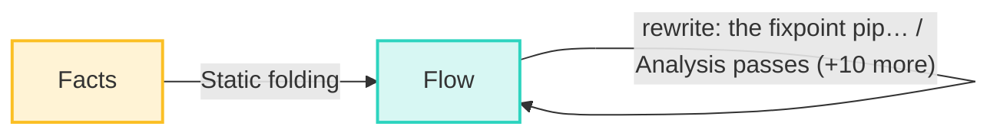

**Guarantees: **[Rewrite preserves the interpreter's result](#g-nat_semantics), [Replaying nothing changes nothing](#g-nat_identity), [Rewrite is deterministic and idempotent](#g-nat_idempotent)

<details>
<summary>Files (1)</summary>

[`crates/mapal-rewrite/tests/testgen/mod.rs:1`](../crates/mapal-rewrite/tests/testgen/mod.rs#L1)

</details>

<details open>
<summary>Transformations (12)</summary>

| Name | From → to | Kind | What it does | Defined at | Lives in |
|---|---|---|---|---|---|
| <a id="t-rewrite"></a>**rewrite: the fixpoint pipeline** | [Flow](#cat-Flow)<br>→ [Flow](#cat-Flow) | functor | Runs inline, unroll, lift, constant fold, CSE, DCE and map fusion round after round until nothing changes (at most 32 rounds); the identity on non-canonical loops.<br>**made of: **[Analysis passes](#t-analyze), [Replay](#t-replay) | [`crates/mapal-rewrite/src/driver.rs:70`](../crates/mapal-rewrite/src/driver.rs#L70) | compiler heap; returns a new graph |
| <a id="t-analyze"></a>**Analysis passes** | [Flow](#cat-Flow)<br>→ [Flow](#cat-Flow): `RewritePlan` | process | Each pass reads the graph and fills plan channels without changing the graph. | [`crates/mapal-rewrite/src/driver.rs:87`](../crates/mapal-rewrite/src/driver.rs#L87) | compiler heap |
| <a id="t-analyze_const_fold"></a>**Constant folding and identities** | [Flow](#cat-Flow)<br>→ [Flow](#cat-Flow): `RewritePlan` | process | Folds constant scalars and forwards identities at the oracle's exact semantics, never folding a trap. | [`crates/mapal-rewrite/src/equations.rs:24`](../crates/mapal-rewrite/src/equations.rs#L24) | RewritePlan.constify, alias |
| <a id="t-analyze_cse"></a>**Common-subexpression elimination** | [Flow](#cat-Flow)<br>→ [Flow](#cat-Flow): `RewritePlan` | process | Merges duplicate pure computations; an element view outside guard arms is keyed by constant index value. | [`crates/mapal-rewrite/src/graph_rewrites.rs:341`](../crates/mapal-rewrite/src/graph_rewrites.rs#L341) | RewritePlan.alias |
| <a id="t-analyze_dce"></a>**Dead-code elimination** | [Flow](#cat-Flow)<br>→ [Flow](#cat-Flow): `RewritePlan` | process | Drops dead cones of pure, non-trapping, terminating operations. | [`crates/mapal-rewrite/src/graph_rewrites.rs:34`](../crates/mapal-rewrite/src/graph_rewrites.rs#L34) | RewritePlan.drop |
| <a id="t-analyze_map_fusion"></a>**Map fusion** | [Flow](#cat-Flow)<br>→ [Flow](#cat-Flow): `RewritePlan` | process | Replaces map g after map f by one map, and drops map of identity. | [`crates/mapal-rewrite/src/functor_laws.rs:32`](../crates/mapal-rewrite/src/functor_laws.rs#L32) | RewritePlan.fuse, alias |
| <a id="t-analyze_inline"></a>**Inlining** | [Flow](#cat-Flow)<br>→ [Flow](#cat-Flow): `RewritePlan` | process | Strips Call operations by substituting the callee's body when it is small enough (256 morphisms). | [`crates/mapal-rewrite/src/inline.rs:47`](../crates/mapal-rewrite/src/inline.rs#L47) | RewritePlan.inline |
| <a id="t-analyze_lift"></a>**Loop lifting** | [Flow](#cat-Flow)<br>→ [Flow](#cat-Flow): `RewritePlan` | process | Recognizes counted accumulator and fill loops and rewrites them as captured Fold or Map. | [`crates/mapal-rewrite/src/lift.rs:23`](../crates/mapal-rewrite/src/lift.rs#L23) | RewritePlan.lift |
| <a id="t-analyze_unroll"></a>**Loop unrolling** | [Flow](#cat-Flow)<br>→ [Flow](#cat-Flow): `RewritePlan` | process | Replays a short constant-trip loop as its trips one after another, up to 128 trips. | [`crates/mapal-rewrite/src/unroll.rs:37`](../crates/mapal-rewrite/src/unroll.rs#L37) | RewritePlan.unroll |
| <a id="t-fold_static"></a>**Static folding** | [Flow](#cat-Flow)<br>[Facts](#cat-Facts)<br>→ [Flow](#cat-Flow) | process | Computes the static_plan roots with the interpreter and replaces their cones with constants. | [`crates/mapal-rewrite/src/statics.rs:34`](../crates/mapal-rewrite/src/statics.rs#L34) | compiler heap; interpreter run at compile time |
| <a id="t-replay"></a>**Replay** | [Flow](#cat-Flow)<br>[Flow](#cat-Flow): `RewritePlan`<br>→ [Flow](#cat-Flow) | functor | Walks each function in topological order, classifies each object by its recipe, and rebuilds an equivalent graph through the public builder, so the output is well-formed by construction. | [`crates/mapal-rewrite/src/replay.rs:67`](../crates/mapal-rewrite/src/replay.rs#L67) | compiler heap; new CategoryIr |
| <a id="t-is_canonical"></a>**Canonical-loop guard** | [Flow](#cat-Flow)<br>→ [Flow](#cat-Flow) | process | If any loop is outside the canonical shapes, rewrite hands the graph back untouched. | [`crates/mapal-rewrite/src/replay/support.rs:138`](../crates/mapal-rewrite/src/replay/support.rs#L138) | compiler stack |

</details>

<details open>
<summary>Algorithms, data structures and design patterns (10)</summary>

| Name | Kind | What it is | Defined at | Used by |
|---|---|---|---|---|
| **Plan then replay** | design pattern | Every pass only decides (graph to plan, pure); one shared replayer is the only code that builds graphs. | [`crates/mapal-rewrite/src/plan.rs:65`](../crates/mapal-rewrite/src/plan.rs#L65) | [rewrite: the fixpoint pipeline](#t-rewrite), [Inlining](#t-analyze_inline), [Loop lifting](#t-analyze_lift), [Common-subexpression elimination](#t-analyze_cse) |
| **Fixpoint iteration with round cap** | algorithm | Rounds repeat until all plans are empty or 32 rounds, with validation after each rebuild. | [`crates/mapal-rewrite/src/driver.rs:87`](../crates/mapal-rewrite/src/driver.rs#L87) | [rewrite: the fixpoint pipeline](#t-rewrite) |
| **Value-numbering CSE** | algorithm | Operations with the same op and same source are merged; views key by constant index value outside guard arms. | [`crates/mapal-rewrite/src/graph_rewrites.rs:395`](../crates/mapal-rewrite/src/graph_rewrites.rs#L395) | [Common-subexpression elimination](#t-analyze_cse) |
| **Liveness-based DCE** | algorithm | Backward reachability from outputs and effects; anything that may trap or diverge is pinned live. | [`crates/mapal-rewrite/src/graph_rewrites.rs:34`](../crates/mapal-rewrite/src/graph_rewrites.rs#L34) | [Dead-code elimination](#t-analyze_dce) |
| **Functor law as rewrite rule** | design pattern | Map fusion justified by map g after map f equals map (g after f); each pass names its law and preconditions. | [`crates/mapal-rewrite/src/functor_laws.rs:32`](../crates/mapal-rewrite/src/functor_laws.rs#L32) | [Map fusion](#t-analyze_map_fusion) |
| **Body substitution (inlining and fusion synthesis)** | algorithm | A callee or fused body is rebuilt in the caller with its input mapped to the call source and fresh ids. | [`crates/mapal-rewrite/src/replay/inline.rs:13`](../crates/mapal-rewrite/src/replay/inline.rs#L13) | [Replay](#t-replay), [Inlining](#t-analyze_inline), [Map fusion](#t-analyze_map_fusion) |
| **Evaluate at compile time with the oracle** | design pattern | Static values are computed by the interpreter itself, so they are exact on every number face. | [`crates/mapal-rewrite/src/statics.rs:34`](../crates/mapal-rewrite/src/statics.rs#L34) | [Static folding](#t-fold_static) |
| **By-value intake and no-op shortcut** | design pattern | The graph is moved in; an all-empty round returns it without a rebuild. | [`crates/mapal-rewrite/src/driver.rs:70`](../crates/mapal-rewrite/src/driver.rs#L70) | [rewrite: the fixpoint pipeline](#t-rewrite) |
| **Random program generator (testgen)** | design pattern | A proptest script of steps is built into a sealed graph or source text, used to validate rules on programs they were not designed on; checked in parallel. | [`crates/mapal-rewrite/tests/testgen/mod.rs:203`](../crates/mapal-rewrite/tests/testgen/mod.rs#L203) | [Rewrite preserves the interpreter's result](#g-nat_semantics), [Facts agree with the interpreter](#g-nat_facts_hold) |
| **Rule data table** | data structure | The Zip/Enumerate naturality laws kept as a const table. | [`crates/mapal-rewrite/src/naturality.rs:30`](../crates/mapal-rewrite/src/naturality.rs#L30) | [rewrite: the fixpoint pipeline](#t-rewrite) |

</details>

<a id="cg-rewrite"></a>

#### Guarantees of Rewrites

| Guarantee (natural transformation) | What must agree | Checked in |
|---|---|---|
| [Rewrite preserves the interpreter's result](#g-nat_semantics) | Evaluating the graph before and after rewriting gives the same result, traps included. | [`crates/mapal-rewrite/tests/property.rs:67`](../crates/mapal-rewrite/tests/property.rs#L67) |
| [Replaying nothing changes nothing](#g-nat_identity) | Replaying with an empty plan reproduces a valid graph equal to the original for every example. | [`crates/mapal-rewrite/tests/identity.rs:55`](../crates/mapal-rewrite/tests/identity.rs#L55) |
| [Rewrite is deterministic and idempotent](#g-nat_idempotent) | Rewriting twice equals rewriting once, and the same input always gives the same output. | [`crates/mapal-rewrite/tests/property.rs:151`](../crates/mapal-rewrite/tests/property.rs#L151) |

<a id="c-interp"></a>

### Interpreter

Runs a Flow graph directly on the CPU. It is the reference: every compiled result is compared against it.

**Reads **[Flow](#cat-Flow), [Facts](#cat-Facts)**  →  produces **[Values](#cat-Values)

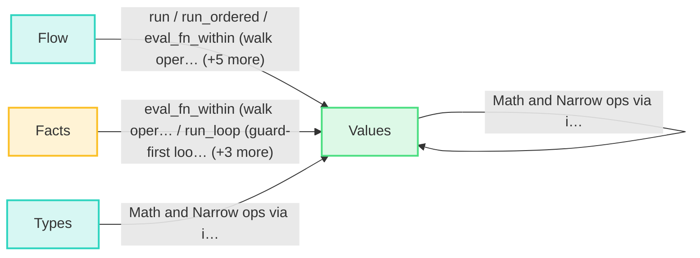

**Guarantees: **[Same graph, same result](#g-interp.nat.det), [The default face lies inside the bound](#g-interp.nat.bound), [Traps and divergence are outcomes, not panics](#g-interp.nat.traps), [Compiled code agrees with the interpreter within the bound](#g-interp.nat.oracle)

<details>
<summary>Files (5)</summary>

[`crates/mapal-interp/src/lib.rs:1`](../crates/mapal-interp/src/lib.rs#L1)  
[`crates/mapal-interp/src/eval.rs:1`](../crates/mapal-interp/src/eval.rs#L1)  
[`crates/mapal-interp/src/loops.rs:1`](../crates/mapal-interp/src/loops.rs#L1)  
[`crates/mapal-interp/src/value.rs:1`](../crates/mapal-interp/src/value.rs#L1)  
[`crates/mapal-interp/src/bound.rs:1`](../crates/mapal-interp/src/bound.rs#L1)

</details>

<a id="cat-Values"></a>

#### Category Values

What a program computes: scalars, arrays and records, and the error bound of a result.

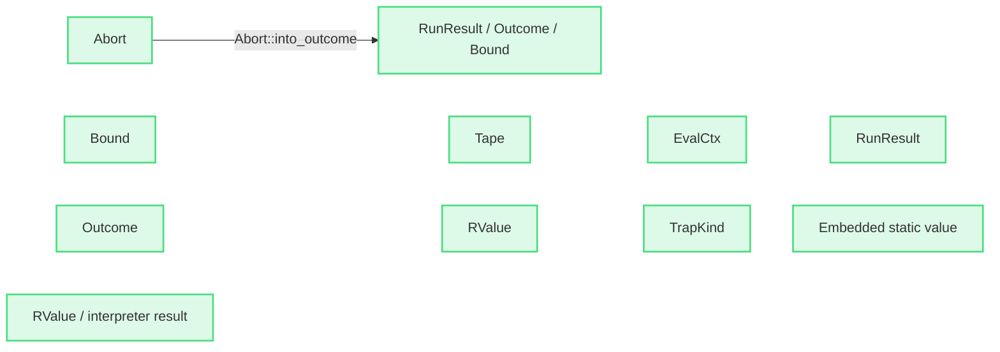

<details open>
<summary>Objects (11)</summary>

| Object | What it is | Defined at | Lives in | Provided by |
|---|---|---|---|---|
| <a id="o-Values.bound"></a>**Bound** | A printed value's error bound split by source: member rounding, summation order, fma, comparison flip, math builtin. | [`crates/mapal-interp/src/bound.rs:60`](../crates/mapal-interp/src/bound.rs#L60) | Vec<Bound> returned by run_bound, one per print |  |
| <a id="o-Values.tape"></a>**Tape** | Record of every float operation of the exact run: operands, partial derivatives, own deviation. | [`crates/mapal-interp/src/bound.rs:146`](../crates/mapal-interp/src/bound.rs#L146) | thread-local TAPE (RefCell<Option<Tape>>) during run_bound |  |
| <a id="o-Values.evalctx"></a>**EvalCtx** | Working state of one function evaluation: value of each object, staged product slots, guard sites, gated morphisms. | [`crates/mapal-interp/src/eval.rs:20`](../crates/mapal-interp/src/eval.rs#L20) | compiler heap, one per function call |  |
| <a id="o-Values.runresult-outcome-bound"></a>**RunResult / Outcome / Bound** | Output text, how it ended, each printed float's composed bound. | [`crates/mapal-interp/src/lib.rs:40`](../crates/mapal-interp/src/lib.rs#L40) | compiler heap | [Command line](#c-cli) |
| <a id="o-Values.runresult"></a>**RunResult** | Outcome plus the printed output text. | [`crates/mapal-interp/src/lib.rs:33`](../crates/mapal-interp/src/lib.rs#L33) | returned by value; output is a String |  |
| <a id="o-Values.abort"></a>**Abort** | Internal early exit (Diverged, Trapped, ReadFailed) threaded as the Err side. | [`crates/mapal-interp/src/value.rs:86`](../crates/mapal-interp/src/value.rs#L86) | Result error; read failure message in a thread-local READ_FAILURE |  |
| <a id="o-Values.outcome"></a>**Outcome** | How a run ended: Done(value), Diverged, Trapped(kind), ReadFailed(message). | [`crates/mapal-interp/src/value.rs:61`](../crates/mapal-interp/src/value.rs#L61) | returned by value |  |
| <a id="o-Values.rvalue"></a>**RValue** | A runtime value: scalar, tuple, struct, array (shared), world token with its log, tracked scalar (for bounds), unit. | [`crates/mapal-interp/src/value.rs:14`](../crates/mapal-interp/src/value.rs#L14) | compiler process heap while the oracle runs; arrays in Rc<Vec<RValue>> |  |
| <a id="o-Values.trapkind"></a>**TrapKind** | DivZero or IndexOob. | [`crates/mapal-interp/src/value.rs:51`](../crates/mapal-interp/src/value.rs#L51) | inside Outcome |  |
| <a id="o-Values.embedded-static-value"></a>**Embedded static value** | A value the interpreter computed at compile time and spliced into the graph as constants. | [`crates/mapal-rewrite/src/plan.rs:65`](../crates/mapal-rewrite/src/plan.rs#L65) | compiler heap, then constants inside the new graph | [Rewrites](#c-rewrite) |
| <a id="o-Values.rvalue-interpreter-result"></a>**RValue / interpreter result** | The interpreter's value for a program or call, compared before and after a rewrite (floats within tolerance). | [`crates/mapal-rewrite/tests/property.rs:47`](../crates/mapal-rewrite/tests/property.rs#L47) | test heap | [Rewrites](#c-rewrite) |

</details>

<details open>
<summary>Arrows (5)</summary>

| Arrow | From → to | What it does | Defined at |
|---|---|---|---|
| **component** | `RValue (product)` → `RValue (slot k)` | Take a component of a runtime product. | [`crates/mapal-interp/src/eval/helpers.rs:64`](../crates/mapal-interp/src/eval/helpers.rs#L64) |
| **eval_fn** | `FuncId and RValue (argument)` → `RValue (result)` | Evaluate one function on an argument. | [`crates/mapal-interp/src/eval.rs:84`](../crates/mapal-interp/src/eval.rs#L84) |
| **native_observable** | `RunResult` → `(stdout, exit code)` | What the compiled program must print and exit with. | [`crates/mapal-interp/src/lib.rs:252`](../crates/mapal-interp/src/lib.rs#L252) |
| **render** | `Value` → `String` | Print a scalar the way the program shows it. | [`crates/mapal-interp/src/value.rs:113`](../crates/mapal-interp/src/value.rs#L113) |
| **Abort::into_outcome** | `Abort` → `Outcome` | Lift an early exit to the public outcome. | [`crates/mapal-interp/src/value.rs:97`](../crates/mapal-interp/src/value.rs#L97) |

</details>

<details open>
<summary>Transformations (8)</summary>

| Name | From → to | Kind | What it does | Defined at | Lives in |
|---|---|---|---|---|---|
| <a id="t-interp.run"></a>**run / run_ordered** | [Flow](#cat-Flow)<br>→ [Values](#cat-Values): `(RunResult` | functor | Seed the entry function (world token or unit), walk the graph, return the outcome and output; total, never panics. | [`crates/mapal-interp/src/lib.rs:40`](../crates/mapal-interp/src/lib.rs#L40) | compiler heap; fuel is a u64 counter passed by &mut |
| <a id="t-interp.eval"></a>**eval_fn_within (walk operations in topological order)** | [Flow](#cat-Flow)<br>[Facts](#cat-Facts): `(topo, guard_plan`<br>→ [Values](#cat-Values) | process | For each morphism in order compute the target value from its sources; Map and Fold call body functions; reads load files; each step spends one unit of fuel. | [`crates/mapal-interp/src/eval.rs:107`](../crates/mapal-interp/src/eval.rs#L107) | EvalCtx.env SecondaryMap<ObjectId, RValue> |
| <a id="t-interp.loop"></a>**run_loop (guard-first loop driver)** | [Flow](#cat-Flow): `(loop SCC`<br>[Facts](#cat-Facts): `(loop_plan`<br>→ [Values](#cat-Values) | process | Per trip: decide and exit first, advance only if continuing, so speculative reads never happen on the exit step. | [`crates/mapal-interp/src/loops.rs:31`](../crates/mapal-interp/src/loops.rs#L31) | EvalCtx.env, staging buffers reset per trip |
| <a id="t-interp.guard"></a>**Phi handler (gated arms)** | [Flow](#cat-Flow)<br>[Facts](#cat-Facts): `(guard_plan`<br>→ [Values](#cat-Values) | process | Arm work that may trap or is heavy runs only when the condition picks that arm. | [`crates/mapal-interp/src/eval.rs:107`](../crates/mapal-interp/src/eval.rs#L107) | EvalCtx.guards and EvalCtx.gated |
| <a id="t-interp.cone"></a>**eval_values / eval_values_once / static_cone** | [Flow](#cat-Flow)<br>[Facts](#cat-Facts): `(static roots`<br>→ [Values](#cat-Values) | process | Evaluate only the cone of values feeding chosen root objects; used to embed compile-time constants. | [`crates/mapal-interp/src/lib.rs:127`](../crates/mapal-interp/src/lib.rs#L127) | SecondaryMap of the wanted objects; results Vec<Option<RValue>> |
| <a id="t-interp.bound"></a>**run_bound (record tape, reverse sweep)** | [Flow](#cat-Flow)<br>[Facts](#cat-Facts): `(precision_plan, step_algebra`<br>→ [Values](#cat-Values): `(Bound` | functor | Run exactly, record each float op, then one backward pass per printed value gives how far fast realizations may differ (reduced-precision members, summation order, fma, math builtins). | [`crates/mapal-interp/src/bound.rs:170`](../crates/mapal-interp/src/bound.rs#L170) | thread-local Tape; Bound per print |
| <a id="t-interp.weakest"></a>**run_weakest** | [Flow](#cat-Flow)<br>→ [Values](#cat-Values): `(RunResult` | process | Run with every admitted reduced-precision multiply taken at its coarsest grid, giving the opposite extreme of the oracle. | [`crates/mapal-interp/src/lib.rs:85`](../crates/mapal-interp/src/lib.rs#L85) | thread-local WEAKEST flag in eval.rs |
| <a id="t-interp.math"></a>**Math and Narrow ops via ir Native Arith** | [Values](#cat-Values): `(scalar`<br>[Types](#cat-Types)<br>→ [Values](#cat-Values): `(scalar` | process | Evaluate exp/sqrt/sin/cos and narrow rounding with the same definitions a backend prints. | [`crates/mapal-interp/src/eval.rs:107`](../crates/mapal-interp/src/eval.rs#L107) | Native<B> in crates/mapal-ir/src/math.rs |

</details>

<details open>
<summary>Algorithms, data structures and design patterns (7)</summary>

| Name | Kind | What it is | Defined at | Used by |
|---|---|---|---|---|
| **Fuel (step budget) for total evaluation** | design pattern | A u64 budget decremented per step so every run halts with Done, Diverged or Trapped. | [`crates/mapal-interp/src/eval.rs:62`](../crates/mapal-interp/src/eval.rs#L62) | [run / run_ordered](#t-interp.run), [eval_fn_within (walk operations in topological order)](#t-interp.eval), [eval_values / eval_values_once / static_cone](#t-interp.cone) |
| **Result as early-exit channel (Abort)** | design pattern | Traps, divergence and read failure travel as Err and are lifted once at the entry. | [`crates/mapal-interp/src/value.rs:86`](../crates/mapal-interp/src/value.rs#L86) | [run / run_ordered](#t-interp.run), [eval_fn_within (walk operations in topological order)](#t-interp.eval) |
| **Guard-first loop evaluation** | algorithm | Decide and exit cone evaluated before the advance cone. | [`crates/mapal-interp/src/loops.rs:31`](../crates/mapal-interp/src/loops.rs#L31) | [run_loop (guard-first loop driver)](#t-interp.loop) |
| **Reverse-mode derivative tape (first-order error composition)** | algorithm | Record partial derivatives forward, sweep backward per output to compose deviations along the program. | [`crates/mapal-interp/src/bound.rs:249`](../crates/mapal-interp/src/bound.rs#L249) | [run_bound (record tape, reverse sweep)](#t-interp.bound) |
| **Shared immutable arrays (Rc) with staging slots for products** | data structure | Arrays are reference counted; products are assembled in staging buffers slot by slot, matching Pair edges. | [`crates/mapal-interp/src/eval/helpers.rs:74`](../crates/mapal-interp/src/eval/helpers.rs#L74) | [eval_fn_within (walk operations in topological order)](#t-interp.eval) |
| **Cone evaluation (evaluate only what a root reads)** | algorithm | Restrict the walk to the set of objects feeding wanted roots. | [`crates/mapal-interp/src/lib.rs:201`](../crates/mapal-interp/src/lib.rs#L201) | [eval_values / eval_values_once / static_cone](#t-interp.cone) |
| **Thread-local recorders (tape, weakest flag, read failure)** | design pattern | Optional modes switched by scoped thread-local state so the common path has no extra parameters. | [`crates/mapal-interp/src/bound.rs:170`](../crates/mapal-interp/src/bound.rs#L170) | [run_bound (record tape, reverse sweep)](#t-interp.bound), [run_weakest](#t-interp.weakest) |

</details>

<a id="cg-interp"></a>

#### Guarantees of Interpreter

| Guarantee (natural transformation) | What must agree | Checked in |
|---|---|---|
| [Same graph, same result](#g-interp.nat.det) | Running twice gives the identical outcome and output (no hash maps, no clocks in the value path). | [`crates/mapal-interp/tests/determinism.rs:59`](../crates/mapal-interp/tests/determinism.rs#L59)<br>[`crates/mapal-interp/tests/determinism.rs:49`](../crates/mapal-interp/tests/determinism.rs#L49) |
| [The default face lies inside the bound](#g-interp.nat.bound) | The weakest-precision run differs from the exact run by at most the composed error bound. | [`crates/mapal-interp/tests/bound.rs:86`](../crates/mapal-interp/tests/bound.rs#L86)<br>[`crates/mapal-interp/tests/bound.rs:124`](../crates/mapal-interp/tests/bound.rs#L124) |
| [Traps and divergence are outcomes, not panics](#g-interp.nat.traps) | An out-of-range index, a zero division or running out of steps gives Trapped or Diverged rather than a crash. | [`crates/mapal-interp/tests/traps.rs:111`](../crates/mapal-interp/tests/traps.rs#L111)<br>[`crates/mapal-interp/tests/traps.rs:40`](../crates/mapal-interp/tests/traps.rs#L40)<br>[`crates/mapal-interp/tests/divergence.rs:60`](../crates/mapal-interp/tests/divergence.rs#L60) |
| [Compiled code agrees with the interpreter within the bound](#g-interp.nat.oracle) | The compiled program's printed values equal the interpreter's within the interpreter's bound; the check lives in the backend tests. | [`crates/backends/llvm/tests/differential/basics.rs:10`](../crates/backends/llvm/tests/differential/basics.rs#L10)<br>[`crates/backends/llvm/tests/differential/batching.rs:274`](../crates/backends/llvm/tests/differential/batching.rs#L274) |

<a id="c-hardware"></a>

### Hardware facts and rules

Describes a chip by its measurable properties and picks optimization switches from those properties, never from a chip's name.

**Reads **[Target](#cat-Target)**  →  produces **[Target](#cat-Target), [Schedule](#cat-Schedule)

```mermaid
flowchart LR
  Schedule["Schedule"]
  Target["Target"]
  Target -->|"Calibration probes / Native GPU profile (+3 more)"| Target
  Target -->|"Choose optimization switc…"| Schedule
  class Schedule k_machine
  class Target k_hardware
  classDef k_syntax fill:#38bdf830,stroke:#38bdf8,stroke-width:2px
  classDef k_lower fill:#a78bfa30,stroke:#a78bfa,stroke-width:2px
  classDef k_check fill:#f472b630,stroke:#f472b6,stroke-width:2px
  classDef k_flow fill:#2dd4bf30,stroke:#2dd4bf,stroke-width:2px
  classDef k_facts fill:#fbbf2430,stroke:#fbbf24,stroke-width:2px
  classDef k_rewrite fill:#fb923c30,stroke:#fb923c,stroke-width:2px
  classDef k_interp fill:#4ade8030,stroke:#4ade80,stroke-width:2px
  classDef k_hardware fill:#f8717130,stroke:#f87171,stroke-width:2px
  classDef k_machine fill:#c084fc30,stroke:#c084fc,stroke-width:2px
  classDef k_llvm fill:#60a5fa30,stroke:#60a5fa,stroke-width:2px
  classDef k_cuda fill:#34d39930,stroke:#34d399,stroke-width:2px
  classDef k_verilog fill:#94a3b830,stroke:#94a3b8,stroke-width:2px
  classDef k_runtime fill:#facc1530,stroke:#facc15,stroke-width:2px
  classDef k_cli fill:#e879f930,stroke:#e879f9,stroke-width:2px
  classDef k_lsp fill:#22d3ee30,stroke:#22d3ee,stroke-width:2px
  classDef plain fill:#94a3b81f,stroke:#94a3b8,stroke-dasharray:4 3
  classDef endpoint fill:#2dd4bf30,stroke:#2dd4bf,stroke-width:2px
```

**Guarantees: **[The native profile is the query plus the calibration](#g-nt-native-reads-claims), [The rules agree with every cited measurement](#g-nt-rung-replay), [The rules ignore names](#g-nt-no-names)

<details>
<summary>Files (10)</summary>

[`crates/backends/llvm/src/profile.rs:1`](../crates/backends/llvm/src/profile.rs#L1)  
[`benches/gpu/calib.cu:1`](../benches/gpu/calib.cu#L1)  
[`benches/local/place_calib.cu:1`](../benches/local/place_calib.cu#L1)  
[`benches/local/place_calib_opt.cu:1`](../benches/local/place_calib_opt.cu#L1)  
[`benches/local/place_calib.sh:1`](../benches/local/place_calib.sh#L1)  
[`benches/local/place_calib_facts.py:1`](../benches/local/place_calib_facts.py#L1)  
[`benches/results/evidence/local-rtx-5080/calib/rtx-5080.calib:1`](../benches/results/evidence/local-rtx-5080/calib/rtx-5080.calib#L1)  
[`crates/backends/llvm/src/rules.rs:1`](../crates/backends/llvm/src/rules.rs#L1)  
[`crates/backends/llvm/src/rung_replay.tsv:1`](../crates/backends/llvm/src/rung_replay.tsv#L1)  
[`crates/backends/llvm/src/lib.rs:1`](../crates/backends/llvm/src/lib.rs#L1)

</details>

<a id="cat-Target"></a>

#### Category Target

A chip as measurable properties (SM count, cache sizes, rates) plus the calibration lines that measured them.

```mermaid
flowchart LR
  n0["Gpu"]
  n1["TargetProfile"]
  n2["calibration line"]
  n3["PLACE_* tables"]
  n4["CalibSource"]
  n5["Machine (CPU or GPU class)"]
  n6["Caps"]
  n7["DeviceCost"]
  n8["DeviceQuery"]
  n9["MatrixOp / MmaShape / MmaFmt"]
  n10["PlaceFacts"]
  n11["CostOver"]
  n12["Src"]
  n1 -->|"TargetProfile::gpu"| n0
  n2 ~~~ n3 ~~~ n4 ~~~ n5
  n6 ~~~ n7 ~~~ n8 ~~~ n9
  n10 ~~~ n11 ~~~ n12
  class n0,n1,n2,n3,n4,n5,n6,n7,n8,n9,n10,n11,n12 k_hardware
  classDef k_syntax fill:#38bdf830,stroke:#38bdf8,stroke-width:2px
  classDef k_lower fill:#a78bfa30,stroke:#a78bfa,stroke-width:2px
  classDef k_check fill:#f472b630,stroke:#f472b6,stroke-width:2px
  classDef k_flow fill:#2dd4bf30,stroke:#2dd4bf,stroke-width:2px
  classDef k_facts fill:#fbbf2430,stroke:#fbbf24,stroke-width:2px
  classDef k_rewrite fill:#fb923c30,stroke:#fb923c,stroke-width:2px
  classDef k_interp fill:#4ade8030,stroke:#4ade80,stroke-width:2px
  classDef k_hardware fill:#f8717130,stroke:#f87171,stroke-width:2px
  classDef k_machine fill:#c084fc30,stroke:#c084fc,stroke-width:2px
  classDef k_llvm fill:#60a5fa30,stroke:#60a5fa,stroke-width:2px
  classDef k_cuda fill:#34d39930,stroke:#34d399,stroke-width:2px
  classDef k_verilog fill:#94a3b830,stroke:#94a3b8,stroke-width:2px
  classDef k_runtime fill:#facc1530,stroke:#facc15,stroke-width:2px
  classDef k_cli fill:#e879f930,stroke:#e879f9,stroke-width:2px
  classDef k_lsp fill:#22d3ee30,stroke:#22d3ee,stroke-width:2px
  classDef plain fill:#94a3b81f,stroke:#94a3b8,stroke-dasharray:4 3
  classDef endpoint fill:#2dd4bf30,stroke:#2dd4bf,stroke-width:2px
```

<details open>
<summary>Objects (13)</summary>

| Object | What it is | Defined at | Lives in | Provided by |
|---|---|---|---|---|
| <a id="o-Target.calibration-line"></a>**calibration line** | One text line per device: a key made of physical facts, then name=value pairs the probes measured. | [`benches/results/evidence/local-rtx-5080/calib/rtx-5080.calib:1`](../benches/results/evidence/local-rtx-5080/calib/rtx-5080.calib#L1) | a text file on disk (also embedded into the compiler binary as COMMITTED_CALIB, or read from MAPAL_GPU_CALIB or ~/.cache/mapal/gpu-calib) |  |
| <a id="o-Target.place-tables"></a>**PLACE_* tables** | The measured placement numbers written into the compiler, one table per known part (4090, 5090, 5080, 3090, A100, H100, H100 PCIe, a generic Ada one). | [`crates/backends/llvm/src/profile/place_rtx_5080.rs:66`](../crates/backends/llvm/src/profile/place_rtx_5080.rs#L66) | compiler process: constants in read-only data |  |
| <a id="o-Target.calibsource"></a>**CalibSource** | Says where the calibration text for this run came from: a file, the committed line, or none. | [`crates/backends/llvm/src/profile/calib.rs:7`](../crates/backends/llvm/src/profile/calib.rs#L7) | compiler process: a OnceLock static |  |
| <a id="o-Target.machine-cpu-or-gpu-class"></a>**Machine (CPU or GPU class)** | The choice inside a profile: a CPU core, or a GPU streaming multiprocessor with its extra facts. | [`crates/backends/llvm/src/profile/facts.rs:87`](../crates/backends/llvm/src/profile/facts.rs#L87) | inside TargetProfile, same place |  |
| <a id="o-Target.caps"></a>**Caps** | What instructions the chip can run, described by what they move and compute (cp.async copies, matrix shapes, bulk copies, PTX level), never by a version number. | [`crates/backends/llvm/src/profile/caps.rs:12`](../crates/backends/llvm/src/profile/caps.rs#L12) | compiler process: field of Gpu | [LLVM backend](#c-llvm) |
| <a id="o-Target.devicecost"></a>**DeviceCost** | Mapal's own achieved rates on this part (FMA-tile flops per ns, launch cost, copy and zero-pass rates, ...), each from a named calibration run. | [`crates/backends/llvm/src/profile/device_cost.rs:10`](../crates/backends/llvm/src/profile/device_cost.rs#L10) | compiler process: Option field of Gpu; values come from a constant or the calibration text | [LLVM backend](#c-llvm) |
| <a id="o-Target.devicequery"></a>**DeviceQuery** | What the driver reports about device 0 (compute capability, SMs, registers, shared memory, L2, clocks, memory bus). | [`crates/backends/llvm/src/profile/calib.rs:61`](../crates/backends/llvm/src/profile/calib.rs#L61) | compiler process stack, built from cuDeviceGetAttribute answers |  |
| <a id="o-Target.gpu"></a>**Gpu** | The facts of one GPU SM and chip: threads per warp, number of SMs, registers, shared memory, L2 bytes, clock, capabilities, and an optional measured cost table. | [`crates/backends/llvm/src/profile/facts.rs:113`](../crates/backends/llvm/src/profile/facts.rs#L113) | compiler process: inside TargetProfile (Copy struct, no heap) | [LLVM backend](#c-llvm) |
| <a id="o-Target.matrixop-mmashape-mmafmt"></a>**MatrixOp / MmaShape / MmaFmt** | One matrix-multiply instruction as geometry (rows x columns x depth, operand formats, where operands live, rate per clock). | [`crates/backends/llvm/src/profile/matrix.rs:79`](../crates/backends/llvm/src/profile/matrix.rs#L79) | compiler process: static tables inside Caps | [LLVM backend](#c-llvm) |
| <a id="o-Target.placefacts"></a>**PlaceFacts** | The extra measured numbers the machine model reads: per-operation efficiency curves, primitive rates and latencies, L2 keep, hit curve, sustained clock, each with where it came from. | [`crates/backends/llvm/src/profile/facts.rs:220`](../crates/backends/llvm/src/profile/facts.rs#L220) | compiler process: a static table per part (PLACE_RTX_5080 and others) referenced from TargetProfile::place | [LLVM backend](#c-llvm) |
| <a id="o-Target.targetprofile"></a>**TargetProfile** | One part's whole description: name, CPU or GPU class, cache sizes, vector widths, and (for a GPU) the Gpu facts plus measured costs. | [`crates/backends/llvm/src/profile/target.rs:8`](../crates/backends/llvm/src/profile/target.rs#L8) | compiler process: a const in the binary's read-only data (hand profiles such as RTX_5080) or one built at start-up and leaked into a static (native-gpu) | [LLVM backend](#c-llvm) |
| <a id="o-Target.costover"></a>**CostOver** | A list of optional overrides, one slot per DeviceCost field, read from a calibration line. | [`crates/backends/llvm/src/profile/device_cost.rs:367`](../crates/backends/llvm/src/profile/device_cost.rs#L367) | compiler process stack |  |
| <a id="o-Target.src"></a>**Src** | A tag that goes with every number: measured, queried, declared, derived or nominal. Derived and nominal numbers are marked as less certain. | [`crates/mapal-place/src/fact.rs:7`](../crates/mapal-place/src/fact.rs#L7) | compiler process: inside every Fact |  |

</details>

<details open>
<summary>Arrows (14)</summary>

| Arrow | From → to | What it does | Defined at |
|---|---|---|---|
| **calib_line** | `calibration text, key` → `CostOver` | Reads one device's line into numbers. | [`crates/backends/llvm/src/profile/calib.rs:264`](../crates/backends/llvm/src/profile/calib.rs#L264) |
| **calib_supply** | `calibration key` → `calibration text` | Finds the calibration text: env file, cache file, then the committed line, or none. | [`crates/backends/llvm/src/profile/calib.rs:36`](../crates/backends/llvm/src/profile/calib.rs#L36) |
| **caps_of_cc** | `compute capability` → `Caps` | Turns the compute capability into the instruction abilities once, at the boundary. | [`crates/backends/llvm/src/profile/matrix.rs:343`](../crates/backends/llvm/src/profile/matrix.rs#L343) |
| **native_gpu** | `device query + calib file` → `TargetProfile` | Query the driver and read measured calibration; never a name lookup. | [`crates/backends/llvm/src/profile/native.rs:92`](../crates/backends/llvm/src/profile/native.rs#L92) |
| **resolve** | `profile name` → `&TargetProfile` | Named profile or detected native; unknown name is an error. | [`crates/backends/llvm/src/profile/registry.rs:111`](../crates/backends/llvm/src/profile/registry.rs#L111) |
| **with_host** | `device and host profiles` → `combined profile` | A GPU build also carries its host's CPU facts. | [`crates/backends/llvm/src/profile/profiles_host.rs:11`](../crates/backends/llvm/src/profile/profiles_host.rs#L11) |
| **Gpu::matrix_op** | `Gpu, format, operand home` → `MatrixOp (optional)` | Looks up the matrix instruction that fits a format and operand location. | [`crates/backends/llvm/src/profile/matrix.rs:271`](../crates/backends/llvm/src/profile/matrix.rs#L271) |
| **DeviceQuery::calib_key** | `DeviceQuery` → `calibration key (String)` | Turns the physical facts into the key that finds this part's calibration line. | [`crates/backends/llvm/src/profile/calib.rs:138`](../crates/backends/llvm/src/profile/calib.rs#L138) |
| **DeviceQuery::device** | `CUDA driver` → `DeviceQuery` | Asks the driver (libcuda opened at run time) for device 0's attributes. | [`crates/backends/llvm/src/profile/calib.rs:111`](../crates/backends/llvm/src/profile/calib.rs#L111) |
| **DeviceQuery::profile** | `DeviceQuery, calibration text` → `TargetProfile` | Builds the profile of this machine's GPU from the query and the measured rates. | [`crates/backends/llvm/src/profile/calib.rs:149`](../crates/backends/llvm/src/profile/calib.rs#L149) |
| **Gpu::dram_bytes_per_us_per_sm** | `Gpu` → `rate` | The share of memory bandwidth one SM gets. | [`crates/backends/llvm/src/profile/plan.rs:526`](../crates/backends/llvm/src/profile/plan.rs#L526) |
| **Gpu::l2_keep_bytes** | `Gpu` → `bytes` | How many bytes of a repeatedly read set the L2 actually keeps. | [`crates/backends/llvm/src/profile/plan.rs:382`](../crates/backends/llvm/src/profile/plan.rs#L382) |
| **Gpu::warps_per_scheduler** | `Gpu, grid size` → `count` | How full a grid keeps the chip's schedulers. | [`crates/backends/llvm/src/profile/plan.rs:539`](../crates/backends/llvm/src/profile/plan.rs#L539) |
| **TargetProfile::gpu** | `TargetProfile` → `Gpu (optional)` | Picks out the GPU facts, if this is a GPU profile. | [`crates/backends/llvm/src/profile/target.rs:586`](../crates/backends/llvm/src/profile/target.rs#L586) |

</details>

<details open>
<summary>Transformations (6)</summary>

| Name | From → to | Kind | What it does | Defined at | Lives in |
|---|---|---|---|---|---|
| <a id="t-measure"></a>**Calibration probes** | [Target](#cat-Target): `the physical chip`<br>→ [Target](#cat-Target): `calibration line` | process | Small CUDA programs time the chip (latency, bandwidth, matrix rate, launch gaps, L2 keep, efficiency curves, primitive rates) and print name=value lines. A Python script turns the print-out into calibration keys and Rust table fields. | [`benches/gpu/calib.cu:1`](../benches/gpu/calib.cu#L1) | runs on the GPU box; output is a text file on disk; extra probe in benches/local/place_calib.cu, optional modules in benches/local/place_calib_opt.cu, driver script benches/local/place_calib.sh, converter benches/local/place_calib_facts.py |
| <a id="t-build-native-profile"></a>**Native GPU profile** | [Target](#cat-Target): `DeviceQuery`<br>[Target](#cat-Target): `calibration line`<br>→ [Target](#cat-Target): `TargetProfile` | functor | Query the driver, find the calibration line, and assemble the part's profile. No part names are looked at.<br>**made of: **[Ask the driver](#t-query), [Find the calibration](#t-supply), [Assemble the profile](#t-assemble) | [`crates/backends/llvm/src/profile/native.rs:92`](../crates/backends/llvm/src/profile/native.rs#L92) | compiler process: one TargetProfile leaked into a OnceLock static at first use |
| <a id="t-query"></a>**Ask the driver** | [Target](#cat-Target): `CUDA driver`<br>→ [Target](#cat-Target): `DeviceQuery` | process | Loads libcuda.so.1 at run time and reads attributes. | [`crates/backends/llvm/src/profile/detect.rs:8`](../crates/backends/llvm/src/profile/detect.rs#L8) | compiler process stack |
| <a id="t-supply"></a>**Find the calibration** | [Target](#cat-Target): `calibration key`<br>→ [Target](#cat-Target): `calibration text` | process | Env file, cache file, committed line in that order. | [`crates/backends/llvm/src/profile/calib.rs:36`](../crates/backends/llvm/src/profile/calib.rs#L36) | reads a file from disk; text kept in the process |
| <a id="t-assemble"></a>**Assemble the profile** | [Target](#cat-Target): `DeviceQuery`<br>[Target](#cat-Target): `CostOver`<br>→ [Target](#cat-Target): `TargetProfile` | functor | Fills Gpu, Caps and DeviceCost; fills the PlaceFacts fields from the calibration's place.* keys. | [`crates/backends/llvm/src/profile/calib.rs:149`](../crates/backends/llvm/src/profile/calib.rs#L149) | compiler process heap, then leaked |
| <a id="t-choose-rungs"></a>**Choose optimization switches from properties** | [Target](#cat-Target): `Gpu`<br>[Target](#cat-Target): `site fill`<br>→ [Schedule](#cat-Schedule): `GpuRungs` | functor | Maps a chip and a site's fill to the switches, using thresholds that sit between the nearest measured winner and loser. | [`crates/backends/llvm/src/rules.rs:342`](../crates/backends/llvm/src/rules.rs#L342) | compiler process, pure function evaluated per site while emitting |

</details>

<details open>
<summary>Algorithms, data structures and design patterns (8)</summary>

| Name | Kind | What it is | Defined at | Used by |
|---|---|---|---|---|
| **Facts carry provenance** | design pattern | Every number is tagged with how it was obtained, and uncertain ones are marked so a decision that depends on them can be called open. | [`crates/mapal-place/src/fact.rs:64`](../crates/mapal-place/src/fact.rs#L64) | [Assemble the profile](#t-assemble), [Translate the profile](#t-machine-of) |
| **Layered fallback for calibration** | design pattern | Try the user's file, then the file in the repository, else run with unmeasured numbers. | [`crates/backends/llvm/src/profile/calib.rs:36`](../crates/backends/llvm/src/profile/calib.rs#L36) | [Find the calibration](#t-supply) |
| **Capabilities as geometry** | design pattern | Instructions are described by what they move and compute, so rules never compare versions. | [`crates/backends/llvm/src/profile/caps.rs:12`](../crates/backends/llvm/src/profile/caps.rs#L12) | [Assemble the profile](#t-assemble) |
| **Probe sweep to knee** | algorithm | Each primitive is swept over how much work a unit keeps in flight; rate is the best point, concurrency the least in flight reaching 90 percent of it. | [`benches/local/place_calib.cu:1`](../benches/local/place_calib.cu#L1) | [Calibration probes](#t-measure) |
| **Static table per part** | data structure | A constant struct per known part, plus a lookup by physical key for new ones. | [`crates/backends/llvm/src/profile/place_rtx_5080.rs:66`](../crates/backends/llvm/src/profile/place_rtx_5080.rs#L66) | [Assemble the profile](#t-assemble) |
| **Threshold between nearest winner and loser** | algorithm | Each rule's cut is placed between the closest measured case that won and the closest that lost, then replayed. | [`crates/backends/llvm/src/rules.rs:342`](../crates/backends/llvm/src/rules.rs#L342) | [Choose optimization switches from properties](#t-choose-rungs) |
| **Plan and replay** | design pattern | Decisions are stored as data (a tsv of measurements) and a test replays them against the rule code. | [`crates/backends/llvm/src/rung_replay.tsv:1`](../crates/backends/llvm/src/rung_replay.tsv#L1) | [The rules agree with every cited measurement](#g-nt-rung-replay) |
| **ON/OFF measurement arms** | design pattern | Every optimization switch can be forced on or off from the command line for A/B timing; defaults come from the rules only. | [`crates/backends/llvm/src/gpu_arms.rs:544`](../crates/backends/llvm/src/gpu_arms.rs#L544) | [Choose optimization switches from properties](#t-choose-rungs) |

</details>

<a id="cg-hardware"></a>

#### Guarantees of Hardware facts and rules

| Guarantee (natural transformation) | What must agree | Checked in |
|---|---|---|
| [The native profile is the query plus the calibration](#g-nt-native-reads-claims) | For every device query and calibration line, the native profile equals the one built from those two inputs alone (no name lookup). | [`crates/backends/llvm/src/rules/native_tests.rs:50`](../crates/backends/llvm/src/rules/native_tests.rs#L50) |
| [The rules agree with every cited measurement](#g-nt-rung-replay) | For every recorded measurement, what the rules decide matches the measured winner, or the line is marked open. | [`crates/backends/llvm/src/rules/tests.rs:124`](../crates/backends/llvm/src/rules/tests.rs#L124) |
| [The rules ignore names](#g-nt-no-names) | Two parts with the same properties take the same switches. | [`crates/backends/llvm/src/rules/tests.rs:407`](../crates/backends/llvm/src/rules/tests.rs#L407) |

<a id="c-machine"></a>

### Machine model

A model of one machine that prices a way of running a computation and searches for the cheapest, with a bridge to the GPU backend.

**Reads **[Target](#cat-Target), [Facts](#cat-Facts)**  →  produces **[Machine](#cat-Machine), [Schedule](#cat-Schedule)

```mermaid
flowchart LR
  Code["Code"]
  Facts["Facts"]
  Flow["Flow"]
  Machine["Machine"]
  Schedule["Schedule"]
  Target["Target"]
  Machine -->|"Pipeline calculation / Count misses by distinct… (+9 more)"| Machine
  Schedule -->|"Zero pass, reduce, launch… / Admissible floor (+2 more)"| Machine
  Machine -->|"Generate candidate schedu… / Price a schedule (+1 more)"| Schedule
  Flow -->|"A trip's steady state / Translate the site"| Machine
  Schedule -->|"Price a schedule"| Schedule
  Target -->|"Translate the profile"| Machine
  Flow -->|"Place one site"| Schedule
  Target -->|"Place one site"| Schedule
  Machine -->|"Record the pick"| Code
  class Code k_llvm
  class Facts k_facts
  class Flow k_flow
  class Machine k_machine
  class Schedule k_machine
  class Target k_hardware
  classDef k_syntax fill:#38bdf830,stroke:#38bdf8,stroke-width:2px
  classDef k_lower fill:#a78bfa30,stroke:#a78bfa,stroke-width:2px
  classDef k_check fill:#f472b630,stroke:#f472b6,stroke-width:2px
  classDef k_flow fill:#2dd4bf30,stroke:#2dd4bf,stroke-width:2px
  classDef k_facts fill:#fbbf2430,stroke:#fbbf24,stroke-width:2px
  classDef k_rewrite fill:#fb923c30,stroke:#fb923c,stroke-width:2px
  classDef k_interp fill:#4ade8030,stroke:#4ade80,stroke-width:2px
  classDef k_hardware fill:#f8717130,stroke:#f87171,stroke-width:2px
  classDef k_machine fill:#c084fc30,stroke:#c084fc,stroke-width:2px
  classDef k_llvm fill:#60a5fa30,stroke:#60a5fa,stroke-width:2px
  classDef k_cuda fill:#34d39930,stroke:#34d399,stroke-width:2px
  classDef k_verilog fill:#94a3b830,stroke:#94a3b8,stroke-width:2px
  classDef k_runtime fill:#facc1530,stroke:#facc15,stroke-width:2px
  classDef k_cli fill:#e879f930,stroke:#e879f9,stroke-width:2px
  classDef k_lsp fill:#22d3ee30,stroke:#22d3ee,stroke-width:2px
  classDef plain fill:#94a3b81f,stroke:#94a3b8,stroke-dasharray:4 3
  classDef endpoint fill:#2dd4bf30,stroke:#2dd4bf,stroke-width:2px
```

**Guarantees: **[Search equals exhaustive](#g-nt-bnb), [The closed form equals the LRU simulation](#g-nt-lru), [Time is monotone and above the bound](#g-nt-monotone), [The pick does not depend on enumeration order](#g-nt-order), [The pick agrees with the measured winner](#g-nt-replay), [The floor is admissible on every replay arm](#g-nt-floor), [The host launches the kernel the device module holds](#g-nt-host-device), [The error band is the replay's residuals](#g-nt-band)

<details>
<summary>Files (14)</summary>

[`crates/mapal-place/src/lib.rs:1`](../crates/mapal-place/src/lib.rs#L1)  
[`crates/mapal-place/src/fact.rs:1`](../crates/mapal-place/src/fact.rs#L1)  
[`crates/mapal-place/src/machine.rs:1`](../crates/mapal-place/src/machine.rs#L1)  
[`crates/mapal-place/src/schedule.rs:1`](../crates/mapal-place/src/schedule.rs#L1)  
[`crates/mapal-place/src/lower.rs:1`](../crates/mapal-place/src/lower.rs#L1)  
[`crates/mapal-place/src/space.rs:1`](../crates/mapal-place/src/space.rs#L1)  
[`crates/mapal-place/src/eval.rs:1`](../crates/mapal-place/src/eval.rs#L1)  
[`crates/mapal-place/src/reuse.rs:1`](../crates/mapal-place/src/reuse.rs#L1)  
[`crates/mapal-place/src/lru.rs:1`](../crates/mapal-place/src/lru.rs#L1)  
[`crates/mapal-place/src/search.rs:1`](../crates/mapal-place/src/search.rs#L1)  
[`crates/backends/llvm/src/place.rs:1`](../crates/backends/llvm/src/place.rs#L1)  
[`crates/backends/llvm/src/place_replay.rs:1`](../crates/backends/llvm/src/place_replay.rs#L1)  
[`crates/backends/llvm/src/place_replay.tsv:1`](../crates/backends/llvm/src/place_replay.tsv#L1)  
[`crates/backends/llvm/src/func/gpu.rs:1`](../crates/backends/llvm/src/func/gpu.rs#L1)

</details>

<a id="cat-Machine"></a>

#### Category Machine

The abstract machine the placement search prices: levels of memory, rates, latencies.

```mermaid
flowchart LR
  n0["Bound"]
  n1["FactT"]
  n2["Cache / Keep / Policy"]
  n3["Cost"]
  n4["Dispatch"]
  n5["Exec / ExecKind"]
  n6["Machine"]
  n7["Mover"]
  n8["Op"]
  n9["Pipe / Class"]
  n10["Place"]
  n11["Prim / PrimOf"]
  n12["Reach"]
  n13["Resource"]
  n0 ~~~ n1 ~~~ n2 ~~~ n3
  n4 ~~~ n5 ~~~ n6 ~~~ n7
  n8 ~~~ n9 ~~~ n10 ~~~ n11
  n12 ~~~ n13
  class n0,n1,n2,n3,n4,n5,n6,n7,n8,n9,n10,n11,n12,n13 k_machine
  classDef k_syntax fill:#38bdf830,stroke:#38bdf8,stroke-width:2px
  classDef k_lower fill:#a78bfa30,stroke:#a78bfa,stroke-width:2px
  classDef k_check fill:#f472b630,stroke:#f472b6,stroke-width:2px
  classDef k_flow fill:#2dd4bf30,stroke:#2dd4bf,stroke-width:2px
  classDef k_facts fill:#fbbf2430,stroke:#fbbf24,stroke-width:2px
  classDef k_rewrite fill:#fb923c30,stroke:#fb923c,stroke-width:2px
  classDef k_interp fill:#4ade8030,stroke:#4ade80,stroke-width:2px
  classDef k_hardware fill:#f8717130,stroke:#f87171,stroke-width:2px
  classDef k_machine fill:#c084fc30,stroke:#c084fc,stroke-width:2px
  classDef k_llvm fill:#60a5fa30,stroke:#60a5fa,stroke-width:2px
  classDef k_cuda fill:#34d39930,stroke:#34d399,stroke-width:2px
  classDef k_verilog fill:#94a3b830,stroke:#94a3b8,stroke-width:2px
  classDef k_runtime fill:#facc1530,stroke:#facc15,stroke-width:2px
  classDef k_cli fill:#e879f930,stroke:#e879f9,stroke-width:2px
  classDef k_lsp fill:#22d3ee30,stroke:#22d3ee,stroke-width:2px
  classDef plain fill:#94a3b81f,stroke:#94a3b8,stroke-dasharray:4 3
  classDef endpoint fill:#2dd4bf30,stroke:#2dd4bf,stroke-width:2px
```

<details open>
<summary>Objects (14)</summary>

| Object | What it is | Defined at | Lives in |
|---|---|---|---|
| <a id="o-Machine.bound"></a>**Bound** | Which end of the intervals to read: slow, value or fast. | [`crates/mapal-place/src/fact.rs:52`](../crates/mapal-place/src/fact.rs#L52) | compiler process stack |
| <a id="o-Machine.fact-t"></a>**Fact<T>** | A value with its source tag and a low and high end. | [`crates/mapal-place/src/fact.rs:64`](../crates/mapal-place/src/fact.rs#L64) | inside every numeric field |
| <a id="o-Machine.cache-keep-policy"></a>**Cache / Keep / Policy** | A cache place's line size, how many bytes it keeps for each access pattern, and per-access policies (evict first, persist). | [`crates/mapal-place/src/machine.rs:253`](../crates/mapal-place/src/machine.rs#L253) | boxed inside Place::mgmt |
| <a id="o-Machine.cost"></a>**Cost** | A primitive's rate, latency and loaded latency in ns at one bound, with a flag for borrowed or marked inputs. | [`crates/mapal-place/src/machine/prims.rs:237`](../crates/mapal-place/src/machine/prims.rs#L237) | compiler process stack |
| <a id="o-Machine.dispatch"></a>**Dispatch** | How work reaches executors: slot start timing, launch costs by mode, atomics, zero pass, clock, barriers. | [`crates/mapal-place/src/machine/prims.rs:116`](../crates/mapal-place/src/machine/prims.rs#L116) | field of Machine |
| <a id="o-Machine.exec-execkind"></a>**Exec / ExecKind** | A level of compute: device, unit (SM), scheduler, warp group, lane, with how many instances sit under each parent. | [`crates/mapal-place/src/machine.rs:36`](../crates/mapal-place/src/machine.rs#L36) | Vec<Exec> inside Machine |
| <a id="o-Machine.machine"></a>**Machine** | The whole machine: executors, places, capacity groups, unit resources, issue pipes, operations, movers, dispatch and measured primitives. | [`crates/mapal-place/src/machine.rs:351`](../crates/mapal-place/src/machine.rs#L351) | compiler process heap (Vecs); one per part, cached per process |
| <a id="o-Machine.mover"></a>**Mover** | A way to move bytes from one place to another and who issues it (load, async copy, bulk copy). | [`crates/mapal-place/src/machine/prims.rs:65`](../crates/mapal-place/src/machine/prims.rs#L65) | Vec<Mover> inside Machine |
| <a id="o-Machine.op"></a>**Op** | One compute instruction as a row of geometry and rate (FMA lane, warp matrix product, warpgroup product) with formats, fragment registers and efficiency points. | [`crates/mapal-place/src/machine.rs:141`](../crates/mapal-place/src/machine.rs#L141) | Vec<Op> inside Machine |
| <a id="o-Machine.pipe-class"></a>**Pipe / Class** | How many instructions of a class (math, matrix, shared, global, barrier) a unit issues per clock. | [`crates/mapal-place/src/machine/prims.rs:25`](../crates/mapal-place/src/machine/prims.rs#L25) | Vec<Pipe> inside Machine |
| <a id="o-Machine.place"></a>**Place** | Somewhere bytes can live: registers, shared memory, L2, DRAM, tensor memory, host. Has capacity, how it is managed, banking, backing place and reach. | [`crates/mapal-place/src/machine.rs:288`](../crates/mapal-place/src/machine.rs#L288) | Vec<Place> inside Machine |
| <a id="o-Machine.prim-primof"></a>**Prim / PrimOf** | A measured primitive (a compute row, a load, a copy, a panel stream, a store, a reduction, a barrier, a launch) with rate, latency and concurrency each as a Fact. | [`crates/mapal-place/src/machine/prims.rs:222`](../crates/mapal-place/src/machine/prims.rs#L222) | Vec<Prim> inside Machine::prims |
| <a id="o-Machine.reach"></a>**Reach** | An executor's link to a place: bandwidth per instance, total bandwidth, loaded latency, transaction size. | [`crates/mapal-place/src/machine.rs:275`](../crates/mapal-place/src/machine.rs#L275) | Vec<Reach> inside Place |
| <a id="o-Machine.resource"></a>**Resource** | A per-unit capacity a running block occupies (registers, threads, slots, scratchpad bytes); occupancy is derived from it. | [`crates/mapal-place/src/machine.rs:328`](../crates/mapal-place/src/machine.rs#L328) | Vec<Resource> inside Machine |

</details>

<details open>
<summary>Arrows (8)</summary>

| Arrow | From → to | What it does | Defined at |
|---|---|---|---|
| **Fact::rate / Fact::cost** | `Fact, Bound` → `number` | Read a rate at its slow or fast end, a cost at the opposite end. | [`crates/mapal-place/src/fact.rs:121`](../crates/mapal-place/src/fact.rs#L121) |
| **Machine::cost** | `PrimOf, Bound` → `Cost` | A primitive's price: its measured row, else a neighbour's, else derived from other facts and marked. | [`crates/mapal-place/src/machine/cost.rs:19`](../crates/mapal-place/src/machine/cost.rs#L19) |
| **Machine::near** | `PrimOf` → `neighbouring measured Prim` | Finds the closest measured row to borrow when one is missing. | [`crates/mapal-place/src/machine/cost.rs:185`](../crates/mapal-place/src/machine/cost.rs#L185) |
| **Machine::occupancy** | `threads, registers, bytes` → `slots per unit` | How many blocks fit on a unit given what each takes. | [`crates/mapal-place/src/machine.rs:475`](../crates/mapal-place/src/machine.rs#L475) |
| **Machine::reach** | `Place, ExecKind` → `Reach` | How an executor level gets at a place. | [`crates/mapal-place/src/machine.rs:442`](../crates/mapal-place/src/machine.rs#L442) |
| **Machine::rows** | `Machine` → `Vec<Row>` | Lists every numeric fact with its provenance for the evidence report. | [`crates/mapal-place/src/machine.rs:511`](../crates/mapal-place/src/machine.rs#L511) |
| **Exec.parent** | `Exec` → `Exec` | The level above (lane to warp to scheduler to SM to device). | [`crates/mapal-place/src/machine.rs:36`](../crates/mapal-place/src/machine.rs#L36) |
| **Place.backing** | `Place` → `Place` | Where a miss or spill goes (L2 to DRAM). | [`crates/mapal-place/src/machine.rs:288`](../crates/mapal-place/src/machine.rs#L288) |

</details>

<a id="cat-Schedule"></a>

#### Category Schedule

A way of running a piece of work: tile shapes, launch geometry, residency, placement picks.

```mermaid
flowchart LR
  n0["Launch"]
  n1["Schedule"]
  n2["Emitter (Lowering)"]
  n3["Chain"]
  n4["Block / Slices / Stage"]
  n5["UMember / UKind / USrc"]
  n6["Unit"]
  n7["Arithmetic"]
  n8["Combine"]
  n9["MmaWalk"]
  n10["SiteCand"]
  n11["SiteTable"]
  n12["Refuse"]
  n13["HzGroup"]
  n14["Shape"]
  n1 -->|"launch_of"| n0
  n0 -->|"lowering_of"| n2
  n0 -->|"schedule_of / schedule_of / launch_of"| n1
  n3 ~~~ n4 ~~~ n5 ~~~ n6
  n7 ~~~ n8 ~~~ n9 ~~~ n10
  n11 ~~~ n12 ~~~ n13 ~~~ n14
  class n0,n1,n2,n3,n4,n5,n6,n7,n8,n9,n10,n11,n12,n13,n14 k_machine
  classDef k_syntax fill:#38bdf830,stroke:#38bdf8,stroke-width:2px
  classDef k_lower fill:#a78bfa30,stroke:#a78bfa,stroke-width:2px
  classDef k_check fill:#f472b630,stroke:#f472b6,stroke-width:2px
  classDef k_flow fill:#2dd4bf30,stroke:#2dd4bf,stroke-width:2px
  classDef k_facts fill:#fbbf2430,stroke:#fbbf24,stroke-width:2px
  classDef k_rewrite fill:#fb923c30,stroke:#fb923c,stroke-width:2px
  classDef k_interp fill:#4ade8030,stroke:#4ade80,stroke-width:2px
  classDef k_hardware fill:#f8717130,stroke:#f87171,stroke-width:2px
  classDef k_machine fill:#c084fc30,stroke:#c084fc,stroke-width:2px
  classDef k_llvm fill:#60a5fa30,stroke:#60a5fa,stroke-width:2px
  classDef k_cuda fill:#34d39930,stroke:#34d399,stroke-width:2px
  classDef k_verilog fill:#94a3b830,stroke:#94a3b8,stroke-width:2px
  classDef k_runtime fill:#facc1530,stroke:#facc15,stroke-width:2px
  classDef k_cli fill:#e879f930,stroke:#e879f9,stroke-width:2px
  classDef k_lsp fill:#22d3ee30,stroke:#22d3ee,stroke-width:2px
  classDef plain fill:#94a3b81f,stroke:#94a3b8,stroke-dasharray:4 3
  classDef endpoint fill:#2dd4bf30,stroke:#2dd4bf,stroke-width:2px
```

<details>
<summary>Objects (51)</summary>

| Object | What it is | Defined at | Lives in | Provided by |
|---|---|---|---|---|
| <a id="o-Schedule.chain"></a>**Chain** | A chain of dependent launches that become one persistent kernel. | [`crates/backends/llvm/src/func/calls.rs:267`](../crates/backends/llvm/src/func/calls.rs#L267) | compiler heap | [LLVM backend](#c-llvm) |
| <a id="o-Schedule.block-slices-stage"></a>**Block / Slices / Stage** | Rows per block, a row cut over blocks, and the staged shared-memory window. | [`crates/backends/llvm/src/func/flow.rs:204`](../crates/backends/llvm/src/func/flow.rs#L204) | compiler heap | [LLVM backend](#c-llvm) |
| <a id="o-Schedule.umember-ukind-usrc"></a>**UMember / UKind / USrc** | A member (fold, cell, or tile), its kind, and where each input comes from. | [`crates/backends/llvm/src/func/flow.rs:84`](../crates/backends/llvm/src/func/flow.rs#L84) | compiler heap | [LLVM backend](#c-llvm) |
| <a id="o-Schedule.unit"></a>**Unit** | A row-block group: one launch, rows threads, ordered members, operands, optional slices or stream. | [`crates/backends/llvm/src/func/flow.rs:105`](../crates/backends/llvm/src/func/flow.rs#L105) | compiler heap, inside ResidentPlan.units | [LLVM backend](#c-llvm) |
| <a id="o-Schedule.arithmetic"></a>**Arithmetic** | What the kernel computes with: separate mul-add, ordered FMA, TF32/half/split matrix instructions. | [`crates/backends/llvm/src/func/gpu/launch_rules.rs:8`](../crates/backends/llvm/src/func/gpu/launch_rules.rs#L8) | compiler stack | [LLVM backend](#c-llvm) |
| <a id="o-Schedule.combine"></a>**Combine** | How partial sums are joined: none, split atomic, workspace, stream-K. | [`crates/backends/llvm/src/func/gpu/launch_rules.rs:89`](../crates/backends/llvm/src/func/gpu/launch_rules.rs#L89) | field of Launch | [LLVM backend](#c-llvm) |
| <a id="o-Schedule.launch"></a>**Launch** | The concrete kernel choice the emitter uses: tile kind, block size, grid, combine, optimization switches. | [`crates/backends/llvm/src/func/gpu/launch_rules.rs:60`](../crates/backends/llvm/src/func/gpu/launch_rules.rs#L60) | compiler process stack, Copy | [LLVM backend](#c-llvm) |
| <a id="o-Schedule.mmawalk"></a>**MmaWalk** | Tile grid rounds across SMs versus a stream-K walk on the matrix pipes. | [`crates/backends/llvm/src/func/gpu/mma_plan.rs:389`](../crates/backends/llvm/src/func/gpu/mma_plan.rs#L389) | compiler stack | [LLVM backend](#c-llvm) |
| <a id="o-Schedule.sitecand"></a>**SiteCand** | One candidate launch of a site's table with its arms and flipped axes. | [`crates/backends/llvm/src/func/gpu/site_table.rs:18`](../crates/backends/llvm/src/func/gpu/site_table.rs#L18) | compiler heap | [LLVM backend](#c-llvm) |
| <a id="o-Schedule.sitetable"></a>**SiteTable** | A site's candidate table on its way to the launch point. | [`crates/backends/llvm/src/func/gpu/site_table.rs:28`](../crates/backends/llvm/src/func/gpu/site_table.rs#L28) | compiler heap; constant table in the host module at run time | [LLVM backend](#c-llvm) |
| <a id="o-Schedule.refuse"></a>**Refuse** | Why a launch was not added to an open group (args, block, smem, occupancy, waves). | [`crates/backends/llvm/src/func/horizontal.rs:97`](../crates/backends/llvm/src/func/horizontal.rs#L97) | compiler stack; reported in evidence lines | [LLVM backend](#c-llvm) |
| <a id="o-Schedule.hzgroup"></a>**HzGroup** | Launches merged side by side or as a persistent chain, with each member's level. | [`crates/backends/llvm/src/func/horizontal.rs:63`](../crates/backends/llvm/src/func/horizontal.rs#L63) | compiler heap, inside ResidentPlan.hz | [LLVM backend](#c-llvm) |
| <a id="o-Schedule.shape"></a>**Shape** | A launch's grid and resource use, the input of the merge rule. | [`crates/backends/llvm/src/func/horizontal.rs:84`](../crates/backends/llvm/src/func/horizontal.rs#L84) | compiler stack | [LLVM backend](#c-llvm) |
| <a id="o-Schedule.devsite"></a>**DevSite** | A device site: a tile site or a row fold. | [`crates/backends/llvm/src/func/resident.rs:136`](../crates/backends/llvm/src/func/resident.rs#L136) | compiler heap | [LLVM backend](#c-llvm) |
| <a id="o-Schedule.arena"></a>**Arena** | One device allocation per function, with a byte offset for each member whose lifetime allows sharing. | [`crates/backends/llvm/src/func/resident.rs:469`](../crates/backends/llvm/src/func/resident.rs#L469) | compiler heap (plan); at run time one slab in GPU global memory | [LLVM backend](#c-llvm) |
| <a id="o-Schedule.batch"></a>**Batch** | A loop whose skippable first trips are written once by one launch before entry. | [`crates/backends/llvm/src/func/resident.rs:449`](../crates/backends/llvm/src/func/resident.rs#L449) | compiler heap | [LLVM backend](#c-llvm) |
| <a id="o-Schedule.carry"></a>**Carry** | A loop state kept on the device across trips: merge, next value, views, exit. | [`crates/backends/llvm/src/func/resident.rs:71`](../crates/backends/llvm/src/func/resident.rs#L71) | compiler heap; at run time one device buffer per carry | [LLVM backend](#c-llvm) |
| <a id="o-Schedule.cell"></a>**Cell** | A per-cell map run as its own one-thread-per-cell kernel. | [`crates/backends/llvm/src/func/resident.rs:273`](../crates/backends/llvm/src/func/resident.rs#L273) | compiler heap | [LLVM backend](#c-llvm) |
| <a id="o-Schedule.deltaup"></a>**DeltaUp** | An upload that sends only the rows a trip wrote. | [`crates/backends/llvm/src/func/resident.rs:121`](../crates/backends/llvm/src/func/resident.rs#L121) | compiler heap; a first-pass flag slot on the host stack | [LLVM backend](#c-llvm) |
| <a id="o-Schedule.epi"></a>**Epi** | A tile with its epilogue cells grouped so the cell work rides on the tile launch. | [`crates/backends/llvm/src/func/resident.rs:198`](../crates/backends/llvm/src/func/resident.rs#L198) | compiler heap | [LLVM backend](#c-llvm) |
| <a id="o-Schedule.gen"></a>**Gen** | A producer computed on the device (id, body function, element count). | [`crates/backends/llvm/src/func/resident.rs:110`](../crates/backends/llvm/src/func/resident.rs#L110) | compiler heap | [LLVM backend](#c-llvm) |
| <a id="o-Schedule.residentplan"></a>**ResidentPlan** | The whole decision record of one function: uploads, keeps, device-built producers, carries, arena, units, merged launches. | [`crates/backends/llvm/src/func/resident.rs:377`](../crates/backends/llvm/src/func/resident.rs#L377) | compiler heap, a pure function of Flow, profile and optimization switches; computed before the walk | [LLVM backend](#c-llvm) |
| <a id="o-Schedule.retaincell"></a>**RetainCell** | A cell whose output differs from the previous trip only in a row range, so later trips launch only that range. | [`crates/backends/llvm/src/func/resident.rs:315`](../crates/backends/llvm/src/func/resident.rs#L315) | compiler heap | [LLVM backend](#c-llvm) |
| <a id="o-Schedule.retained"></a>**Retained** | A tile site over a carried array that recomputes only the rows the last trip wrote. | [`crates/backends/llvm/src/func/retain.rs:29`](../crates/backends/llvm/src/func/retain.rs#L29) | compiler heap | [LLVM backend](#c-llvm) |
| <a id="o-Schedule.stream"></a>**Stream** | One pass over windows of an axis (attention shape): rows per block, window, threads, cp.async, split-KV, matrix format. | [`crates/backends/llvm/src/func/stream.rs:52`](../crates/backends/llvm/src/func/stream.rs#L52) | compiler heap | [LLVM backend](#c-llvm) |
| <a id="o-Schedule.gpuarms"></a>**GpuArms** | The user's measurement flags: which optimization switches to force ON or OFF, plus placement search arms. | [`crates/backends/llvm/src/gpu_arms.rs:544`](../crates/backends/llvm/src/gpu_arms.rs#L544) | compiler process: options passed down from the command line | [Hardware facts and rules](#c-hardware), [LLVM backend](#c-llvm) |
| <a id="o-Schedule.gpurungs"></a>**GpuRungs** | The set of on/off optimization switches chosen for one site (wide tile, async copy, split, stream-K, machine-place, ...). | [`crates/backends/llvm/src/gpu_rungs.rs:31`](../crates/backends/llvm/src/gpu_rungs.rs#L31) | compiler process: Copy struct inside each Launch | [Hardware facts and rules](#c-hardware), [LLVM backend](#c-llvm) |
| <a id="o-Schedule.place-band-pm-place-null"></a>**PLACE_BAND_PM / PLACE_NULL** | The model's error band by bounding term and the measurement null (2 percent), derived from the replay's residuals. | [`crates/backends/llvm/src/place/search.rs:18`](../crates/backends/llvm/src/place/search.rs#L18) | constants in read-only data |  |
| <a id="o-Schedule.emitter-lowering"></a>**Emitter (Lowering)** | One present kernel family (naive cell, FMA tile, mma, wgmma, wgmma warp-specialized) acting as a Lowering over one site and profile. | [`crates/backends/llvm/src/place/emitter.rs:9`](../crates/backends/llvm/src/place/emitter.rs#L9) | compiler stack | [LLVM backend](#c-llvm) |
| <a id="o-Schedule.placed"></a>**Placed** | The search's pick for a site: the launch to take, its plan name, the ; mapal.place line, whether open, whether the rules' launch was kept. | [`crates/backends/llvm/src/place/search.rs:138`](../crates/backends/llvm/src/place/search.rs#L138) | compiler process heap; cached in a thread-local PICKS map keyed by site, part, arms and order | [LLVM backend](#c-llvm) |
| <a id="o-Schedule.place-replay-tsv"></a>**place_replay.tsv** | One row per measured arm of a site on a part: extents, formats, order, arm name and measured time. | [`crates/backends/llvm/src/place_replay.tsv:1`](../crates/backends/llvm/src/place_replay.tsv#L1) | text file in the repo; read by tests |  |
| <a id="o-Schedule.face"></a>**Face** | The numeric promise being compiled for (exact, default, TF32 and so on), which changes which optimization switches are allowed. | [`crates/backends/llvm/src/profile/choice.rs:12`](../crates/backends/llvm/src/profile/choice.rs#L12) | compiler process stack | [Hardware facts and rules](#c-hardware) |
| <a id="o-Schedule.rung-replay-tsv"></a>**rung_replay.tsv** | One line per cited measurement: the part's properties, fill and whether the optimization switch won; replayed against the rules. | [`crates/backends/llvm/src/rung_replay.tsv:1`](../crates/backends/llvm/src/rung_replay.tsv#L1) | text file in the repo; read by a test | [Hardware facts and rules](#c-hardware) |
| <a id="o-Schedule.corner"></a>**Corner** | One choice of slow or fast end for each of compute, cache, memory, dispatch; sixteen corners in all. | [`crates/mapal-place/src/eval/terms.rs:223`](../crates/mapal-place/src/eval/terms.rs#L223) | compiler process stack |  |
| <a id="o-Schedule.flow"></a>**Flow** | One resource of a loop trip: work, rate, latency and bytes in flight. | [`crates/mapal-place/src/eval/terms.rs:52`](../crates/mapal-place/src/eval/terms.rs#L52) | compiler process stack |  |
| <a id="o-Schedule.terms-phase"></a>**Terms / Phase** | The evaluator's result: per-phase times by resource (compute, issue, dram, cache, latency, atomics, epilogue, barriers), occupancy, misses, marked facts, infeasibility reason. | [`crates/mapal-place/src/eval/terms.rs:112`](../crates/mapal-place/src/eval/terms.rs#L112) | compiler process heap; one line written into the emitted module as a ; mapal.place comment |  |
| <a id="o-Schedule.move"></a>**Move** | How a slot's panels arrive: register loads, async copies, bulk boxes. | [`crates/mapal-place/src/lower.rs:13`](../crates/mapal-place/src/lower.rs#L13) | field of Declared |  |
| <a id="o-Schedule.declared"></a>**Declared** | What a lowering says its schedule costs: lanes, registers, shared bytes, instructions per class per trip, bytes in flight, mover. | [`crates/mapal-place/src/lower.rs:27`](../crates/mapal-place/src/lower.rs#L27) | compiler process heap, paired with each candidate |  |
| <a id="o-Schedule.grid-order-reads"></a>**Grid / Order / Reads** | A traversal as the cache sees it (tiles, panels, slot sizes, access order) and the bytes missed per slice family. | [`crates/mapal-place/src/reuse.rs:23`](../crates/mapal-place/src/reuse.rs#L23) | compiler process stack; results memoized in thread-local hash maps |  |
| <a id="o-Schedule.fold"></a>**Fold** | How free the order of the k sum is: any, fixed grouping, sequential. | [`crates/mapal-place/src/schedule.rs:10`](../crates/mapal-place/src/schedule.rs#L10) | inside Site |  |
| <a id="o-Schedule.traversal-comb"></a>**Traversal / Comb** | The order tiles are visited: ordered with raster, split into k partitions (atomic or workspace), stream-K walk, hybrid, persistent. | [`crates/mapal-place/src/schedule.rs:96`](../crates/mapal-place/src/schedule.rs#L96) | inside Schedule |  |
| <a id="o-Schedule.level-home-bind"></a>**Level / Home / Bind** | A tile of m x n x k bound to an executor level or place, with each operand's place, layout and buffering depth. | [`crates/mapal-place/src/schedule.rs:78`](../crates/mapal-place/src/schedule.rs#L78) | inside Schedule::levels |  |
| <a id="o-Schedule.schedule"></a>**Schedule** | One placement: the operation, tile levels with where each operand lives, groups, traversal, launch mode, cache policies, occupancy. | [`crates/mapal-place/src/schedule.rs:133`](../crates/mapal-place/src/schedule.rs#L133) | compiler process heap (Vec of levels) |  |
| <a id="o-Schedule.site"></a>**Site** | What the dataflow says about one tile site: sizes m, n, k, batch, operand bytes, fold freedom, allowed formats, operands already resident. | [`crates/mapal-place/src/schedule.rs:26`](../crates/mapal-place/src/schedule.rs#L26) | compiler process stack or heap, built per site |  |
| <a id="o-Schedule.opts"></a>**Opts** | Search parameters: how many candidates to keep, error band per bounding term, null, traversal kinds allowed. | [`crates/mapal-place/src/search.rs:37`](../crates/mapal-place/src/search.rs#L37) | compiler process stack |  |
| <a id="o-Schedule.cand-ranked-stats"></a>**Cand / Ranked / Stats** | A priced candidate (schedule, counts, terms, times at slow, value, fast, every corner), the search's ranked result, and counters of what was walked and pruned. | [`crates/mapal-place/src/search.rs:117`](../crates/mapal-place/src/search.rs#L117) | compiler process heap |  |
| <a id="o-Schedule.verdict"></a>**Verdict** | The index of the chosen candidate and the reasons it is open (a flip at some corner, or a tie). | [`crates/mapal-place/src/search.rs:485`](../crates/mapal-place/src/search.rs#L485) | compiler process stack |  |
| <a id="o-Schedule.wisdom-file-line"></a>**Wisdom file line** | One stored decision: key, site, pick, repetitions, nanoseconds, kernel names. | [`crates/mapal-rt/gpu/mapal_choice.h:138`](../crates/mapal-rt/gpu/mapal_choice.h#L138) | a tab-separated file wisdom-<device>.tsv under MAPAL_WISDOM, XDG_CACHE_HOME or ~/.cache/mapal | [Runtime](#c-runtime) |
| <a id="o-Schedule.choice-memo"></a>**choice_memo** | The pick already decided for a table, found by the table's address. | [`crates/mapal-rt/gpu/mapal_choice.h:125`](../crates/mapal-rt/gpu/mapal_choice.h#L125) | a small direct-mapped array in host static memory | [Runtime](#c-runtime) |
| <a id="o-Schedule.mapal-cand"></a>**mapal_cand** | One candidate's launch recipe: main kernel id, reduce kernel id, bytes to zero, workspace bytes, grid, block, shared memory. | [`crates/mapal-rt/gpu/mapal_choice.h:41`](../crates/mapal-rt/gpu/mapal_choice.h#L41) | a constant table in the emitted host module (56 bytes each; layout declared by SITE_DECL in the backend) | [Runtime](#c-runtime) |
| <a id="o-Schedule.mapal-site-reg"></a>**mapal_site_reg** | A site, its table, its length and its flags (re-run safe, output already zeroed, cooperative, operand in DRAM). | [`crates/mapal-rt/gpu/mapal_choice.h:54`](../crates/mapal-rt/gpu/mapal_choice.h#L54) | the constant array @mapal_sites in the host module | [Runtime](#c-runtime) |

</details>

<details>
<summary>Arrows (44)</summary>

| Arrow | From → to | What it does | Defined at |
|---|---|---|---|
| **flag apply** | `CLI flag text` → `EmitOpts update` | Each --gpu-off=name and similar flag toggles one arm. | [`crates/backends/llvm/src/flags.rs:8`](../crates/backends/llvm/src/flags.rs#L8) |
| **member source** | `UMember input slot` → `USrc` | Where an input comes from: another member, global memory, the cell index, or a closed-form law. | [`crates/backends/llvm/src/func/flow.rs:52`](../crates/backends/llvm/src/func/flow.rs#L52) |
| **kernel_id** | `TileSite, profile, contract` → `u64 id` | Content hash naming a kernel so equal sites share one. | [`crates/backends/llvm/src/func/gpu/split_plan.rs:325`](../crates/backends/llvm/src/func/gpu/split_plan.rs#L325) |
| **launch_in** | `TileSite, TargetProfile, Order, arms` → `Launch` | The launch a site gets under an emission's order. | [`crates/backends/llvm/src/func/gpu/launch_lines.rs:338`](../crates/backends/llvm/src/func/gpu/launch_lines.rs#L338) |
| **launch_split** | `TileSite, TargetProfile` → `Launch (split form)` | The launch with the k fold cut or streamed. | [`crates/backends/llvm/src/func/gpu/launch_rules.rs:198`](../crates/backends/llvm/src/func/gpu/launch_rules.rs#L198) |
| **arena offset** | `ObjectId` → `byte offset` | Where a member sits in the arena slab. | [`crates/backends/llvm/src/func/resident/arena.rs:181`](../crates/backends/llvm/src/func/resident/arena.rs#L181) |
| **chain stream** | `MorphismId` → `stream number` | Which stream each straight-line device site goes on. | [`crates/backends/llvm/src/func/resident/plan.rs:405`](../crates/backends/llvm/src/func/resident/plan.rs#L405) |
| **upload / keep / elem** | `ObjectId` → `copy decision` | Per object: copy in after producer, never copy out, or copy out one element. | [`crates/backends/llvm/src/func/resident.rs:377`](../crates/backends/llvm/src/func/resident.rs#L377) |
| **devgen / skip** | `MorphismId` → `Gen or skipped` | Per producer: build it on the device, or skip it because every reader is device-built. | [`crates/backends/llvm/src/func/resident.rs:377`](../crates/backends/llvm/src/func/resident.rs#L377) |
| **free_after** | `MorphismId` → `objects freed` | Which device buffers die right after this morphism. | [`crates/backends/llvm/src/func/resident.rs:377`](../crates/backends/llvm/src/func/resident.rs#L377) |
| **zero_by / zero_after** | `atomic site` → `kernel or step that zeroes its output` | The kernel or earliest step that clears an atomic site's output bytes. | [`crates/backends/llvm/src/func/resident.rs:377`](../crates/backends/llvm/src/func/resident.rs#L377) |
| **launch_of** | `Schedule` → `Launch` | Turns a placed schedule back into the kernel geometry the emitter lowers. | [`crates/backends/llvm/src/place/launch.rs:361`](../crates/backends/llvm/src/place/launch.rs#L361) |
| **lowering_of** | `Launch` → `emitter id` | Names which emitter a launch belongs to. | [`crates/backends/llvm/src/place/search.rs:536`](../crates/backends/llvm/src/place/search.rs#L536) |
| **machine_of** | `TargetProfile` → `Machine` | Reads every physical fact and its source into the target-neutral machine; missing facts become marked intervals. | [`crates/backends/llvm/src/place/machine.rs:7`](../crates/backends/llvm/src/place/machine.rs#L7) |
| **schedule_of** | `Launch` → `Schedule` | Writes the rules' launch as a schedule, so the rules' choice can be the search's incumbent. | [`crates/backends/llvm/src/place/launch.rs:161`](../crates/backends/llvm/src/place/launch.rs#L161) |
| **schedule_of / launch_of** | `Launch / Schedule` → `Schedule / Launch` | The rules' launch as a schedule and back. | [`crates/backends/llvm/src/place/launch.rs:161`](../crates/backends/llvm/src/place/launch.rs#L161) |
| **site_of** | `TileSite (Flow facts)` → `Site` | Reads a dataflow tile site as extents, operand bytes, fold freedom, allowed formats. | [`crates/backends/llvm/src/place/site.rs:11`](../crates/backends/llvm/src/place/site.rs#L11) |
| **table_rungs** | `TileSite, profile, arms` → `GpuRungs` | The optimization switches the site's table carries beyond the launch. | [`crates/backends/llvm/src/place/launch.rs:129`](../crates/backends/llvm/src/place/launch.rs#L129) |
| **warm_of** | `TileSite` → `which operands are already resident` | Reads the residence facts to know operands kept from the previous call. | [`crates/backends/llvm/src/place/site.rs:58`](../crates/backends/llvm/src/place/site.rs#L58) |
| **Emitter::declare** | `Machine, Site, Schedule` → `Declared` | Each kernel family states its footprint and per-trip instruction counts. | [`crates/backends/llvm/src/place/lowering.rs:6`](../crates/backends/llvm/src/place/lowering.rs#L6) |
| **grid_spread_pm** | `blocks, SMs` → `per mille` | How evenly a grid spreads across SMs. | [`crates/backends/llvm/src/rules.rs:74`](../crates/backends/llvm/src/rules.rs#L74) |
| **row_split_pays** | `Gpu, row bytes` → `bool` | Split a long row fold across blocks. | [`crates/backends/llvm/src/rules.rs:169`](../crates/backends/llvm/src/rules.rs#L169) |
| **rungs** | `Gpu, warps per scheduler, Face` → `GpuRungs` | The main rule chain: the chip's numbers plus the site's fill give the optimization switch values. | [`crates/backends/llvm/src/rules.rs:342`](../crates/backends/llvm/src/rules.rs#L342) |
| **split_rate_pays** | `Gpu, tile` → `bool` | Does a split-precision matrix product beat the plain FMA tile at its achieved rate. | [`crates/backends/llvm/src/rules.rs:229`](../crates/backends/llvm/src/rules.rs#L229) |
| **stream_ld_pays** | `Gpu, bytes read once` → `bool` | Mark a read-once operand as streaming so it does not push other data out of L2. | [`crates/backends/llvm/src/rules.rs:485`](../crates/backends/llvm/src/rules.rs#L485) |
| **streamk_epi_pays** | `Gpu, operand bytes` → `bool` | Does stream-K with an epilogue pay. | [`crates/backends/llvm/src/rules.rs:134`](../crates/backends/llvm/src/rules.rs#L134) |
| **vec_cells_pay** | `Gpu, grids` → `bool` | Do vector cells beat scalar ones given the DRAM share. | [`crates/backends/llvm/src/rules.rs:91`](../crates/backends/llvm/src/rules.rs#L91) |
| **wide_fma_pays** | `Gpu, blocks, wave` → `bool` | Does the wider FMA tile win at this grid size. | [`crates/backends/llvm/src/rules.rs:59`](../crates/backends/llvm/src/rules.rs#L59) |
| **ws_persist_pays** | `Gpu, tiles, stages` → `bool` | Does a persistent warp-specialized kernel pay. | [`crates/backends/llvm/src/rules.rs:312`](../crates/backends/llvm/src/rules.rs#L312) |
| **Lowering::slots** | `Machine, Site, op` → `Vec<Schedule>` | A lowering lists its tile schedules that fit the chip's capacities. | [`crates/mapal-place/src/lower.rs:125`](../crates/mapal-place/src/lower.rs#L125) |
| **Lowering::declare** | `Machine, Site, Schedule` → `Declared or Refusal` | Checks constraints and gives the counts. | [`crates/mapal-place/src/lower.rs:125`](../crates/mapal-place/src/lower.rs#L125) |
| **Lowering::search_domain / point** | `prefix of coordinates` → `allowed values / Schedule` | Exposes the schedule space as coordinates for the branch and bound. | [`crates/mapal-place/src/lower.rs:125`](../crates/mapal-place/src/lower.rs#L125) |
| **lru_bytes** | `trace, keep` → `Reads` | Exact LRU misses over a trace. | [`crates/mapal-place/src/lru.rs:188`](../crates/mapal-place/src/lru.rs#L188) |
| **trace** | `Grid` → `access trace of slices` | The exact order slices are touched, for the simulator. | [`crates/mapal-place/src/lru.rs:22`](../crates/mapal-place/src/lru.rs#L22) |
| **reads** | `Grid, keep bytes` → `Reads` | Bytes a cache misses on a grid's traversal. | [`crates/mapal-place/src/reuse.rs:101`](../crates/mapal-place/src/reuse.rs#L101) |
| **Schedule::plan** | `Schedule` → `String` | A short readable name of the placement. | [`crates/mapal-place/src/schedule.rs:201`](../crates/mapal-place/src/schedule.rs#L201) |
| **Schedule::tiles / panels** | `Schedule, Site` → `counts` | How many output tiles and k panels a placement makes. | [`crates/mapal-place/src/schedule.rs:193`](../crates/mapal-place/src/schedule.rs#L193) |
| **ops** | `Machine, Site` → `operations the site's formats admit` | Step 1 of the space: which instructions can run this site. | [`crates/mapal-place/src/space.rs:18`](../crates/mapal-place/src/space.rs#L18) |
| **traversals** | `Schedule, Declared` → `Vec<Traversal>` | Step 4: the traversals and their parameters over the slots a footprint allows. | [`crates/mapal-place/src/space.rs:51`](../crates/mapal-place/src/space.rs#L51) |
| **choice_lookup** | `table bytes, module text` → `key and stored pick` | Hash the table and the module text; look it up in the wisdom file. | [`crates/mapal-rt/gpu/mapal_choice.h:227`](../crates/mapal-rt/gpu/mapal_choice.h#L227) |
| **choice_site** | `table, timing hooks` → `pick index` | The decision rule shared by device and emulator. | [`crates/mapal-rt/gpu/mapal_choice.h:279`](../crates/mapal-rt/gpu/mapal_choice.h#L279) |
| **mapal_gpu_site** | `site, table, pointers` → `one chosen launch` | Run a site: pick a candidate (forced, remembered, timed, or the compiler's first) and launch it. | [`crates/mapal-rt/gpu/mapal_gpu_emu_sites.inc:68`](../crates/mapal-rt/gpu/mapal_gpu_emu_sites.inc#L68) |
| **mapal_gpu_sites** | `site_reg table` → `registered tables` | The host hands its tables to the runtime before init. | [`crates/mapal-rt/gpu/mapal_gpu_emu_sites.inc:101`](../crates/mapal-rt/gpu/mapal_gpu_emu_sites.inc#L101) |
| **sites_resolve / choice_preset** | `site_reg` → `decided pick, ready kernels` | At load, decide every pick that needs no run and prepare every candidate's kernel. | [`crates/mapal-rt/gpu/mapal_gpu_init.inc:37`](../crates/mapal-rt/gpu/mapal_gpu_init.inc#L37) |

</details>

<details>
<summary>Transformations (19)</summary>

| Name | From → to | Kind | What it does | Defined at | Lives in |
|---|---|---|---|---|---|
| <a id="t-candidates"></a>**Generate candidate schedules** | [Machine](#cat-Machine)<br>[Machine](#cat-Machine): `Site`<br>[Machine](#cat-Machine): `Lowering`<br>→ [Schedule](#cat-Schedule): `Schedule + Declared` | functor | From the machine's facts and the site, list operations, then tiles, then traversals, never from a fixed table. | [`crates/mapal-place/src/space.rs:129`](../crates/mapal-place/src/space.rs#L129) | compiler process heap, temporary Vec |
| <a id="t-evaluate"></a>**Price a schedule** | [Machine](#cat-Machine)<br>[Machine](#cat-Machine): `Site`<br>[Schedule](#cat-Schedule)<br>[Machine](#cat-Machine): `Declared`<br>→ [Schedule](#cat-Schedule): `Terms (nanoseconds` | functor | One evaluator for every schedule: steady state of a trip, a wave's pipeline, the grid by traversal, plus fixed costs. Reads only measured or declared facts.<br>**made of: **[A trip's steady state](#t-trip-steady), [Pipeline calculation](#t-pipeline-calc), [Count misses by distinct bytes](#t-grid-reuse), [Zero pass, reduce, launches](#t-fixed-costs) | [`crates/mapal-place/src/eval.rs:35`](../crates/mapal-place/src/eval.rs#L35) | compiler process, pure function |
| <a id="t-trip-steady"></a>**A trip's steady state** | [Flow](#cat-Flow): `list`<br>→ [Machine](#cat-Machine): `ns per trip` | process | The slowest of compute, issue, scratchpad, and every mover; a mover with too little in flight is slowed by Little's law. | [`crates/mapal-place/src/eval/terms.rs:92`](../crates/mapal-place/src/eval/terms.rs#L92) | compiler process stack |
| <a id="t-pipeline-calc"></a>**Pipeline calculation** | [Machine](#cat-Machine): `trips`<br>[Machine](#cat-Machine): `compute flows`<br>[Machine](#cat-Machine): `mover flows`<br>[Machine](#cat-Machine): `fill`<br>[Machine](#cat-Machine): `serial`<br>→ [Machine](#cat-Machine): `ns` | process | fill + trips x (slowest of compute and movement + barriers) + drain. | [`crates/mapal-place/src/eval/terms.rs:102`](../crates/mapal-place/src/eval/terms.rs#L102) | compiler process stack |
| <a id="t-grid-reuse"></a>**Count misses by distinct bytes** | [Machine](#cat-Machine): `Grid`<br>[Machine](#cat-Machine): `keep`<br>→ [Machine](#cat-Machine): `Reads` | functor | Closed forms for lockstep waves, walks and staggered starts, counting distinct slices rather than bytes requested. | [`crates/mapal-place/src/reuse.rs:101`](../crates/mapal-place/src/reuse.rs#L101) | compiler process; memoized in thread-local hash maps |
| <a id="t-fixed-costs"></a>**Zero pass, reduce, launches** | [Schedule](#cat-Schedule)<br>[Machine](#cat-Machine)<br>→ [Machine](#cat-Machine): `ns` | process | Costs outside the loop: zeroing the output, workspace reduce, launches. | [`crates/mapal-place/src/eval.rs:55`](../crates/mapal-place/src/eval.rs#L55) | compiler process stack |
| <a id="t-floor"></a>**Admissible floor** | [Machine](#cat-Machine)<br>[Machine](#cat-Machine): `Site`<br>[Schedule](#cat-Schedule)<br>→ [Machine](#cat-Machine): `Terms (lower bound)` | functor | The same evaluation with every operand byte missed exactly once, cheap and never above the true price; used to cut the search. | [`crates/mapal-place/src/eval.rs:51`](../crates/mapal-place/src/eval.rs#L51) | compiler process |
| <a id="t-corners"></a>**Evaluate at every corner** | [Machine](#cat-Machine): `Cand`<br>→ [Machine](#cat-Machine): `Cand.corners` | process | Prices a candidate with each fact group at its slow or fast end, sixteen times. | [`crates/mapal-place/src/search.rs:401`](../crates/mapal-place/src/search.rs#L401) | compiler process heap |
| <a id="t-search"></a>**Branch and bound search** | [Machine](#cat-Machine)<br>[Machine](#cat-Machine): `Site`<br>[Machine](#cat-Machine): `Lowerings`<br>[Machine](#cat-Machine): `Opts`<br>[Machine](#cat-Machine): `incumbent`<br>[Machine](#cat-Machine): `gate`<br>→ [Machine](#cat-Machine): `Ranked` | process | Walks coordinate prefixes in a fixed order and cuts any prefix whose admissible bound is worse than the k-th best so far; the best go through a gate, then are priced at every corner and the minimax pick is taken.<br>**made of: **[Tile bound](#t-bound-tile), [Point bound](#t-bound-point), [Post-lowering gate](#t-gate), [Evaluate at every corner](#t-corners), [Minimax verdict](#t-verdict-step) | [`crates/mapal-place/src/search.rs:496`](../crates/mapal-place/src/search.rs#L496) | compiler process; Best keeps a bounded top list |
| <a id="t-bound-tile"></a>**Tile bound** | [Machine](#cat-Machine)<br>[Machine](#cat-Machine): `Site`<br>[Machine](#cat-Machine): `op`<br>[Machine](#cat-Machine): `bm`<br>[Machine](#cat-Machine): `bn`<br>→ [Machine](#cat-Machine): `ns lower bound` | process | Cheapest any schedule with this slot tile can be: peak compute and the panel stream. | [`crates/mapal-place/src/search.rs:138`](../crates/mapal-place/src/search.rs#L138) | compiler process stack |
| <a id="t-bound-point"></a>**Point bound** | [Schedule](#cat-Schedule)<br>[Machine](#cat-Machine): `Declared`<br>→ [Machine](#cat-Machine): `ns lower bound` | process | Compute at the efficiency this footprint's occupancy reaches. | [`crates/mapal-place/src/search.rs:192`](../crates/mapal-place/src/search.rs#L192) | compiler process stack |
| <a id="t-gate"></a>**Post-lowering gate** | [Machine](#cat-Machine): `Cand`<br>→ [Machine](#cat-Machine): `ok or refusal` | process | Checks the candidate actually lowers to code (and, with an arm, assembles without spills); a refusal makes the next candidate be taken. The gate itself is a closure supplied by the backend. | [`crates/mapal-place/src/search.rs:496`](../crates/mapal-place/src/search.rs#L496) | closure called during search |
| <a id="t-verdict-step"></a>**Minimax verdict** | [Machine](#cat-Machine): `times per candidate at value`<br>[Machine](#cat-Machine): `times at every corner`<br>→ [Machine](#cat-Machine): `Verdict` | process | Picks the candidate whose worst regret over the corners is least; marks the pick open on a flip at a corner or a tie within the null. | [`crates/mapal-place/src/search.rs:420`](../crates/mapal-place/src/search.rs#L420) | compiler process stack |
| <a id="t-machine-of"></a>**Translate the profile** | [Target](#cat-Target): `TargetProfile`<br>→ [Machine](#cat-Machine): `Machine` | functor | Executors, places, capacity groups, resources, pipes, operation rows, movers, dispatch and measured primitives built from the profile; each number keeps its provenance and every missing one is marked. | [`crates/backends/llvm/src/place/machine.rs:7`](../crates/backends/llvm/src/place/machine.rs#L7) | compiler process heap; cached per part in a thread-local MACHINES map |
| <a id="t-place-site"></a>**Place one site** | [Flow](#cat-Flow): `TileSite`<br>[Target](#cat-Target): `TargetProfile`<br>[Machine](#cat-Machine): `rules' Launch`<br>→ [Schedule](#cat-Schedule): `Placed` | process | Translates the site, lists the emitters as lowerings, sets the rules' launch as incumbent, runs the search with the post-lowering gate, and records the pick and a ; mapal.place line. When the best does not clear the band, the rules' launch is kept; when no candidate passes, the rules' launch is used and the line says so.<br>**made of: **[Translate the profile](#t-machine-of), [Translate the site](#t-site_of-step), [Branch and bound search](#t-search), [Lower to check a candidate](#t-gate-lower), [Record the pick](#t-emit-line) | [`crates/backends/llvm/src/place/search.rs:291`](../crates/backends/llvm/src/place/search.rs#L291) | compiler process; result memoized in thread-local PICKS |
| <a id="t-site_of-step"></a>**Translate the site** | [Flow](#cat-Flow): `TileSite`<br>→ [Machine](#cat-Machine): `Site` | functor | Reads the dataflow facts into placement's site. | [`crates/backends/llvm/src/place/site.rs:11`](../crates/backends/llvm/src/place/site.rs#L11) | compiler process stack |
| <a id="t-gate-lower"></a>**Lower to check a candidate** | [Schedule](#cat-Schedule)<br>→ [Machine](#cat-Machine): `emitted device text or refusal` | process | Turns the schedule into a launch and lowers the kernel text under a forced launch; with the ptxas arm it also assembles it and rejects spills. | [`crates/backends/llvm/src/place/search.rs:219`](../crates/backends/llvm/src/place/search.rs#L219) | compiler process; the ptxas arm writes temp files and runs llc and ptxas |
| <a id="t-emit-line"></a>**Record the pick** | [Machine](#cat-Machine): `Placed`<br>→ [Code](#cat-Code): `; mapal.place comment` | process | Writes the chosen plan, times at three bounds, counters and terms into the module text. | [`crates/backends/llvm/src/place/search.rs:291`](../crates/backends/llvm/src/place/search.rs#L291) | a comment line inside the emitted device module |
| <a id="t-placed-hook"></a>**Placement at launch time** | [Machine](#cat-Machine): `rules' Launch`<br>[Machine](#cat-Machine): `order`<br>→ [Machine](#cat-Machine): `Launch` | process | Called when the emitter derives a launch; returns the pick when the machine-place switch is on, else the rules' launch. A second entry picks the pick whose combine matches the kernel being emitted. | [`crates/backends/llvm/src/place/search.rs:435`](../crates/backends/llvm/src/place/search.rs#L435) | compiler process; called from func/gpu.rs launch_in and launch_for |

</details>

<details>
<summary>Algorithms, data structures and design patterns (17)</summary>

| Name | Kind | What it is | Defined at | Used by |
|---|---|---|---|---|
| **Branch and bound** | algorithm | Search with an admissible lower bound that prunes prefixes and points. | [`crates/mapal-place/src/search.rs:496`](../crates/mapal-place/src/search.rs#L496) | [Branch and bound search](#t-search) |
| **Minimax regret over intervals** | algorithm | Choose the candidate whose largest regret at any corner of the fact intervals is smallest. | [`crates/mapal-place/src/search.rs:420`](../crates/mapal-place/src/search.rs#L420) | [Minimax verdict](#t-verdict-step) |
| **Exact LRU trace simulation** | algorithm | Counts misses of a line-granular LRU using a Fenwick tree over distinct bytes since last use. | [`crates/mapal-place/src/lru.rs:188`](../crates/mapal-place/src/lru.rs#L188) | [The closed form equals the LRU simulation](#g-nt-lru) |
| **Fenwick tree** | data structure | A binary indexed tree for prefix sums used by the LRU simulator. | [`crates/mapal-place/src/lru.rs:162`](../crates/mapal-place/src/lru.rs#L162) | [The closed form equals the LRU simulation](#g-nt-lru) |
| **Three-gap progression** | algorithm | The gaps between readers of a row in a stream-K walk take at most three sizes; counted directly. | [`crates/mapal-place/src/reuse/walk.rs:11`](../crates/mapal-place/src/reuse/walk.rs#L11) | [Count misses by distinct bytes](#t-grid-reuse) |
| **Closed-form reuse by interval unions** | algorithm | Misses by distinct bytes over waves and walk windows, linear instead of simulated. | [`crates/mapal-place/src/reuse/cross.rs:118`](../crates/mapal-place/src/reuse/cross.rs#L118) | [Count misses by distinct bytes](#t-grid-reuse) |
| **Memo caches in thread locals** | design pattern | Pure functions of a grid are memoized in thread-local maps and cleared at a size cap. | [`crates/mapal-place/src/reuse.rs:101`](../crates/mapal-place/src/reuse.rs#L101) | [Count misses by distinct bytes](#t-grid-reuse) |
| **Little's law flow** | algorithm | A mover's time is the larger of work over rate and latency times work over bytes in flight. | [`crates/mapal-place/src/eval/terms.rs:52`](../crates/mapal-place/src/eval/terms.rs#L52) | [A trip's steady state](#t-trip-steady) |
| **Facts with intervals** | design pattern | Every machine number has a low, value and high; evaluation at the ends makes uncertain picks visible. | [`crates/mapal-place/src/fact.rs:64`](../crates/mapal-place/src/fact.rs#L64) | [Evaluate at every corner](#t-corners), [Minimax verdict](#t-verdict-step) |
| **Lowering as a trait** | design pattern | The backend supplies its kernels as a Lowering that declares constraints and counts; the search is generic over them. | [`crates/mapal-place/src/lower.rs:125`](../crates/mapal-place/src/lower.rs#L125) | [Generate candidate schedules](#t-candidates), [Branch and bound search](#t-search) |
| **Incumbent with error band** | design pattern | The rules' choice stays unless the model's pick beats it by more than the measured error band, so a re-measured rate does not churn emission. | [`crates/mapal-place/src/search.rs:37`](../crates/mapal-place/src/search.rs#L37) | [Branch and bound search](#t-search) |
| **Incumbent and candidate** | design pattern | The rules' launch is always a point of the model's space, and wins unless beaten beyond the band. | [`crates/backends/llvm/src/place/search.rs:252`](../crates/backends/llvm/src/place/search.rs#L252) | [Place one site](#t-place-site) |
| **Memo by search key** | design pattern | A search is cached by site, part, face, arms and order in a thread-local map; related per-site memos are cleared when a search ends. | [`crates/backends/llvm/src/place/search.rs:252`](../crates/backends/llvm/src/place/search.rs#L252) | [Place one site](#t-place-site) |
| **Scoped guards (RAII)** | design pattern | WarmScope, ColScope and OrderScope set per-compile context and restore it when dropped. | [`crates/backends/llvm/src/place/site.rs:97`](../crates/backends/llvm/src/place/site.rs#L97) | [Placement at launch time](#t-placed-hook) |
| **Forced launch for lowering** | design pattern | A thread-local FORCED launch replaces whatever the emitter would derive, so a candidate can be lowered and checked in isolation. | [`crates/backends/llvm/src/place/search.rs:70`](../crates/backends/llvm/src/place/search.rs#L70) | [Lower to check a candidate](#t-gate-lower) |
| **Plan and replay** | design pattern | Measured arms are stored as data and every change is re-scored against them. | [`crates/backends/llvm/src/place_replay.tsv:1`](../crates/backends/llvm/src/place_replay.tsv#L1) | [The pick agrees with the measured winner](#g-nt-replay), [The error band is the replay's residuals](#g-nt-band) |
| **Coordinate domains** | data structure | A lowering's schedule space as a list of coordinates whose allowed values depend on earlier ones, so dominated choices are narrowed before the search. | [`crates/backends/llvm/src/place/emitter.rs:76`](../crates/backends/llvm/src/place/emitter.rs#L76) | [Branch and bound search](#t-search) |

</details>

<a id="cg-machine"></a>

#### Guarantees of Machine model

| Guarantee (natural transformation) | What must agree | Checked in |
|---|---|---|
| [Search equals exhaustive](#g-nt-bnb) | For every machine and site, branch and bound finds the same best time as pricing every candidate. | [`crates/mapal-place/tests/search.rs:154`](../crates/mapal-place/tests/search.rs#L154) |
| [The closed form equals the LRU simulation](#g-nt-lru) | For lockstep grids the closed form equals the exact cache simulation byte for byte; for walks and staggers it is within a slice or five percent. | [`crates/mapal-place/tests/props.rs:69`](../crates/mapal-place/tests/props.rs#L69) |
| [Time is monotone and above the bound](#g-nt-monotone) | A faster machine or a smaller site never raises the price, and the price is never below the admissible bound. | [`crates/mapal-place/tests/props.rs:322`](../crates/mapal-place/tests/props.rs#L322) |
| [The pick does not depend on enumeration order](#g-nt-order) | Reversing every domain gives the same pick, and noise flips only picks marked open. | [`crates/mapal-place/tests/search.rs:189`](../crates/mapal-place/tests/search.rs#L189) |
| [The pick agrees with the measured winner](#g-nt-replay) | For every row of the replay corpus the model's pick is scored against the measured winner and the rules' pick; the count of agreements may not fall. | [`crates/backends/llvm/src/place_replay.rs:455`](../crates/backends/llvm/src/place_replay.rs#L455) |
| [The floor is admissible on every replay arm](#g-nt-floor) | For every replayed arm, the cheap floor is never above the full price. | [`crates/backends/llvm/src/place_replay.rs:261`](../crates/backends/llvm/src/place_replay.rs#L261) |
| [The host launches the kernel the device module holds](#g-nt-host-device) | The host launches exactly the kernel the device module contains, including when the pick is kept. | [`crates/backends/llvm/src/place/tests.rs:156`](../crates/backends/llvm/src/place/tests.rs#L156) |
| [The error band is the replay's residuals](#g-nt-band) | The error band written in the compiler equals the one recomputed from the replay data. | [`crates/backends/llvm/src/place_replay.rs:682`](../crates/backends/llvm/src/place_replay.rs#L682) |

<a id="c-llvm"></a>

### LLVM backend

Turns the Flow graph and its facts into LLVM text for the CPU and, for GPU programs, a device module that becomes PTX.

**Reads **[Flow](#cat-Flow), [Facts](#cat-Facts), [Schedule](#cat-Schedule), [Target](#cat-Target)**  →  produces **[Code](#cat-Code)

```mermaid
flowchart LR
  Code["Code"]
  Facts["Facts"]
  Flow["Flow"]
  Machine["Machine"]
  Schedule["Schedule"]
  Target["Target"]
  Code -->|"emit_detailed / emit_tiled_map_blocked (+24 more)"| Code
  Facts -->|"emit_loop / emit_parallel (+8 more)"| Code
  Flow -->|"emit_detailed / emit_module (+2 more)"| Code
  Facts -->|"resident_plan / launch_in (+1 more)"| Schedule
  Target -->|"emit_detailed / rules::optimization switc…"| Code
  Target -->|"launch_in"| Schedule
  Schedule -->|"cell_kernel_text"| Code
  Machine -->|"placed (machine-place sea…"| Code
  Target -->|"machine_of"| Machine
  class Code k_llvm
  class Facts k_facts
  class Flow k_flow
  class Machine k_machine
  class Schedule k_machine
  class Target k_hardware
  classDef k_syntax fill:#38bdf830,stroke:#38bdf8,stroke-width:2px
  classDef k_lower fill:#a78bfa30,stroke:#a78bfa,stroke-width:2px
  classDef k_check fill:#f472b630,stroke:#f472b6,stroke-width:2px
  classDef k_flow fill:#2dd4bf30,stroke:#2dd4bf,stroke-width:2px
  classDef k_facts fill:#fbbf2430,stroke:#fbbf24,stroke-width:2px
  classDef k_rewrite fill:#fb923c30,stroke:#fb923c,stroke-width:2px
  classDef k_interp fill:#4ade8030,stroke:#4ade80,stroke-width:2px
  classDef k_hardware fill:#f8717130,stroke:#f87171,stroke-width:2px
  classDef k_machine fill:#c084fc30,stroke:#c084fc,stroke-width:2px
  classDef k_llvm fill:#60a5fa30,stroke:#60a5fa,stroke-width:2px
  classDef k_cuda fill:#34d39930,stroke:#34d399,stroke-width:2px
  classDef k_verilog fill:#94a3b830,stroke:#94a3b8,stroke-width:2px
  classDef k_runtime fill:#facc1530,stroke:#facc15,stroke-width:2px
  classDef k_cli fill:#e879f930,stroke:#e879f9,stroke-width:2px
  classDef k_lsp fill:#22d3ee30,stroke:#22d3ee,stroke-width:2px
  classDef plain fill:#94a3b81f,stroke:#94a3b8,stroke-dasharray:4 3
  classDef endpoint fill:#2dd4bf30,stroke:#2dd4bf,stroke-width:2px
```

**Guarantees: **[A native run agrees with the interpreter](#g-host.nat_differential), [Emission is deterministic](#g-host.nat_golden), [Data movement equals what the facts require](#g-res.nat_movement), [The device agrees with the interpreter within the bound](#g-ker.nat_values), [A switch on and off compute the same values](#g-ker.nat_arms), [A merged launch equals separate launches](#g-mrg.nat_values), [Streamed attention agrees with the interpreter](#g-mrg.nat_attention)

<details>
<summary>Files (35)</summary>

[`crates/backends/llvm/src/lib.rs:1`](../crates/backends/llvm/src/lib.rs#L1)  
[`crates/backends/llvm/src/module.rs:1`](../crates/backends/llvm/src/module.rs#L1)  
[`crates/backends/llvm/src/ty.rs:1`](../crates/backends/llvm/src/ty.rs#L1)  
[`crates/backends/llvm/src/loops.rs:1`](../crates/backends/llvm/src/loops.rs#L1)  
[`crates/backends/llvm/src/math.rs:1`](../crates/backends/llvm/src/math.rs#L1)  
[`crates/backends/llvm/src/narrow.rs:1`](../crates/backends/llvm/src/narrow.rs#L1)  
[`crates/backends/llvm/src/reuse.rs:1`](../crates/backends/llvm/src/reuse.rs#L1)  
[`crates/backends/llvm/src/func/mod.rs:1`](../crates/backends/llvm/src/func/mod.rs#L1)  
[`crates/backends/llvm/src/func/drive.rs:1`](../crates/backends/llvm/src/func/drive.rs#L1)  
[`crates/backends/llvm/src/func/ops.rs:1`](../crates/backends/llvm/src/func/ops.rs#L1)  
[`crates/backends/llvm/src/func/core.rs:1`](../crates/backends/llvm/src/func/core.rs#L1)  
[`crates/backends/llvm/src/func/frame.rs:1`](../crates/backends/llvm/src/func/frame.rs#L1)  
[`crates/backends/llvm/src/func/bulk.rs:1`](../crates/backends/llvm/src/func/bulk.rs#L1)  
[`crates/backends/llvm/src/func/tile.rs:1`](../crates/backends/llvm/src/func/tile.rs#L1)  
[`crates/backends/llvm/src/func/trio.rs:1`](../crates/backends/llvm/src/func/trio.rs#L1)  
[`crates/backends/llvm/src/func/vec.rs:1`](../crates/backends/llvm/src/func/vec.rs#L1)  
[`crates/backends/llvm/src/func/packed.rs:1`](../crates/backends/llvm/src/func/packed.rs#L1)  
[`crates/backends/llvm/src/func/window.rs:1`](../crates/backends/llvm/src/func/window.rs#L1)  
[`crates/backends/llvm/src/func/conv.rs:1`](../crates/backends/llvm/src/func/conv.rs#L1)  
[`crates/backends/llvm/src/func/sme.rs:1`](../crates/backends/llvm/src/func/sme.rs#L1)  
[`crates/backends/llvm/src/func/hostpar.rs:1`](../crates/backends/llvm/src/func/hostpar.rs#L1)  
[`crates/backends/llvm/src/func/resident.rs:1`](../crates/backends/llvm/src/func/resident.rs#L1)  
[`crates/backends/llvm/src/func/retain.rs:1`](../crates/backends/llvm/src/func/retain.rs#L1)  
[`crates/backends/llvm/src/func/rowfold.rs:1`](../crates/backends/llvm/src/func/rowfold.rs#L1)  
[`crates/backends/llvm/src/func/gpu.rs:1`](../crates/backends/llvm/src/func/gpu.rs#L1)  
[`crates/backends/llvm/src/profile.rs:1`](../crates/backends/llvm/src/profile.rs#L1)  
[`crates/backends/llvm/src/func/flow.rs:1`](../crates/backends/llvm/src/func/flow.rs#L1)  
[`crates/backends/llvm/src/func/stream.rs:1`](../crates/backends/llvm/src/func/stream.rs#L1)  
[`crates/backends/llvm/src/func/horizontal.rs:1`](../crates/backends/llvm/src/func/horizontal.rs#L1)  
[`crates/backends/llvm/src/func/calls.rs:1`](../crates/backends/llvm/src/func/calls.rs#L1)  
[`crates/backends/llvm/src/func/zero.rs:1`](../crates/backends/llvm/src/func/zero.rs#L1)  
[`crates/backends/llvm/src/rules.rs:1`](../crates/backends/llvm/src/rules.rs#L1)  
[`crates/backends/llvm/src/flags.rs:1`](../crates/backends/llvm/src/flags.rs#L1)  
[`crates/backends/llvm/src/place.rs:1`](../crates/backends/llvm/src/place.rs#L1)  
[`crates/backends/llvm/src/place_replay.rs:1`](../crates/backends/llvm/src/place_replay.rs#L1)

</details>

<a id="cat-Code"></a>

#### Category Code

Generated programs: LLVM text, device modules, PTX, object files and executables.

```mermaid
flowchart LR
  n0["ArenaPlan / ArenaKey"]
  n1["FnEmit (CUDA)"]
  n2["KernelSet"]
  n3["Qualifiers / FnQual"]
  n4["Site"]
  n5["TrapCaps"]
  n6["EmitError (CUDA)"]
  n7["CUDA translation unit"]
  n8["EmitOpts (CUDA)"]
  n9["ProdStruct"]
  n10["@mapal_gsync"]
  n11["UnitGen"]
  n12["UnitKernel"]
  n13["LoopBuf"]
  n14["Root"]
  n0 ~~~ n1 ~~~ n2 ~~~ n3
  n4 ~~~ n5 ~~~ n6 ~~~ n7
  n8 ~~~ n9 ~~~ n10 ~~~ n11
  n12 ~~~ n13 ~~~ n14
  class n0,n1,n2,n3,n4,n5,n6,n7,n8,n9,n10,n11,n12,n13,n14 k_llvm
  classDef k_syntax fill:#38bdf830,stroke:#38bdf8,stroke-width:2px
  classDef k_lower fill:#a78bfa30,stroke:#a78bfa,stroke-width:2px
  classDef k_check fill:#f472b630,stroke:#f472b6,stroke-width:2px
  classDef k_flow fill:#2dd4bf30,stroke:#2dd4bf,stroke-width:2px
  classDef k_facts fill:#fbbf2430,stroke:#fbbf24,stroke-width:2px
  classDef k_rewrite fill:#fb923c30,stroke:#fb923c,stroke-width:2px
  classDef k_interp fill:#4ade8030,stroke:#4ade80,stroke-width:2px
  classDef k_hardware fill:#f8717130,stroke:#f87171,stroke-width:2px
  classDef k_machine fill:#c084fc30,stroke:#c084fc,stroke-width:2px
  classDef k_llvm fill:#60a5fa30,stroke:#60a5fa,stroke-width:2px
  classDef k_cuda fill:#34d39930,stroke:#34d399,stroke-width:2px
  classDef k_verilog fill:#94a3b830,stroke:#94a3b8,stroke-width:2px
  classDef k_runtime fill:#facc1530,stroke:#facc15,stroke-width:2px
  classDef k_cli fill:#e879f930,stroke:#e879f9,stroke-width:2px
  classDef k_lsp fill:#22d3ee30,stroke:#22d3ee,stroke-width:2px
  classDef plain fill:#94a3b81f,stroke:#94a3b8,stroke-dasharray:4 3
  classDef endpoint fill:#2dd4bf30,stroke:#2dd4bf,stroke-width:2px
```

<details>
<summary>Objects (42)</summary>

| Object | What it is | Defined at | Lives in | Provided by |
|---|---|---|---|---|
| <a id="o-Code.arenaplan-arenakey"></a>**ArenaPlan / ArenaKey** | Offset of each buffer in the function's one zone and its capacity. | [`crates/backends/cuda/src/arena.rs:61`](../crates/backends/cuda/src/arena.rs#L61) | compiler heap, a pure function of the graph | [CUDA backend](#c-cuda) |
| <a id="o-Code.fnemit-cuda"></a>**FnEmit (CUDA)** | Per-function host-side emission state. | [`crates/backends/cuda/src/func.rs:69`](../crates/backends/cuda/src/func.rs#L69) | compiler heap | [CUDA backend](#c-cuda) |
| <a id="o-Code.kernelset"></a>**KernelSet** | Kernels emitted for a function, deduplicated by structural shape. | [`crates/backends/cuda/src/kernel/kernels.rs:98`](../crates/backends/cuda/src/kernel/kernels.rs#L98) | compiler heap | [CUDA backend](#c-cuda) |
| <a id="o-Code.qualifiers-fnqual"></a>**Qualifiers / FnQual** | Host, device or both for each function. | [`crates/backends/cuda/src/kernel.rs:94`](../crates/backends/cuda/src/kernel.rs#L94) | compiler heap | [CUDA backend](#c-cuda) |
| <a id="o-Code.site"></a>**Site** | A launch-form bulk operation and its kernel name k<fn>_<site>. | [`crates/backends/cuda/src/kernel/sites.rs:198`](../crates/backends/cuda/src/kernel/sites.rs#L198) | compiler heap | [CUDA backend](#c-cuda) |
| <a id="o-Code.trapcaps"></a>**TrapCaps** | Which functions and launches can trap, so only they get a readback check. | [`crates/backends/cuda/src/kernel.rs:262`](../crates/backends/cuda/src/kernel.rs#L262) | compiler heap | [CUDA backend](#c-cuda) |
| <a id="o-Code.emiterror-cuda"></a>**EmitError (CUDA)** | Unsupported feature with a SourceLoc, or internal. | [`crates/backends/cuda/src/lib.rs:74`](../crates/backends/cuda/src/lib.rs#L74) | compiler stack | [CUDA backend](#c-cuda) |
| <a id="o-Code.cuda-translation-unit"></a>**CUDA translation unit** | The .cu text; the String is the artifact. | [`crates/backends/cuda/src/lib.rs:111`](../crates/backends/cuda/src/lib.rs#L111) | compiler heap String; later a file on the GPU box | [CUDA backend](#c-cuda) |
| <a id="o-Code.emitopts-cuda"></a>**EmitOpts (CUDA)** | Only a perf-timing switch. | [`crates/backends/cuda/src/lib.rs:87`](../crates/backends/cuda/src/lib.rs#L87) | compiler stack | [CUDA backend](#c-cuda) |
| <a id="o-Code.prodstruct"></a>**ProdStruct** | A struct generated for a product type. | [`crates/backends/cuda/src/module.rs:302`](../crates/backends/cuda/src/module.rs#L302) | compiler heap; a struct definition in the .cu | [CUDA backend](#c-cuda) |
| <a id="o-Code.mapal-gsync"></a>**@mapal_gsync** | The grid barrier used between levels of a persistent kernel. | [`crates/backends/llvm/src/func/calls/kernel.rs:13`](../crates/backends/llvm/src/func/calls/kernel.rs#L13) | device function in the device module; barrier counter in GPU global memory |  |
| <a id="o-Code.unitgen"></a>**UnitGen** | Builder for the kernel text of a unit. | [`crates/backends/llvm/src/func/flow.rs:443`](../crates/backends/llvm/src/func/flow.rs#L443) | compiler heap, short-lived |  |
| <a id="o-Code.unitkernel"></a>**UnitKernel** | Kernel text of one unit plus the helper bodies it calls. | [`crates/backends/llvm/src/func/flow.rs:383`](../crates/backends/llvm/src/func/flow.rs#L383) | compiler heap |  |
| <a id="o-Code.loopbuf"></a>**LoopBuf** | How a loop state's buffers are shared between trips: its own buffer, or a coloured set of spares. | [`crates/backends/llvm/src/func/frame.rs:313`](../crates/backends/llvm/src/func/frame.rs#L313) | compiler heap, decided before the walk |  |
| <a id="o-Code.root"></a>**Root** | Whose bytes a view points at: an object, a loop-state position, or outside the function. | [`crates/backends/llvm/src/func/frame.rs:337`](../crates/backends/llvm/src/func/frame.rs#L337) | compiler heap, map keys |  |
| <a id="o-Code.loop"></a>**Loop** | A canonical loop of the function: its LoopPlan and the set of morphisms in its body. | [`crates/backends/llvm/src/func/frame.rs:328`](../crates/backends/llvm/src/func/frame.rs#L328) | compiler heap, Vec inside FnEmit |  |
| <a id="o-Code.parorder"></a>**ParOrder** | For the parallel entry: which task each morphism belongs to and which tasks come before which. | [`crates/backends/llvm/src/func/frame.rs:346`](../crates/backends/llvm/src/func/frame.rs#L346) | compiler heap |  |
| <a id="o-Code.mapal-site-reg"></a>**%mapal_site_reg** | Registry row of a table, handed to the runtime before init. | [`crates/backends/llvm/src/func/gpu.rs:160`](../crates/backends/llvm/src/func/gpu.rs#L160) | private constant @mapal_sites in the host module |  |
| <a id="o-Code.mapal-cand"></a>**%mapal_cand** | One row of a site's candidate table: kernel id, reduce id, zero bytes, workspace, grid, block, smem. | [`crates/backends/llvm/src/func/gpu/site_table.rs:8`](../crates/backends/llvm/src/func/gpu/site_table.rs#L8) | constant table in the host module; C twin read by the runtime |  |
| <a id="o-Code.device-module-text"></a>**device module text** | The nvptx64 LLVM unit: one kernel per live site, cell, generator, row fold, unit. | [`crates/backends/llvm/src/func/gpu/device_text.rs:9`](../crates/backends/llvm/src/func/gpu/device_text.rs#L9) | compiler heap String; <exe>.dev.ll on disk |  |
| <a id="o-Code.cellgeo"></a>**CellGeo** | Grid and shape of a one-thread-per-cell kernel. | [`crates/backends/llvm/src/func/gpu/cell_kernels.rs:270`](../crates/backends/llvm/src/func/gpu/cell_kernels.rs#L270) | compiler stack |  |
| <a id="o-Code.episite-epikernel"></a>**EpiSite / EpiKernel** | A tile kernel with epilogue cells folded into it. | [`crates/backends/llvm/src/func/gpu/epi_rowfold.rs:73`](../crates/backends/llvm/src/func/gpu/epi_rowfold.rs#L73) | compiler heap |  |
| <a id="o-Code.kernel-text-builder"></a>**Kernel text builder** | String builder for one kernel, separate from the host function around the site. | [`crates/backends/llvm/src/func/gpu/kernel_geom.rs:580`](../crates/backends/llvm/src/func/gpu/kernel_geom.rs#L580) | compiler heap, short-lived |  |
| <a id="o-Code.hzspec"></a>**HzSpec** | Parsed merged-launch description read back from the host text. | [`crates/backends/llvm/src/func/horizontal/device.rs:8`](../crates/backends/llvm/src/func/horizontal/device.rs#L8) | compiler heap |  |
| <a id="o-Code.fnattrs"></a>**FnAttrs** | Per function: is it clean (reads only, never traps or prints) and does it loop; decides readonly/nounwind/willreturn. | [`crates/backends/llvm/src/func/mod.rs:40`](../crates/backends/llvm/src/func/mod.rs#L40) | compiler heap: two SecondaryMaps keyed by FuncId |  |
| <a id="o-Code.fnemit-llvm"></a>**FnEmit (LLVM)** | All the state of emitting one function: slot name of each object, the alloca block, the body text, the facts it reads. | [`crates/backends/llvm/src/func/mod.rs:254`](../crates/backends/llvm/src/func/mod.rs#L254) | compiler heap, one per function, dropped after emit_ordered returns its text |  |
| <a id="o-Code.hostemit"></a>**HostEmit** | Where the host waits for tasks: checkpoints, pinned tasks, waits that must fire before a loop. | [`crates/backends/llvm/src/func/mod.rs:240`](../crates/backends/llvm/src/func/mod.rs#L240) | compiler heap, inside FnEmit |  |
| <a id="o-Code.tilectx"></a>**TileCtx** | The per-site numbers a CPU matrix tile is emitted with: tile sizes, packing, offsets. | [`crates/backends/llvm/src/func/mod.rs:705`](../crates/backends/llvm/src/func/mod.rs#L705) | compiler stack/heap while a site is emitted |  |
| <a id="o-Code.emiterror-llvm"></a>**EmitError (LLVM)** | Why an emission was refused: an unsupported feature at a source place, or an internal break. | [`crates/backends/llvm/src/lib.rs:93`](../crates/backends/llvm/src/lib.rs#L93) | compiler stack; carries a SourceLoc (Diagnostics) |  |
| <a id="o-Code.order"></a>**Order** | How a tile's sum over k may be ordered: sequential, fixed split, or free. | [`crates/backends/llvm/src/opts.rs:22`](../crates/backends/llvm/src/opts.rs#L22) | compiler stack |  |
| <a id="o-Code.mapal-comment-lines"></a>**; mapal.* comment lines** | Evidence lines in the module text (plan, host, ptx) read by the checker scripts. | [`crates/backends/llvm/src/emit.rs:172`](../crates/backends/llvm/src/emit.rs#L172) | comments inside .ll text |  |
| <a id="o-Code.emission"></a>**Emission** | Host LLVM IR text, optional device LLVM IR, resolved profile name, fold orders. | [`crates/backends/llvm/src/opts.rs:198`](../crates/backends/llvm/src/opts.rs#L198) | compiler heap Strings | [Command line](#c-cli) |
| <a id="o-Code.emitopts-llvm"></a>**EmitOpts (LLVM)** | The knobs of one emission: target name, float face (contract, order), tiling, packing, timing, GPU arms. | [`crates/backends/llvm/src/opts.rs:48`](../crates/backends/llvm/src/opts.rs#L48) | compiler stack (Copy struct) |  |
| <a id="o-Code.foldorder"></a>**FoldOrder** | A split fold compiled in fixed order, kept so the interpreter can replay the same grouping. | [`crates/backends/llvm/src/opts.rs:40`](../crates/backends/llvm/src/opts.rs#L40) | compiler heap, Vec inside Emission |  |
| <a id="o-Code.strglobal"></a>**StrGlobal** | One string literal turned into a private LLVM global with its byte length. | [`crates/backends/llvm/src/module.rs:12`](../crates/backends/llvm/src/module.rs#L12) | compiler heap: SecondaryMap<ObjectId, StrGlobal>; at run time a constant in the module's read-only data |  |
| <a id="o-Code.ptx"></a>**Ptx** | The PTX ISA version and SM a module declares and llc is told by -mattr. | [`crates/backends/llvm/src/profile/caps.rs:80`](../crates/backends/llvm/src/profile/caps.rs#L80) | compiler stack; a ; mapal.ptx comment |  |
| <a id="o-Code.reuse"></a>**Reuse** | How a tile operand is reused across the i axis (new row each step, same row, shifting window). | [`crates/backends/llvm/src/reuse.rs:27`](../crates/backends/llvm/src/reuse.rs#L27) | compiler stack |  |
| <a id="o-Code.mapal-gpu-c-mapal-choice-h-as-embedded-text"></a>**mapal_gpu.c / mapal_choice.h as embedded text** | The C runtime and its header are embedded into the mapal binary and written next to each GPU build. | [`crates/mapal-cli/src/main.rs:378`](../crates/mapal-cli/src/main.rs#L378) | include_str! in the mapal executable; written to <exe>.mapal_gpu.c | [Runtime](#c-runtime) |
| <a id="o-Code.ptx-file"></a>**PTX file** | The device program made by opt and llc. | [`crates/mapal-cli/src/main.rs:378`](../crates/mapal-cli/src/main.rs#L378) | disk <exe>.ptx; its path goes to the program in MAPAL_PTX | [Command line](#c-cli) |
| <a id="o-Code.executable"></a>**Executable** | The linked native program. | [`crates/mapal-cli/src/main.rs:378`](../crates/mapal-cli/src/main.rs#L378) | disk | [Command line](#c-cli) |
| <a id="o-Code.libmapal-rt-a"></a>**libmapal_rt.a** | The Rust runtime as a static library. | [`crates/mapal-rt/Cargo.toml:1`](../crates/mapal-rt/Cargo.toml#L1) | file in target/<profile>/ next to the mapal binary | [Runtime](#c-runtime) |
| <a id="o-Code.zero-ptx"></a>**zero_ptx** | PTX text of the runtime's own zero-fill kernel. | [`crates/mapal-rt/gpu/mapal_gpu_fills.inc:39`](../crates/mapal-rt/gpu/mapal_gpu_fills.inc#L39) | a static string in the C runtime; loaded to the device at init | [Runtime](#c-runtime) |

</details>

<details>
<summary>Arrows (17)</summary>

| Arrow | From → to | What it does | Defined at |
|---|---|---|---|
| **arena offset** | `ArenaKey` → `byte offset` | 256-byte aligned offset within the zone. | [`crates/backends/cuda/src/arena.rs:70`](../crates/backends/cuda/src/arena.rs#L70) |
| **collect_sites** | `FuncId` → `Vec<Site>` | Launch-form bulk operations in topological order. | [`crates/backends/cuda/src/kernel/sites.rs:222`](../crates/backends/cuda/src/kernel/sites.rs#L222) |
| **lower_ty** | `Ty (Types)` → `C++ type text` | Mapal type to CUDA C++ type. | [`crates/backends/cuda/src/ty.rs:42`](../crates/backends/cuda/src/ty.rs#L42) |
| **kernel_name** | `u64 id` → `kernel symbol` | Deterministic kernel name. | [`crates/backends/llvm/src/func/gpu/epi_rowfold.rs:84`](../crates/backends/llvm/src/func/gpu/epi_rowfold.rs#L84) |
| **site_registry** | `host text` → `@mapal_sites constant` | One registry row per distinct table the host launches. | [`crates/backends/llvm/src/func/gpu.rs:124`](../crates/backends/llvm/src/func/gpu.rs#L124) |
| **compose** | `member kernel texts` → `merged kernel text` | Joins member kernels into one grid, each on its own block range. | [`crates/backends/llvm/src/func/horizontal/device.rs:248`](../crates/backends/llvm/src/func/horizontal/device.rs#L248) |
| **attrs** | `FuncId (Flow)` → `clean / loopy flags` | Which functions may be marked readonly nounwind (willreturn when loop-free). | [`crates/backends/llvm/src/func/mod.rs:46`](../crates/backends/llvm/src/func/mod.rs#L46) |
| **slot** | `ObjectId (Flow)` → `LLVM alloca name` | Each materialized object has one stack slot; erased objects (tokens, unit) have none. | [`crates/backends/llvm/src/func/mod.rs:254`](../crates/backends/llvm/src/func/mod.rs#L254) |
| **fnames** | `FuncId (Flow)` → `LLVM function name` | The entry becomes @mapal_main, every other function @fn<ordinal>, so output is deterministic. | [`crates/backends/llvm/src/emit.rs:217`](../crates/backends/llvm/src/emit.rs#L217) |
| **collect_str_globals** | `CategoryIr (Flow)` → `StrGlobal per string object` | One global per string literal object. | [`crates/backends/llvm/src/module.rs:299`](../crates/backends/llvm/src/module.rs#L299) |
| **i_reuse** | `TileSite, TileRead (Facts)` → `Reuse` | Classifies how an operand moves across tile rows. | [`crates/backends/llvm/src/reuse.rs:53`](../crates/backends/llvm/src/reuse.rs#L53) |
| **mark / pack of capture paths** | `Ty (Types)` → `array pointer paths` | Which arrays inside a function input arrive by address. | [`crates/backends/llvm/src/ty.rs:67`](../crates/backends/llvm/src/ty.rs#L67) |
| **lower_ty** | `Ty (Types)` → `LLVM type text` | A Mapal type becomes the LLVM type string of its slot. | [`crates/backends/llvm/src/ty.rs:23`](../crates/backends/llvm/src/ty.rs#L23) |
| **emit** | `CategoryIr` → `Emission` | Call the LLVM emitter; turn an Unsupported error into a source position message. | [`crates/mapal-cli/src/main.rs:273`](../crates/mapal-cli/src/main.rs#L273) |
| **write** | `text` → `file` | Write a side file. | [`crates/mapal-cli/src/main.rs:317`](../crates/mapal-cli/src/main.rs#L317) |
| **scan PTX for entries** | `PTX text` → `fn_entry table` | Find every kernel name and resolve it once at load. | [`crates/mapal-rt/gpu/mapal_gpu_modscan.inc:166`](../crates/mapal-rt/gpu/mapal_gpu_modscan.inc#L166) |
| **scan PTX for tensor-map recipes** | `PTX text` → `tmap_e table` | Read the copy recipes the compiler left in comments of the module. | [`crates/mapal-rt/gpu/mapal_gpu_modscan.inc:68`](../crates/mapal-rt/gpu/mapal_gpu_modscan.inc#L68) |

</details>

<a id="part-llvm-host"></a>

#### Host code

Entry point and host function emission: loops, parallel tasks, CPU tiles.

```mermaid
flowchart LR
  Code["Code"]
  Facts["Facts"]
  Flow["Flow"]
  Target["Target"]
  Code -->|"emit_detailed / emit_tiled_map_blocked (+3 more)"| Code
  Flow -->|"emit_detailed / emit_module (+2 more)"| Code
  Facts -->|"emit_loop / emit_parallel (+1 more)"| Code
  Target -->|"emit_detailed"| Code
  class Code k_llvm
  class Facts k_facts
  class Flow k_flow
  class Target k_hardware
  classDef k_syntax fill:#38bdf830,stroke:#38bdf8,stroke-width:2px
  classDef k_lower fill:#a78bfa30,stroke:#a78bfa,stroke-width:2px
  classDef k_check fill:#f472b630,stroke:#f472b6,stroke-width:2px
  classDef k_flow fill:#2dd4bf30,stroke:#2dd4bf,stroke-width:2px
  classDef k_facts fill:#fbbf2430,stroke:#fbbf24,stroke-width:2px
  classDef k_rewrite fill:#fb923c30,stroke:#fb923c,stroke-width:2px
  classDef k_interp fill:#4ade8030,stroke:#4ade80,stroke-width:2px
  classDef k_hardware fill:#f8717130,stroke:#f87171,stroke-width:2px
  classDef k_machine fill:#c084fc30,stroke:#c084fc,stroke-width:2px
  classDef k_llvm fill:#60a5fa30,stroke:#60a5fa,stroke-width:2px
  classDef k_cuda fill:#34d39930,stroke:#34d399,stroke-width:2px
  classDef k_verilog fill:#94a3b830,stroke:#94a3b8,stroke-width:2px
  classDef k_runtime fill:#facc1530,stroke:#facc15,stroke-width:2px
  classDef k_cli fill:#e879f930,stroke:#e879f9,stroke-width:2px
  classDef k_lsp fill:#22d3ee30,stroke:#22d3ee,stroke-width:2px
  classDef plain fill:#94a3b81f,stroke:#94a3b8,stroke-dasharray:4 3
  classDef endpoint fill:#2dd4bf30,stroke:#2dd4bf,stroke-width:2px
```

<details open>
<summary>Transformations (11)</summary>

| Name | From → to | Kind | What it does | Defined at | Lives in |
|---|---|---|---|---|---|
| <a id="t-host.emit_detailed"></a>**emit_detailed** | [Flow](#cat-Flow): `CategoryIr (Flow)`<br>[Code](#cat-Code): `EmitOpts`<br>[Target](#cat-Target): `TargetProfile (Target)`<br>→ [Code](#cat-Code): `Emission` | process | The public entry: rebuilds facts under the fact arms asked for, resolves the profile, picks the face, then emits a host module (and a device module on GPU profiles).<br>**made of: **[emit_module](#t-host.emit_module) | [`crates/backends/llvm/src/emit.rs:21`](../crates/backends/llvm/src/emit.rs#L21) | compiler process, pure over its inputs (profile is an explicit input) |
| <a id="t-host.emit_module"></a>**emit_module** | [Flow](#cat-Flow): `CategoryIr (Flow)`<br>→ [Code](#cat-Code): `Emission.text (Code)` | functor | Flow to LLVM IR text: checks loops are canonical, emits every function, adds only the declarations the text uses, and ends with the main wrapper.<br>**made of: **[FnEmit::emit_ordered](#t-host.emit_fn), [emit_loop](#t-host.emit_loop) | [`crates/backends/llvm/src/emit.rs:217`](../crates/backends/llvm/src/emit.rs#L217) | compiler heap; output String |
| <a id="t-host.emit_fn"></a>**FnEmit::emit_ordered** | [Flow](#cat-Flow): `FuncDef (Flow)`<br>→ [Code](#cat-Code): `LLVM function text (Code)` | functor | One function: allocate slots, walk morphisms in topological order, then return and free.<br>**made of: **[emit_morphism](#t-host.emit_morphism) | [`crates/backends/llvm/src/func/drive.rs:130`](../crates/backends/llvm/src/func/drive.rs#L130) | compiler heap |
| <a id="t-host.emit_morphism"></a>**emit_morphism** | [Flow](#cat-Flow): `Operation (Flow)`<br>→ [Code](#cat-Code): `LLVM instructions (Code)` | functor | The operation table: each Flow operation becomes its instructions, applied one morphism at a time. | [`crates/backends/llvm/src/func/ops.rs:15`](../crates/backends/llvm/src/func/ops.rs#L15) | compiler heap |
| <a id="t-host.emit_loop"></a>**emit_loop** | [Facts](#cat-Facts): `LoopPlan (Facts)`<br>→ [Code](#cat-Code): `header / advance / exit blocks (Code)` | functor | A canonical loop becomes guard-first branches: decide cone, branch, advance cone, back edge. | [`crates/backends/llvm/src/loops.rs:22`](../crates/backends/llvm/src/loops.rs#L22) | compiler heap |
| <a id="t-host.emit_parallel"></a>**emit_parallel** | [Facts](#cat-Facts): `PathPlan (Facts)`<br>→ [Code](#cat-Code): `task functions + mapal_par_* calls (Code)` | process | Splits independent paths into tasks launched on the mapal-rt pool and waits where the plan says. | [`crates/backends/llvm/src/func/drive/parallel.rs:6`](../crates/backends/llvm/src/func/drive/parallel.rs#L6) | emitted code runs on host threads; handle on host heap |
| <a id="t-host.emit_tiled_map"></a>**emit_tiled_map (tile ladder)** | [Facts](#cat-Facts): `TileSite (Facts)`<br>→ [Code](#cat-Code): `CPU tile loop nest (Code)` | functor | Picks one CPU optimization switch for a matmul-like site: lanes, register block, packed panel, 1-D window, conv taps, or ARM SME.<br>**made of: **[emit_tiled_map_blocked](#t-host.rung_blocked), [emit_tiled_map_blocked_1d](#t-host.rung_window), [emit_tiled_map_conv](#t-host.rung_conv), [emit_tiled_map_sme](#t-host.rung_sme) | [`crates/backends/llvm/src/func/tile.rs:36`](../crates/backends/llvm/src/func/tile.rs#L36) | compiler heap |
| <a id="t-host.rung_blocked"></a>**emit_tiled_map_blocked** | [Code](#cat-Code): `TileSite`<br>→ [Code](#cat-Code): `register-blocked nest` | functor | Rows blocked in registers so one b load serves several rows. | [`crates/backends/llvm/src/func/tile.rs:402`](../crates/backends/llvm/src/func/tile.rs#L402) | compiler heap |
| <a id="t-host.rung_window"></a>**emit_tiled_map_blocked_1d** | [Code](#cat-Code): `TileSite`<br>→ [Code](#cat-Code): `window nest` | functor | The dual for 1-D windows such as FIR: blocks over lanes. | [`crates/backends/llvm/src/func/window.rs:18`](../crates/backends/llvm/src/func/window.rs#L18) | compiler heap |
| <a id="t-host.rung_conv"></a>**emit_tiled_map_conv** | [Code](#cat-Code): `TileSite`<br>→ [Code](#cat-Code): `unrolled tap nest` | functor | Conv micro-kernel with the k split constant-folded. | [`crates/backends/llvm/src/func/conv.rs:16`](../crates/backends/llvm/src/func/conv.rs#L16) | compiler heap |
| <a id="t-host.rung_sme"></a>**emit_tiled_map_sme** | [Code](#cat-Code): `TileSite`<br>→ [Code](#cat-Code): `SME streaming-mode tile` | functor | ARM streaming matrix unit realization of a tile. | [`crates/backends/llvm/src/func/sme.rs:155`](../crates/backends/llvm/src/func/sme.rs#L155) | compiler heap |

</details>

<details open>
<summary>Algorithms, data structures and design patterns (8)</summary>

| Name | Kind | What it is | Defined at | Used by |
|---|---|---|---|---|
| **Slot per object, mem2reg left to LLVM** | design pattern | Every value gets a stack cell written once; LLVM turns them into registers. | [`crates/backends/llvm/src/func/mod.rs:254`](../crates/backends/llvm/src/func/mod.rs#L254) | [FnEmit::emit_ordered](#t-host.emit_fn), [emit_morphism](#t-host.emit_morphism) |
| **Guard-first loop CFG** | design pattern | The loop header decides first, so the exit trip still runs the decide cone. | [`crates/backends/llvm/src/loops.rs:22`](../crates/backends/llvm/src/loops.rs#L22) | [emit_loop](#t-host.emit_loop) |
| **Fixpoint over the call graph (attribute capability)** | algorithm | A function is clean only if every callee is clean; loops block willreturn. | [`crates/backends/llvm/src/func/mod.rs:46`](../crates/backends/llvm/src/func/mod.rs#L46) | [FnEmit::emit_ordered](#t-host.emit_fn) |
| **Arena of typed ids (SecondaryMap)** | data structure | Per-object and per-morphism side tables keyed by slotmap ids. | [`crates/backends/llvm/src/func/mod.rs:254`](../crates/backends/llvm/src/func/mod.rs#L254) | [emit_module](#t-host.emit_module), [FnEmit::emit_ordered](#t-host.emit_fn) |
| **Declare only what is used** | design pattern | Runtime declarations are added by searching the emitted text for the call. | [`crates/backends/llvm/src/emit.rs:217`](../crates/backends/llvm/src/emit.rs#L217) | [emit_module](#t-host.emit_module) |
| **Strategy ladder with a predicate per optimization switch** | design pattern | Each CPU tile optimization switch has one test (packing_site, window1d_site, conv_site, sme_tile_site) and one emitter. | [`crates/backends/llvm/src/func/mod.rs:526`](../crates/backends/llvm/src/func/mod.rs#L526) | [emit_tiled_map (tile ladder)](#t-host.emit_tiled_map) |
| **Loop buffer colouring** | algorithm | Next-state bytes take a spare buffer not read while they are written. | [`crates/backends/llvm/src/func/frame/loop_buffers.rs:52`](../crates/backends/llvm/src/func/frame/loop_buffers.rs#L52) | [emit_loop](#t-host.emit_loop) |
| **Text builder as the artifact** | design pattern | The String is the translation unit; no intermediate LLVM object model. | [`crates/backends/llvm/src/opts.rs:198`](../crates/backends/llvm/src/opts.rs#L198) | [emit_module](#t-host.emit_module) |

</details>

<a id="part-llvm-gpu-residency"></a>

#### GPU memory residency

Which values live on the device, when they are copied or freed, and how device buffers share memory.

```mermaid
flowchart LR
  Code["Code"]
  Facts["Facts"]
  Schedule["Schedule"]
  Facts -->|"placement / chains (+3 more)"| Code
  Code -->|"color / color_by / emit_site_resident (+1 more)"| Code
  Facts -->|"resident_plan"| Schedule
  class Code k_llvm
  class Facts k_facts
  class Schedule k_machine
  classDef k_syntax fill:#38bdf830,stroke:#38bdf8,stroke-width:2px
  classDef k_lower fill:#a78bfa30,stroke:#a78bfa,stroke-width:2px
  classDef k_check fill:#f472b630,stroke:#f472b6,stroke-width:2px
  classDef k_flow fill:#2dd4bf30,stroke:#2dd4bf,stroke-width:2px
  classDef k_facts fill:#fbbf2430,stroke:#fbbf24,stroke-width:2px
  classDef k_rewrite fill:#fb923c30,stroke:#fb923c,stroke-width:2px
  classDef k_interp fill:#4ade8030,stroke:#4ade80,stroke-width:2px
  classDef k_hardware fill:#f8717130,stroke:#f87171,stroke-width:2px
  classDef k_machine fill:#c084fc30,stroke:#c084fc,stroke-width:2px
  classDef k_llvm fill:#60a5fa30,stroke:#60a5fa,stroke-width:2px
  classDef k_cuda fill:#34d39930,stroke:#34d399,stroke-width:2px
  classDef k_verilog fill:#94a3b830,stroke:#94a3b8,stroke-width:2px
  classDef k_runtime fill:#facc1530,stroke:#facc15,stroke-width:2px
  classDef k_cli fill:#e879f930,stroke:#e879f9,stroke-width:2px
  classDef k_lsp fill:#22d3ee30,stroke:#22d3ee,stroke-width:2px
  classDef plain fill:#94a3b81f,stroke:#94a3b8,stroke-dasharray:4 3
  classDef endpoint fill:#2dd4bf30,stroke:#2dd4bf,stroke-width:2px
```

<details open>
<summary>Transformations (9)</summary>

| Name | From → to | Kind | What it does | Defined at | Lives in |
|---|---|---|---|---|---|
| <a id="t-res.resident_plan"></a>**resident_plan** | [Facts](#cat-Facts): `tile_plan, last_use_plan, path_plan, loop_plan, unchanged_plan, access_plan (Facts`<br>→ [Schedule](#cat-Schedule): `ResidentPlan (Schedule)` | functor | Reads the graph facts and decides placement for every object; no data is moved that the facts do not require.<br>**made of: **[placement](#t-res.placement), [chains](#t-res.chains), [arena](#t-res.arena) | [`crates/backends/llvm/src/func/resident/plan.rs:7`](../crates/backends/llvm/src/func/resident/plan.rs#L7) | compiler heap |
| <a id="t-res.placement"></a>**placement** | [Facts](#cat-Facts): `TileSite set (Facts)`<br>→ [Code](#cat-Code): `device / host choice per site` | functor | Per tile site: device or host, by the cost rules and the machine facts. | [`crates/backends/llvm/src/func/gpu/placement.rs:69`](../crates/backends/llvm/src/func/gpu/placement.rs#L69) | compiler heap |
| <a id="t-res.chains"></a>**chains** | [Facts](#cat-Facts): `access_plan edges (Facts)`<br>→ [Code](#cat-Code): `stream per site, uploads per chain` | functor | Independent sites go on different streams; uploads ride the chain that reads them. | [`crates/backends/llvm/src/func/resident/plan.rs:405`](../crates/backends/llvm/src/func/resident/plan.rs#L405) | compiler heap |
| <a id="t-res.arena"></a>**arena** | [Facts](#cat-Facts): `last_use_plan births and deaths (Facts)`<br>→ [Code](#cat-Code): `Arena offsets` | functor | Lifetime colouring packs buffers into one slab. | [`crates/backends/llvm/src/func/resident/arena.rs:52`](../crates/backends/llvm/src/func/resident/arena.rs#L52) | compiler heap |
| <a id="t-res.color"></a>**color / color_by** | [Code](#cat-Code): `(birth, death, bytes) intervals`<br>→ [Code](#cat-Code): `offsets, total bytes` | process | First-fit interval colouring. | [`crates/backends/llvm/src/func/resident.rs:486`](../crates/backends/llvm/src/func/resident.rs#L486) | compiler stack |
| <a id="t-res.emit_site"></a>**emit_site_resident** | [Code](#cat-Code): `DevSite, ResidentPlan`<br>→ [Code](#cat-Code): `host calls: alloc, h2d, launch, d2h (Code)` | process | Emits the host-side calls that run one device site. | [`crates/backends/llvm/src/func/resident/emit_site.rs:259`](../crates/backends/llvm/src/func/resident/emit_site.rs#L259) | emitted code runs on host; effects on GPU |
| <a id="t-res.rowfold"></a>**row folds on device** | [Facts](#cat-Facts): `RowFoldSite (Facts)`<br>→ [Code](#cat-Code): `device row-fold launch` | functor | A row fold over a device output runs on the device, one thread per row, so the output never crosses the bus whole. | [`crates/backends/llvm/src/func/rowfold.rs:1`](../crates/backends/llvm/src/func/rowfold.rs#L1) | compiler heap |
| <a id="t-res.retain"></a>**retained_sites** | [Facts](#cat-Facts): `Delta (Facts)`<br>→ [Code](#cat-Code): `Retained` | functor | Inside a loop recompute only the rows the previous trip wrote. | [`crates/backends/llvm/src/func/retain.rs:48`](../crates/backends/llvm/src/func/retain.rs#L48) | compiler heap |
| <a id="t-res.hostpar"></a>**host-par** | [Code](#cat-Code): `split bulk sites on a GPU build`<br>→ [Code](#cat-Code): `pool tasks` | functor | Host-placed bulk work in a GPU build runs on the CPU task pool. | [`crates/backends/llvm/src/func/hostpar.rs:1`](../crates/backends/llvm/src/func/hostpar.rs#L1) | host threads |

</details>

<details open>
<summary>Algorithms, data structures and design patterns (4)</summary>

| Name | Kind | What it is | Defined at | Used by |
|---|---|---|---|---|
| **Plan then replay** | design pattern | A pure plan record is computed first; emission only reads it. | [`crates/backends/llvm/src/func/resident.rs:377`](../crates/backends/llvm/src/func/resident.rs#L377) | [resident_plan](#t-res.resident_plan), [emit_site_resident](#t-res.emit_site) |
| **First-fit interval colouring** | algorithm | Buffers with disjoint lifetimes share bytes. | [`crates/backends/llvm/src/func/resident.rs:486`](../crates/backends/llvm/src/func/resident.rs#L486) | [color / color_by](#t-res.color), [arena](#t-res.arena) |
| **Delta transfer** | design pattern | Only the rows a trip wrote are uploaded or recomputed. | [`crates/backends/llvm/src/func/resident.rs:121`](../crates/backends/llvm/src/func/resident.rs#L121) | [retained_sites](#t-res.retain) |
| **Lazy allocation through a slot** | design pattern | The runtime fills the slot on first use, so the host emits no branch. | [`crates/mapal-rt/gpu/mapal_gpu_emu_host.inc:69`](../crates/mapal-rt/gpu/mapal_gpu_emu_host.inc#L69) | [emit_site_resident](#t-res.emit_site) |

</details>

<a id="part-llvm-gpu-kernels"></a>

#### GPU kernels

Kernels, the device module, and the table of candidate kernels a program picks from when it loads.

```mermaid
flowchart LR
  Code["Code"]
  Facts["Facts"]
  Schedule["Schedule"]
  Target["Target"]
  Code -->|"site_cands / device_module (+5 more)"| Code
  Facts -->|"launch_in"| Schedule
  Target -->|"launch_in"| Schedule
  Schedule -->|"cell_kernel_text"| Code
  class Code k_llvm
  class Facts k_facts
  class Schedule k_machine
  class Target k_hardware
  classDef k_syntax fill:#38bdf830,stroke:#38bdf8,stroke-width:2px
  classDef k_lower fill:#a78bfa30,stroke:#a78bfa,stroke-width:2px
  classDef k_check fill:#f472b630,stroke:#f472b6,stroke-width:2px
  classDef k_flow fill:#2dd4bf30,stroke:#2dd4bf,stroke-width:2px
  classDef k_facts fill:#fbbf2430,stroke:#fbbf24,stroke-width:2px
  classDef k_rewrite fill:#fb923c30,stroke:#fb923c,stroke-width:2px
  classDef k_interp fill:#4ade8030,stroke:#4ade80,stroke-width:2px
  classDef k_hardware fill:#f8717130,stroke:#f87171,stroke-width:2px
  classDef k_machine fill:#c084fc30,stroke:#c084fc,stroke-width:2px
  classDef k_llvm fill:#60a5fa30,stroke:#60a5fa,stroke-width:2px
  classDef k_cuda fill:#34d39930,stroke:#34d399,stroke-width:2px
  classDef k_verilog fill:#94a3b830,stroke:#94a3b8,stroke-width:2px
  classDef k_runtime fill:#facc1530,stroke:#facc15,stroke-width:2px
  classDef k_cli fill:#e879f930,stroke:#e879f9,stroke-width:2px
  classDef k_lsp fill:#22d3ee30,stroke:#22d3ee,stroke-width:2px
  classDef plain fill:#94a3b81f,stroke:#94a3b8,stroke-dasharray:4 3
  classDef endpoint fill:#2dd4bf30,stroke:#2dd4bf,stroke-width:2px
```

<details open>
<summary>Transformations (9)</summary>

| Name | From → to | Kind | What it does | Defined at | Lives in |
|---|---|---|---|---|---|
| <a id="t-ker.launch_in"></a>**launch_in** | [Facts](#cat-Facts): `TileSite (Facts)`<br>[Target](#cat-Target): `TargetProfile (Target)`<br>→ [Schedule](#cat-Schedule): `Launch (Schedule)` | functor | Chooses a kernel and its grid from the site and the hardware properties. | [`crates/backends/llvm/src/func/gpu/launch_lines.rs:338`](../crates/backends/llvm/src/func/gpu/launch_lines.rs#L338) | compiler heap |
| <a id="t-ker.site_cands"></a>**site_cands** | [Code](#cat-Code): `TileSite`<br>[Code](#cat-Code): `Launch`<br>→ [Code](#cat-Code): `Vec<SiteCand>` | functor | A table of candidate launches, the rules' choice first. | [`crates/backends/llvm/src/func/gpu/site_table.rs:105`](../crates/backends/llvm/src/func/gpu/site_table.rs#L105) | compiler heap |
| <a id="t-ker.device_module"></a>**device_module** | [Code](#cat-Code): `Launch, cells, gens, epis, units, rowfolds`<br>→ [Code](#cat-Code): `device module text (Code)` | functor | Collects every live kernel and writes the nvptx module.<br>**made of: **[lowered_text / Kernel](#t-ker.kernel_text) | [`crates/backends/llvm/src/func/gpu/device_text.rs:9`](../crates/backends/llvm/src/func/gpu/device_text.rs#L9) | compiler heap |
| <a id="t-ker.kernel_text"></a>**lowered_text / Kernel** | [Code](#cat-Code): `Launch + TileSite`<br>→ [Code](#cat-Code): `kernel LLVM text` | functor | Writes one tile kernel: panel loops, FMA or matrix instructions, epilogue. | [`crates/backends/llvm/src/func/gpu/kernel_geom.rs:539`](../crates/backends/llvm/src/func/gpu/kernel_geom.rs#L539) | compiler heap |
| <a id="t-ker.cell_kernel"></a>**cell_kernel_text** | [Schedule](#cat-Schedule): `Cell (Schedule)`<br>→ [Code](#cat-Code): `cell kernel text` | functor | One thread per output cell, the host's own body text. | [`crates/backends/llvm/src/func/gpu/cell_kernels.rs:90`](../crates/backends/llvm/src/func/gpu/cell_kernels.rs#L90) | compiler heap |
| <a id="t-ker.site_call"></a>**site_call** | [Code](#cat-Code): `SiteTable`<br>→ [Code](#cat-Code): `call @mapal_gpu_site` | process | Emits the host call with the table constant. | [`crates/backends/llvm/src/func/gpu/emit_site.rs:10`](../crates/backends/llvm/src/func/gpu/emit_site.rs#L10) | emitted host code |
| <a id="t-ker.init_call"></a>**init_call** | [Code](#cat-Code): `host rungs`<br>→ [Code](#cat-Code): `call @mapal_gpu_init(flags)` | process | First call of main: hands the runtime its flags after registering site tables. | [`crates/backends/llvm/src/func/gpu.rs:97`](../crates/backends/llvm/src/func/gpu.rs#L97) | emitted host code |
| <a id="t-ker.ptx"></a>**opt then llc** | [Code](#cat-Code): `device module text`<br>→ [Code](#cat-Code): `PTX file` | process | opt -O3 then llc for the profile's arch, with the declared PTX attribute. | [`crates/mapal-cli/src/main.rs:378`](../crates/mapal-cli/src/main.rs#L378) | external tools; files <exe>.dev.ll, .dev.opt.ll, .ptx |
| <a id="t-ker.load_pick"></a>**load-time dispatch** | [Code](#cat-Code): `@mapal_sites`<br>[Code](#cat-Code): `PTX`<br>→ [Code](#cat-Code): `picked candidate per site` | process | At module load the runtime resolves each table to one candidate from shared-memory limits and occupancy. | [`crates/mapal-rt/gpu/mapal_gpu_emu_sites.inc:101`](../crates/mapal-rt/gpu/mapal_gpu_emu_sites.inc#L101) | host heap in the runtime |

</details>

<details open>
<summary>Algorithms, data structures and design patterns (5)</summary>

| Name | Kind | What it is | Defined at | Used by |
|---|---|---|---|---|
| **Candidate table, chosen at load** | design pattern | Compile time lists launches; the runtime picks one from device limits. | [`crates/backends/llvm/src/func/gpu/site_table.rs:28`](../crates/backends/llvm/src/func/gpu/site_table.rs#L28) | [site_cands](#t-ker.site_cands), [site_call](#t-ker.site_call), [load-time dispatch](#t-ker.load_pick) |
| **Content-hashed kernel ids** | algorithm | FNV hash of body and profile names a kernel so equal kernels merge. | [`crates/backends/llvm/src/func/gpu/site_table.rs:256`](../crates/backends/llvm/src/func/gpu/site_table.rs#L256) | [device_module](#t-ker.device_module) |
| **Rule table over hardware properties** | design pattern | Choices read geometry (SMs, registers, L2, bandwidth), never a part name. | [`crates/backends/llvm/src/rules.rs:342`](../crates/backends/llvm/src/rules.rs#L342) | [launch_in](#t-ker.launch_in) |
| **Stream-K / split-K** | algorithm | Cut the k fold across blocks, add partials atomically or via workspace. | [`crates/backends/llvm/src/func/gpu/launch_rules.rs:89`](../crates/backends/llvm/src/func/gpu/launch_rules.rs#L89) | [launch_in](#t-ker.launch_in), [lowered_text / Kernel](#t-ker.kernel_text) |
| **Software-pipelined panels** | algorithm | Next panel loads while this one computes (cp.async, TMA). | [`crates/backends/llvm/src/func/gpu/kernel_geom.rs:580`](../crates/backends/llvm/src/func/gpu/kernel_geom.rs#L580) | [lowered_text / Kernel](#t-ker.kernel_text) |

</details>

<a id="part-llvm-gpu-merge"></a>

#### Merged launches

Row-block units, one-pass streaming, merged launches and zero-fill folding.

```mermaid
flowchart LR
  Code["Code"]
  Facts["Facts"]
  Schedule["Schedule"]
  Code -->|"block_choice / geo / unit_kernel (+5 more)"| Code
  Facts -->|"stream_geo / zero-fold / zero-hoist"| Code
  Facts -->|"unit_of (flow)"| Schedule
  class Code k_llvm
  class Facts k_facts
  class Schedule k_machine
  classDef k_syntax fill:#38bdf830,stroke:#38bdf8,stroke-width:2px
  classDef k_lower fill:#a78bfa30,stroke:#a78bfa,stroke-width:2px
  classDef k_check fill:#f472b630,stroke:#f472b6,stroke-width:2px
  classDef k_flow fill:#2dd4bf30,stroke:#2dd4bf,stroke-width:2px
  classDef k_facts fill:#fbbf2430,stroke:#fbbf24,stroke-width:2px
  classDef k_rewrite fill:#fb923c30,stroke:#fb923c,stroke-width:2px
  classDef k_interp fill:#4ade8030,stroke:#4ade80,stroke-width:2px
  classDef k_hardware fill:#f8717130,stroke:#f87171,stroke-width:2px
  classDef k_machine fill:#c084fc30,stroke:#c084fc,stroke-width:2px
  classDef k_llvm fill:#60a5fa30,stroke:#60a5fa,stroke-width:2px
  classDef k_cuda fill:#34d39930,stroke:#34d399,stroke-width:2px
  classDef k_verilog fill:#94a3b830,stroke:#94a3b8,stroke-width:2px
  classDef k_runtime fill:#facc1530,stroke:#facc15,stroke-width:2px
  classDef k_cli fill:#e879f930,stroke:#e879f9,stroke-width:2px
  classDef k_lsp fill:#22d3ee30,stroke:#22d3ee,stroke-width:2px
  classDef plain fill:#94a3b81f,stroke:#94a3b8,stroke-dasharray:4 3
  classDef endpoint fill:#2dd4bf30,stroke:#2dd4bf,stroke-width:2px
```

<details open>
<summary>Transformations (9)</summary>

| Name | From → to | Kind | What it does | Defined at | Lives in |
|---|---|---|---|---|---|
| <a id="t-mrg.unit_of"></a>**unit_of (flow)** | [Facts](#cat-Facts): `UnitGroup, footprint_plan, Reach (Facts)`<br>→ [Schedule](#cat-Schedule): `Unit (Schedule)` | functor | A consumer joins its producer's group when everything it reads from the producer lies in the same work unit, or is a halo the group recomputes. | [`crates/backends/llvm/src/func/flow/units.rs:289`](../crates/backends/llvm/src/func/flow/units.rs#L289) | compiler heap |
| <a id="t-mrg.block_choice"></a>**block_choice / geo** | [Code](#cat-Code): `Unit`<br>[Code](#cat-Code): `TargetProfile`<br>→ [Code](#cat-Code): `Block, Geo` | functor | Rows per block and the resource budget from registers, shared memory and the roofline of fused versus separate launches. | [`crates/backends/llvm/src/func/flow/slices.rs:329`](../crates/backends/llvm/src/func/flow/slices.rs#L329) | compiler heap |
| <a id="t-mrg.unit_kernel"></a>**unit_kernel** | [Code](#cat-Code): `Unit`<br>→ [Code](#cat-Code): `UnitKernel (Code)` | functor | One kernel for the group: members in order as phases, values kept in registers or shared memory unless a reader outside needs them. | [`crates/backends/llvm/src/func/flow/unit_kernel.rs:8`](../crates/backends/llvm/src/func/flow/unit_kernel.rs#L8) | compiler heap |
| <a id="t-mrg.stream_geo"></a>**stream_geo** | [Facts](#cat-Facts): `StreamGroup (Facts)`<br>→ [Code](#cat-Code): `Stream, Geo` | functor | Walks one axis in windows with running max and sum so axis-wide values are never stored. | [`crates/backends/llvm/src/func/stream.rs:429`](../crates/backends/llvm/src/func/stream.rs#L429) | compiler heap |
| <a id="t-mrg.mma_fmt"></a>**mma_fmt** | [Code](#cat-Code): `Unit members, roles, Gpu`<br>→ [Code](#cat-Code): `matrix format or none` | functor | Whether every product in the stream fits one warp matrix instruction. | [`crates/backends/llvm/src/func/stream.rs:97`](../crates/backends/llvm/src/func/stream.rs#L97) | compiler stack |
| <a id="t-mrg.side_by_side"></a>**side_by_side** | [Code](#cat-Code): `Vec<Shape>`<br>[Code](#cat-Code): `Gpu`<br>→ [Code](#cat-Code): `merged blocks or Refuse` | functor | Whether launches with no hazard between them fit one grid at no loss in waves. | [`crates/backends/llvm/src/func/horizontal.rs:150`](../crates/backends/llvm/src/func/horizontal.rs#L150) | compiler stack |
| <a id="t-mrg.hz_launch"></a>**hz_launch** | [Code](#cat-Code): `HzGroup`<br>→ [Code](#cat-Code): `one merged launch call` | process | Captures each member's launch and issues the group after its last member. | [`crates/backends/llvm/src/func/horizontal/emit.rs:396`](../crates/backends/llvm/src/func/horizontal/emit.rs#L396) | emitted host code |
| <a id="t-mrg.persistent_fit"></a>**persistent_fit / chain_ns** | [Code](#cat-Code): `levels of Shapes`<br>[Code](#cat-Code): `Gpu`<br>→ [Code](#cat-Code): `grid size or Refuse; time` | functor | A chain is one co-resident kernel when it fits and beats separate launches. | [`crates/backends/llvm/src/func/calls.rs:80`](../crates/backends/llvm/src/func/calls.rs#L80) | compiler stack |
| <a id="t-mrg.zero"></a>**zero-fold / zero-hoist** | [Facts](#cat-Facts): `access_plan hazards (Facts)`<br>[Code](#cat-Code): `atomic sites`<br>→ [Code](#cat-Code): `zero_by, zero_after` | functor | A zero pass becomes extra stores in an earlier kernel, or is issued after the earliest step that allows it. | [`crates/backends/llvm/src/func/zero.rs:645`](../crates/backends/llvm/src/func/zero.rs#L645) | compiler heap |

</details>

<details open>
<summary>Algorithms, data structures and design patterns (6)</summary>

| Name | Kind | What it is | Defined at | Used by |
|---|---|---|---|---|
| **Footprint rule (producer cells read lie inside the unit)** | design pattern | Group membership is decided only by what each work unit reads, not by an operator name. | [`crates/backends/llvm/src/func/flow/units.rs:289`](../crates/backends/llvm/src/func/flow/units.rs#L289) | [unit_of (flow)](#t-mrg.unit_of) |
| **Online softmax / running rescale** | algorithm | A running maximum and sum are rescaled as windows arrive. | [`crates/backends/llvm/src/func/stream.rs:52`](../crates/backends/llvm/src/func/stream.rs#L52) | [stream_geo](#t-mrg.stream_geo) |
| **Tree and warp-shuffle reduction** | algorithm | Row totals by tree in shared memory or by shuffles. | [`crates/backends/llvm/src/func/flow/gen_slices.rs:322`](../crates/backends/llvm/src/func/flow/gen_slices.rs#L322) | [unit_kernel](#t-mrg.unit_kernel) |
| **Hazard graph (RAW/WAR/WAW) as the merge test** | design pattern | Launches merge only if the access plan leaves them unordered. | [`crates/backends/llvm/src/func/horizontal.rs:150`](../crates/backends/llvm/src/func/horizontal.rs#L150) | [side_by_side](#t-mrg.side_by_side), [persistent_fit / chain_ns](#t-mrg.persistent_fit) |
| **Grid barrier** | algorithm | A level barrier inside a persistent kernel. | [`crates/backends/llvm/src/func/calls/kernel.rs:13`](../crates/backends/llvm/src/func/calls/kernel.rs#L13) | [persistent_fit / chain_ns](#t-mrg.persistent_fit) |
| **Ticket (last block combines)** | algorithm | The last block to finish a row combines partial states. | [`crates/backends/llvm/src/func/gpu/k_streamk.rs:326`](../crates/backends/llvm/src/func/gpu/k_streamk.rs#L326) | [stream_geo](#t-mrg.stream_geo) |

</details>

<a id="part-llvm-rungs-place"></a>

#### Switches and placement

How the rules' switches and the machine-model search reach the emitter.

```mermaid
flowchart LR
  Code["Code"]
  Machine["Machine"]
  Target["Target"]
  Code -->|"rules::optimization switc… / arms applied over rules (+2 more)"| Code
  Target -->|"rules::optimization switc…"| Code
  Machine -->|"placed (machine-place sea…"| Code
  Target -->|"machine_of"| Machine
  class Code k_llvm
  class Machine k_machine
  class Target k_hardware
  classDef k_syntax fill:#38bdf830,stroke:#38bdf8,stroke-width:2px
  classDef k_lower fill:#a78bfa30,stroke:#a78bfa,stroke-width:2px
  classDef k_check fill:#f472b630,stroke:#f472b6,stroke-width:2px
  classDef k_flow fill:#2dd4bf30,stroke:#2dd4bf,stroke-width:2px
  classDef k_facts fill:#fbbf2430,stroke:#fbbf24,stroke-width:2px
  classDef k_rewrite fill:#fb923c30,stroke:#fb923c,stroke-width:2px
  classDef k_interp fill:#4ade8030,stroke:#4ade80,stroke-width:2px
  classDef k_hardware fill:#f8717130,stroke:#f87171,stroke-width:2px
  classDef k_machine fill:#c084fc30,stroke:#c084fc,stroke-width:2px
  classDef k_llvm fill:#60a5fa30,stroke:#60a5fa,stroke-width:2px
  classDef k_cuda fill:#34d39930,stroke:#34d399,stroke-width:2px
  classDef k_verilog fill:#94a3b830,stroke:#94a3b8,stroke-width:2px
  classDef k_runtime fill:#facc1530,stroke:#facc15,stroke-width:2px
  classDef k_cli fill:#e879f930,stroke:#e879f9,stroke-width:2px
  classDef k_lsp fill:#22d3ee30,stroke:#22d3ee,stroke-width:2px
  classDef plain fill:#94a3b81f,stroke:#94a3b8,stroke-dasharray:4 3
  classDef endpoint fill:#2dd4bf30,stroke:#2dd4bf,stroke-width:2px
```

<details open>
<summary>Transformations (5)</summary>

| Name | From → to | Kind | What it does | Defined at | Lives in |
|---|---|---|---|---|---|
| <a id="t-pol.rungs"></a>**rules::optimization switches** | [Target](#cat-Target): `Gpu (Target)`<br>[Code](#cat-Code): `Face`<br>→ [Code](#cat-Code): `GpuRungs` | functor | Each optimization switch decides from properties such as FFMA per DRAM byte, registers per thread, L2 per SM. | [`crates/backends/llvm/src/rules.rs:342`](../crates/backends/llvm/src/rules.rs#L342) | compiler stack |
| <a id="t-pol.arms"></a>**arms applied over rules** | [Code](#cat-Code): `GpuRungs`<br>[Code](#cat-Code): `GpuArms`<br>→ [Code](#cat-Code): `effective GpuRungs` | process | on forces, off removes; default arms are empty. | [`crates/backends/llvm/src/func/gpu.rs:275`](../crates/backends/llvm/src/func/gpu.rs#L275) | compiler stack |
| <a id="t-pol.place"></a>**placed (machine-place search)** | [Code](#cat-Code): `TileSite`<br>[Machine](#cat-Machine)<br>→ [Code](#cat-Code): `Placed` | functor | A cost model over candidate lowerings picks a launch; a pick that does not clear the band keeps the rules' launch. Off by default.<br>**made of: **[machine_of](#t-pol.machine) | [`crates/backends/llvm/src/place/search.rs:435`](../crates/backends/llvm/src/place/search.rs#L435) | compiler heap; thread-local memo |
| <a id="t-pol.machine"></a>**machine_of** | [Target](#cat-Target): `TargetProfile (Target)`<br>→ [Machine](#cat-Machine) | functor | Profile facts become machine facts with source and spread. | [`crates/backends/llvm/src/place/machine.rs:7`](../crates/backends/llvm/src/place/machine.rs#L7) | compiler heap, cached per profile |
| <a id="t-pol.resolve"></a>**profile::resolve** | [Code](#cat-Code): `name`<br>→ [Code](#cat-Code): `TargetProfile` | process | Detects the host (sysfs, sysctl) or device (driver query plus calibration) and returns a static profile. | [`crates/backends/llvm/src/profile/registry.rs:111`](../crates/backends/llvm/src/profile/registry.rs#L111) | process static |

</details>

<details open>
<summary>Algorithms, data structures and design patterns (5)</summary>

| Name | Kind | What it is | Defined at | Used by |
|---|---|---|---|---|
| **Plan + replay** | design pattern | Rules are checked by replaying every cited measurement. | [`crates/backends/llvm/src/rules/tests.rs:124`](../crates/backends/llvm/src/rules/tests.rs#L124) | [The rules agree with every cited measurement](#g-nt-rung-replay) |
| **ON/OFF measurement arms** | design pattern | Every optimization switch has an off arm for A/B; defaults come from rules, not flags. | [`crates/backends/llvm/src/gpu_arms.rs:544`](../crates/backends/llvm/src/gpu_arms.rs#L544) | [arms applied over rules](#t-pol.arms) |
| **Roofline cost** | algorithm | Time is the larger of flops over rate and bytes over bandwidth. | [`crates/backends/llvm/src/profile/tiles.rs:550`](../crates/backends/llvm/src/profile/tiles.rs#L550) | [placed (machine-place search)](#t-pol.place), [rules::optimization switches](#t-pol.rungs) |
| **Candidate search with admissible floor** | algorithm | The search prunes candidates whose lower bound cannot beat the best. | [`crates/backends/llvm/src/place/search.rs:252`](../crates/backends/llvm/src/place/search.rs#L252) | [placed (machine-place search)](#t-pol.place) |
| **Memoization by key (thread-local)** | data structure | Searches and machines are cached per key inside one emission. | [`crates/backends/llvm/src/place/search.rs:96`](../crates/backends/llvm/src/place/search.rs#L96) | [placed (machine-place search)](#t-pol.place) |

</details>

<a id="cg-llvm"></a>

#### Guarantees of LLVM backend

| Guarantee (natural transformation) | What must agree | Checked in |
|---|---|---|
| [A native run agrees with the interpreter](#g-host.nat_differential) | Compile and run gives the interpreter's output and exit status, at -O0 and -O2, on raw and rewritten graphs. | [`crates/backends/llvm/tests/differential/basics.rs:10`](../crates/backends/llvm/tests/differential/basics.rs#L10)<br>[`crates/backends/llvm/tests/differential/basics.rs:29`](../crates/backends/llvm/tests/differential/basics.rs#L29) |
| [Emission is deterministic](#g-host.nat_golden) | The same graph and options always give the same text; stored snapshots pin it. | [`crates/backends/llvm/tests/golden_ll/basics.rs:6`](../crates/backends/llvm/tests/golden_ll/basics.rs#L6)<br>[`crates/backends/llvm/tests/golden_ll/basics.rs:19`](../crates/backends/llvm/tests/golden_ll/basics.rs#L19) |
| [Data movement equals what the facts require](#g-res.nat_movement) | The copies and allocations emitted are exactly those the dataflow facts need. | [`crates/backends/llvm/tests/resident.rs:206`](../crates/backends/llvm/tests/resident.rs#L206)<br>[`crates/backends/llvm/tests/resident.rs:239`](../crates/backends/llvm/tests/resident.rs#L239) |
| [The device agrees with the interpreter within the bound](#g-ker.nat_values) | GPU results equal the interpreter's inside the stated error bound. | [`crates/backends/llvm/tests/large_gemm.rs:253`](../crates/backends/llvm/tests/large_gemm.rs#L253)<br>[`crates/backends/llvm/tests/site_choice/choice.rs:12`](../crates/backends/llvm/tests/site_choice/choice.rs#L12) |
| [A switch on and off compute the same values](#g-ker.nat_arms) | Each switch only moves operands; turning it off changes speed, not values. | [`crates/backends/llvm/tests/site_choice/choice.rs:12`](../crates/backends/llvm/tests/site_choice/choice.rs#L12)<br>[`crates/backends/llvm/tests/site_choice/choice.rs:137`](../crates/backends/llvm/tests/site_choice/choice.rs#L137) |
| [A merged launch equals separate launches](#g-mrg.nat_values) | A merged group gives the same values as its members launched alone. | [`crates/backends/llvm/tests/horizontal.rs:215`](../crates/backends/llvm/tests/horizontal.rs#L215)<br>[`crates/backends/llvm/tests/horizontal.rs:342`](../crates/backends/llvm/tests/horizontal.rs#L342) |
| [Streamed attention agrees with the interpreter](#g-mrg.nat_attention) | The one-pass attention kernel matches the interpreter within the bound. | [`crates/backends/llvm/tests/flash_attention/stream_facts.rs:89`](../crates/backends/llvm/tests/flash_attention/stream_facts.rs#L89)<br>[`crates/backends/llvm/tests/flash_attention/generated.rs:434`](../crates/backends/llvm/tests/flash_attention/generated.rs#L434) |

<a id="c-cuda"></a>

### CUDA backend

A second backend that writes CUDA C for the same graph, used as a differential check against the main backend.

**Reads **[Flow](#cat-Flow), [Facts](#cat-Facts)**  →  produces **[Code](#cat-Code)

```mermaid
flowchart LR
  Code["Code"]
  Facts["Facts"]
  Flow["Flow"]
  Code -->|"emit_kernel_set / emit_loop (+2 more)"| Code
  Flow -->|"emit_with_opts"| Code
  class Code k_llvm
  class Facts k_facts
  class Flow k_flow
  classDef k_syntax fill:#38bdf830,stroke:#38bdf8,stroke-width:2px
  classDef k_lower fill:#a78bfa30,stroke:#a78bfa,stroke-width:2px
  classDef k_check fill:#f472b630,stroke:#f472b6,stroke-width:2px
  classDef k_flow fill:#2dd4bf30,stroke:#2dd4bf,stroke-width:2px
  classDef k_facts fill:#fbbf2430,stroke:#fbbf24,stroke-width:2px
  classDef k_rewrite fill:#fb923c30,stroke:#fb923c,stroke-width:2px
  classDef k_interp fill:#4ade8030,stroke:#4ade80,stroke-width:2px
  classDef k_hardware fill:#f8717130,stroke:#f87171,stroke-width:2px
  classDef k_machine fill:#c084fc30,stroke:#c084fc,stroke-width:2px
  classDef k_llvm fill:#60a5fa30,stroke:#60a5fa,stroke-width:2px
  classDef k_cuda fill:#34d39930,stroke:#34d399,stroke-width:2px
  classDef k_verilog fill:#94a3b830,stroke:#94a3b8,stroke-width:2px
  classDef k_runtime fill:#facc1530,stroke:#facc15,stroke-width:2px
  classDef k_cli fill:#e879f930,stroke:#e879f9,stroke-width:2px
  classDef k_lsp fill:#22d3ee30,stroke:#22d3ee,stroke-width:2px
  classDef plain fill:#94a3b81f,stroke:#94a3b8,stroke-dasharray:4 3
  classDef endpoint fill:#2dd4bf30,stroke:#2dd4bf,stroke-width:2px
```

**Guarantees: **[A CUDA run agrees with the interpreter](#g-cuda.nat_diff), [CUDA emission is deterministic](#g-cuda.nat_golden)

<details>
<summary>Files (7)</summary>

[`crates/backends/cuda/src/lib.rs:1`](../crates/backends/cuda/src/lib.rs#L1)  
[`crates/backends/cuda/src/func.rs:1`](../crates/backends/cuda/src/func.rs#L1)  
[`crates/backends/cuda/src/kernel.rs:1`](../crates/backends/cuda/src/kernel.rs#L1)  
[`crates/backends/cuda/src/loops.rs:1`](../crates/backends/cuda/src/loops.rs#L1)  
[`crates/backends/cuda/src/arena.rs:1`](../crates/backends/cuda/src/arena.rs#L1)  
[`crates/backends/cuda/src/module.rs:1`](../crates/backends/cuda/src/module.rs#L1)  
[`crates/backends/cuda/src/ty.rs:1`](../crates/backends/cuda/src/ty.rs#L1)

</details>

<details open>
<summary>Transformations (5)</summary>

| Name | From → to | Kind | What it does | Defined at | Lives in |
|---|---|---|---|---|---|
| <a id="t-cuda.emit"></a>**emit_with_opts** | [Flow](#cat-Flow): `CategoryIr (Flow)`<br>→ [Code](#cat-Code): `CUDA translation unit (Code)` | functor | Flow to .cu text, deterministic, with only the non-canonical loop shape unsupported.<br>**made of: **[emit_kernel_set](#t-cuda.kernels), [emit_loop](#t-cuda.loops), [arena_plan](#t-cuda.arena) | [`crates/backends/cuda/src/lib.rs:111`](../crates/backends/cuda/src/lib.rs#L111) | compiler heap |
| <a id="t-cuda.kernels"></a>**emit_kernel_set** | [Code](#cat-Code): `Site`<br>→ [Code](#cat-Code): `__global__ kernel + host launch` | functor | One kernel per structural shape; each site launches it. | [`crates/backends/cuda/src/kernel/kernels.rs:111`](../crates/backends/cuda/src/kernel/kernels.rs#L111) | compiler heap |
| <a id="t-cuda.loops"></a>**emit_loop** | [Code](#cat-Code): `LoopPlan`<br>→ [Code](#cat-Code): `host guard-first loop` | functor | Decide, guard, advance, back edge; in-place updates where the last-use plan allows. | [`crates/backends/cuda/src/loops.rs:61`](../crates/backends/cuda/src/loops.rs#L61) | compiler heap |
| <a id="t-cuda.arena"></a>**arena_plan** | [Code](#cat-Code): `CategoryIr`<br>[Code](#cat-Code): `FuncId`<br>→ [Code](#cat-Code): `ArenaPlan` | functor | Give every non-loop buffer the next aligned offset. | [`crates/backends/cuda/src/arena.rs:99`](../crates/backends/cuda/src/arena.rs#L99) | compiler heap |
| <a id="t-cuda.nvcc"></a>**nvcc compile and run** | [Code](#cat-Code): `.cu text`<br>→ [Code](#cat-Code): `executable and output` | process | Built on a GPU box and linked with mapal-rt. | [`crates/backends/cuda/tests/differential/harness.rs:74`](../crates/backends/cuda/tests/differential/harness.rs#L74) | external nvcc; files on the box |

</details>

<details open>
<summary>Algorithms, data structures and design patterns (4)</summary>

| Name | Kind | What it is | Defined at | Used by |
|---|---|---|---|---|
| **Shape-deduplicated kernels** | design pattern | One definition per structural shape, launched from many sites. | [`crates/backends/cuda/src/kernel/kernels.rs:111`](../crates/backends/cuda/src/kernel/kernels.rs#L111) | [emit_kernel_set](#t-cuda.kernels) |
| **Capability fixpoint (TrapCaps)** | algorithm | A launch may trap if any reachable callee may. | [`crates/backends/cuda/src/kernel.rs:262`](../crates/backends/cuda/src/kernel.rs#L262) | [emit_kernel_set](#t-cuda.kernels) |
| **Fn-scope arena zone** | design pattern | One allocation and one release per function, escape-checked. | [`crates/backends/cuda/src/arena.rs:99`](../crates/backends/cuda/src/arena.rs#L99) | [arena_plan](#t-cuda.arena) |
| **Host-driven loop** | design pattern | The loop runs on the host; each trip launches kernels. | [`crates/backends/cuda/src/loops.rs:61`](../crates/backends/cuda/src/loops.rs#L61) | [emit_loop](#t-cuda.loops) |

</details>

<a id="cg-cuda"></a>

#### Guarantees of CUDA backend

| Guarantee (natural transformation) | What must agree | Checked in |
|---|---|---|
| [A CUDA run agrees with the interpreter](#g-cuda.nat_diff) | Outputs and traps equal the interpreter's. | [`crates/backends/cuda/tests/differential/basics.rs:11`](../crates/backends/cuda/tests/differential/basics.rs#L11)<br>[`crates/backends/cuda/tests/differential/basics.rs:168`](../crates/backends/cuda/tests/differential/basics.rs#L168) |
| [CUDA emission is deterministic](#g-cuda.nat_golden) | Stored .cu snapshots pin the text. | [`crates/backends/cuda/tests/golden_cu/basics.rs:6`](../crates/backends/cuda/tests/golden_cu/basics.rs#L6)<br>[`crates/backends/cuda/tests/golden_cu/basics.rs:27`](../crates/backends/cuda/tests/golden_cu/basics.rs#L27) |

<a id="c-verilog"></a>

### Verilog backend

Not built yet: the crate is a one-line placeholder.

**Not built yet. **The crate is a one-line placeholder: [`crates/backends/verilog/src/lib.rs:1`](../crates/backends/verilog/src/lib.rs#L1)

<a id="c-runtime"></a>

### Runtime

The code a compiled program links against: host memory, parallel tasks, printing and traps, and the GPU driver glue (with a CPU emulator of the device).

**Reads **[Code](#cat-Code), [Schedule](#cat-Schedule)**  →  produces **[Run](#cat-Run)

```mermaid
flowchart LR
  Code["Code"]
  Run["Run"]
  Schedule["Schedule"]
  Run -->|"Run a parallel region / Build the graph (+10 more)"| Run
  Schedule -->|"Load the device module / Launch a kernel"| Run
  Schedule -->|"Load the device module / Pick a candidate for a si…"| Schedule
  Code -->|"Load the device module"| Run
  Code -->|"Load the device module"| Schedule
  class Code k_llvm
  class Run k_runtime
  class Schedule k_machine
  classDef k_syntax fill:#38bdf830,stroke:#38bdf8,stroke-width:2px
  classDef k_lower fill:#a78bfa30,stroke:#a78bfa,stroke-width:2px
  classDef k_check fill:#f472b630,stroke:#f472b6,stroke-width:2px
  classDef k_flow fill:#2dd4bf30,stroke:#2dd4bf,stroke-width:2px
  classDef k_facts fill:#fbbf2430,stroke:#fbbf24,stroke-width:2px
  classDef k_rewrite fill:#fb923c30,stroke:#fb923c,stroke-width:2px
  classDef k_interp fill:#4ade8030,stroke:#4ade80,stroke-width:2px
  classDef k_hardware fill:#f8717130,stroke:#f87171,stroke-width:2px
  classDef k_machine fill:#c084fc30,stroke:#c084fc,stroke-width:2px
  classDef k_llvm fill:#60a5fa30,stroke:#60a5fa,stroke-width:2px
  classDef k_cuda fill:#34d39930,stroke:#34d399,stroke-width:2px
  classDef k_verilog fill:#94a3b830,stroke:#94a3b8,stroke-width:2px
  classDef k_runtime fill:#facc1530,stroke:#facc15,stroke-width:2px
  classDef k_cli fill:#e879f930,stroke:#e879f9,stroke-width:2px
  classDef k_lsp fill:#22d3ee30,stroke:#22d3ee,stroke-width:2px
  classDef plain fill:#94a3b81f,stroke:#94a3b8,stroke-dasharray:4 3
  classDef endpoint fill:#2dd4bf30,stroke:#2dd4bf,stroke-width:2px
```

**Guarantees: **[Emulator agrees with the device](#g-nt-emu-device), [Print agrees with the interpreter](#g-nt-print-oracle)

<details>
<summary>Files (5)</summary>

[`crates/mapal-rt/src/lib.rs:1`](../crates/mapal-rt/src/lib.rs#L1)  
[`crates/mapal-rt/gpu/mapal_gpu.c:1`](../crates/mapal-rt/gpu/mapal_gpu.c#L1)  
[`crates/mapal-rt/gpu/mapal_choice.h:1`](../crates/mapal-rt/gpu/mapal_choice.h#L1)  
[`crates/mapal-rt/gpu/mapal_gpu_emu.c:1`](../crates/mapal-rt/gpu/mapal_gpu_emu.c#L1)  
[`crates/mapal-rt/tests/read.rs:1`](../crates/mapal-rt/tests/read.rs#L1)

</details>

<a id="cat-Run"></a>

#### Category Run

A running program: host memory, tasks, device memory, output and exit code.

```mermaid
flowchart LR
  n0["arena zone"]
  n1["device twin"]
  n2["loop buffer"]
  n3["packed panel"]
  n4["heap array buffer"]
  n5["per-object slot"]
  n6["tile registers / shared memory"]
  n7["%Frame"]
  n8["device arena slab"]
  n9["task pool run"]
  n10["DeviceSlot (uint64_t* slot)"]
  n11["stream chain"]
  n12["PinnedRange"]
  n13["mapal_gpu_site"]
  n14["module trap word"]
  n0 ~~~ n1 ~~~ n2 ~~~ n3
  n4 ~~~ n5 ~~~ n6 ~~~ n7
  n8 ~~~ n9 ~~~ n10 ~~~ n11
  n12 ~~~ n13 ~~~ n14
  class n0,n1,n2,n3,n4,n5,n6,n7,n8,n9,n10,n11,n12,n13,n14 k_runtime
  classDef k_syntax fill:#38bdf830,stroke:#38bdf8,stroke-width:2px
  classDef k_lower fill:#a78bfa30,stroke:#a78bfa,stroke-width:2px
  classDef k_check fill:#f472b630,stroke:#f472b6,stroke-width:2px
  classDef k_flow fill:#2dd4bf30,stroke:#2dd4bf,stroke-width:2px
  classDef k_facts fill:#fbbf2430,stroke:#fbbf24,stroke-width:2px
  classDef k_rewrite fill:#fb923c30,stroke:#fb923c,stroke-width:2px
  classDef k_interp fill:#4ade8030,stroke:#4ade80,stroke-width:2px
  classDef k_hardware fill:#f8717130,stroke:#f87171,stroke-width:2px
  classDef k_machine fill:#c084fc30,stroke:#c084fc,stroke-width:2px
  classDef k_llvm fill:#60a5fa30,stroke:#60a5fa,stroke-width:2px
  classDef k_cuda fill:#34d39930,stroke:#34d399,stroke-width:2px
  classDef k_verilog fill:#94a3b830,stroke:#94a3b8,stroke-width:2px
  classDef k_runtime fill:#facc1530,stroke:#facc15,stroke-width:2px
  classDef k_cli fill:#e879f930,stroke:#e879f9,stroke-width:2px
  classDef k_lsp fill:#22d3ee30,stroke:#22d3ee,stroke-width:2px
  classDef plain fill:#94a3b81f,stroke:#94a3b8,stroke-dasharray:4 3
  classDef endpoint fill:#2dd4bf30,stroke:#2dd4bf,stroke-width:2px
```

<details>
<summary>Objects (32)</summary>

| Object | What it is | Defined at | Lives in | Provided by |
|---|---|---|---|---|
| <a id="o-Run.arena-zone"></a>**arena zone** | One cudaMalloc per function covering non-loop buffers, released at function exit unless an escape points into it. | [`crates/backends/cuda/src/arena.rs:99`](../crates/backends/cuda/src/arena.rs#L99) | GPU global memory | [CUDA backend](#c-cuda) |
| <a id="o-Run.device-twin"></a>**device twin** | __device__ copy of a token-free function used inside kernels. | [`crates/backends/cuda/src/kernel.rs:461`](../crates/backends/cuda/src/kernel.rs#L461) | GPU code; per-thread locals in registers or local memory | [CUDA backend](#c-cuda) |
| <a id="o-Run.loop-buffer"></a>**loop buffer** | A per-buffer cudaMalloc inside loop cones; carried arrays swap pointers at the back edge. | [`crates/backends/cuda/src/loops.rs:61`](../crates/backends/cuda/src/loops.rs#L61) | GPU global memory | [CUDA backend](#c-cuda) |
| <a id="o-Run.packed-panel"></a>**packed panel** | A right-hand matrix repacked tile by tile for the CPU matmul loop. | [`crates/backends/llvm/src/func/core/packs.rs:8`](../crates/backends/llvm/src/func/core/packs.rs#L8) | host heap/stack scratch, 64-byte aligned | [LLVM backend](#c-llvm) |
| <a id="o-Run.heap-array-buffer"></a>**heap array buffer** | Bytes of an array result, allocated and freed at last use. | [`crates/backends/llvm/src/func/core/ptrs.rs:367`](../crates/backends/llvm/src/func/core/ptrs.rs#L367) | host heap via mapal-rt @mapal_rt_alloc | [LLVM backend](#c-llvm) |
| <a id="o-Run.per-object-slot"></a>**per-object slot** | The stack cell of one value, written once by its producing operation. | [`crates/backends/llvm/src/func/frame.rs:197`](../crates/backends/llvm/src/func/frame.rs#L197) | host stack (alloca in the entry block); registers after LLVM mem2reg | [LLVM backend](#c-llvm) |
| <a id="o-Run.tile-registers-shared-memory"></a>**tile registers / shared memory** | Accumulators sit in registers; panels staged in shared memory (cp.async or TMA). | [`crates/backends/llvm/src/func/gpu/kernel_geom.rs:580`](../crates/backends/llvm/src/func/gpu/kernel_geom.rs#L580) | GPU registers and shared memory | [LLVM backend](#c-llvm) |
| <a id="o-Run.frame"></a>**%Frame** | The struct holding every object's value of one function call. | [`crates/backends/llvm/src/func/mod.rs:196`](../crates/backends/llvm/src/func/mod.rs#L196) | host stack frame, or the mapal-rt frame arena when too large (@mapal_rt_frame_alloc) | [LLVM backend](#c-llvm) |
| <a id="o-Run.device-arena-slab"></a>**device arena slab** | The function's one cuMemAlloc, aligned to 256 bytes. | [`crates/backends/llvm/src/func/resident.rs:461`](../crates/backends/llvm/src/func/resident.rs#L461) | GPU global memory | [LLVM backend](#c-llvm) |
| <a id="o-Run.task-pool-run"></a>**task pool run** | The handle of one parallel run of split tasks. | [`crates/backends/llvm/src/module.rs:284`](../crates/backends/llvm/src/module.rs#L284) | host heap inside mapal-rt (FlowParRun) | [LLVM backend](#c-llvm) |
| <a id="o-Run.deviceslot-uint64-t-slot"></a>**DeviceSlot (uint64_t* slot)** | A u64 device address in a frame slot, filled lazily by mapal_gpu_alloc / mapal_gpu_arena. | [`crates/mapal-rt/gpu/mapal_gpu_emu_host.inc:55`](../crates/mapal-rt/gpu/mapal_gpu_emu_host.inc#L55) | a host stack or frame slot owned by the emitted code; the bytes are in GPU global memory | [LLVM backend](#c-llvm) |
| <a id="o-Run.stream-chain"></a>**stream chain** | A CUDA stream a chain of dependent sites runs on. | [`crates/mapal-rt/gpu/mapal_gpu_emu_host.inc:100`](../crates/mapal-rt/gpu/mapal_gpu_emu_host.inc#L100) | CUDA driver state | [LLVM backend](#c-llvm) |
| <a id="o-Run.pinnedrange"></a>**PinnedRange** | A host array locked in memory so uploads can be asynchronous. | [`crates/mapal-rt/gpu/mapal_gpu_emu_sites.inc:130`](../crates/mapal-rt/gpu/mapal_gpu_emu_sites.inc#L130) | host memory registered with the driver; a static array of (pointer, bytes) |  |
| <a id="o-Run.mapal-gpu-site"></a>**mapal_gpu_site** | The call that launches a site: picks among the candidates at load time and then runs the pick. | [`crates/mapal-rt/gpu/mapal_gpu_emu_sites.inc:68`](../crates/mapal-rt/gpu/mapal_gpu_emu_sites.inc#L68) | host code; kernels in GPU code memory | [LLVM backend](#c-llvm) |
| <a id="o-Run.module-trap-word"></a>**module trap word** | A device cell records a trap here; the next host checkpoint reads it. | [`crates/mapal-rt/gpu/mapal_gpu_emu_host.inc:39`](../crates/mapal-rt/gpu/mapal_gpu_emu_host.inc#L39) | GPU global memory | [LLVM backend](#c-llvm) |
| <a id="o-Run.module-and-fn-entry"></a>**Module and fn_entry** | The loaded PTX module and a table from kernel name to function handle, built by scanning the PTX text for entries. | [`crates/mapal-rt/gpu/mapal_gpu_modscan.inc:166`](../crates/mapal-rt/gpu/mapal_gpu_modscan.inc#L166) | GPU module in the driver; table is a malloc'd array on the host |  |
| <a id="o-Run.stream-slots-and-events"></a>**Stream slots and events** | Eight non-blocking chains plus the default stream, each joined to program order by an event. | [`crates/mapal-rt/gpu/mapal_gpu_fills.inc:5`](../crates/mapal-rt/gpu/mapal_gpu_fills.inc#L5) | CUDA driver objects; the counters are static C arrays |  |
| <a id="o-Run.mapal-dev-trap-word"></a>**mapal_dev_trap word** | A 64-bit global in the device module where a kernel records a trap (all ones means none). | [`crates/mapal-rt/gpu/mapal_gpu_emu_host.inc:48`](../crates/mapal-rt/gpu/mapal_gpu_emu_host.inc#L48) | GPU global memory inside the module |  |
| <a id="o-Run.trace-totals"></a>**Trace totals** | Counters of time and bytes per phase, printed at exit under MAPAL_GPU_TRACE. | [`crates/mapal-rt/gpu/mapal_gpu.c:1`](../crates/mapal-rt/gpu/mapal_gpu.c#L1) | a static struct in the host process |  |
| <a id="o-Run.arena-device"></a>**Arena (device)** | One big device allocation that many buffers share, released as a whole. | [`crates/mapal-rt/gpu/mapal_gpu_memory.inc:42`](../crates/mapal-rt/gpu/mapal_gpu_memory.inc#L42) | GPU global memory; the table of arenas is a malloc'd array on the host |  |
| <a id="o-Run.tmap-e-tensor-map-recipe"></a>**tmap_e (tensor-map recipe)** | How to build a copy descriptor for a kernel that uses bulk tile copies, read from the module text. | [`crates/mapal-rt/gpu/mapal_gpu_launch.inc:23`](../crates/mapal-rt/gpu/mapal_gpu_launch.inc#L23) | host heap; encoded descriptors are passed as kernel arguments |  |
| <a id="o-Run.taskstate"></a>**TaskState** | Waiting, Running or Done. | [`crates/mapal-rt/src/sched.rs:39`](../crates/mapal-rt/src/sched.rs#L39) | one atomic byte per task |  |
| <a id="o-Run.frameslot-frame"></a>**FrameSlot (FRAME)** | Scratch memory of one function call, released when the call returns. | [`crates/mapal-rt/src/mem.rs:149`](../crates/mapal-rt/src/mem.rs#L149) | host heap; per-thread Vec of (address, layout) in a thread_local |  |
| <a id="o-Run.trap"></a>**Trap** | A language error (divide by zero, index out of range): a code 0 or 1 that ends the process with exit 101. | [`crates/mapal-rt/src/lib.rs:98`](../crates/mapal-rt/src/lib.rs#L98) | a u32 argument; in a parallel run the first one is kept in Run.trap (an atomic u64) |  |
| <a id="o-Run.arenablock-arena"></a>**ArenaBlock (ARENA)** | One heap block handed out by mapal_rt_alloc; all blocks are released together at the end. | [`crates/mapal-rt/src/mem.rs:55`](../crates/mapal-rt/src/mem.rs#L55) | host heap; the list of (address, layout) is a Vec behind one global mutex |  |
| <a id="o-Run.readfailure"></a>**ReadFailure** | A failed file read: a message and a position in the program order; exit code 103. | [`crates/mapal-rt/src/read.rs:100`](../crates/mapal-rt/src/read.rs#L100) | host heap, a Mutex<Vec<(i64, String)>> |  |
| <a id="o-Run.flowparrun"></a>**FlowParRun** | The opaque handle the emitted code holds for a Run. | [`crates/mapal-rt/src/sched.rs:113`](../crates/mapal-rt/src/sched.rs#L113) | host heap; the pointer sits in an emitted stack slot |  |
| <a id="o-Run.pool"></a>**Pool** | The worker threads, one queue and one parking spot per lane. | [`crates/mapal-rt/src/sched.rs:145`](../crates/mapal-rt/src/sched.rs#L145) | process-wide (global_pool); queues are Mutex<VecDeque<Work>> |  |
| <a id="o-Run.run"></a>**Run** | One parallel region: its tasks, the frame pointer they share, the first trap, and a wake-up signal. | [`crates/mapal-rt/src/sched.rs:90`](../crates/mapal-rt/src/sched.rs#L90) | host heap behind an Arc |  |
| <a id="o-Run.taskdef"></a>**TaskDef** | What one parallel task is: its kernel function, element count, rank, slice size, width. | [`crates/mapal-rt/src/sched.rs:14`](../crates/mapal-rt/src/sched.rs#L14) | host heap, filled by the emitted program's mapal_par_task calls |  |
| <a id="o-Run.taskbuild-taskrt"></a>**TaskBuild / TaskRt** | A task while the graph is being built (definition, dependents, count of unmet dependencies), and after it is sealed (atomic counters). | [`crates/mapal-rt/src/sched.rs:79`](../crates/mapal-rt/src/sched.rs#L79) | host heap: Mutex<Vec<TaskBuild>> turned into a Box<[TaskRt]> by seal |  |
| <a id="o-Run.work-slice"></a>**Work (slice)** | A range [lo, hi) of one task, queued for a worker. | [`crates/mapal-rt/src/sched.rs:117`](../crates/mapal-rt/src/sched.rs#L117) | host heap, inside a per-lane VecDeque |  |

</details>

<details>
<summary>Arrows (28)</summary>

| Arrow | From → to | What it does | Defined at |
|---|---|---|---|
| **trap check after launch** | `launch that can trap` → `readback and mapal_trap` | Only launches that can trap read back. | [`crates/backends/cuda/src/kernel.rs:262`](../crates/backends/cuda/src/kernel.rs#L262) |
| **Index with guard** | `Index morphism` → `bounds branch + trap or bare load` | A proven in-bounds index drops its trap check. | [`crates/backends/llvm/src/func/ops/index.rs:6`](../crates/backends/llvm/src/func/ops/index.rs#L6) |
| **Operation to instructions** | `MorphismId (Flow)` → `LLVM instructions over slots` | Each morphism loads its input slots, computes, and stores its output slot. | [`crates/backends/llvm/src/func/ops.rs:36`](../crates/backends/llvm/src/func/ops.rs#L36) |
| **resident_after** | `MorphismId` → `frees and copy-outs` | After each morphism, free what died and copy out what the host reads. | [`crates/backends/llvm/src/func/resident/emit_site.rs:8`](../crates/backends/llvm/src/func/resident/emit_site.rs#L8) |
| **resident_instead** | `MorphismId` → `device alloc + launch instead of host op` | A producer placed on the device is replaced by its device call. | [`crates/backends/llvm/src/func/resident/arena.rs:376`](../crates/backends/llvm/src/func/resident/arena.rs#L376) |
| **mapal_gpu_init / load_module** | `flags, MAPAL_PTX file` → `Module, context` | Start the driver on a helper thread and load the kernels; waits for it at the first use. | [`crates/mapal-rt/gpu/mapal_gpu_init.inc:158`](../crates/mapal-rt/gpu/mapal_gpu_init.inc#L158) |
| **mapal_gpu_alloc / mapal_gpu_arena** | `DeviceSlot, bytes` → `device address` | Allocate a buffer, or carve the shared arena. | [`crates/mapal-rt/gpu/mapal_gpu_emu_host.inc:69`](../crates/mapal-rt/gpu/mapal_gpu_emu_host.inc#L69) |
| **mapal_gpu_d2h / d2h_on** | `device bytes` → `host bytes` | Copy back; also a checkpoint that reads the device trap word. | [`crates/mapal-rt/gpu/mapal_gpu_emu_host.inc:107`](../crates/mapal-rt/gpu/mapal_gpu_emu_host.inc#L107) |
| **mapal_gpu_event** | `two stream slots` → `ordering` | Make one stream wait for work on another. | [`crates/mapal-rt/gpu/mapal_gpu_emu_host.inc:100`](../crates/mapal-rt/gpu/mapal_gpu_emu_host.inc#L100) |
| **mapal_gpu_free** | `DeviceSlot` → `nothing` | Release the buffer (members of an arena are only emptied). | [`crates/mapal-rt/gpu/mapal_gpu_emu_host.inc:124`](../crates/mapal-rt/gpu/mapal_gpu_emu_host.inc#L124) |
| **mapal_gpu_gen** | `kernel id, count` → `device array` | Compute a producer array on the device. | [`crates/mapal-rt/gpu/mapal_gpu_emu_sites.inc:132`](../crates/mapal-rt/gpu/mapal_gpu_emu_sites.inc#L132) |
| **mapal_gpu_h2d / h2d_async / h2d_on** | `host bytes` → `device bytes` | Copy to the device, optionally without waiting, optionally on a chosen stream. | [`crates/mapal-rt/gpu/mapal_gpu_emu_host.inc:88`](../crates/mapal-rt/gpu/mapal_gpu_emu_host.inc#L88) |
| **mapal_gpu_launch / launchv / launch_coop / launch_l2** | `kernel id, pointers, grid` → `queued kernel run` | Find the kernel by its 64-bit id and enqueue it (plain, with many pointers, cooperative, or with a cache hint). | [`crates/mapal-rt/gpu/mapal_gpu_emu_host.inc:138`](../crates/mapal-rt/gpu/mapal_gpu_emu_host.inc#L138) |
| **mapal_gpu_launchv** | `id, stream, pointers, grid` → `kernel launch` | Launch over any number of device pointers. | [`crates/mapal-rt/gpu/mapal_gpu_emu_host.inc:138`](../crates/mapal-rt/gpu/mapal_gpu_emu_host.inc#L138) |
| **mapal_gpu_sync** | `streams` → `idle device` | Wait for all device work. | [`crates/mapal-rt/gpu/mapal_gpu_emu_host.inc:54`](../crates/mapal-rt/gpu/mapal_gpu_emu_host.inc#L54) |
| **mapal_gpu_trap_arm / trap_poll / trap_word** | `device trap word` → `host trap` | After a launch, arm a check that reads the device trap word at the next print, clock read, copy-back or exit and raises it as an ordinary trap. | [`crates/mapal-rt/gpu/mapal_gpu_emu_host.inc:39`](../crates/mapal-rt/gpu/mapal_gpu_emu_host.inc#L39) |
| **mapal_gpu_zero / zero_for** | `device bytes` → `zeroed bytes` | Zero a buffer with the runtime's own tiny kernel, unless the site's chosen variant needs none. | [`crates/mapal-rt/gpu/mapal_gpu_emu_sites.inc:112`](../crates/mapal-rt/gpu/mapal_gpu_emu_sites.inc#L112) |
| **mapal_print_str / emit** | `value` → `stdout text` | Print a value with the same formatter the interpreter uses, and flush. | [`crates/mapal-rt/src/lib.rs:53`](../crates/mapal-rt/src/lib.rs#L53) |
| **mapal_par_begin** | `task count` → `FlowParRun` | Open a parallel region. | [`crates/mapal-rt/src/par.rs:46`](../crates/mapal-rt/src/par.rs#L46) |
| **mapal_par_dep** | `two task indexes` → `dependency edge` | Say that one task must finish before another starts. | [`crates/mapal-rt/src/par.rs:98`](../crates/mapal-rt/src/par.rs#L98) |
| **mapal_par_launch / pin / wait / finish** | `FlowParRun` → `FlowParRun` | Start the region, keep a task on the calling thread, wait for chosen tasks, wait for all and close. | [`crates/mapal-rt/src/par.rs:118`](../crates/mapal-rt/src/par.rs#L118) |
| **mapal_par_task** | `FlowParRun, TaskDef` → `FlowParRun` | Add a task to the region. | [`crates/mapal-rt/src/par.rs:60`](../crates/mapal-rt/src/par.rs#L60) |
| **mapal_par_trap / mapal_par_check** | `Trap` → `Run.trap` | Record a trap raised inside a task; raise it at the right point of the program order. | [`crates/mapal-rt/src/par.rs:210`](../crates/mapal-rt/src/par.rs#L210) |
| **mapal_read / mapal_read_task** | `path, bytes` → `array bytes` | Read a data file into an array, relative to the recorded source directory (or MAPAL_DATA_DIR). | [`crates/mapal-rt/src/read.rs:66`](../crates/mapal-rt/src/read.rs#L66) |
| **mapal_rt_alloc** | `size and alignment` → `ArenaBlock` | Get a block that lives until the program ends. | [`crates/mapal-rt/src/mem.rs:65`](../crates/mapal-rt/src/mem.rs#L65) |
| **mapal_rt_frame_mark / alloc / release** | `FrameSlot stack` → `FrameSlot stack` | Remember the stack height, push a block, pop back to the remembered height. | [`crates/mapal-rt/src/mem.rs:141`](../crates/mapal-rt/src/mem.rs#L141) |
| **mapal_rt_free_all** | `all ArenaBlocks` → `nothing` | Release every block. | [`crates/mapal-rt/src/mem.rs:124`](../crates/mapal-rt/src/mem.rs#L124) |
| **mapal_time_ms / mapal_perf_begin / mapal_perf_end** | `nothing` → `milliseconds` | The clock the program can read and the optional timing window. | [`crates/mapal-rt/src/mem.rs:34`](../crates/mapal-rt/src/mem.rs#L34) |

</details>

<details open>
<summary>Transformations (14)</summary>

| Name | From → to | Kind | What it does | Defined at | Lives in |
|---|---|---|---|---|---|
| <a id="t-rt-par"></a>**Run a parallel region** | [Run](#cat-Run): `TaskDef`<br>[Run](#cat-Run): `FlowParRun`<br>→ [Run](#cat-Run): `Run`<br>[Run](#cat-Run): `Trap` | process | The emitted program builds a task graph with begin, task and dep calls; launch seals it and queues slices; workers run them; wait and finish join. Any trap inside a task is reported in program order.<br>**made of: **[Build the graph](#t-rt-par-build), [Seal](#t-rt-par-seal), [Slice and queue](#t-rt-par-schedule), [Worker loop](#t-rt-par-work), [Wait and finish](#t-rt-par-join) | [`crates/mapal-rt/src/par.rs:118`](../crates/mapal-rt/src/par.rs#L118) | host threads of the global Pool; frame shared through Run.frame |
| <a id="t-rt-par-build"></a>**Build the graph** | [Run](#cat-Run): `TaskDef`<br>→ [Run](#cat-Run): `TaskBuild` | process | Collect tasks and edges while the program issues them. | [`crates/mapal-rt/src/par.rs:60`](../crates/mapal-rt/src/par.rs#L60) |  |
| <a id="t-rt-par-seal"></a>**Seal** | [Run](#cat-Run): `TaskBuild`<br>→ [Run](#cat-Run): `TaskRt` | process | Turn the mutable build list into immutable tasks with atomic counters. | [`crates/mapal-rt/src/run.rs:39`](../crates/mapal-rt/src/run.rs#L39) |  |
| <a id="t-rt-par-schedule"></a>**Slice and queue** | [Run](#cat-Run): `TaskRt`<br>→ [Run](#cat-Run): `Work` | process | Cut each ready task into slices (size from the grain, the pool width and MAPAL_SLICE) and put them on lane queues. | [`crates/mapal-rt/src/run.rs:119`](../crates/mapal-rt/src/run.rs#L119) | slice_ranges decides the cuts |
| <a id="t-rt-par-work"></a>**Worker loop** | [Run](#cat-Run): `Work`<br>→ [Run](#cat-Run): `TaskState` | process | Each worker takes from its own queue, steals from others, runs the slice, and when a task's last slice finishes releases its dependents. | [`crates/mapal-rt/src/pool.rs:136`](../crates/mapal-rt/src/pool.rs#L136) |  |
| <a id="t-rt-par-join"></a>**Wait and finish** | [Run](#cat-Run): `TaskState`<br>→ [Run](#cat-Run): `FlowParRun` | process | The caller helps run work until its tasks are done, then checks for a trap. | [`crates/mapal-rt/src/run.rs:297`](../crates/mapal-rt/src/run.rs#L297) |  |
| <a id="t-rt-mem"></a>**Allocate host memory** | [Run](#cat-Run): `size`<br>→ [Run](#cat-Run): `ArenaBlock`<br>[Run](#cat-Run): `FrameSlot` | process | Whole-program blocks come from a global list freed at the end; per-call blocks come from a per-thread stack released on return. | [`crates/mapal-rt/src/mem.rs:65`](../crates/mapal-rt/src/mem.rs#L65) |  |
| <a id="t-rt-print"></a>**Print and trap** | [Run](#cat-Run): `value`<br>→ [Run](#cat-Run): `stdout`<br>[Run](#cat-Run): `exit code` | process | A print writes the shortest round-trip text and flushes. A trap prints 'mapal trap: div_zero\|index_oob' and exits 101. | [`crates/mapal-rt/src/lib.rs:98`](../crates/mapal-rt/src/lib.rs#L98) |  |
| <a id="t-rt-gpu-load"></a>**Load the device module** | [Code](#cat-Code): `PTX file (MAPAL_PTX`<br>[Schedule](#cat-Schedule): `mapal_site_reg`<br>→ [Run](#cat-Run): `Module`<br>[Schedule](#cat-Schedule): `choice_memo` | process | On a helper thread: start the driver, make the context, load the PTX, resolve all kernels and the site tables. The first site call joins it. | [`crates/mapal-rt/gpu/mapal_gpu_init.inc:56`](../crates/mapal-rt/gpu/mapal_gpu_init.inc#L56) | helper pthread then host heap and the GPU context |
| <a id="t-rt-gpu-move"></a>**Move bytes** | [Run](#cat-Run): `host bytes`<br>[Run](#cat-Run): `DeviceSlot`<br>→ [Run](#cat-Run): `device bytes` | process | Allocate, upload, download and free by the emitted program's explicit calls; the runtime adds no copy of its own. | [`crates/mapal-rt/gpu/mapal_gpu_emu_host.inc:88`](../crates/mapal-rt/gpu/mapal_gpu_emu_host.inc#L88) |  |
| <a id="t-rt-gpu-launch"></a>**Launch a kernel** | [Schedule](#cat-Schedule): `mapal_cand`<br>[Run](#cat-Run): `DeviceSlot`<br>→ [Run](#cat-Run): `device bytes` | process | Look up the kernel by id, set its shared memory limit, enqueue on the stream the emitter named. | [`crates/mapal-rt/gpu/mapal_gpu_emu_host.inc:138`](../crates/mapal-rt/gpu/mapal_gpu_emu_host.inc#L138) | driver call cuLaunchKernel; arguments built on the host stack |
| <a id="t-rt-site-pick"></a>**Pick a candidate for a site** | [Schedule](#cat-Schedule): `mapal_cand`<br>[Schedule](#cat-Schedule): `Wisdom file line`<br>→ [Schedule](#cat-Schedule): `choice_memo` | process | Use the forced index, the stored winner, a timed trial of every candidate, or the compiler's first one, in that order; remember the answer. | [`crates/mapal-rt/gpu/mapal_choice.h:279`](../crates/mapal-rt/gpu/mapal_choice.h#L279) | trial timed with events on the device; result appended to the wisdom file |
| <a id="t-rt-trap-dev"></a>**Carry a device trap to the host** | [Run](#cat-Run): `mapal_dev_trap word`<br>→ [Run](#cat-Run): `Trap` | process | A kernel writes the word; the next host print, clock, copy-back or exit reads it and raises the same trap the host would. | [`crates/mapal-rt/gpu/mapal_gpu_emu_host.inc:20`](../crates/mapal-rt/gpu/mapal_gpu_emu_host.inc#L20) | the hook is a function pointer in the Rust runtime's CHECKPOINT atomic |
| <a id="t-rt-emu"></a>**Emulate the device on the CPU** | [Run](#cat-Run): `device (GPU`<br>→ [Run](#cat-Run): `device (host memory` | functor | Same entry points, device memory is host memory and a kernel is run once per thread, so tests can check the host half without a GPU. | [`crates/mapal-rt/gpu/mapal_gpu_emu.c:1`](../crates/mapal-rt/gpu/mapal_gpu_emu.c#L1) | host heap filled with 0xA5; blocks run as threads that meet at barrier functions |

</details>

<details open>
<summary>Algorithms, data structures and design patterns (14)</summary>

| Name | Kind | What it is | Defined at | Used by |
|---|---|---|---|---|
| **Task graph with dependency counters** | data structure | Each task counts unmet dependencies; at zero it becomes ready. | [`crates/mapal-rt/src/sched.rs:79`](../crates/mapal-rt/src/sched.rs#L79) | [Slice and queue](#t-rt-par-schedule), [Worker loop](#t-rt-par-work) |
| **Work-stealing pool with spin then park** | design pattern | Per-lane queues; idle workers steal, spin briefly, then sleep on a condition variable. | [`crates/mapal-rt/src/sched.rs:145`](../crates/mapal-rt/src/sched.rs#L145) | [Worker loop](#t-rt-par-work) |
| **Epoch counter plus condition variable** | design pattern | A counter bumped on every change lets waiters re-check without missing a wake-up. | [`crates/mapal-rt/src/run.rs:67`](../crates/mapal-rt/src/run.rs#L67) | [Wait and finish](#t-rt-par-join) |
| **Build then seal** | design pattern | A mutable list while being built, an immutable lock-free array afterwards. | [`crates/mapal-rt/src/run.rs:39`](../crates/mapal-rt/src/run.rs#L39) | [Build the graph](#t-rt-par-build), [Seal](#t-rt-par-seal) |
| **Arena with one teardown** | design pattern | Allocate often, free everything once; per-call frames use a mark and release stack. | [`crates/mapal-rt/src/mem.rs:65`](../crates/mapal-rt/src/mem.rs#L65) | [Allocate host memory](#t-rt-mem) |
| **Pure-function parsing of quotas** | design pattern | Thread count from MAPAL_PAR and cgroup limits is computed by small pure functions so it can be tested. | [`crates/mapal-rt/src/sched.rs:385`](../crates/mapal-rt/src/sched.rs#L385) | [Run a parallel region](#t-rt-par) |
| **Autotune with memo and persistent cache (plan then replay)** | algorithm | Time every candidate once, store the winner keyed by a hash of the table and module, never time again. | [`crates/mapal-rt/gpu/mapal_choice.h:279`](../crates/mapal-rt/gpu/mapal_choice.h#L279) | [Pick a candidate for a site](#t-rt-site-pick) |
| **FNV-1a hash** | algorithm | The key of a site decision. | [`crates/mapal-rt/gpu/mapal_choice.h:130`](../crates/mapal-rt/gpu/mapal_choice.h#L130) | [Pick a candidate for a site](#t-rt-site-pick) |
| **Direct-mapped memo by table address** | data structure | A decided site costs one pointer compare. | [`crates/mapal-rt/gpu/mapal_choice.h:125`](../crates/mapal-rt/gpu/mapal_choice.h#L125) | [Pick a candidate for a site](#t-rt-site-pick) |
| **Init on a helper thread, join at first use** | design pattern | Driver start-up overlaps with host work before the first site. | [`crates/mapal-rt/gpu/mapal_gpu_init.inc:128`](../crates/mapal-rt/gpu/mapal_gpu_init.inc#L128) | [Load the device module](#t-rt-gpu-load) |
| **Kernel lookup by id with preloaded table** | data structure | A hash table from kernel id to function handle built from the PTX text. | [`crates/mapal-rt/gpu/mapal_gpu_modscan.inc:155`](../crates/mapal-rt/gpu/mapal_gpu_modscan.inc#L155) | [Launch a kernel](#t-rt-gpu-launch) |
| **Stream join by events** | design pattern | A chain stream waits on an event recorded on the default stream if anything was enqueued there since its last join. | [`crates/mapal-rt/gpu/mapal_gpu_memory.inc:167`](../crates/mapal-rt/gpu/mapal_gpu_memory.inc#L167) | [Launch a kernel](#t-rt-gpu-launch) |
| **Deferred trap checkpoint** | design pattern | The device error is read only at points where the host would observe a value. | [`crates/mapal-rt/gpu/mapal_gpu_emu_host.inc:20`](../crates/mapal-rt/gpu/mapal_gpu_emu_host.inc#L20) | [Carry a device trap to the host](#t-rt-trap-dev) |
| **Baton scheduling in the emulator** | algorithm | Cooperative blocks run one at a time and hand over at grid barriers; a barrier that never completes exits 105. | [`crates/mapal-rt/gpu/mapal_gpu_emu_launch.inc:219`](../crates/mapal-rt/gpu/mapal_gpu_emu_launch.inc#L219) | [Emulate the device on the CPU](#t-rt-emu) |

</details>

<a id="cg-runtime"></a>

#### Guarantees of Runtime

| Guarantee (natural transformation) | What must agree | Checked in |
|---|---|---|
| [Emulator agrees with the device](#g-nt-emu-device) | The emulated entry points and the real ones give the same values and the same trap outcome; both share the same pick code. | [`crates/backends/llvm/tests/large_gemm.rs:253`](../crates/backends/llvm/tests/large_gemm.rs#L253)<br>[`crates/backends/llvm/tests/streamk_epi.rs:270`](../crates/backends/llvm/tests/streamk_epi.rs#L270) |
| [Print agrees with the interpreter](#g-nt-print-oracle) | Compiled and interpreted programs print the same text, because both use the same formatter and trap codes. | [`crates/backends/llvm/tests/differential/basics.rs:53`](../crates/backends/llvm/tests/differential/basics.rs#L53)<br>[`crates/backends/llvm/tests/differential/basics.rs:187`](../crates/backends/llvm/tests/differential/basics.rs#L187) |

<a id="c-cli"></a>

### Command line

The `mapal` command: it runs the stages in order for build, run, test, dump-ir, fmt, repl and lsp.

**Reads **[Text](#cat-Text)**  →  produces **[Driver](#cat-Driver)

```mermaid
flowchart LR
  Code["Code"]
  Diagnostics["Diagnostics"]
  Driver["Driver"]
  Flow["Flow"]
  Run["Run"]
  Syntax["Syntax"]
  Text["Text"]
  Values["Values"]
  Code -->|"build (emit, tools, link) / Write host .ll (+4 more)"| Code
  Flow -->|"check / test"| Diagnostics
  Flow -->|"emit / dump-ir"| Code
  Flow -->|"run / in_temp"| Run
  Text -->|"frontend (source to check…"| Flow
  Text -->|"parse"| Syntax
  Syntax -->|"lower"| Flow
  Flow -->|"rewritten (static folding…"| Flow
  Driver -->|"emit"| Code
  Flow -->|"Interpreter run (oracle)"| Values
  Text -->|"fmt"| Text
  Driver -->|"repl"| Values
  class Code k_llvm
  class Diagnostics k_syntax
  class Driver k_cli
  class Flow k_flow
  class Run k_runtime
  class Syntax k_syntax
  class Text k_syntax
  class Values k_interp
  classDef k_syntax fill:#38bdf830,stroke:#38bdf8,stroke-width:2px
  classDef k_lower fill:#a78bfa30,stroke:#a78bfa,stroke-width:2px
  classDef k_check fill:#f472b630,stroke:#f472b6,stroke-width:2px
  classDef k_flow fill:#2dd4bf30,stroke:#2dd4bf,stroke-width:2px
  classDef k_facts fill:#fbbf2430,stroke:#fbbf24,stroke-width:2px
  classDef k_rewrite fill:#fb923c30,stroke:#fb923c,stroke-width:2px
  classDef k_interp fill:#4ade8030,stroke:#4ade80,stroke-width:2px
  classDef k_hardware fill:#f8717130,stroke:#f87171,stroke-width:2px
  classDef k_machine fill:#c084fc30,stroke:#c084fc,stroke-width:2px
  classDef k_llvm fill:#60a5fa30,stroke:#60a5fa,stroke-width:2px
  classDef k_cuda fill:#34d39930,stroke:#34d399,stroke-width:2px
  classDef k_verilog fill:#94a3b830,stroke:#94a3b8,stroke-width:2px
  classDef k_runtime fill:#facc1530,stroke:#facc15,stroke-width:2px
  classDef k_cli fill:#e879f930,stroke:#e879f9,stroke-width:2px
  classDef k_lsp fill:#22d3ee30,stroke:#22d3ee,stroke-width:2px
  classDef plain fill:#94a3b81f,stroke:#94a3b8,stroke-dasharray:4 3
  classDef endpoint fill:#2dd4bf30,stroke:#2dd4bf,stroke-width:2px
```

**Guarantees: **[A compiled run agrees with the interpreter](#g-nt-exec-interp), [Rewrite and no-rewrite agree](#g-nt-rewrite-keeps)

<details>
<summary>Files (3)</summary>

[`crates/mapal-cli/src/main.rs:1`](../crates/mapal-cli/src/main.rs#L1)  
[`crates/mapal-cli/src/fmt.rs:1`](../crates/mapal-cli/src/fmt.rs#L1)  
[`crates/mapal-cli/src/repl.rs:1`](../crates/mapal-cli/src/repl.rs#L1)

</details>

<a id="cat-Driver"></a>

#### Category Driver

How the command line drives the stages: arguments, side files, sessions.

```mermaid
flowchart LR
  n0["EmitOpts"]
  n1["Options (fmt)"]
  n2["Side files"]
  n3["Args"]
  n4["Session / Entry / Repl"]
  n0 ~~~ n1 ~~~ n2 ~~~ n3
  n4
  class n0,n1,n2,n3,n4 k_cli
  classDef k_syntax fill:#38bdf830,stroke:#38bdf8,stroke-width:2px
  classDef k_lower fill:#a78bfa30,stroke:#a78bfa,stroke-width:2px
  classDef k_check fill:#f472b630,stroke:#f472b6,stroke-width:2px
  classDef k_flow fill:#2dd4bf30,stroke:#2dd4bf,stroke-width:2px
  classDef k_facts fill:#fbbf2430,stroke:#fbbf24,stroke-width:2px
  classDef k_rewrite fill:#fb923c30,stroke:#fb923c,stroke-width:2px
  classDef k_interp fill:#4ade8030,stroke:#4ade80,stroke-width:2px
  classDef k_hardware fill:#f8717130,stroke:#f87171,stroke-width:2px
  classDef k_machine fill:#c084fc30,stroke:#c084fc,stroke-width:2px
  classDef k_llvm fill:#60a5fa30,stroke:#60a5fa,stroke-width:2px
  classDef k_cuda fill:#34d39930,stroke:#34d399,stroke-width:2px
  classDef k_verilog fill:#94a3b830,stroke:#94a3b8,stroke-width:2px
  classDef k_runtime fill:#facc1530,stroke:#facc15,stroke-width:2px
  classDef k_cli fill:#e879f930,stroke:#e879f9,stroke-width:2px
  classDef k_lsp fill:#22d3ee30,stroke:#22d3ee,stroke-width:2px
  classDef plain fill:#94a3b81f,stroke:#94a3b8,stroke-dasharray:4 3
  classDef endpoint fill:#2dd4bf30,stroke:#2dd4bf,stroke-width:2px
```

<details open>
<summary>Objects (5)</summary>

| Object | What it is | Defined at | Lives in |
|---|---|---|---|
| <a id="o-Driver.emitopts"></a>**EmitOpts** | The emitter's flags: target profile, face, order, optimization switch on/off settings. | [`crates/backends/llvm/src/opts.rs:48`](../crates/backends/llvm/src/opts.rs#L48) | compiler heap, inside Args |
| <a id="o-Driver.options-fmt"></a>**Options (fmt)** | check or stdout mode and the list of files. | [`crates/mapal-cli/src/fmt.rs:23`](../crates/mapal-cli/src/fmt.rs#L23) | compiler heap |
| <a id="o-Driver.side-files"></a>**Side files** | <exe>.ll, <exe>.dev.ll, <exe>.dev.opt.ll, <exe>.ptx, <exe>.o, <exe>.mapal_gpu.c, remarks yaml. | [`crates/mapal-cli/src/main.rs:290`](../crates/mapal-cli/src/main.rs#L290) | disk, next to the executable (or in $TMP/mapal-<pid>/ for run and test) |
| <a id="o-Driver.args"></a>**Args** | Command, file, output path, mode flags, emitter options, face flags. | [`crates/mapal-cli/src/main.rs:58`](../crates/mapal-cli/src/main.rs#L58) | compiler heap; built by parse_args from the command line |
| <a id="o-Driver.session-entry-repl"></a>**Session / Entry / Repl** | The REPL's remembered definitions and statements, replayed as one program each time. | [`crates/mapal-cli/src/repl.rs:79`](../crates/mapal-cli/src/repl.rs#L79) | compiler heap; history in a file from history_file |

</details>

<details open>
<summary>Arrows (2)</summary>

| Arrow | From → to | What it does | Defined at |
|---|---|---|---|
| **main** | `Args` → `exit code` | Dispatch to fmt, repl, lsp, build, run, dump-ir or test. | [`crates/mapal-cli/src/main.rs:83`](../crates/mapal-cli/src/main.rs#L83) |
| **parse_args** | `command line` → `Args` | Read the command, file and flags. | [`crates/mapal-cli/src/main.rs:128`](../crates/mapal-cli/src/main.rs#L128) |

</details>

<details>
<summary>Transformations (20)</summary>

| Name | From → to | Kind | What it does | Defined at | Lives in |
|---|---|---|---|---|---|
| <a id="t-cli-frontend"></a>**frontend (source to checked IR)** | [Text](#cat-Text): `Source file (.mapal`<br>→ [Flow](#cat-Flow): `CategoryIr` | functor | parse, then lower, then check; any diagnostic stops with exit 1.<br>**made of: **[parse](#t-cli-parse), [lower](#t-cli-lower), [check](#t-cli-check) | [`crates/mapal-cli/src/main.rs:215`](../crates/mapal-cli/src/main.rs#L215) | compiler heap, one process |
| <a id="t-cli-parse"></a>**parse** | [Text](#cat-Text): `Source file (.mapal`<br>→ [Syntax](#cat-Syntax): `Program` | functor | Source text to parse tree. | [`crates/mapal-syntax/src/parser.rs:43`](../crates/mapal-syntax/src/parser.rs#L43) |  |
| <a id="t-cli-lower"></a>**lower** | [Syntax](#cat-Syntax): `Program`<br>→ [Flow](#cat-Flow): `CategoryIr` | functor | Parse tree to the IR; also records the source directory. | [`crates/mapal-lower/src/lib.rs:52`](../crates/mapal-lower/src/lib.rs#L52) |  |
| <a id="t-cli-check"></a>**check** | [Flow](#cat-Flow): `CategoryIr`<br>→ [Diagnostics](#cat-Diagnostics): `Diagnostic` | process | Rules on effects and exclusivity. | [`crates/mapal-check/src/lib.rs:41`](../crates/mapal-check/src/lib.rs#L41) |  |
| <a id="t-cli-rewrite"></a>**rewritten (static folding then rewrite)** | [Flow](#cat-Flow): `CategoryIr`<br>→ [Flow](#cat-Flow): `CategoryIr` | functor | Compute what is known before the run, then apply the rewrite rules. | [`crates/mapal-cli/src/main.rs:252`](../crates/mapal-cli/src/main.rs#L252) |  |
| <a id="t-cli-emit"></a>**emit** | [Flow](#cat-Flow): `CategoryIr`<br>[Driver](#cat-Driver): `EmitOpts`<br>→ [Code](#cat-Code): `Emission` | functor | Plan and write LLVM text for host and device. | [`crates/mapal-cli/src/main.rs:273`](../crates/mapal-cli/src/main.rs#L273) |  |
| <a id="t-cli-build"></a>**build (emit, tools, link)** | [Code](#cat-Code): `Emission`<br>→ [Code](#cat-Code): `PTX file`<br>[Code](#cat-Code): `Executable` | process | Write <exe>.ll; on a GPU profile run opt -O3 and llc -O3 for the card's arch to get PTX, compile the host with clang, write the C GPU runtime next to it and link it with libcuda; on CPU link the .ll with libmapal_rt.a.<br>**made of: **[Write host .ll](#t-cli-write-ll), [Optimize device IR](#t-cli-dev-opt), [Device IR to PTX](#t-cli-dev-llc), [Compile host object (GPU)](#t-cli-host-obj), [Link](#t-cli-link) | [`crates/mapal-cli/src/main.rs:378`](../crates/mapal-cli/src/main.rs#L378) | child processes opt, llc, clang; files on disk |
| <a id="t-cli-write-ll"></a>**Write host .ll** | [Code](#cat-Code): `Emission`<br>→ [Code](#cat-Code): `<exe>.ll` | process | Save the host text. | [`crates/mapal-cli/src/main.rs:317`](../crates/mapal-cli/src/main.rs#L317) |  |
| <a id="t-cli-dev-opt"></a>**Optimize device IR** | [Code](#cat-Code): `<exe>.dev.ll`<br>→ [Code](#cat-Code): `<exe>.dev.opt.ll` | process | opt -O3. | [`crates/mapal-cli/src/main.rs:352`](../crates/mapal-cli/src/main.rs#L352) |  |
| <a id="t-cli-dev-llc"></a>**Device IR to PTX** | [Code](#cat-Code): `<exe>.dev.opt.ll`<br>→ [Code](#cat-Code): `PTX file` | process | llc -O3 with -mcpu from the profile's GPU arch and -mattr from the module's declared PTX version. | [`crates/mapal-cli/src/main.rs:378`](../crates/mapal-cli/src/main.rs#L378) |  |
| <a id="t-cli-host-obj"></a>**Compile host object (GPU)** | [Code](#cat-Code): `<exe>.ll`<br>→ [Code](#cat-Code): `<exe>.o` | process | clang -O2 -c. | [`crates/mapal-cli/src/main.rs:347`](../crates/mapal-cli/src/main.rs#L347) |  |
| <a id="t-cli-link"></a>**Link** | [Code](#cat-Code): `<exe>.o`<br>[Code](#cat-Code): `libmapal_rt.a`<br>[Code](#cat-Code): `mapal_gpu.c`<br>→ [Code](#cat-Code): `Executable` | process | clang links host, runtime library, and on GPU the C runtime with -lcuda from MAPAL_CUDA. | [`crates/mapal-cli/src/main.rs:358`](../crates/mapal-cli/src/main.rs#L358) |  |
| <a id="t-cli-run"></a>**run** | [Flow](#cat-Flow): `CategoryIr`<br>→ [Run](#cat-Run): `stdout`<br>[Run](#cat-Run): `exit code` | process | Compile into a temp directory, run the program (with MAPAL_PTX set on GPU), pass through its exit code, delete the directory. With --interp: run the interpreter instead.<br>**made of: **[frontend (source to checked IR)](#t-cli-frontend), [rewritten (static folding then rewrite)](#t-cli-rewrite), [build (emit, tools, link)](#t-cli-build) | [`crates/mapal-cli/src/main.rs:556`](../crates/mapal-cli/src/main.rs#L556) | $TMP/mapal-<pid>/<stem>; child process inherits stdio |
| <a id="t-cli-in-temp"></a>**in_temp** | [Flow](#cat-Flow): `CategoryIr`<br>→ [Run](#cat-Run): `exit code` | process | Make the temp directory, build, give the executable command to a closure, remove the directory. | [`crates/mapal-cli/src/main.rs:519`](../crates/mapal-cli/src/main.rs#L519) |  |
| <a id="t-cli-dump"></a>**dump-ir** | [Flow](#cat-Flow): `CategoryIr`<br>→ [Code](#cat-Code): `text on stdout` | process | Print the IR at a chosen stage (lowered, rewritten, llvm, device) or as a Mermaid diagram. | [`crates/mapal-cli/src/main.rs:651`](../crates/mapal-cli/src/main.rs#L651) |  |
| <a id="t-cli-test"></a>**test** | [Flow](#cat-Flow): `CategoryIr`<br>→ [Diagnostics](#cat-Diagnostics): `PASS/FAIL line` | process | Run the interpreter with the compiled program's fold orders and the compiled program with a timeout, and compare exit code and output byte for byte (or against the composed bound when a product admits a weaker member). | [`crates/mapal-cli/src/main.rs:724`](../crates/mapal-cli/src/main.rs#L724) | child process stdout through a pipe, read by wait_boxed |
| <a id="t-cli-interp"></a>**Interpreter run (oracle)** | [Flow](#cat-Flow): `CategoryIr`<br>→ [Values](#cat-Values): `RunResult` | process | run, run_ordered, run_weakest or run_bound, then native_observable. | [`crates/mapal-interp/src/lib.rs:49`](../crates/mapal-interp/src/lib.rs#L49) |  |
| <a id="t-cli-fmt"></a>**fmt** | [Text](#cat-Text): `Source file (.mapal`<br>→ [Text](#cat-Text): `Source file (.mapal` | process | Format files in place, check, or print to stdout; rejects invalid input. | [`crates/mapal-cli/src/fmt.rs:1`](../crates/mapal-cli/src/fmt.rs#L1) |  |
| <a id="t-cli-repl"></a>**repl** | [Driver](#cat-Driver): `Session`<br>→ [Values](#cat-Values): `RunResult` | process | Keep each definition and statement; on each input rebuild the whole program from the session and run it on the interpreter, showing only the new output. | [`crates/mapal-cli/src/repl/session.rs:206`](../crates/mapal-cli/src/repl/session.rs#L206) | compiler heap; history file on disk |
| <a id="t-cli-lsp"></a>**lsp** | [Editor](#cat-Editor): `requests`<br>→ [Editor](#cat-Editor): `responses` | process | Start the language server on stdin and stdout. | [`crates/mapal-lsp/src/server.rs:116`](../crates/mapal-lsp/src/server.rs#L116) |  |

</details>

<details open>
<summary>Algorithms, data structures and design patterns (8)</summary>

| Name | Kind | What it is | Defined at | Used by |
|---|---|---|---|---|
| **Pipeline of stages with a single error type** | design pattern | Each stage returns Result<_, u8> with the exit code; the message is already printed. | [`crates/mapal-cli/src/main.rs:55`](../crates/mapal-cli/src/main.rs#L55) | [frontend (source to checked IR)](#t-cli-frontend), [build (emit, tools, link)](#t-cli-build), [run](#t-cli-run), [test](#t-cli-test) |
| **Artifacts named after the executable** | design pattern | Every side file is <exe><ext>. | [`crates/mapal-cli/src/main.rs:290`](../crates/mapal-cli/src/main.rs#L290) | [build (emit, tools, link)](#t-cli-build) |
| **Embedded runtime source** | design pattern | The C runtime is compiled into the CLI with include_str! and written out at build time, so the build needs only the CLI and the toolchain. | [`crates/mapal-cli/src/main.rs:378`](../crates/mapal-cli/src/main.rs#L378) | [build (emit, tools, link)](#t-cli-build) |
| **Temporary build directory** | design pattern | A private folder per process, removed even on failure. | [`crates/mapal-cli/src/main.rs:519`](../crates/mapal-cli/src/main.rs#L519) | [run](#t-cli-run), [test](#t-cli-test) |
| **Differential testing against an oracle** | design pattern | The interpreter is the specification; test_cmd checks the native program against it. | [`crates/mapal-cli/src/main.rs:724`](../crates/mapal-cli/src/main.rs#L724) | [test](#t-cli-test) |
| **Timeout by polling a child** | algorithm | Run the program with piped stdout and kill it after N seconds. | [`crates/mapal-cli/src/main.rs:839`](../crates/mapal-cli/src/main.rs#L839) | [test](#t-cli-test) |
| **Replay session in REPL** | design pattern | State is the list of inputs, not a running machine. | [`crates/mapal-cli/src/repl/render.rs:96`](../crates/mapal-cli/src/repl/render.rs#L96) | [repl](#t-cli-repl) |
| **Toolchain lookup by environment** | design pattern | CC, LLVM, MAPAL_RT, MAPAL_CUDA, MAPAL_LD select the tools; missing tools exit 3. | [`crates/mapal-cli/src/main.rs:352`](../crates/mapal-cli/src/main.rs#L352) | [build (emit, tools, link)](#t-cli-build) |

</details>

<a id="cg-cli"></a>

#### Guarantees of Command line

| Guarantee (natural transformation) | What must agree | Checked in |
|---|---|---|
| [A compiled run agrees with the interpreter](#g-nt-exec-interp) | Emitting, linking and running gives the same output and exit code as the interpreter on the fixed face, and the same within the bound otherwise. `mapal test` is the gate. | [`crates/mapal-cli/src/main.rs:724`](../crates/mapal-cli/src/main.rs#L724)<br>[`crates/mapal-cli/tests/examples.rs:79`](../crates/mapal-cli/tests/examples.rs#L79) |
| [Rewrite and no-rewrite agree](#g-nt-rewrite-keeps) | The --no-rewrite arm and the default arm give the same result; both stay reachable for A/B checks. | [`crates/backends/llvm/tests/differential/basics.rs:10`](../crates/backends/llvm/tests/differential/basics.rs#L10) |

<a id="c-lsp"></a>

### Language server and editors

Gives editors the compiler's own answers (errors, hover, go to definition, rename, colors) and ships the Neovim and VS Code plugins.

**Reads **[Text](#cat-Text), [Syntax](#cat-Syntax)**  →  produces **[Editor](#cat-Editor)

```mermaid
flowchart LR
  Diagnostics["Diagnostics"]
  Editor["Editor"]
  Syntax["Syntax"]
  Text["Text"]
  Tokens["Tokens"]
  Editor -->|"serve (the request loop) / mapal lsp command (+3 more)"| Editor
  Text -->|"Analysis::new"| Editor
  Syntax -->|"Analysis::new"| Editor
  Tokens -->|"Analysis::new"| Editor
  Text -->|"compile_diagnostics"| Diagnostics
  Text -->|"format on request"| Text
  class Diagnostics k_syntax
  class Editor k_lsp
  class Syntax k_syntax
  class Text k_syntax
  class Tokens k_syntax
  classDef k_syntax fill:#38bdf830,stroke:#38bdf8,stroke-width:2px
  classDef k_lower fill:#a78bfa30,stroke:#a78bfa,stroke-width:2px
  classDef k_check fill:#f472b630,stroke:#f472b6,stroke-width:2px
  classDef k_flow fill:#2dd4bf30,stroke:#2dd4bf,stroke-width:2px
  classDef k_facts fill:#fbbf2430,stroke:#fbbf24,stroke-width:2px
  classDef k_rewrite fill:#fb923c30,stroke:#fb923c,stroke-width:2px
  classDef k_interp fill:#4ade8030,stroke:#4ade80,stroke-width:2px
  classDef k_hardware fill:#f8717130,stroke:#f87171,stroke-width:2px
  classDef k_machine fill:#c084fc30,stroke:#c084fc,stroke-width:2px
  classDef k_llvm fill:#60a5fa30,stroke:#60a5fa,stroke-width:2px
  classDef k_cuda fill:#34d39930,stroke:#34d399,stroke-width:2px
  classDef k_verilog fill:#94a3b830,stroke:#94a3b8,stroke-width:2px
  classDef k_runtime fill:#facc1530,stroke:#facc15,stroke-width:2px
  classDef k_cli fill:#e879f930,stroke:#e879f9,stroke-width:2px
  classDef k_lsp fill:#22d3ee30,stroke:#22d3ee,stroke-width:2px
  classDef plain fill:#94a3b81f,stroke:#94a3b8,stroke-dasharray:4 3
  classDef endpoint fill:#2dd4bf30,stroke:#2dd4bf,stroke-width:2px
```

**Guarantees: **[Editor errors equal build errors](#g-lsp-nat-diag), [Rename keeps meaning](#g-lsp-nat-rename), [Same highlighting everywhere](#g-ed-nat-same-look)

<details>
<summary>Files (6)</summary>

[`crates/mapal-lsp/src/lib.rs:1`](../crates/mapal-lsp/src/lib.rs#L1)  
[`crates/mapal-lsp/src/analysis.rs:1`](../crates/mapal-lsp/src/analysis.rs#L1)  
[`crates/mapal-lsp/src/server.rs:1`](../crates/mapal-lsp/src/server.rs#L1)  
[`crates/mapal-lsp/src/text.rs:1`](../crates/mapal-lsp/src/text.rs#L1)  
[`crates/mapal-lsp/src/docs.rs:1`](../crates/mapal-lsp/src/docs.rs#L1)  
[`crates/mapal-cli/src/main.rs:1`](../crates/mapal-cli/src/main.rs#L1)

</details>

<a id="cat-Editor"></a>

#### Category Editor

What an editor sees: requests, answers, colors, plugin files.

```mermaid
flowchart LR
  n0["Occ / Role"]
  n1["Class"]
  n2["Def / DefId"]
  n3["DefKind"]
  n4["Ty (editor type)"]
  n5["Analysis"]
  n6["builtin and primitive docs"]
  n7["TOKEN_TYPES / TOKEN_MODIFIERS"]
  n8["Doc (open document)"]
  n9["LineMap"]
  n10["server command"]
  n11["Vim syntax groups"]
  n12["highlight class table"]
  n13["token fixture"]
  n14["TextMate grammar"]
  n0 -->|"Analysis::class_of"| n1
  n2 -->|"Analysis::occurrences"| n0
  n3 ~~~ n4 ~~~ n5 ~~~ n6
  n7 ~~~ n8 ~~~ n9 ~~~ n10
  n11 ~~~ n12 ~~~ n13 ~~~ n14
  class n0,n1,n2,n3,n4,n5,n6,n7,n8,n9,n10,n11,n12,n13,n14 k_lsp
  classDef k_syntax fill:#38bdf830,stroke:#38bdf8,stroke-width:2px
  classDef k_lower fill:#a78bfa30,stroke:#a78bfa,stroke-width:2px
  classDef k_check fill:#f472b630,stroke:#f472b6,stroke-width:2px
  classDef k_flow fill:#2dd4bf30,stroke:#2dd4bf,stroke-width:2px
  classDef k_facts fill:#fbbf2430,stroke:#fbbf24,stroke-width:2px
  classDef k_rewrite fill:#fb923c30,stroke:#fb923c,stroke-width:2px
  classDef k_interp fill:#4ade8030,stroke:#4ade80,stroke-width:2px
  classDef k_hardware fill:#f8717130,stroke:#f87171,stroke-width:2px
  classDef k_machine fill:#c084fc30,stroke:#c084fc,stroke-width:2px
  classDef k_llvm fill:#60a5fa30,stroke:#60a5fa,stroke-width:2px
  classDef k_cuda fill:#34d39930,stroke:#34d399,stroke-width:2px
  classDef k_verilog fill:#94a3b830,stroke:#94a3b8,stroke-width:2px
  classDef k_runtime fill:#facc1530,stroke:#facc15,stroke-width:2px
  classDef k_cli fill:#e879f930,stroke:#e879f9,stroke-width:2px
  classDef k_lsp fill:#22d3ee30,stroke:#22d3ee,stroke-width:2px
  classDef plain fill:#94a3b81f,stroke:#94a3b8,stroke-dasharray:4 3
  classDef endpoint fill:#2dd4bf30,stroke:#2dd4bf,stroke-width:2px
```

<details>
<summary>Objects (15)</summary>

| Object | What it is | Defined at | Lives in |
|---|---|---|---|
| <a id="o-Editor.class"></a>**Class** | The highlight class of a name (function declaration, builtin, binding, parameter, size ...), the shared vocabulary of all editors. | [`crates/mapal-lsp/src/analysis.rs:156`](../crates/mapal-lsp/src/analysis.rs#L156) | one tag per highlighted span |
| <a id="o-Editor.defkind"></a>**DefKind** | What a name is: function, type, field, global, local, parameter, body parameter, size parameter, format parameter. | [`crates/mapal-lsp/src/analysis.rs:45`](../crates/mapal-lsp/src/analysis.rs#L45) | one tag in each Def |
| <a id="o-Editor.ty-editor-type"></a>**Ty (editor type)** | A light type as the source states it, only for hovers and completion; sizes stay as written. | [`crates/mapal-lsp/src/analysis.rs:83`](../crates/mapal-lsp/src/analysis.rs#L83) | server heap, inside Def |
| <a id="o-Editor.analysis"></a>**Analysis** | Everything known about one file: text, parse tree, definitions, uses, highlight spans. A pure function of the text. | [`crates/mapal-lsp/src/analysis.rs:199`](../crates/mapal-lsp/src/analysis.rs#L199) | server heap, rebuilt on each edit and kept per open document |
| <a id="o-Editor.def-defid"></a>**Def / DefId** | A named thing in the file (function, type, field, parameter, local) and its index in the definitions list. | [`crates/mapal-lsp/src/analysis.rs:120`](../crates/mapal-lsp/src/analysis.rs#L120) | server heap: Vec<Def> inside Analysis; DefId is a usize index |
| <a id="o-Editor.occ-role"></a>**Occ / Role** | One use of a definition at a span, and whether it is a declaration, read, write, call or type use. | [`crates/mapal-lsp/src/analysis.rs:147`](../crates/mapal-lsp/src/analysis.rs#L147) | server heap: Vec<Occ> inside Analysis |
| <a id="o-Editor.builtin-and-primitive-docs"></a>**builtin and primitive docs** | Hover text for each builtin function and primitive type. | [`crates/mapal-lsp/src/docs.rs:5`](../crates/mapal-lsp/src/docs.rs#L5) | constant strings in the binary |
| <a id="o-Editor.token-types-token-modifiers"></a>**TOKEN_TYPES / TOKEN_MODIFIERS** | The fixed list of semantic token names the server announces to the editor. | [`crates/mapal-lsp/src/server.rs:41`](../crates/mapal-lsp/src/server.rs#L41) | constant tables in the binary and in the capabilities message |
| <a id="o-Editor.doc-open-document"></a>**Doc (open document)** | A document the editor opened: its URI, text, version and cached analysis. | [`crates/mapal-lsp/src/server.rs:276`](../crates/mapal-lsp/src/server.rs#L276) | server heap: map from URI to Doc inside Server |
| <a id="o-Editor.linemap"></a>**LineMap** | Line starts so byte offsets can be converted to editor positions counted in UTF-16 units. | [`crates/mapal-lsp/src/text.rs:7`](../crates/mapal-lsp/src/text.rs#L7) | server heap, one per document |
| <a id="o-Editor.server-command"></a>**server command** | The command used to start the server: the mapal executable plus lsp. | [`editors/nvim/lua/mapal/lsp.lua:1`](../editors/nvim/lua/mapal/lsp.lua#L1) | a Lua table in Neovim; a {command, args:[lsp]} object in VS Code |
| <a id="o-Editor.vim-syntax-groups"></a>**Vim syntax groups** | The Neovim highlighting rules working without a server. | [`editors/nvim/syntax/mapal.vim:1`](../editors/nvim/syntax/mapal.vim#L1) | a Vim script loaded by Neovim |
| <a id="o-Editor.highlight-class-table"></a>**highlight class table** | One row per class with its Vim group, TextMate scope and language-server token, the single source of truth tested in all three places. | [`editors/test/classes.tsv:1`](../editors/test/classes.tsv#L1) | a data file read by tests; its rows are copied into each editor's own files |
| <a id="o-Editor.token-fixture"></a>**token fixture** | A sample program and its expected token classes. | [`editors/test/fixture.mapal:1`](../editors/test/fixture.mapal#L1) | test file on disk |
| <a id="o-Editor.textmate-grammar"></a>**TextMate grammar** | The VS Code highlighting rules working without a server. | [`editors/vscode/syntaxes/mapal.tmLanguage.json:1`](../editors/vscode/syntaxes/mapal.tmLanguage.json#L1) | a JSON file inside the extension |

</details>

<details open>
<summary>Arrows (9)</summary>

| Arrow | From → to | What it does | Defined at |
|---|---|---|---|
| **Analysis::class_of** | `Occ` → `Class` | A use to its highlight class. | [`crates/mapal-lsp/src/analysis.rs:273`](../crates/mapal-lsp/src/analysis.rs#L273) |
| **Analysis::occ_at / def_at** | `offset` → `Occ / DefId` | A byte offset to the use under it, then to its definition. | [`crates/mapal-lsp/src/analysis.rs:263`](../crates/mapal-lsp/src/analysis.rs#L263) |
| **Analysis::occurrences** | `DefId` → `Occ list` | A definition to every place it is used (go to references, rename, highlight). | [`crates/mapal-lsp/src/analysis.rs:268`](../crates/mapal-lsp/src/analysis.rs#L268) |
| **Analysis::visible_at** | `offset` → `DefId list` | An offset to the definitions whose name can be written there (completion). | [`crates/mapal-lsp/src/analysis.rs:315`](../crates/mapal-lsp/src/analysis.rs#L315) |
| **to_lsp_diagnostic** | `Diagnostic` → `lsp Diagnostic` | A compiler diagnostic to an editor diagnostic. | [`crates/mapal-lsp/src/server.rs:258`](../crates/mapal-lsp/src/server.rs#L258) |
| **token_of** | `Class` → `(type, modifier)` | A highlight class to the editor's semantic token type and modifier. | [`crates/mapal-lsp/src/server.rs:54`](../crates/mapal-lsp/src/server.rs#L54) |
| **LineMap::position / offset / range** | `SourceLoc / offset` → `lsp Position / Range` | Convert between byte offsets or spans and editor positions or ranges. | [`crates/mapal-lsp/src/text.rs:38`](../crates/mapal-lsp/src/text.rs#L38) |
| **semantic token to Vim group** | `LSP semantic token` → `Vim group` | The server's token type maps back to a class's Vim group. | [`editors/nvim/lua/mapal/lsp.lua:1`](../editors/nvim/lua/mapal/lsp.lua#L1) |
| **semantic token to TextMate scope** | `LSP semantic token` → `TextMate scope` | The same mapping into scopes through the extension manifest. | [`editors/vscode/package.json:1`](../editors/vscode/package.json#L1) |

</details>

<details open>
<summary>Transformations (8)</summary>

| Name | From → to | Kind | What it does | Defined at | Lives in |
|---|---|---|---|---|---|
| <a id="t-lsp-analyze"></a>**Analysis::new** | [Text](#cat-Text)<br>[Syntax](#cat-Syntax)<br>[Tokens](#cat-Tokens)<br>→ [Editor](#cat-Editor) | functor | Parses and lexes the text, then walks the tree with a stack of scopes to record every definition and use, each with a role and highlight class. | [`crates/mapal-lsp/src/analysis.rs:212`](../crates/mapal-lsp/src/analysis.rs#L212) | server heap |
| <a id="t-lsp-diag"></a>**compile_diagnostics** | [Text](#cat-Text)<br>→ [Diagnostics](#cat-Diagnostics) | process | Runs the compiler's front end (parse, then lower and check if the parse is clean) and returns the same errors `mapal build` would, turning a front-end crash into a warning. | [`crates/mapal-lsp/src/server.rs:229`](../crates/mapal-lsp/src/server.rs#L229) | a worker thread with a 64 MiB stack, fed by a channel that keeps only the newest text per document |
| <a id="t-lsp-serve"></a>**serve (the request loop)** | [Editor](#cat-Editor)<br>→ [Editor](#cat-Editor) | process | Reads requests and notifications from the editor over stdin/stdout, keeps open documents, answers definition, references, hover, symbols, rename, completion, format and semantic tokens, and pushes diagnostics. | [`crates/mapal-lsp/src/server.rs:124`](../crates/mapal-lsp/src/server.rs#L124) | main server thread; messages are JSON over stdio |
| <a id="t-lsp-start"></a>**mapal lsp command** | [Editor](#cat-Editor)<br>→ [Editor](#cat-Editor) | process | The CLI subcommand that starts the server on stdin/stdout.<br>**made of: **[serve (the request loop)](#t-lsp-serve) | [`crates/mapal-cli/src/main.rs:83`](../crates/mapal-cli/src/main.rs#L83) | an OS process started by the editor |
| <a id="t-lsp-tokens"></a>**encode_tokens** | [Editor](#cat-Editor)<br>→ [Editor](#cat-Editor) | functor | Turns the classified spans into the editor's delta-encoded semantic token array. | [`crates/mapal-lsp/src/server.rs:646`](../crates/mapal-lsp/src/server.rs#L646) | server heap: Vec<SemanticToken> in the reply |
| <a id="t-ed-nvim-start"></a>**Neovim starts the server** | [Editor](#cat-Editor)<br>→ [Editor](#cat-Editor) | process | On opening a .mapal file, runs `mapal lsp` (command overridable by a global setting) through vim.lsp.config / vim.lsp.start. | [`editors/nvim/lua/mapal/lsp.lua:1`](../editors/nvim/lua/mapal/lsp.lua#L1) | a child OS process talking over stdio |
| <a id="t-ed-vscode-start"></a>**VS Code starts the server** | [Editor](#cat-Editor)<br>→ [Editor](#cat-Editor) | process | The extension finds the executable (setting, bundled binary, or PATH) and launches `<executable> lsp` over stdio; formatting falls back to `<executable> fmt -`. | [`editors/vscode/extension.js:126`](../editors/vscode/extension.js#L126) | extension host process spawning a child process |
| <a id="t-ed-format"></a>**format on request** | [Text](#cat-Text)<br>→ [Text](#cat-Text) | process | The editors send buffer text to the formatter (through the server or `mapal fmt -`) and replace the buffer. | [`editors/nvim/lua/mapal/format.lua:1`](../editors/nvim/lua/mapal/format.lua#L1) | buffer text in the editor, formatter in the mapal process |

</details>

<details open>
<summary>Algorithms, data structures and design patterns (9)</summary>

| Name | Kind | What it is | Defined at | Used by |
|---|---|---|---|---|
| **Pure analysis, rebuilt per edit** | design pattern | Analysis depends only on the text; no incremental state to keep in sync. | [`crates/mapal-lsp/src/analysis.rs:199`](../crates/mapal-lsp/src/analysis.rs#L199) | [Analysis::new](#t-lsp-analyze) |
| **Scope-frame stack walker** | algorithm | The walker pushes a frame per function, block and loop, binds names into it, and looks names up from the inner frame outward. | [`crates/mapal-lsp/src/analysis.rs:379`](../crates/mapal-lsp/src/analysis.rs#L379) | [Analysis::new](#t-lsp-analyze) |
| **Definition table plus occurrence list** | data structure | Definitions are in one vector and every use points to one by index, so references and rename need no search of the tree. | [`crates/mapal-lsp/src/analysis.rs:147`](../crates/mapal-lsp/src/analysis.rs#L147) | [Analysis::new](#t-lsp-analyze), [Rename keeps meaning](#g-lsp-nat-rename) |
| **Background worker with coalescing queue** | design pattern | Diagnostics run on their own thread, and a burst of edits to one document collapses to the latest. | [`crates/mapal-lsp/src/server.rs:176`](../crates/mapal-lsp/src/server.rs#L176) | [compile_diagnostics](#t-lsp-diag) |
| **UTF-16 position mapping** | algorithm | Editors count columns in UTF-16 units while the compiler counts bytes, so a line table converts between them. | [`crates/mapal-lsp/src/text.rs:7`](../crates/mapal-lsp/src/text.rs#L7) | [serve (the request loop)](#t-lsp-serve) |
| **Request dispatch by method name** | design pattern | One match routes each protocol method to a handler. | [`crates/mapal-lsp/src/server.rs:384`](../crates/mapal-lsp/src/server.rs#L384) | [serve (the request loop)](#t-lsp-serve) |
| **Single class table checked by three tests** | design pattern | One table drives tests in Neovim, VS Code and the server crate so they cannot drift. | [`editors/test/classes.tsv:1`](../editors/test/classes.tsv#L1) | [Same highlighting everywhere](#g-ed-nat-same-look) |
| **Layered highlighting (static grammar, then server tokens)** | design pattern | The grammar gives instant colours; the server's semantic tokens refine names once it is running. | [`editors/vscode/syntaxes/mapal.tmLanguage.json:1`](../editors/vscode/syntaxes/mapal.tmLanguage.json#L1) | [Same highlighting everywhere](#g-ed-nat-same-look) |
| **Executable discovery order** | algorithm | Setting first, bundled binary second, PATH last. | [`editors/vscode/extension.js:1`](../editors/vscode/extension.js#L1) | [VS Code starts the server](#t-ed-vscode-start) |

</details>

<a id="cg-lsp"></a>

#### Guarantees of Language server and editors

| Guarantee (natural transformation) | What must agree | Checked in |
|---|---|---|
| [Editor errors equal build errors](#g-lsp-nat-diag) | For every file, the errors the editor shows are the errors the compiler's own front end gives. | [`crates/mapal-lsp/tests/protocol.rs:509`](../crates/mapal-lsp/tests/protocol.rs#L509) |
| [Rename keeps meaning](#g-lsp-nat-rename) | Renaming a definition edits exactly its occurrences, so every name still resolves to the same definition. | [`crates/mapal-lsp/tests/protocol.rs:382`](../crates/mapal-lsp/tests/protocol.rs#L382) |
| [Same highlighting everywhere](#g-ed-nat-same-look) | For each highlight class, Vim, TextMate and the server's tokens give the same look, with or without the server running. | [`crates/mapal-lsp/tests/highlight.rs:324`](../crates/mapal-lsp/tests/highlight.rs#L324)<br>[`crates/mapal-lsp/tests/highlight.rs:394`](../crates/mapal-lsp/tests/highlight.rs#L394)<br>[`editors/test.sh:1`](../editors/test.sh#L1) |

<a id="guarantees"></a>

## Guarantees

A guarantee is a natural transformation: two routes between the same two ends that must give the same result. Each square below is one such statement, with the test or gate that checks it.

<a id="g-nt-ir-agrees"></a>

#### The lowered graph means what the program means

For every program, interpreting the lowered graph gives what interpreting the parse tree gives.

```mermaid
flowchart LR
  S(["parse tree"])
  T(["result"])
  p0n0["Flow graph"]
  S -->|"lower"| p0n0
  p0n0 -->|"interpret the graph"| T
  S -->|"interpret the parse tree"| T
  class p0n0 plain
  class S,T endpoint
  classDef k_syntax fill:#38bdf830,stroke:#38bdf8,stroke-width:2px
  classDef k_lower fill:#a78bfa30,stroke:#a78bfa,stroke-width:2px
  classDef k_check fill:#f472b630,stroke:#f472b6,stroke-width:2px
  classDef k_flow fill:#2dd4bf30,stroke:#2dd4bf,stroke-width:2px
  classDef k_facts fill:#fbbf2430,stroke:#fbbf24,stroke-width:2px
  classDef k_rewrite fill:#fb923c30,stroke:#fb923c,stroke-width:2px
  classDef k_interp fill:#4ade8030,stroke:#4ade80,stroke-width:2px
  classDef k_hardware fill:#f8717130,stroke:#f87171,stroke-width:2px
  classDef k_machine fill:#c084fc30,stroke:#c084fc,stroke-width:2px
  classDef k_llvm fill:#60a5fa30,stroke:#60a5fa,stroke-width:2px
  classDef k_cuda fill:#34d39930,stroke:#34d399,stroke-width:2px
  classDef k_verilog fill:#94a3b830,stroke:#94a3b8,stroke-width:2px
  classDef k_runtime fill:#facc1530,stroke:#facc15,stroke-width:2px
  classDef k_cli fill:#e879f930,stroke:#e879f9,stroke-width:2px
  classDef k_lsp fill:#22d3ee30,stroke:#22d3ee,stroke-width:2px
  classDef plain fill:#94a3b81f,stroke:#94a3b8,stroke-dasharray:4 3
  classDef endpoint fill:#2dd4bf30,stroke:#2dd4bf,stroke-width:2px
```

**Checked in: **[`crates/mapal-lower/tests/top_level.rs:43`](../crates/mapal-lower/tests/top_level.rs#L43), [`crates/mapal-lower/tests/proptests.rs:43`](../crates/mapal-lower/tests/proptests.rs#L43)  ·  [Lowering](#c-lower)  
Checked on example programs run on the interpreter; the generated-program test checks only that lowering gives valid graphs, not yet that they agree with the tree's meaning.

<a id="g-syn-nat-format"></a>

#### Formatting keeps the tree

Parsing the formatted text gives the same tree as parsing the original (apart from positions), and formatting twice changes nothing.

```mermaid
flowchart LR
  S(["source text"])
  T(["parse tree"])
  S -->|"parse"| T
  p1n0["formatted text"]
  S -->|"format"| p1n0
  p1n0 -->|"parse"| T
  class p1n0 plain
  class S,T endpoint
  classDef k_syntax fill:#38bdf830,stroke:#38bdf8,stroke-width:2px
  classDef k_lower fill:#a78bfa30,stroke:#a78bfa,stroke-width:2px
  classDef k_check fill:#f472b630,stroke:#f472b6,stroke-width:2px
  classDef k_flow fill:#2dd4bf30,stroke:#2dd4bf,stroke-width:2px
  classDef k_facts fill:#fbbf2430,stroke:#fbbf24,stroke-width:2px
  classDef k_rewrite fill:#fb923c30,stroke:#fb923c,stroke-width:2px
  classDef k_interp fill:#4ade8030,stroke:#4ade80,stroke-width:2px
  classDef k_hardware fill:#f8717130,stroke:#f87171,stroke-width:2px
  classDef k_machine fill:#c084fc30,stroke:#c084fc,stroke-width:2px
  classDef k_llvm fill:#60a5fa30,stroke:#60a5fa,stroke-width:2px
  classDef k_cuda fill:#34d39930,stroke:#34d399,stroke-width:2px
  classDef k_verilog fill:#94a3b830,stroke:#94a3b8,stroke-width:2px
  classDef k_runtime fill:#facc1530,stroke:#facc15,stroke-width:2px
  classDef k_cli fill:#e879f930,stroke:#e879f9,stroke-width:2px
  classDef k_lsp fill:#22d3ee30,stroke:#22d3ee,stroke-width:2px
  classDef plain fill:#94a3b81f,stroke:#94a3b8,stroke-dasharray:4 3
  classDef endpoint fill:#2dd4bf30,stroke:#2dd4bf,stroke-width:2px
```

**Checked in: **[`crates/mapal-syntax/tests/format.rs:171`](../crates/mapal-syntax/tests/format.rs#L171)  ·  [Syntax](#c-syntax)

<a id="g-syn-nat-total"></a>

#### Lexing and parsing never fail

For every input string, even invalid, lexing and parsing return a result and never panic; bad input shows up only as diagnostics.

```mermaid
flowchart LR
  S(["any text"])
  T(["tree and errors"])
  p0n0["tokens"]
  S -->|"lex"| p0n0
  p0n0 -->|"parse"| T
  S -->|"parse the text in one step"| T
  class p0n0 plain
  class S,T endpoint
  classDef k_syntax fill:#38bdf830,stroke:#38bdf8,stroke-width:2px
  classDef k_lower fill:#a78bfa30,stroke:#a78bfa,stroke-width:2px
  classDef k_check fill:#f472b630,stroke:#f472b6,stroke-width:2px
  classDef k_flow fill:#2dd4bf30,stroke:#2dd4bf,stroke-width:2px
  classDef k_facts fill:#fbbf2430,stroke:#fbbf24,stroke-width:2px
  classDef k_rewrite fill:#fb923c30,stroke:#fb923c,stroke-width:2px
  classDef k_interp fill:#4ade8030,stroke:#4ade80,stroke-width:2px
  classDef k_hardware fill:#f8717130,stroke:#f87171,stroke-width:2px
  classDef k_machine fill:#c084fc30,stroke:#c084fc,stroke-width:2px
  classDef k_llvm fill:#60a5fa30,stroke:#60a5fa,stroke-width:2px
  classDef k_cuda fill:#34d39930,stroke:#34d399,stroke-width:2px
  classDef k_verilog fill:#94a3b830,stroke:#94a3b8,stroke-width:2px
  classDef k_runtime fill:#facc1530,stroke:#facc15,stroke-width:2px
  classDef k_cli fill:#e879f930,stroke:#e879f9,stroke-width:2px
  classDef k_lsp fill:#22d3ee30,stroke:#22d3ee,stroke-width:2px
  classDef plain fill:#94a3b81f,stroke:#94a3b8,stroke-dasharray:4 3
  classDef endpoint fill:#2dd4bf30,stroke:#2dd4bf,stroke-width:2px
```

**Checked in: **[`crates/mapal-syntax/tests/proptest_lexer.rs:40`](../crates/mapal-syntax/tests/proptest_lexer.rs#L40), [`crates/mapal-syntax/tests/proptest_parser.rs:310`](../crates/mapal-syntax/tests/proptest_parser.rs#L310), [`crates/mapal-syntax/tests/proptest_parser.rs:404`](../crates/mapal-syntax/tests/proptest_parser.rs#L404)  ·  [Syntax](#c-syntax)

<a id="g-chk-nat-accept"></a>

#### Accepted means the interpreter's assumptions hold

For every program the checker accepts, what the interpreter assumes (one return writer, no effect racing in a fan-out) is true.

```mermaid
flowchart LR
  S(["Flow graph"])
  T(["no violation"])
  S -->|"check"| T
  S -->|"test the interpreter's assumptions dire…"| T
  class S,T endpoint
  classDef k_syntax fill:#38bdf830,stroke:#38bdf8,stroke-width:2px
  classDef k_lower fill:#a78bfa30,stroke:#a78bfa,stroke-width:2px
  classDef k_check fill:#f472b630,stroke:#f472b6,stroke-width:2px
  classDef k_flow fill:#2dd4bf30,stroke:#2dd4bf,stroke-width:2px
  classDef k_facts fill:#fbbf2430,stroke:#fbbf24,stroke-width:2px
  classDef k_rewrite fill:#fb923c30,stroke:#fb923c,stroke-width:2px
  classDef k_interp fill:#4ade8030,stroke:#4ade80,stroke-width:2px
  classDef k_hardware fill:#f8717130,stroke:#f87171,stroke-width:2px
  classDef k_machine fill:#c084fc30,stroke:#c084fc,stroke-width:2px
  classDef k_llvm fill:#60a5fa30,stroke:#60a5fa,stroke-width:2px
  classDef k_cuda fill:#34d39930,stroke:#34d399,stroke-width:2px
  classDef k_verilog fill:#94a3b830,stroke:#94a3b8,stroke-width:2px
  classDef k_runtime fill:#facc1530,stroke:#facc15,stroke-width:2px
  classDef k_cli fill:#e879f930,stroke:#e879f9,stroke-width:2px
  classDef k_lsp fill:#22d3ee30,stroke:#22d3ee,stroke-width:2px
  classDef plain fill:#94a3b81f,stroke:#94a3b8,stroke-dasharray:4 3
  classDef endpoint fill:#2dd4bf30,stroke:#2dd4bf,stroke-width:2px
```

**Checked in: **[`crates/mapal-check/tests/acceptance.rs:65`](../crates/mapal-check/tests/acceptance.rs#L65), [`crates/mapal-check/tests/acceptance.rs:110`](../crates/mapal-check/tests/acceptance.rs#L110), [`crates/mapal-check/tests/exclusivity.rs:44`](../crates/mapal-check/tests/exclusivity.rs#L44), [`crates/mapal-check/tests/effects.rs:25`](../crates/mapal-check/tests/effects.rs#L25)  ·  [Checker](#c-check)

<a id="g-lsp-nat-diag"></a>

#### Editor errors equal build errors

For every file, the errors the editor shows are the errors the compiler's own front end gives.

```mermaid
flowchart LR
  S(["file text"])
  T(["errors"])
  S -->|"editor: compile_diagnostics"| T
  S -->|"compiler front end: parse, lower, check"| T
  class S,T endpoint
  classDef k_syntax fill:#38bdf830,stroke:#38bdf8,stroke-width:2px
  classDef k_lower fill:#a78bfa30,stroke:#a78bfa,stroke-width:2px
  classDef k_check fill:#f472b630,stroke:#f472b6,stroke-width:2px
  classDef k_flow fill:#2dd4bf30,stroke:#2dd4bf,stroke-width:2px
  classDef k_facts fill:#fbbf2430,stroke:#fbbf24,stroke-width:2px
  classDef k_rewrite fill:#fb923c30,stroke:#fb923c,stroke-width:2px
  classDef k_interp fill:#4ade8030,stroke:#4ade80,stroke-width:2px
  classDef k_hardware fill:#f8717130,stroke:#f87171,stroke-width:2px
  classDef k_machine fill:#c084fc30,stroke:#c084fc,stroke-width:2px
  classDef k_llvm fill:#60a5fa30,stroke:#60a5fa,stroke-width:2px
  classDef k_cuda fill:#34d39930,stroke:#34d399,stroke-width:2px
  classDef k_verilog fill:#94a3b830,stroke:#94a3b8,stroke-width:2px
  classDef k_runtime fill:#facc1530,stroke:#facc15,stroke-width:2px
  classDef k_cli fill:#e879f930,stroke:#e879f9,stroke-width:2px
  classDef k_lsp fill:#22d3ee30,stroke:#22d3ee,stroke-width:2px
  classDef plain fill:#94a3b81f,stroke:#94a3b8,stroke-dasharray:4 3
  classDef endpoint fill:#2dd4bf30,stroke:#2dd4bf,stroke-width:2px
```

**Checked in: **[`crates/mapal-lsp/tests/protocol.rs:509`](../crates/mapal-lsp/tests/protocol.rs#L509)  ·  [Language server and editors](#c-lsp)

<a id="g-lsp-nat-rename"></a>

#### Rename keeps meaning

Renaming a definition edits exactly its occurrences, so every name still resolves to the same definition.

```mermaid
flowchart LR
  S(["file"])
  T(["name-to-definition table"])
  S -->|"rename"| T
  S -->|"resolve names"| T
  class S,T endpoint
  classDef k_syntax fill:#38bdf830,stroke:#38bdf8,stroke-width:2px
  classDef k_lower fill:#a78bfa30,stroke:#a78bfa,stroke-width:2px
  classDef k_check fill:#f472b630,stroke:#f472b6,stroke-width:2px
  classDef k_flow fill:#2dd4bf30,stroke:#2dd4bf,stroke-width:2px
  classDef k_facts fill:#fbbf2430,stroke:#fbbf24,stroke-width:2px
  classDef k_rewrite fill:#fb923c30,stroke:#fb923c,stroke-width:2px
  classDef k_interp fill:#4ade8030,stroke:#4ade80,stroke-width:2px
  classDef k_hardware fill:#f8717130,stroke:#f87171,stroke-width:2px
  classDef k_machine fill:#c084fc30,stroke:#c084fc,stroke-width:2px
  classDef k_llvm fill:#60a5fa30,stroke:#60a5fa,stroke-width:2px
  classDef k_cuda fill:#34d39930,stroke:#34d399,stroke-width:2px
  classDef k_verilog fill:#94a3b830,stroke:#94a3b8,stroke-width:2px
  classDef k_runtime fill:#facc1530,stroke:#facc15,stroke-width:2px
  classDef k_cli fill:#e879f930,stroke:#e879f9,stroke-width:2px
  classDef k_lsp fill:#22d3ee30,stroke:#22d3ee,stroke-width:2px
  classDef plain fill:#94a3b81f,stroke:#94a3b8,stroke-dasharray:4 3
  classDef endpoint fill:#2dd4bf30,stroke:#2dd4bf,stroke-width:2px
```

**Checked in: **[`crates/mapal-lsp/tests/protocol.rs:382`](../crates/mapal-lsp/tests/protocol.rs#L382)  ·  [Language server and editors](#c-lsp)  
The two paths are: rename then resolve, and resolve then rename the table's keys.

<a id="g-ed-nat-same-look"></a>

#### Same highlighting everywhere

For each highlight class, Vim, TextMate and the server's tokens give the same look, with or without the server running.

```mermaid
flowchart LR
  S(["highlight class"])
  T(["look"])
  S -->|"Vim syntax rule"| T
  S -->|"TextMate and server token"| T
  class S,T endpoint
  classDef k_syntax fill:#38bdf830,stroke:#38bdf8,stroke-width:2px
  classDef k_lower fill:#a78bfa30,stroke:#a78bfa,stroke-width:2px
  classDef k_check fill:#f472b630,stroke:#f472b6,stroke-width:2px
  classDef k_flow fill:#2dd4bf30,stroke:#2dd4bf,stroke-width:2px
  classDef k_facts fill:#fbbf2430,stroke:#fbbf24,stroke-width:2px
  classDef k_rewrite fill:#fb923c30,stroke:#fb923c,stroke-width:2px
  classDef k_interp fill:#4ade8030,stroke:#4ade80,stroke-width:2px
  classDef k_hardware fill:#f8717130,stroke:#f87171,stroke-width:2px
  classDef k_machine fill:#c084fc30,stroke:#c084fc,stroke-width:2px
  classDef k_llvm fill:#60a5fa30,stroke:#60a5fa,stroke-width:2px
  classDef k_cuda fill:#34d39930,stroke:#34d399,stroke-width:2px
  classDef k_verilog fill:#94a3b830,stroke:#94a3b8,stroke-width:2px
  classDef k_runtime fill:#facc1530,stroke:#facc15,stroke-width:2px
  classDef k_cli fill:#e879f930,stroke:#e879f9,stroke-width:2px
  classDef k_lsp fill:#22d3ee30,stroke:#22d3ee,stroke-width:2px
  classDef plain fill:#94a3b81f,stroke:#94a3b8,stroke-dasharray:4 3
  classDef endpoint fill:#2dd4bf30,stroke:#2dd4bf,stroke-width:2px
```

**Checked in: **[`crates/mapal-lsp/tests/highlight.rs:324`](../crates/mapal-lsp/tests/highlight.rs#L324), [`crates/mapal-lsp/tests/highlight.rs:394`](../crates/mapal-lsp/tests/highlight.rs#L394), [`editors/test.sh:1`](../editors/test.sh#L1)  ·  [Language server and editors](#c-lsp)  
editors/test.sh is the gate that holds the Vim and TextMate files to the same class table.

<a id="g-nat_facts_hold"></a>

#### Facts agree with the interpreter

A claim a fact makes (a tile bound, a proven index, a static value) holds when the interpreter runs the program.

```mermaid
flowchart LR
  S(["graph"])
  T(["claim holds"])
  p0n0["claim"]
  S -->|"compute the fact"| p0n0
  p0n0 -->|"test it"| T
  p1n0["values"]
  S -->|"run the interpreter"| p1n0
  p1n0 -->|"compare"| T
  class p0n0,p1n0 plain
  class S,T endpoint
  classDef k_syntax fill:#38bdf830,stroke:#38bdf8,stroke-width:2px
  classDef k_lower fill:#a78bfa30,stroke:#a78bfa,stroke-width:2px
  classDef k_check fill:#f472b630,stroke:#f472b6,stroke-width:2px
  classDef k_flow fill:#2dd4bf30,stroke:#2dd4bf,stroke-width:2px
  classDef k_facts fill:#fbbf2430,stroke:#fbbf24,stroke-width:2px
  classDef k_rewrite fill:#fb923c30,stroke:#fb923c,stroke-width:2px
  classDef k_interp fill:#4ade8030,stroke:#4ade80,stroke-width:2px
  classDef k_hardware fill:#f8717130,stroke:#f87171,stroke-width:2px
  classDef k_machine fill:#c084fc30,stroke:#c084fc,stroke-width:2px
  classDef k_llvm fill:#60a5fa30,stroke:#60a5fa,stroke-width:2px
  classDef k_cuda fill:#34d39930,stroke:#34d399,stroke-width:2px
  classDef k_verilog fill:#94a3b830,stroke:#94a3b8,stroke-width:2px
  classDef k_runtime fill:#facc1530,stroke:#facc15,stroke-width:2px
  classDef k_cli fill:#e879f930,stroke:#e879f9,stroke-width:2px
  classDef k_lsp fill:#22d3ee30,stroke:#22d3ee,stroke-width:2px
  classDef plain fill:#94a3b81f,stroke:#94a3b8,stroke-dasharray:4 3
  classDef endpoint fill:#2dd4bf30,stroke:#2dd4bf,stroke-width:2px
```

**Checked in: **[`crates/mapal-rewrite/tests/stream_plan.rs:135`](../crates/mapal-rewrite/tests/stream_plan.rs#L135), [`crates/mapal-rewrite/tests/static_eval.rs:45`](../crates/mapal-rewrite/tests/static_eval.rs#L45)  ·  [Facts](#c-facts)  
Similar checks are spread over several rewrite tests; these two are the closest.

<a id="g-nat_semantics"></a>

#### Rewrite preserves the interpreter's result

Evaluating the graph before and after rewriting gives the same result, traps included.

```mermaid
flowchart LR
  S(["graph"])
  T(["result"])
  S -->|"interpret"| T
  p1n0["rewritten graph"]
  S -->|"rewrite"| p1n0
  p1n0 -->|"interpret"| T
  class p1n0 plain
  class S,T endpoint
  classDef k_syntax fill:#38bdf830,stroke:#38bdf8,stroke-width:2px
  classDef k_lower fill:#a78bfa30,stroke:#a78bfa,stroke-width:2px
  classDef k_check fill:#f472b630,stroke:#f472b6,stroke-width:2px
  classDef k_flow fill:#2dd4bf30,stroke:#2dd4bf,stroke-width:2px
  classDef k_facts fill:#fbbf2430,stroke:#fbbf24,stroke-width:2px
  classDef k_rewrite fill:#fb923c30,stroke:#fb923c,stroke-width:2px
  classDef k_interp fill:#4ade8030,stroke:#4ade80,stroke-width:2px
  classDef k_hardware fill:#f8717130,stroke:#f87171,stroke-width:2px
  classDef k_machine fill:#c084fc30,stroke:#c084fc,stroke-width:2px
  classDef k_llvm fill:#60a5fa30,stroke:#60a5fa,stroke-width:2px
  classDef k_cuda fill:#34d39930,stroke:#34d399,stroke-width:2px
  classDef k_verilog fill:#94a3b830,stroke:#94a3b8,stroke-width:2px
  classDef k_runtime fill:#facc1530,stroke:#facc15,stroke-width:2px
  classDef k_cli fill:#e879f930,stroke:#e879f9,stroke-width:2px
  classDef k_lsp fill:#22d3ee30,stroke:#22d3ee,stroke-width:2px
  classDef plain fill:#94a3b81f,stroke:#94a3b8,stroke-dasharray:4 3
  classDef endpoint fill:#2dd4bf30,stroke:#2dd4bf,stroke-width:2px
```

**Checked in: **[`crates/mapal-rewrite/tests/property.rs:67`](../crates/mapal-rewrite/tests/property.rs#L67)  ·  [Rewrites](#c-rewrite)

<a id="g-nat_identity"></a>

#### Replaying nothing changes nothing

Replaying with an empty plan reproduces a valid graph equal to the original for every example.

```mermaid
flowchart LR
  S(["graph"])
  T(["graph"])
  S -->|"replay an empty plan"| T
  S -->|"do nothing"| T
  class S,T endpoint
  classDef k_syntax fill:#38bdf830,stroke:#38bdf8,stroke-width:2px
  classDef k_lower fill:#a78bfa30,stroke:#a78bfa,stroke-width:2px
  classDef k_check fill:#f472b630,stroke:#f472b6,stroke-width:2px
  classDef k_flow fill:#2dd4bf30,stroke:#2dd4bf,stroke-width:2px
  classDef k_facts fill:#fbbf2430,stroke:#fbbf24,stroke-width:2px
  classDef k_rewrite fill:#fb923c30,stroke:#fb923c,stroke-width:2px
  classDef k_interp fill:#4ade8030,stroke:#4ade80,stroke-width:2px
  classDef k_hardware fill:#f8717130,stroke:#f87171,stroke-width:2px
  classDef k_machine fill:#c084fc30,stroke:#c084fc,stroke-width:2px
  classDef k_llvm fill:#60a5fa30,stroke:#60a5fa,stroke-width:2px
  classDef k_cuda fill:#34d39930,stroke:#34d399,stroke-width:2px
  classDef k_verilog fill:#94a3b830,stroke:#94a3b8,stroke-width:2px
  classDef k_runtime fill:#facc1530,stroke:#facc15,stroke-width:2px
  classDef k_cli fill:#e879f930,stroke:#e879f9,stroke-width:2px
  classDef k_lsp fill:#22d3ee30,stroke:#22d3ee,stroke-width:2px
  classDef plain fill:#94a3b81f,stroke:#94a3b8,stroke-dasharray:4 3
  classDef endpoint fill:#2dd4bf30,stroke:#2dd4bf,stroke-width:2px
```

**Checked in: **[`crates/mapal-rewrite/tests/identity.rs:55`](../crates/mapal-rewrite/tests/identity.rs#L55)  ·  [Rewrites](#c-rewrite)

<a id="g-nat_idempotent"></a>

#### Rewrite is deterministic and idempotent

Rewriting twice equals rewriting once, and the same input always gives the same output.

```mermaid
flowchart LR
  S(["graph"])
  T(["rewritten graph"])
  S -->|"rewrite"| T
  p1n0["rewritten graph"]
  S -->|"rewrite"| p1n0
  p1n0 -->|"rewrite again"| T
  class p1n0 plain
  class S,T endpoint
  classDef k_syntax fill:#38bdf830,stroke:#38bdf8,stroke-width:2px
  classDef k_lower fill:#a78bfa30,stroke:#a78bfa,stroke-width:2px
  classDef k_check fill:#f472b630,stroke:#f472b6,stroke-width:2px
  classDef k_flow fill:#2dd4bf30,stroke:#2dd4bf,stroke-width:2px
  classDef k_facts fill:#fbbf2430,stroke:#fbbf24,stroke-width:2px
  classDef k_rewrite fill:#fb923c30,stroke:#fb923c,stroke-width:2px
  classDef k_interp fill:#4ade8030,stroke:#4ade80,stroke-width:2px
  classDef k_hardware fill:#f8717130,stroke:#f87171,stroke-width:2px
  classDef k_machine fill:#c084fc30,stroke:#c084fc,stroke-width:2px
  classDef k_llvm fill:#60a5fa30,stroke:#60a5fa,stroke-width:2px
  classDef k_cuda fill:#34d39930,stroke:#34d399,stroke-width:2px
  classDef k_verilog fill:#94a3b830,stroke:#94a3b8,stroke-width:2px
  classDef k_runtime fill:#facc1530,stroke:#facc15,stroke-width:2px
  classDef k_cli fill:#e879f930,stroke:#e879f9,stroke-width:2px
  classDef k_lsp fill:#22d3ee30,stroke:#22d3ee,stroke-width:2px
  classDef plain fill:#94a3b81f,stroke:#94a3b8,stroke-dasharray:4 3
  classDef endpoint fill:#2dd4bf30,stroke:#2dd4bf,stroke-width:2px
```

**Checked in: **[`crates/mapal-rewrite/tests/property.rs:151`](../crates/mapal-rewrite/tests/property.rs#L151)  ·  [Rewrites](#c-rewrite)

<a id="g-ir.nat.sealed-valid"></a>

#### A sealed graph is always valid

Every program the builder accepts passes validation, and every rule validate has has a matching rejection in the builder.

```mermaid
flowchart LR
  S(["program"])
  T(["no violation"])
  p0n0["sealed graph"]
  S -->|"build and seal"| p0n0
  p0n0 -->|"validate"| T
  S -->|"builder's own rejections"| T
  class p0n0 plain
  class S,T endpoint
  classDef k_syntax fill:#38bdf830,stroke:#38bdf8,stroke-width:2px
  classDef k_lower fill:#a78bfa30,stroke:#a78bfa,stroke-width:2px
  classDef k_check fill:#f472b630,stroke:#f472b6,stroke-width:2px
  classDef k_flow fill:#2dd4bf30,stroke:#2dd4bf,stroke-width:2px
  classDef k_facts fill:#fbbf2430,stroke:#fbbf24,stroke-width:2px
  classDef k_rewrite fill:#fb923c30,stroke:#fb923c,stroke-width:2px
  classDef k_interp fill:#4ade8030,stroke:#4ade80,stroke-width:2px
  classDef k_hardware fill:#f8717130,stroke:#f87171,stroke-width:2px
  classDef k_machine fill:#c084fc30,stroke:#c084fc,stroke-width:2px
  classDef k_llvm fill:#60a5fa30,stroke:#60a5fa,stroke-width:2px
  classDef k_cuda fill:#34d39930,stroke:#34d399,stroke-width:2px
  classDef k_verilog fill:#94a3b830,stroke:#94a3b8,stroke-width:2px
  classDef k_runtime fill:#facc1530,stroke:#facc15,stroke-width:2px
  classDef k_cli fill:#e879f930,stroke:#e879f9,stroke-width:2px
  classDef k_lsp fill:#22d3ee30,stroke:#22d3ee,stroke-width:2px
  classDef plain fill:#94a3b81f,stroke:#94a3b8,stroke-dasharray:4 3
  classDef endpoint fill:#2dd4bf30,stroke:#2dd4bf,stroke-width:2px
```

**Checked in: **[`crates/mapal-ir/tests/proptest_builder.rs:87`](../crates/mapal-ir/tests/proptest_builder.rs#L87), [`crates/mapal-ir/tests/builder_rejections.rs:51`](../crates/mapal-ir/tests/builder_rejections.rs#L51)  ·  [Flow graph](#c-flow)

<a id="g-ir.nat.golden"></a>

#### Pictures are stable

Every example graph draws to byte-identical Mermaid text (stored snapshots) and passes the lint.

```mermaid
flowchart LR
  S(["example graph"])
  T(["Mermaid text"])
  S -->|"draw"| T
  S -->|"read the stored snapshot"| T
  class S,T endpoint
  classDef k_syntax fill:#38bdf830,stroke:#38bdf8,stroke-width:2px
  classDef k_lower fill:#a78bfa30,stroke:#a78bfa,stroke-width:2px
  classDef k_check fill:#f472b630,stroke:#f472b6,stroke-width:2px
  classDef k_flow fill:#2dd4bf30,stroke:#2dd4bf,stroke-width:2px
  classDef k_facts fill:#fbbf2430,stroke:#fbbf24,stroke-width:2px
  classDef k_rewrite fill:#fb923c30,stroke:#fb923c,stroke-width:2px
  classDef k_interp fill:#4ade8030,stroke:#4ade80,stroke-width:2px
  classDef k_hardware fill:#f8717130,stroke:#f87171,stroke-width:2px
  classDef k_machine fill:#c084fc30,stroke:#c084fc,stroke-width:2px
  classDef k_llvm fill:#60a5fa30,stroke:#60a5fa,stroke-width:2px
  classDef k_cuda fill:#34d39930,stroke:#34d399,stroke-width:2px
  classDef k_verilog fill:#94a3b830,stroke:#94a3b8,stroke-width:2px
  classDef k_runtime fill:#facc1530,stroke:#facc15,stroke-width:2px
  classDef k_cli fill:#e879f930,stroke:#e879f9,stroke-width:2px
  classDef k_lsp fill:#22d3ee30,stroke:#22d3ee,stroke-width:2px
  classDef plain fill:#94a3b81f,stroke:#94a3b8,stroke-dasharray:4 3
  classDef endpoint fill:#2dd4bf30,stroke:#2dd4bf,stroke-width:2px
```

**Checked in: **[`crates/mapal-ir/tests/golden_mermaid.rs:22`](../crates/mapal-ir/tests/golden_mermaid.rs#L22), [`crates/mapal-ir/tests/golden_mermaid.rs:91`](../crates/mapal-ir/tests/golden_mermaid.rs#L91)  ·  [Flow graph](#c-flow)

<a id="g-ir.nat.algos"></a>

#### Graph algorithms agree with loop structure

Every loop is exactly one non-trivial cycle holding its merge, and loop-back edges are exactly the cycle breakers.

```mermaid
flowchart LR
  S(["graph"])
  T(["loop list"])
  S -->|"find cycles (sccs)"| T
  S -->|"loop_structure: loop-back edges"| T
  class S,T endpoint
  classDef k_syntax fill:#38bdf830,stroke:#38bdf8,stroke-width:2px
  classDef k_lower fill:#a78bfa30,stroke:#a78bfa,stroke-width:2px
  classDef k_check fill:#f472b630,stroke:#f472b6,stroke-width:2px
  classDef k_flow fill:#2dd4bf30,stroke:#2dd4bf,stroke-width:2px
  classDef k_facts fill:#fbbf2430,stroke:#fbbf24,stroke-width:2px
  classDef k_rewrite fill:#fb923c30,stroke:#fb923c,stroke-width:2px
  classDef k_interp fill:#4ade8030,stroke:#4ade80,stroke-width:2px
  classDef k_hardware fill:#f8717130,stroke:#f87171,stroke-width:2px
  classDef k_machine fill:#c084fc30,stroke:#c084fc,stroke-width:2px
  classDef k_llvm fill:#60a5fa30,stroke:#60a5fa,stroke-width:2px
  classDef k_cuda fill:#34d39930,stroke:#34d399,stroke-width:2px
  classDef k_verilog fill:#94a3b830,stroke:#94a3b8,stroke-width:2px
  classDef k_runtime fill:#facc1530,stroke:#facc15,stroke-width:2px
  classDef k_cli fill:#e879f930,stroke:#e879f9,stroke-width:2px
  classDef k_lsp fill:#22d3ee30,stroke:#22d3ee,stroke-width:2px
  classDef plain fill:#94a3b81f,stroke:#94a3b8,stroke-dasharray:4 3
  classDef endpoint fill:#2dd4bf30,stroke:#2dd4bf,stroke-width:2px
```

**Checked in: **[`crates/mapal-ir/tests/algos/scc.rs:59`](../crates/mapal-ir/tests/algos/scc.rs#L59), [`crates/mapal-ir/tests/algos/scc.rs:85`](../crates/mapal-ir/tests/algos/scc.rs#L85)  ·  [Flow graph](#c-flow)

<a id="g-interp.nat.det"></a>

#### Same graph, same result

Running twice gives the identical outcome and output (no hash maps, no clocks in the value path).

```mermaid
flowchart LR
  S(["graph"])
  T(["result"])
  S -->|"run"| T
  S -->|"run again"| T
  class S,T endpoint
  classDef k_syntax fill:#38bdf830,stroke:#38bdf8,stroke-width:2px
  classDef k_lower fill:#a78bfa30,stroke:#a78bfa,stroke-width:2px
  classDef k_check fill:#f472b630,stroke:#f472b6,stroke-width:2px
  classDef k_flow fill:#2dd4bf30,stroke:#2dd4bf,stroke-width:2px
  classDef k_facts fill:#fbbf2430,stroke:#fbbf24,stroke-width:2px
  classDef k_rewrite fill:#fb923c30,stroke:#fb923c,stroke-width:2px
  classDef k_interp fill:#4ade8030,stroke:#4ade80,stroke-width:2px
  classDef k_hardware fill:#f8717130,stroke:#f87171,stroke-width:2px
  classDef k_machine fill:#c084fc30,stroke:#c084fc,stroke-width:2px
  classDef k_llvm fill:#60a5fa30,stroke:#60a5fa,stroke-width:2px
  classDef k_cuda fill:#34d39930,stroke:#34d399,stroke-width:2px
  classDef k_verilog fill:#94a3b830,stroke:#94a3b8,stroke-width:2px
  classDef k_runtime fill:#facc1530,stroke:#facc15,stroke-width:2px
  classDef k_cli fill:#e879f930,stroke:#e879f9,stroke-width:2px
  classDef k_lsp fill:#22d3ee30,stroke:#22d3ee,stroke-width:2px
  classDef plain fill:#94a3b81f,stroke:#94a3b8,stroke-dasharray:4 3
  classDef endpoint fill:#2dd4bf30,stroke:#2dd4bf,stroke-width:2px
```

**Checked in: **[`crates/mapal-interp/tests/determinism.rs:59`](../crates/mapal-interp/tests/determinism.rs#L59), [`crates/mapal-interp/tests/determinism.rs:49`](../crates/mapal-interp/tests/determinism.rs#L49)  ·  [Interpreter](#c-interp)

<a id="g-interp.nat.bound"></a>

#### The default face lies inside the bound

The weakest-precision run differs from the exact run by at most the composed error bound.

```mermaid
flowchart LR
  S(["program"])
  T(["difference within the bound"])
  p0n0["exact result"]
  S -->|"run exactly"| p0n0
  p0n0 -->|"compare"| T
  p1n0["rough result"]
  S -->|"run at weakest precision"| p1n0
  p1n0 -->|"compare"| T
  class p0n0,p1n0 plain
  class S,T endpoint
  classDef k_syntax fill:#38bdf830,stroke:#38bdf8,stroke-width:2px
  classDef k_lower fill:#a78bfa30,stroke:#a78bfa,stroke-width:2px
  classDef k_check fill:#f472b630,stroke:#f472b6,stroke-width:2px
  classDef k_flow fill:#2dd4bf30,stroke:#2dd4bf,stroke-width:2px
  classDef k_facts fill:#fbbf2430,stroke:#fbbf24,stroke-width:2px
  classDef k_rewrite fill:#fb923c30,stroke:#fb923c,stroke-width:2px
  classDef k_interp fill:#4ade8030,stroke:#4ade80,stroke-width:2px
  classDef k_hardware fill:#f8717130,stroke:#f87171,stroke-width:2px
  classDef k_machine fill:#c084fc30,stroke:#c084fc,stroke-width:2px
  classDef k_llvm fill:#60a5fa30,stroke:#60a5fa,stroke-width:2px
  classDef k_cuda fill:#34d39930,stroke:#34d399,stroke-width:2px
  classDef k_verilog fill:#94a3b830,stroke:#94a3b8,stroke-width:2px
  classDef k_runtime fill:#facc1530,stroke:#facc15,stroke-width:2px
  classDef k_cli fill:#e879f930,stroke:#e879f9,stroke-width:2px
  classDef k_lsp fill:#22d3ee30,stroke:#22d3ee,stroke-width:2px
  classDef plain fill:#94a3b81f,stroke:#94a3b8,stroke-dasharray:4 3
  classDef endpoint fill:#2dd4bf30,stroke:#2dd4bf,stroke-width:2px
```

**Checked in: **[`crates/mapal-interp/tests/bound.rs:86`](../crates/mapal-interp/tests/bound.rs#L86), [`crates/mapal-interp/tests/bound.rs:124`](../crates/mapal-interp/tests/bound.rs#L124)  ·  [Interpreter](#c-interp)

<a id="g-interp.nat.traps"></a>

#### Traps and divergence are outcomes, not panics

An out-of-range index, a zero division or running out of steps gives Trapped or Diverged rather than a crash.

```mermaid
flowchart LR
  S(["graph"])
  T(["outcome"])
  S -->|"run"| T
  S -->|"name the outcome: ok, trapped or diverg…"| T
  class S,T endpoint
  classDef k_syntax fill:#38bdf830,stroke:#38bdf8,stroke-width:2px
  classDef k_lower fill:#a78bfa30,stroke:#a78bfa,stroke-width:2px
  classDef k_check fill:#f472b630,stroke:#f472b6,stroke-width:2px
  classDef k_flow fill:#2dd4bf30,stroke:#2dd4bf,stroke-width:2px
  classDef k_facts fill:#fbbf2430,stroke:#fbbf24,stroke-width:2px
  classDef k_rewrite fill:#fb923c30,stroke:#fb923c,stroke-width:2px
  classDef k_interp fill:#4ade8030,stroke:#4ade80,stroke-width:2px
  classDef k_hardware fill:#f8717130,stroke:#f87171,stroke-width:2px
  classDef k_machine fill:#c084fc30,stroke:#c084fc,stroke-width:2px
  classDef k_llvm fill:#60a5fa30,stroke:#60a5fa,stroke-width:2px
  classDef k_cuda fill:#34d39930,stroke:#34d399,stroke-width:2px
  classDef k_verilog fill:#94a3b830,stroke:#94a3b8,stroke-width:2px
  classDef k_runtime fill:#facc1530,stroke:#facc15,stroke-width:2px
  classDef k_cli fill:#e879f930,stroke:#e879f9,stroke-width:2px
  classDef k_lsp fill:#22d3ee30,stroke:#22d3ee,stroke-width:2px
  classDef plain fill:#94a3b81f,stroke:#94a3b8,stroke-dasharray:4 3
  classDef endpoint fill:#2dd4bf30,stroke:#2dd4bf,stroke-width:2px
```

**Checked in: **[`crates/mapal-interp/tests/traps.rs:111`](../crates/mapal-interp/tests/traps.rs#L111), [`crates/mapal-interp/tests/traps.rs:40`](../crates/mapal-interp/tests/traps.rs#L40), [`crates/mapal-interp/tests/divergence.rs:60`](../crates/mapal-interp/tests/divergence.rs#L60)  ·  [Interpreter](#c-interp)

<a id="g-interp.nat.oracle"></a>

#### Compiled code agrees with the interpreter within the bound

The compiled program's printed values equal the interpreter's within the interpreter's bound; the check lives in the backend tests.

```mermaid
flowchart LR
  S(["program"])
  T(["printed values"])
  S -->|"interpret"| T
  S -->|"compile and run"| T
  class S,T endpoint
  classDef k_syntax fill:#38bdf830,stroke:#38bdf8,stroke-width:2px
  classDef k_lower fill:#a78bfa30,stroke:#a78bfa,stroke-width:2px
  classDef k_check fill:#f472b630,stroke:#f472b6,stroke-width:2px
  classDef k_flow fill:#2dd4bf30,stroke:#2dd4bf,stroke-width:2px
  classDef k_facts fill:#fbbf2430,stroke:#fbbf24,stroke-width:2px
  classDef k_rewrite fill:#fb923c30,stroke:#fb923c,stroke-width:2px
  classDef k_interp fill:#4ade8030,stroke:#4ade80,stroke-width:2px
  classDef k_hardware fill:#f8717130,stroke:#f87171,stroke-width:2px
  classDef k_machine fill:#c084fc30,stroke:#c084fc,stroke-width:2px
  classDef k_llvm fill:#60a5fa30,stroke:#60a5fa,stroke-width:2px
  classDef k_cuda fill:#34d39930,stroke:#34d399,stroke-width:2px
  classDef k_verilog fill:#94a3b830,stroke:#94a3b8,stroke-width:2px
  classDef k_runtime fill:#facc1530,stroke:#facc15,stroke-width:2px
  classDef k_cli fill:#e879f930,stroke:#e879f9,stroke-width:2px
  classDef k_lsp fill:#22d3ee30,stroke:#22d3ee,stroke-width:2px
  classDef plain fill:#94a3b81f,stroke:#94a3b8,stroke-dasharray:4 3
  classDef endpoint fill:#2dd4bf30,stroke:#2dd4bf,stroke-width:2px
```

**Checked in: **[`crates/backends/llvm/tests/differential/basics.rs:10`](../crates/backends/llvm/tests/differential/basics.rs#L10), [`crates/backends/llvm/tests/differential/batching.rs:274`](../crates/backends/llvm/tests/differential/batching.rs#L274)  ·  [Interpreter](#c-interp)  
Checked in the LLVM backend's tests, not in the interpreter's.

<a id="g-nt-emu-device"></a>

#### Emulator agrees with the device

The emulated entry points and the real ones give the same values and the same trap outcome; both share the same pick code.

```mermaid
flowchart LR
  S(["GPU program"])
  T(["values and trap"])
  S -->|"run on the GPU"| T
  S -->|"run on the CPU emulator"| T
  class S,T endpoint
  classDef k_syntax fill:#38bdf830,stroke:#38bdf8,stroke-width:2px
  classDef k_lower fill:#a78bfa30,stroke:#a78bfa,stroke-width:2px
  classDef k_check fill:#f472b630,stroke:#f472b6,stroke-width:2px
  classDef k_flow fill:#2dd4bf30,stroke:#2dd4bf,stroke-width:2px
  classDef k_facts fill:#fbbf2430,stroke:#fbbf24,stroke-width:2px
  classDef k_rewrite fill:#fb923c30,stroke:#fb923c,stroke-width:2px
  classDef k_interp fill:#4ade8030,stroke:#4ade80,stroke-width:2px
  classDef k_hardware fill:#f8717130,stroke:#f87171,stroke-width:2px
  classDef k_machine fill:#c084fc30,stroke:#c084fc,stroke-width:2px
  classDef k_llvm fill:#60a5fa30,stroke:#60a5fa,stroke-width:2px
  classDef k_cuda fill:#34d39930,stroke:#34d399,stroke-width:2px
  classDef k_verilog fill:#94a3b830,stroke:#94a3b8,stroke-width:2px
  classDef k_runtime fill:#facc1530,stroke:#facc15,stroke-width:2px
  classDef k_cli fill:#e879f930,stroke:#e879f9,stroke-width:2px
  classDef k_lsp fill:#22d3ee30,stroke:#22d3ee,stroke-width:2px
  classDef plain fill:#94a3b81f,stroke:#94a3b8,stroke-dasharray:4 3
  classDef endpoint fill:#2dd4bf30,stroke:#2dd4bf,stroke-width:2px
```

**Checked in: **[`crates/backends/llvm/tests/large_gemm.rs:253`](../crates/backends/llvm/tests/large_gemm.rs#L253), [`crates/backends/llvm/tests/streamk_epi.rs:270`](../crates/backends/llvm/tests/streamk_epi.rs#L270)  ·  [Runtime](#c-runtime)  
Stated, not checked by a test here: these tests check the emulator against the interpreter; the real device is compared on a GPU box.

<a id="g-nt-print-oracle"></a>

#### Print agrees with the interpreter

Compiled and interpreted programs print the same text, because both use the same formatter and trap codes.

```mermaid
flowchart LR
  S(["value"])
  T(["printed text"])
  S -->|"interpret and format"| T
  S -->|"compile, run, print"| T
  class S,T endpoint
  classDef k_syntax fill:#38bdf830,stroke:#38bdf8,stroke-width:2px
  classDef k_lower fill:#a78bfa30,stroke:#a78bfa,stroke-width:2px
  classDef k_check fill:#f472b630,stroke:#f472b6,stroke-width:2px
  classDef k_flow fill:#2dd4bf30,stroke:#2dd4bf,stroke-width:2px
  classDef k_facts fill:#fbbf2430,stroke:#fbbf24,stroke-width:2px
  classDef k_rewrite fill:#fb923c30,stroke:#fb923c,stroke-width:2px
  classDef k_interp fill:#4ade8030,stroke:#4ade80,stroke-width:2px
  classDef k_hardware fill:#f8717130,stroke:#f87171,stroke-width:2px
  classDef k_machine fill:#c084fc30,stroke:#c084fc,stroke-width:2px
  classDef k_llvm fill:#60a5fa30,stroke:#60a5fa,stroke-width:2px
  classDef k_cuda fill:#34d39930,stroke:#34d399,stroke-width:2px
  classDef k_verilog fill:#94a3b830,stroke:#94a3b8,stroke-width:2px
  classDef k_runtime fill:#facc1530,stroke:#facc15,stroke-width:2px
  classDef k_cli fill:#e879f930,stroke:#e879f9,stroke-width:2px
  classDef k_lsp fill:#22d3ee30,stroke:#22d3ee,stroke-width:2px
  classDef plain fill:#94a3b81f,stroke:#94a3b8,stroke-dasharray:4 3
  classDef endpoint fill:#2dd4bf30,stroke:#2dd4bf,stroke-width:2px
```

**Checked in: **[`crates/backends/llvm/tests/differential/basics.rs:53`](../crates/backends/llvm/tests/differential/basics.rs#L53), [`crates/backends/llvm/tests/differential/basics.rs:187`](../crates/backends/llvm/tests/differential/basics.rs#L187)  ·  [Runtime](#c-runtime)

<a id="g-nt-exec-interp"></a>

#### A compiled run agrees with the interpreter

Emitting, linking and running gives the same output and exit code as the interpreter on the fixed face, and the same within the bound otherwise. `mapal test` is the gate.

```mermaid
flowchart LR
  S(["program"])
  T(["output and exit code"])
  S -->|"interpret"| T
  S -->|"rewrite, emit, link, run"| T
  class S,T endpoint
  classDef k_syntax fill:#38bdf830,stroke:#38bdf8,stroke-width:2px
  classDef k_lower fill:#a78bfa30,stroke:#a78bfa,stroke-width:2px
  classDef k_check fill:#f472b630,stroke:#f472b6,stroke-width:2px
  classDef k_flow fill:#2dd4bf30,stroke:#2dd4bf,stroke-width:2px
  classDef k_facts fill:#fbbf2430,stroke:#fbbf24,stroke-width:2px
  classDef k_rewrite fill:#fb923c30,stroke:#fb923c,stroke-width:2px
  classDef k_interp fill:#4ade8030,stroke:#4ade80,stroke-width:2px
  classDef k_hardware fill:#f8717130,stroke:#f87171,stroke-width:2px
  classDef k_machine fill:#c084fc30,stroke:#c084fc,stroke-width:2px
  classDef k_llvm fill:#60a5fa30,stroke:#60a5fa,stroke-width:2px
  classDef k_cuda fill:#34d39930,stroke:#34d399,stroke-width:2px
  classDef k_verilog fill:#94a3b830,stroke:#94a3b8,stroke-width:2px
  classDef k_runtime fill:#facc1530,stroke:#facc15,stroke-width:2px
  classDef k_cli fill:#e879f930,stroke:#e879f9,stroke-width:2px
  classDef k_lsp fill:#22d3ee30,stroke:#22d3ee,stroke-width:2px
  classDef plain fill:#94a3b81f,stroke:#94a3b8,stroke-dasharray:4 3
  classDef endpoint fill:#2dd4bf30,stroke:#2dd4bf,stroke-width:2px
```

**Checked in: **[`crates/mapal-cli/src/main.rs:724`](../crates/mapal-cli/src/main.rs#L724), [`crates/mapal-cli/tests/examples.rs:79`](../crates/mapal-cli/tests/examples.rs#L79)  ·  [Command line](#c-cli)

<a id="g-nt-rewrite-keeps"></a>

#### Rewrite and no-rewrite agree

The --no-rewrite arm and the default arm give the same result; both stay reachable for A/B checks.

```mermaid
flowchart LR
  S(["program"])
  T(["output and exit code"])
  S -->|"rewrite, then emit and run"| T
  S -->|"emit and run as lowered"| T
  class S,T endpoint
  classDef k_syntax fill:#38bdf830,stroke:#38bdf8,stroke-width:2px
  classDef k_lower fill:#a78bfa30,stroke:#a78bfa,stroke-width:2px
  classDef k_check fill:#f472b630,stroke:#f472b6,stroke-width:2px
  classDef k_flow fill:#2dd4bf30,stroke:#2dd4bf,stroke-width:2px
  classDef k_facts fill:#fbbf2430,stroke:#fbbf24,stroke-width:2px
  classDef k_rewrite fill:#fb923c30,stroke:#fb923c,stroke-width:2px
  classDef k_interp fill:#4ade8030,stroke:#4ade80,stroke-width:2px
  classDef k_hardware fill:#f8717130,stroke:#f87171,stroke-width:2px
  classDef k_machine fill:#c084fc30,stroke:#c084fc,stroke-width:2px
  classDef k_llvm fill:#60a5fa30,stroke:#60a5fa,stroke-width:2px
  classDef k_cuda fill:#34d39930,stroke:#34d399,stroke-width:2px
  classDef k_verilog fill:#94a3b830,stroke:#94a3b8,stroke-width:2px
  classDef k_runtime fill:#facc1530,stroke:#facc15,stroke-width:2px
  classDef k_cli fill:#e879f930,stroke:#e879f9,stroke-width:2px
  classDef k_lsp fill:#22d3ee30,stroke:#22d3ee,stroke-width:2px
  classDef plain fill:#94a3b81f,stroke:#94a3b8,stroke-dasharray:4 3
  classDef endpoint fill:#2dd4bf30,stroke:#2dd4bf,stroke-width:2px
```

**Checked in: **[`crates/backends/llvm/tests/differential/basics.rs:10`](../crates/backends/llvm/tests/differential/basics.rs#L10)  ·  [Command line](#c-cli)

<a id="g-nt-native-reads-claims"></a>

#### The native profile is the query plus the calibration

For every device query and calibration line, the native profile equals the one built from those two inputs alone (no name lookup).

```mermaid
flowchart LR
  S(["device query and calibration"])
  T(["profile"])
  S -->|"native_gpu"| T
  S -->|"build by hand from the same two inputs"| T
  class S,T endpoint
  classDef k_syntax fill:#38bdf830,stroke:#38bdf8,stroke-width:2px
  classDef k_lower fill:#a78bfa30,stroke:#a78bfa,stroke-width:2px
  classDef k_check fill:#f472b630,stroke:#f472b6,stroke-width:2px
  classDef k_flow fill:#2dd4bf30,stroke:#2dd4bf,stroke-width:2px
  classDef k_facts fill:#fbbf2430,stroke:#fbbf24,stroke-width:2px
  classDef k_rewrite fill:#fb923c30,stroke:#fb923c,stroke-width:2px
  classDef k_interp fill:#4ade8030,stroke:#4ade80,stroke-width:2px
  classDef k_hardware fill:#f8717130,stroke:#f87171,stroke-width:2px
  classDef k_machine fill:#c084fc30,stroke:#c084fc,stroke-width:2px
  classDef k_llvm fill:#60a5fa30,stroke:#60a5fa,stroke-width:2px
  classDef k_cuda fill:#34d39930,stroke:#34d399,stroke-width:2px
  classDef k_verilog fill:#94a3b830,stroke:#94a3b8,stroke-width:2px
  classDef k_runtime fill:#facc1530,stroke:#facc15,stroke-width:2px
  classDef k_cli fill:#e879f930,stroke:#e879f9,stroke-width:2px
  classDef k_lsp fill:#22d3ee30,stroke:#22d3ee,stroke-width:2px
  classDef plain fill:#94a3b81f,stroke:#94a3b8,stroke-dasharray:4 3
  classDef endpoint fill:#2dd4bf30,stroke:#2dd4bf,stroke-width:2px
```

**Checked in: **[`crates/backends/llvm/src/rules/native_tests.rs:50`](../crates/backends/llvm/src/rules/native_tests.rs#L50)  ·  [Hardware facts and rules](#c-hardware)

<a id="g-nt-rung-replay"></a>

#### The rules agree with every cited measurement

For every recorded measurement, what the rules decide matches the measured winner, or the line is marked open.

```mermaid
flowchart LR
  S(["measured site"])
  T(["winning switch"])
  S -->|"the rules decide"| T
  S -->|"the measurement's winner"| T
  class S,T endpoint
  classDef k_syntax fill:#38bdf830,stroke:#38bdf8,stroke-width:2px
  classDef k_lower fill:#a78bfa30,stroke:#a78bfa,stroke-width:2px
  classDef k_check fill:#f472b630,stroke:#f472b6,stroke-width:2px
  classDef k_flow fill:#2dd4bf30,stroke:#2dd4bf,stroke-width:2px
  classDef k_facts fill:#fbbf2430,stroke:#fbbf24,stroke-width:2px
  classDef k_rewrite fill:#fb923c30,stroke:#fb923c,stroke-width:2px
  classDef k_interp fill:#4ade8030,stroke:#4ade80,stroke-width:2px
  classDef k_hardware fill:#f8717130,stroke:#f87171,stroke-width:2px
  classDef k_machine fill:#c084fc30,stroke:#c084fc,stroke-width:2px
  classDef k_llvm fill:#60a5fa30,stroke:#60a5fa,stroke-width:2px
  classDef k_cuda fill:#34d39930,stroke:#34d399,stroke-width:2px
  classDef k_verilog fill:#94a3b830,stroke:#94a3b8,stroke-width:2px
  classDef k_runtime fill:#facc1530,stroke:#facc15,stroke-width:2px
  classDef k_cli fill:#e879f930,stroke:#e879f9,stroke-width:2px
  classDef k_lsp fill:#22d3ee30,stroke:#22d3ee,stroke-width:2px
  classDef plain fill:#94a3b81f,stroke:#94a3b8,stroke-dasharray:4 3
  classDef endpoint fill:#2dd4bf30,stroke:#2dd4bf,stroke-width:2px
```

**Checked in: **[`crates/backends/llvm/src/rules/tests.rs:124`](../crates/backends/llvm/src/rules/tests.rs#L124)  ·  [Hardware facts and rules](#c-hardware)

<a id="g-nt-no-names"></a>

#### The rules ignore names

Two parts with the same properties take the same switches.

```mermaid
flowchart LR
  S(["set of properties"])
  T(["switches"])
  S -->|"rules on part A"| T
  S -->|"rules on part B"| T
  class S,T endpoint
  classDef k_syntax fill:#38bdf830,stroke:#38bdf8,stroke-width:2px
  classDef k_lower fill:#a78bfa30,stroke:#a78bfa,stroke-width:2px
  classDef k_check fill:#f472b630,stroke:#f472b6,stroke-width:2px
  classDef k_flow fill:#2dd4bf30,stroke:#2dd4bf,stroke-width:2px
  classDef k_facts fill:#fbbf2430,stroke:#fbbf24,stroke-width:2px
  classDef k_rewrite fill:#fb923c30,stroke:#fb923c,stroke-width:2px
  classDef k_interp fill:#4ade8030,stroke:#4ade80,stroke-width:2px
  classDef k_hardware fill:#f8717130,stroke:#f87171,stroke-width:2px
  classDef k_machine fill:#c084fc30,stroke:#c084fc,stroke-width:2px
  classDef k_llvm fill:#60a5fa30,stroke:#60a5fa,stroke-width:2px
  classDef k_cuda fill:#34d39930,stroke:#34d399,stroke-width:2px
  classDef k_verilog fill:#94a3b830,stroke:#94a3b8,stroke-width:2px
  classDef k_runtime fill:#facc1530,stroke:#facc15,stroke-width:2px
  classDef k_cli fill:#e879f930,stroke:#e879f9,stroke-width:2px
  classDef k_lsp fill:#22d3ee30,stroke:#22d3ee,stroke-width:2px
  classDef plain fill:#94a3b81f,stroke:#94a3b8,stroke-dasharray:4 3
  classDef endpoint fill:#2dd4bf30,stroke:#2dd4bf,stroke-width:2px
```

**Checked in: **[`crates/backends/llvm/src/rules/tests.rs:407`](../crates/backends/llvm/src/rules/tests.rs#L407)  ·  [Hardware facts and rules](#c-hardware)

<a id="g-nt-bnb"></a>

#### Search equals exhaustive

For every machine and site, branch and bound finds the same best time as pricing every candidate.

```mermaid
flowchart LR
  S(["machine and site"])
  T(["best time"])
  S -->|"branch and bound"| T
  S -->|"price every candidate"| T
  class S,T endpoint
  classDef k_syntax fill:#38bdf830,stroke:#38bdf8,stroke-width:2px
  classDef k_lower fill:#a78bfa30,stroke:#a78bfa,stroke-width:2px
  classDef k_check fill:#f472b630,stroke:#f472b6,stroke-width:2px
  classDef k_flow fill:#2dd4bf30,stroke:#2dd4bf,stroke-width:2px
  classDef k_facts fill:#fbbf2430,stroke:#fbbf24,stroke-width:2px
  classDef k_rewrite fill:#fb923c30,stroke:#fb923c,stroke-width:2px
  classDef k_interp fill:#4ade8030,stroke:#4ade80,stroke-width:2px
  classDef k_hardware fill:#f8717130,stroke:#f87171,stroke-width:2px
  classDef k_machine fill:#c084fc30,stroke:#c084fc,stroke-width:2px
  classDef k_llvm fill:#60a5fa30,stroke:#60a5fa,stroke-width:2px
  classDef k_cuda fill:#34d39930,stroke:#34d399,stroke-width:2px
  classDef k_verilog fill:#94a3b830,stroke:#94a3b8,stroke-width:2px
  classDef k_runtime fill:#facc1530,stroke:#facc15,stroke-width:2px
  classDef k_cli fill:#e879f930,stroke:#e879f9,stroke-width:2px
  classDef k_lsp fill:#22d3ee30,stroke:#22d3ee,stroke-width:2px
  classDef plain fill:#94a3b81f,stroke:#94a3b8,stroke-dasharray:4 3
  classDef endpoint fill:#2dd4bf30,stroke:#2dd4bf,stroke-width:2px
```

**Checked in: **[`crates/mapal-place/tests/search.rs:154`](../crates/mapal-place/tests/search.rs#L154)  ·  [Machine model](#c-machine)

<a id="g-nt-lru"></a>

#### The closed form equals the LRU simulation

For lockstep grids the closed form equals the exact cache simulation byte for byte; for walks and staggers it is within a slice or five percent.

```mermaid
flowchart LR
  S(["grid of reads"])
  T(["bytes read from memory"])
  S -->|"closed form"| T
  S -->|"simulate an LRU cache"| T
  class S,T endpoint
  classDef k_syntax fill:#38bdf830,stroke:#38bdf8,stroke-width:2px
  classDef k_lower fill:#a78bfa30,stroke:#a78bfa,stroke-width:2px
  classDef k_check fill:#f472b630,stroke:#f472b6,stroke-width:2px
  classDef k_flow fill:#2dd4bf30,stroke:#2dd4bf,stroke-width:2px
  classDef k_facts fill:#fbbf2430,stroke:#fbbf24,stroke-width:2px
  classDef k_rewrite fill:#fb923c30,stroke:#fb923c,stroke-width:2px
  classDef k_interp fill:#4ade8030,stroke:#4ade80,stroke-width:2px
  classDef k_hardware fill:#f8717130,stroke:#f87171,stroke-width:2px
  classDef k_machine fill:#c084fc30,stroke:#c084fc,stroke-width:2px
  classDef k_llvm fill:#60a5fa30,stroke:#60a5fa,stroke-width:2px
  classDef k_cuda fill:#34d39930,stroke:#34d399,stroke-width:2px
  classDef k_verilog fill:#94a3b830,stroke:#94a3b8,stroke-width:2px
  classDef k_runtime fill:#facc1530,stroke:#facc15,stroke-width:2px
  classDef k_cli fill:#e879f930,stroke:#e879f9,stroke-width:2px
  classDef k_lsp fill:#22d3ee30,stroke:#22d3ee,stroke-width:2px
  classDef plain fill:#94a3b81f,stroke:#94a3b8,stroke-dasharray:4 3
  classDef endpoint fill:#2dd4bf30,stroke:#2dd4bf,stroke-width:2px
```

**Checked in: **[`crates/mapal-place/tests/props.rs:69`](../crates/mapal-place/tests/props.rs#L69)  ·  [Machine model](#c-machine)

<a id="g-nt-monotone"></a>

#### Time is monotone and above the bound

A faster machine or a smaller site never raises the price, and the price is never below the admissible bound.

```mermaid
flowchart LR
  S(["machine and site"])
  T(["price"])
  S -->|"evaluate"| T
  p1n0["faster machine"]
  S -->|"use a faster machine"| p1n0
  p1n0 -->|"evaluate (price must not rise)"| T
  class p1n0 plain
  class S,T endpoint
  classDef k_syntax fill:#38bdf830,stroke:#38bdf8,stroke-width:2px
  classDef k_lower fill:#a78bfa30,stroke:#a78bfa,stroke-width:2px
  classDef k_check fill:#f472b630,stroke:#f472b6,stroke-width:2px
  classDef k_flow fill:#2dd4bf30,stroke:#2dd4bf,stroke-width:2px
  classDef k_facts fill:#fbbf2430,stroke:#fbbf24,stroke-width:2px
  classDef k_rewrite fill:#fb923c30,stroke:#fb923c,stroke-width:2px
  classDef k_interp fill:#4ade8030,stroke:#4ade80,stroke-width:2px
  classDef k_hardware fill:#f8717130,stroke:#f87171,stroke-width:2px
  classDef k_machine fill:#c084fc30,stroke:#c084fc,stroke-width:2px
  classDef k_llvm fill:#60a5fa30,stroke:#60a5fa,stroke-width:2px
  classDef k_cuda fill:#34d39930,stroke:#34d399,stroke-width:2px
  classDef k_verilog fill:#94a3b830,stroke:#94a3b8,stroke-width:2px
  classDef k_runtime fill:#facc1530,stroke:#facc15,stroke-width:2px
  classDef k_cli fill:#e879f930,stroke:#e879f9,stroke-width:2px
  classDef k_lsp fill:#22d3ee30,stroke:#22d3ee,stroke-width:2px
  classDef plain fill:#94a3b81f,stroke:#94a3b8,stroke-dasharray:4 3
  classDef endpoint fill:#2dd4bf30,stroke:#2dd4bf,stroke-width:2px
```

**Checked in: **[`crates/mapal-place/tests/props.rs:322`](../crates/mapal-place/tests/props.rs#L322)  ·  [Machine model](#c-machine)

<a id="g-nt-order"></a>

#### The pick does not depend on enumeration order

Reversing every domain gives the same pick, and noise flips only picks marked open.

```mermaid
flowchart LR
  S(["machine and site"])
  T(["pick"])
  S -->|"search"| T
  p1n0["reversed domains"]
  S -->|"reverse the domains"| p1n0
  p1n0 -->|"search"| T
  class p1n0 plain
  class S,T endpoint
  classDef k_syntax fill:#38bdf830,stroke:#38bdf8,stroke-width:2px
  classDef k_lower fill:#a78bfa30,stroke:#a78bfa,stroke-width:2px
  classDef k_check fill:#f472b630,stroke:#f472b6,stroke-width:2px
  classDef k_flow fill:#2dd4bf30,stroke:#2dd4bf,stroke-width:2px
  classDef k_facts fill:#fbbf2430,stroke:#fbbf24,stroke-width:2px
  classDef k_rewrite fill:#fb923c30,stroke:#fb923c,stroke-width:2px
  classDef k_interp fill:#4ade8030,stroke:#4ade80,stroke-width:2px
  classDef k_hardware fill:#f8717130,stroke:#f87171,stroke-width:2px
  classDef k_machine fill:#c084fc30,stroke:#c084fc,stroke-width:2px
  classDef k_llvm fill:#60a5fa30,stroke:#60a5fa,stroke-width:2px
  classDef k_cuda fill:#34d39930,stroke:#34d399,stroke-width:2px
  classDef k_verilog fill:#94a3b830,stroke:#94a3b8,stroke-width:2px
  classDef k_runtime fill:#facc1530,stroke:#facc15,stroke-width:2px
  classDef k_cli fill:#e879f930,stroke:#e879f9,stroke-width:2px
  classDef k_lsp fill:#22d3ee30,stroke:#22d3ee,stroke-width:2px
  classDef plain fill:#94a3b81f,stroke:#94a3b8,stroke-dasharray:4 3
  classDef endpoint fill:#2dd4bf30,stroke:#2dd4bf,stroke-width:2px
```

**Checked in: **[`crates/mapal-place/tests/search.rs:189`](../crates/mapal-place/tests/search.rs#L189)  ·  [Machine model](#c-machine)

<a id="g-nt-replay"></a>

#### The pick agrees with the measured winner

For every row of the replay corpus the model's pick is scored against the measured winner and the rules' pick; the count of agreements may not fall.

```mermaid
flowchart LR
  S(["replayed site"])
  T(["pick"])
  S -->|"the model picks"| T
  S -->|"the measured winner"| T
  class S,T endpoint
  classDef k_syntax fill:#38bdf830,stroke:#38bdf8,stroke-width:2px
  classDef k_lower fill:#a78bfa30,stroke:#a78bfa,stroke-width:2px
  classDef k_check fill:#f472b630,stroke:#f472b6,stroke-width:2px
  classDef k_flow fill:#2dd4bf30,stroke:#2dd4bf,stroke-width:2px
  classDef k_facts fill:#fbbf2430,stroke:#fbbf24,stroke-width:2px
  classDef k_rewrite fill:#fb923c30,stroke:#fb923c,stroke-width:2px
  classDef k_interp fill:#4ade8030,stroke:#4ade80,stroke-width:2px
  classDef k_hardware fill:#f8717130,stroke:#f87171,stroke-width:2px
  classDef k_machine fill:#c084fc30,stroke:#c084fc,stroke-width:2px
  classDef k_llvm fill:#60a5fa30,stroke:#60a5fa,stroke-width:2px
  classDef k_cuda fill:#34d39930,stroke:#34d399,stroke-width:2px
  classDef k_verilog fill:#94a3b830,stroke:#94a3b8,stroke-width:2px
  classDef k_runtime fill:#facc1530,stroke:#facc15,stroke-width:2px
  classDef k_cli fill:#e879f930,stroke:#e879f9,stroke-width:2px
  classDef k_lsp fill:#22d3ee30,stroke:#22d3ee,stroke-width:2px
  classDef plain fill:#94a3b81f,stroke:#94a3b8,stroke-dasharray:4 3
  classDef endpoint fill:#2dd4bf30,stroke:#2dd4bf,stroke-width:2px
```

**Checked in: **[`crates/backends/llvm/src/place_replay.rs:455`](../crates/backends/llvm/src/place_replay.rs#L455)  ·  [Machine model](#c-machine)

<a id="g-nt-floor"></a>

#### The floor is admissible on every replay arm

For every replayed arm, the cheap floor is never above the full price.

```mermaid
flowchart LR
  S(["replayed arm"])
  T(["price"])
  S -->|"floor"| T
  S -->|"full price"| T
  class S,T endpoint
  classDef k_syntax fill:#38bdf830,stroke:#38bdf8,stroke-width:2px
  classDef k_lower fill:#a78bfa30,stroke:#a78bfa,stroke-width:2px
  classDef k_check fill:#f472b630,stroke:#f472b6,stroke-width:2px
  classDef k_flow fill:#2dd4bf30,stroke:#2dd4bf,stroke-width:2px
  classDef k_facts fill:#fbbf2430,stroke:#fbbf24,stroke-width:2px
  classDef k_rewrite fill:#fb923c30,stroke:#fb923c,stroke-width:2px
  classDef k_interp fill:#4ade8030,stroke:#4ade80,stroke-width:2px
  classDef k_hardware fill:#f8717130,stroke:#f87171,stroke-width:2px
  classDef k_machine fill:#c084fc30,stroke:#c084fc,stroke-width:2px
  classDef k_llvm fill:#60a5fa30,stroke:#60a5fa,stroke-width:2px
  classDef k_cuda fill:#34d39930,stroke:#34d399,stroke-width:2px
  classDef k_verilog fill:#94a3b830,stroke:#94a3b8,stroke-width:2px
  classDef k_runtime fill:#facc1530,stroke:#facc15,stroke-width:2px
  classDef k_cli fill:#e879f930,stroke:#e879f9,stroke-width:2px
  classDef k_lsp fill:#22d3ee30,stroke:#22d3ee,stroke-width:2px
  classDef plain fill:#94a3b81f,stroke:#94a3b8,stroke-dasharray:4 3
  classDef endpoint fill:#2dd4bf30,stroke:#2dd4bf,stroke-width:2px
```

**Checked in: **[`crates/backends/llvm/src/place_replay.rs:261`](../crates/backends/llvm/src/place_replay.rs#L261)  ·  [Machine model](#c-machine)

<a id="g-nt-host-device"></a>

#### The host launches the kernel the device module holds

The host launches exactly the kernel the device module contains, including when the pick is kept.

```mermaid
flowchart LR
  S(["placed site"])
  T(["kernel"])
  S -->|"host's launch"| T
  S -->|"device module's kernel"| T
  class S,T endpoint
  classDef k_syntax fill:#38bdf830,stroke:#38bdf8,stroke-width:2px
  classDef k_lower fill:#a78bfa30,stroke:#a78bfa,stroke-width:2px
  classDef k_check fill:#f472b630,stroke:#f472b6,stroke-width:2px
  classDef k_flow fill:#2dd4bf30,stroke:#2dd4bf,stroke-width:2px
  classDef k_facts fill:#fbbf2430,stroke:#fbbf24,stroke-width:2px
  classDef k_rewrite fill:#fb923c30,stroke:#fb923c,stroke-width:2px
  classDef k_interp fill:#4ade8030,stroke:#4ade80,stroke-width:2px
  classDef k_hardware fill:#f8717130,stroke:#f87171,stroke-width:2px
  classDef k_machine fill:#c084fc30,stroke:#c084fc,stroke-width:2px
  classDef k_llvm fill:#60a5fa30,stroke:#60a5fa,stroke-width:2px
  classDef k_cuda fill:#34d39930,stroke:#34d399,stroke-width:2px
  classDef k_verilog fill:#94a3b830,stroke:#94a3b8,stroke-width:2px
  classDef k_runtime fill:#facc1530,stroke:#facc15,stroke-width:2px
  classDef k_cli fill:#e879f930,stroke:#e879f9,stroke-width:2px
  classDef k_lsp fill:#22d3ee30,stroke:#22d3ee,stroke-width:2px
  classDef plain fill:#94a3b81f,stroke:#94a3b8,stroke-dasharray:4 3
  classDef endpoint fill:#2dd4bf30,stroke:#2dd4bf,stroke-width:2px
```

**Checked in: **[`crates/backends/llvm/src/place/tests.rs:156`](../crates/backends/llvm/src/place/tests.rs#L156)  ·  [Machine model](#c-machine)

<a id="g-nt-band"></a>

#### The error band is the replay's residuals

The error band written in the compiler equals the one recomputed from the replay data.

```mermaid
flowchart LR
  S(["replay data"])
  T(["error band"])
  S -->|"constant in the compiler"| T
  S -->|"recompute from the replay"| T
  class S,T endpoint
  classDef k_syntax fill:#38bdf830,stroke:#38bdf8,stroke-width:2px
  classDef k_lower fill:#a78bfa30,stroke:#a78bfa,stroke-width:2px
  classDef k_check fill:#f472b630,stroke:#f472b6,stroke-width:2px
  classDef k_flow fill:#2dd4bf30,stroke:#2dd4bf,stroke-width:2px
  classDef k_facts fill:#fbbf2430,stroke:#fbbf24,stroke-width:2px
  classDef k_rewrite fill:#fb923c30,stroke:#fb923c,stroke-width:2px
  classDef k_interp fill:#4ade8030,stroke:#4ade80,stroke-width:2px
  classDef k_hardware fill:#f8717130,stroke:#f87171,stroke-width:2px
  classDef k_machine fill:#c084fc30,stroke:#c084fc,stroke-width:2px
  classDef k_llvm fill:#60a5fa30,stroke:#60a5fa,stroke-width:2px
  classDef k_cuda fill:#34d39930,stroke:#34d399,stroke-width:2px
  classDef k_verilog fill:#94a3b830,stroke:#94a3b8,stroke-width:2px
  classDef k_runtime fill:#facc1530,stroke:#facc15,stroke-width:2px
  classDef k_cli fill:#e879f930,stroke:#e879f9,stroke-width:2px
  classDef k_lsp fill:#22d3ee30,stroke:#22d3ee,stroke-width:2px
  classDef plain fill:#94a3b81f,stroke:#94a3b8,stroke-dasharray:4 3
  classDef endpoint fill:#2dd4bf30,stroke:#2dd4bf,stroke-width:2px
```

**Checked in: **[`crates/backends/llvm/src/place_replay.rs:682`](../crates/backends/llvm/src/place_replay.rs#L682)  ·  [Machine model](#c-machine)

<a id="g-host.nat_differential"></a>

#### A native run agrees with the interpreter

Compile and run gives the interpreter's output and exit status, at -O0 and -O2, on raw and rewritten graphs.

```mermaid
flowchart LR
  S(["program"])
  T(["output and exit status"])
  S -->|"interpret"| T
  S -->|"emit, compile, run"| T
  class S,T endpoint
  classDef k_syntax fill:#38bdf830,stroke:#38bdf8,stroke-width:2px
  classDef k_lower fill:#a78bfa30,stroke:#a78bfa,stroke-width:2px
  classDef k_check fill:#f472b630,stroke:#f472b6,stroke-width:2px
  classDef k_flow fill:#2dd4bf30,stroke:#2dd4bf,stroke-width:2px
  classDef k_facts fill:#fbbf2430,stroke:#fbbf24,stroke-width:2px
  classDef k_rewrite fill:#fb923c30,stroke:#fb923c,stroke-width:2px
  classDef k_interp fill:#4ade8030,stroke:#4ade80,stroke-width:2px
  classDef k_hardware fill:#f8717130,stroke:#f87171,stroke-width:2px
  classDef k_machine fill:#c084fc30,stroke:#c084fc,stroke-width:2px
  classDef k_llvm fill:#60a5fa30,stroke:#60a5fa,stroke-width:2px
  classDef k_cuda fill:#34d39930,stroke:#34d399,stroke-width:2px
  classDef k_verilog fill:#94a3b830,stroke:#94a3b8,stroke-width:2px
  classDef k_runtime fill:#facc1530,stroke:#facc15,stroke-width:2px
  classDef k_cli fill:#e879f930,stroke:#e879f9,stroke-width:2px
  classDef k_lsp fill:#22d3ee30,stroke:#22d3ee,stroke-width:2px
  classDef plain fill:#94a3b81f,stroke:#94a3b8,stroke-dasharray:4 3
  classDef endpoint fill:#2dd4bf30,stroke:#2dd4bf,stroke-width:2px
```

**Checked in: **[`crates/backends/llvm/tests/differential/basics.rs:10`](../crates/backends/llvm/tests/differential/basics.rs#L10), [`crates/backends/llvm/tests/differential/basics.rs:29`](../crates/backends/llvm/tests/differential/basics.rs#L29)  ·  [LLVM backend](#c-llvm)

<a id="g-host.nat_golden"></a>

#### Emission is deterministic

The same graph and options always give the same text; stored snapshots pin it.

```mermaid
flowchart LR
  S(["graph and options"])
  T(["LLVM text"])
  S -->|"emit"| T
  S -->|"emit again"| T
  class S,T endpoint
  classDef k_syntax fill:#38bdf830,stroke:#38bdf8,stroke-width:2px
  classDef k_lower fill:#a78bfa30,stroke:#a78bfa,stroke-width:2px
  classDef k_check fill:#f472b630,stroke:#f472b6,stroke-width:2px
  classDef k_flow fill:#2dd4bf30,stroke:#2dd4bf,stroke-width:2px
  classDef k_facts fill:#fbbf2430,stroke:#fbbf24,stroke-width:2px
  classDef k_rewrite fill:#fb923c30,stroke:#fb923c,stroke-width:2px
  classDef k_interp fill:#4ade8030,stroke:#4ade80,stroke-width:2px
  classDef k_hardware fill:#f8717130,stroke:#f87171,stroke-width:2px
  classDef k_machine fill:#c084fc30,stroke:#c084fc,stroke-width:2px
  classDef k_llvm fill:#60a5fa30,stroke:#60a5fa,stroke-width:2px
  classDef k_cuda fill:#34d39930,stroke:#34d399,stroke-width:2px
  classDef k_verilog fill:#94a3b830,stroke:#94a3b8,stroke-width:2px
  classDef k_runtime fill:#facc1530,stroke:#facc15,stroke-width:2px
  classDef k_cli fill:#e879f930,stroke:#e879f9,stroke-width:2px
  classDef k_lsp fill:#22d3ee30,stroke:#22d3ee,stroke-width:2px
  classDef plain fill:#94a3b81f,stroke:#94a3b8,stroke-dasharray:4 3
  classDef endpoint fill:#2dd4bf30,stroke:#2dd4bf,stroke-width:2px
```

**Checked in: **[`crates/backends/llvm/tests/golden_ll/basics.rs:6`](../crates/backends/llvm/tests/golden_ll/basics.rs#L6), [`crates/backends/llvm/tests/golden_ll/basics.rs:19`](../crates/backends/llvm/tests/golden_ll/basics.rs#L19)  ·  [LLVM backend](#c-llvm)

<a id="g-res.nat_movement"></a>

#### Data movement equals what the facts require

The copies and allocations emitted are exactly those the dataflow facts need.

```mermaid
flowchart LR
  S(["program"])
  T(["copies and allocations"])
  S -->|"emit the residency plan"| T
  S -->|"count what the facts require"| T
  class S,T endpoint
  classDef k_syntax fill:#38bdf830,stroke:#38bdf8,stroke-width:2px
  classDef k_lower fill:#a78bfa30,stroke:#a78bfa,stroke-width:2px
  classDef k_check fill:#f472b630,stroke:#f472b6,stroke-width:2px
  classDef k_flow fill:#2dd4bf30,stroke:#2dd4bf,stroke-width:2px
  classDef k_facts fill:#fbbf2430,stroke:#fbbf24,stroke-width:2px
  classDef k_rewrite fill:#fb923c30,stroke:#fb923c,stroke-width:2px
  classDef k_interp fill:#4ade8030,stroke:#4ade80,stroke-width:2px
  classDef k_hardware fill:#f8717130,stroke:#f87171,stroke-width:2px
  classDef k_machine fill:#c084fc30,stroke:#c084fc,stroke-width:2px
  classDef k_llvm fill:#60a5fa30,stroke:#60a5fa,stroke-width:2px
  classDef k_cuda fill:#34d39930,stroke:#34d399,stroke-width:2px
  classDef k_verilog fill:#94a3b830,stroke:#94a3b8,stroke-width:2px
  classDef k_runtime fill:#facc1530,stroke:#facc15,stroke-width:2px
  classDef k_cli fill:#e879f930,stroke:#e879f9,stroke-width:2px
  classDef k_lsp fill:#22d3ee30,stroke:#22d3ee,stroke-width:2px
  classDef plain fill:#94a3b81f,stroke:#94a3b8,stroke-dasharray:4 3
  classDef endpoint fill:#2dd4bf30,stroke:#2dd4bf,stroke-width:2px
```

**Checked in: **[`crates/backends/llvm/tests/resident.rs:206`](../crates/backends/llvm/tests/resident.rs#L206), [`crates/backends/llvm/tests/resident.rs:239`](../crates/backends/llvm/tests/resident.rs#L239)  ·  [LLVM backend](#c-llvm)

<a id="g-ker.nat_values"></a>

#### The device agrees with the interpreter within the bound

GPU results equal the interpreter's inside the stated error bound.

```mermaid
flowchart LR
  S(["program"])
  T(["values"])
  S -->|"interpret"| T
  S -->|"emit and run on the GPU"| T
  class S,T endpoint
  classDef k_syntax fill:#38bdf830,stroke:#38bdf8,stroke-width:2px
  classDef k_lower fill:#a78bfa30,stroke:#a78bfa,stroke-width:2px
  classDef k_check fill:#f472b630,stroke:#f472b6,stroke-width:2px
  classDef k_flow fill:#2dd4bf30,stroke:#2dd4bf,stroke-width:2px
  classDef k_facts fill:#fbbf2430,stroke:#fbbf24,stroke-width:2px
  classDef k_rewrite fill:#fb923c30,stroke:#fb923c,stroke-width:2px
  classDef k_interp fill:#4ade8030,stroke:#4ade80,stroke-width:2px
  classDef k_hardware fill:#f8717130,stroke:#f87171,stroke-width:2px
  classDef k_machine fill:#c084fc30,stroke:#c084fc,stroke-width:2px
  classDef k_llvm fill:#60a5fa30,stroke:#60a5fa,stroke-width:2px
  classDef k_cuda fill:#34d39930,stroke:#34d399,stroke-width:2px
  classDef k_verilog fill:#94a3b830,stroke:#94a3b8,stroke-width:2px
  classDef k_runtime fill:#facc1530,stroke:#facc15,stroke-width:2px
  classDef k_cli fill:#e879f930,stroke:#e879f9,stroke-width:2px
  classDef k_lsp fill:#22d3ee30,stroke:#22d3ee,stroke-width:2px
  classDef plain fill:#94a3b81f,stroke:#94a3b8,stroke-dasharray:4 3
  classDef endpoint fill:#2dd4bf30,stroke:#2dd4bf,stroke-width:2px
```

**Checked in: **[`crates/backends/llvm/tests/large_gemm.rs:253`](../crates/backends/llvm/tests/large_gemm.rs#L253), [`crates/backends/llvm/tests/site_choice/choice.rs:12`](../crates/backends/llvm/tests/site_choice/choice.rs#L12)  ·  [LLVM backend](#c-llvm)  
Device kernels run through the CPU emulator in these tests; real GPUs are compared on rented boxes.

<a id="g-ker.nat_arms"></a>

#### A switch on and off compute the same values

Each switch only moves operands; turning it off changes speed, not values.

```mermaid
flowchart LR
  S(["program"])
  T(["values"])
  S -->|"emit with the switch on"| T
  S -->|"emit with the switch off"| T
  class S,T endpoint
  classDef k_syntax fill:#38bdf830,stroke:#38bdf8,stroke-width:2px
  classDef k_lower fill:#a78bfa30,stroke:#a78bfa,stroke-width:2px
  classDef k_check fill:#f472b630,stroke:#f472b6,stroke-width:2px
  classDef k_flow fill:#2dd4bf30,stroke:#2dd4bf,stroke-width:2px
  classDef k_facts fill:#fbbf2430,stroke:#fbbf24,stroke-width:2px
  classDef k_rewrite fill:#fb923c30,stroke:#fb923c,stroke-width:2px
  classDef k_interp fill:#4ade8030,stroke:#4ade80,stroke-width:2px
  classDef k_hardware fill:#f8717130,stroke:#f87171,stroke-width:2px
  classDef k_machine fill:#c084fc30,stroke:#c084fc,stroke-width:2px
  classDef k_llvm fill:#60a5fa30,stroke:#60a5fa,stroke-width:2px
  classDef k_cuda fill:#34d39930,stroke:#34d399,stroke-width:2px
  classDef k_verilog fill:#94a3b830,stroke:#94a3b8,stroke-width:2px
  classDef k_runtime fill:#facc1530,stroke:#facc15,stroke-width:2px
  classDef k_cli fill:#e879f930,stroke:#e879f9,stroke-width:2px
  classDef k_lsp fill:#22d3ee30,stroke:#22d3ee,stroke-width:2px
  classDef plain fill:#94a3b81f,stroke:#94a3b8,stroke-dasharray:4 3
  classDef endpoint fill:#2dd4bf30,stroke:#2dd4bf,stroke-width:2px
```

**Checked in: **[`crates/backends/llvm/tests/site_choice/choice.rs:12`](../crates/backends/llvm/tests/site_choice/choice.rs#L12), [`crates/backends/llvm/tests/site_choice/choice.rs:137`](../crates/backends/llvm/tests/site_choice/choice.rs#L137)  ·  [LLVM backend](#c-llvm)

<a id="g-mrg.nat_values"></a>

#### A merged launch equals separate launches

A merged group gives the same values as its members launched alone.

```mermaid
flowchart LR
  S(["group of sites"])
  T(["values"])
  S -->|"emit merged"| T
  S -->|"emit each alone"| T
  class S,T endpoint
  classDef k_syntax fill:#38bdf830,stroke:#38bdf8,stroke-width:2px
  classDef k_lower fill:#a78bfa30,stroke:#a78bfa,stroke-width:2px
  classDef k_check fill:#f472b630,stroke:#f472b6,stroke-width:2px
  classDef k_flow fill:#2dd4bf30,stroke:#2dd4bf,stroke-width:2px
  classDef k_facts fill:#fbbf2430,stroke:#fbbf24,stroke-width:2px
  classDef k_rewrite fill:#fb923c30,stroke:#fb923c,stroke-width:2px
  classDef k_interp fill:#4ade8030,stroke:#4ade80,stroke-width:2px
  classDef k_hardware fill:#f8717130,stroke:#f87171,stroke-width:2px
  classDef k_machine fill:#c084fc30,stroke:#c084fc,stroke-width:2px
  classDef k_llvm fill:#60a5fa30,stroke:#60a5fa,stroke-width:2px
  classDef k_cuda fill:#34d39930,stroke:#34d399,stroke-width:2px
  classDef k_verilog fill:#94a3b830,stroke:#94a3b8,stroke-width:2px
  classDef k_runtime fill:#facc1530,stroke:#facc15,stroke-width:2px
  classDef k_cli fill:#e879f930,stroke:#e879f9,stroke-width:2px
  classDef k_lsp fill:#22d3ee30,stroke:#22d3ee,stroke-width:2px
  classDef plain fill:#94a3b81f,stroke:#94a3b8,stroke-dasharray:4 3
  classDef endpoint fill:#2dd4bf30,stroke:#2dd4bf,stroke-width:2px
```

**Checked in: **[`crates/backends/llvm/tests/horizontal.rs:215`](../crates/backends/llvm/tests/horizontal.rs#L215), [`crates/backends/llvm/tests/horizontal.rs:342`](../crates/backends/llvm/tests/horizontal.rs#L342)  ·  [LLVM backend](#c-llvm)

<a id="g-mrg.nat_attention"></a>

#### Streamed attention agrees with the interpreter

The one-pass attention kernel matches the interpreter within the bound.

```mermaid
flowchart LR
  S(["attention program"])
  T(["values"])
  S -->|"interpret"| T
  S -->|"run the streamed kernel"| T
  class S,T endpoint
  classDef k_syntax fill:#38bdf830,stroke:#38bdf8,stroke-width:2px
  classDef k_lower fill:#a78bfa30,stroke:#a78bfa,stroke-width:2px
  classDef k_check fill:#f472b630,stroke:#f472b6,stroke-width:2px
  classDef k_flow fill:#2dd4bf30,stroke:#2dd4bf,stroke-width:2px
  classDef k_facts fill:#fbbf2430,stroke:#fbbf24,stroke-width:2px
  classDef k_rewrite fill:#fb923c30,stroke:#fb923c,stroke-width:2px
  classDef k_interp fill:#4ade8030,stroke:#4ade80,stroke-width:2px
  classDef k_hardware fill:#f8717130,stroke:#f87171,stroke-width:2px
  classDef k_machine fill:#c084fc30,stroke:#c084fc,stroke-width:2px
  classDef k_llvm fill:#60a5fa30,stroke:#60a5fa,stroke-width:2px
  classDef k_cuda fill:#34d39930,stroke:#34d399,stroke-width:2px
  classDef k_verilog fill:#94a3b830,stroke:#94a3b8,stroke-width:2px
  classDef k_runtime fill:#facc1530,stroke:#facc15,stroke-width:2px
  classDef k_cli fill:#e879f930,stroke:#e879f9,stroke-width:2px
  classDef k_lsp fill:#22d3ee30,stroke:#22d3ee,stroke-width:2px
  classDef plain fill:#94a3b81f,stroke:#94a3b8,stroke-dasharray:4 3
  classDef endpoint fill:#2dd4bf30,stroke:#2dd4bf,stroke-width:2px
```

**Checked in: **[`crates/backends/llvm/tests/flash_attention/stream_facts.rs:89`](../crates/backends/llvm/tests/flash_attention/stream_facts.rs#L89), [`crates/backends/llvm/tests/flash_attention/generated.rs:434`](../crates/backends/llvm/tests/flash_attention/generated.rs#L434)  ·  [LLVM backend](#c-llvm)

<a id="g-cuda.nat_diff"></a>

#### A CUDA run agrees with the interpreter

Outputs and traps equal the interpreter's.

```mermaid
flowchart LR
  S(["program"])
  T(["output and traps"])
  S -->|"interpret"| T
  S -->|"emit CUDA, compile with nvcc, run"| T
  class S,T endpoint
  classDef k_syntax fill:#38bdf830,stroke:#38bdf8,stroke-width:2px
  classDef k_lower fill:#a78bfa30,stroke:#a78bfa,stroke-width:2px
  classDef k_check fill:#f472b630,stroke:#f472b6,stroke-width:2px
  classDef k_flow fill:#2dd4bf30,stroke:#2dd4bf,stroke-width:2px
  classDef k_facts fill:#fbbf2430,stroke:#fbbf24,stroke-width:2px
  classDef k_rewrite fill:#fb923c30,stroke:#fb923c,stroke-width:2px
  classDef k_interp fill:#4ade8030,stroke:#4ade80,stroke-width:2px
  classDef k_hardware fill:#f8717130,stroke:#f87171,stroke-width:2px
  classDef k_machine fill:#c084fc30,stroke:#c084fc,stroke-width:2px
  classDef k_llvm fill:#60a5fa30,stroke:#60a5fa,stroke-width:2px
  classDef k_cuda fill:#34d39930,stroke:#34d399,stroke-width:2px
  classDef k_verilog fill:#94a3b830,stroke:#94a3b8,stroke-width:2px
  classDef k_runtime fill:#facc1530,stroke:#facc15,stroke-width:2px
  classDef k_cli fill:#e879f930,stroke:#e879f9,stroke-width:2px
  classDef k_lsp fill:#22d3ee30,stroke:#22d3ee,stroke-width:2px
  classDef plain fill:#94a3b81f,stroke:#94a3b8,stroke-dasharray:4 3
  classDef endpoint fill:#2dd4bf30,stroke:#2dd4bf,stroke-width:2px
```

**Checked in: **[`crates/backends/cuda/tests/differential/basics.rs:11`](../crates/backends/cuda/tests/differential/basics.rs#L11), [`crates/backends/cuda/tests/differential/basics.rs:168`](../crates/backends/cuda/tests/differential/basics.rs#L168)  ·  [CUDA backend](#c-cuda)

<a id="g-cuda.nat_golden"></a>

#### CUDA emission is deterministic

Stored .cu snapshots pin the text.

```mermaid
flowchart LR
  S(["graph"])
  T(["CUDA text"])
  S -->|"emit"| T
  S -->|"emit again"| T
  class S,T endpoint
  classDef k_syntax fill:#38bdf830,stroke:#38bdf8,stroke-width:2px
  classDef k_lower fill:#a78bfa30,stroke:#a78bfa,stroke-width:2px
  classDef k_check fill:#f472b630,stroke:#f472b6,stroke-width:2px
  classDef k_flow fill:#2dd4bf30,stroke:#2dd4bf,stroke-width:2px
  classDef k_facts fill:#fbbf2430,stroke:#fbbf24,stroke-width:2px
  classDef k_rewrite fill:#fb923c30,stroke:#fb923c,stroke-width:2px
  classDef k_interp fill:#4ade8030,stroke:#4ade80,stroke-width:2px
  classDef k_hardware fill:#f8717130,stroke:#f87171,stroke-width:2px
  classDef k_machine fill:#c084fc30,stroke:#c084fc,stroke-width:2px
  classDef k_llvm fill:#60a5fa30,stroke:#60a5fa,stroke-width:2px
  classDef k_cuda fill:#34d39930,stroke:#34d399,stroke-width:2px
  classDef k_verilog fill:#94a3b830,stroke:#94a3b8,stroke-width:2px
  classDef k_runtime fill:#facc1530,stroke:#facc15,stroke-width:2px
  classDef k_cli fill:#e879f930,stroke:#e879f9,stroke-width:2px
  classDef k_lsp fill:#22d3ee30,stroke:#22d3ee,stroke-width:2px
  classDef plain fill:#94a3b81f,stroke:#94a3b8,stroke-dasharray:4 3
  classDef endpoint fill:#2dd4bf30,stroke:#2dd4bf,stroke-width:2px
```

**Checked in: **[`crates/backends/cuda/tests/golden_cu/basics.rs:6`](../crates/backends/cuda/tests/golden_cu/basics.rs#L6), [`crates/backends/cuda/tests/golden_cu/basics.rs:27`](../crates/backends/cuda/tests/golden_cu/basics.rs#L27)  ·  [CUDA backend](#c-cuda)

<a id="index"></a>

## Index of algorithms, data structures and design patterns

151 entries. Click a column header to sort; type to filter.

| Name | Kind | Component | What it is | Defined at | Used by |
|---|---|---|---|---|---|
| **Hand-written recursive-descent parser with depth limit** | algorithm | [Syntax](#c-syntax) | One function per grammar rule, a cursor over the token array, and a recursion cap that turns runaway nesting into an error. | [`crates/mapal-syntax/src/parser.rs:62`](../crates/mapal-syntax/src/parser.rs#L62) | [parse](#t-syn-parse) |
| **Error recovery with cooldown** | design pattern | [Syntax](#c-syntax) | After an error the parser skips to a safe point and mutes follow-up errors for a short while. | [`crates/mapal-syntax/src/parser.rs:241`](../crates/mapal-syntax/src/parser.rs#L241) | [parse](#t-syn-parse) |
| **Context-sensitive guard-arrow scan** | algorithm | [Syntax](#c-syntax) | A guard arrow like -42-> is one lexeme only when adjacent and at statement start; otherwise it is minus, number, arrow. | [`crates/mapal-syntax/src/lexer.rs:30`](../crates/mapal-syntax/src/lexer.rs#L30) | [lex](#t-syn-lex) |
| **Spans instead of copied text** | design pattern | [Syntax](#c-syntax) | Tokens and names hold only offsets, and text is cut from the one source string when needed. | [`crates/mapal-syntax/src/token.rs:11`](../crates/mapal-syntax/src/token.rs#L11) | [lex](#t-syn-lex), [parse](#t-syn-parse), [format_source](#t-syn-format) |
| **Line-start index with binary search** | data structure | [Syntax](#c-syntax) | Line starts are stored once, and an offset is found by search. | [`crates/mapal-syntax/src/loc.rs:59`](../crates/mapal-syntax/src/loc.rs#L59) | [lex](#t-syn-lex) |
| **Token-stream pretty printer** | algorithm | [Syntax](#c-syntax) | The formatter walks tokens, tracks a stack of brace frames and decides spacing and line breaks from neighbouring token kinds. | [`crates/mapal-syntax/src/format.rs:52`](../crates/mapal-syntax/src/format.rs#L52) | [format_source](#t-syn-format) |
| **Renderer-free diagnostics** | design pattern | [Syntax](#c-syntax) | Diagnostics are plain data with no Display; only the CLI and the language server turn them into text or editor messages. | [`crates/mapal-syntax/src/diag.rs:32`](../crates/mapal-syntax/src/diag.rs#L32) | [lex](#t-syn-lex), [parse](#t-syn-parse) |
| **Staged pipeline with fail-fast emission** | design pattern | [Lowering](#c-lower) | Checks run in stages and are collected; once emission starts the first error stops that function. | [`crates/mapal-lower/src/lib.rs:378`](../crates/mapal-lower/src/lib.rs#L378) | [lower with globals](#t-lower-with), [declare, emit and seal](#t-emit-program) |
| **Fixed-point rounds (monomorphization)** | algorithm | [Lowering](#c-lower) | Repeat typing and emission up to 32 rounds until every called generic instance was declared. | [`crates/mapal-lower/src/lib.rs:40`](../crates/mapal-lower/src/lib.rs#L40) | [lower with globals](#t-lower-with), [typing and size inference](#t-type-round) |
| **Union-find over literal types** | algorithm | [Lowering](#c-lower) | Integer/float literals of unknown width are variables merged into groups, then pinned to a type. | [`crates/mapal-lower/src/typing/walk_core.rs:376`](../crates/mapal-lower/src/typing/walk_core.rs#L376) | [type one function](#t-analyze-fn) |
| **Size equation solving (inversion, monotone search, divisor enumeration)** | algorithm | [Lowering](#c-lower) | Solves expressions like n*2 = 8 for n by inverting or searching. | [`crates/mapal-lower/src/sizes/infer.rs:477`](../crates/mapal-lower/src/sizes/infer.rs#L477) | [infer generic sizes and formats](#t-infer-sizes) |
| **Cycle detection by iterative DFS** | algorithm | [Lowering](#c-lower) | Finds recursive types and recursive calls with an explicit stack frame. | [`crates/mapal-lower/src/tys.rs:222`](../crates/mapal-lower/src/tys.rs#L222) | [build the type table](#t-types-build), [effect analysis](#t-effects-analyze) |
| **Scope stack with poison marks** | data structure | [Lowering](#c-lower) | Lexical scopes as a stack, with names marked unreadable after a loop. | [`crates/mapal-lower/src/scope.rs:36`](../crates/mapal-lower/src/scope.rs#L36) | [type one function](#t-analyze-fn), [emit one function](#t-emit-fn) |
| **Token threading for effects** | design pattern | [Lowering](#c-lower) | Effectful functions take and return an IO token so order of print/clock is explicit data. | [`crates/mapal-lower/src/emit/exprs.rs:444`](../crates/mapal-lower/src/emit/exprs.rs#L444) | [emit one function](#t-emit-fn), [effect analysis](#t-effects-analyze) |
| **Capture analysis (struct captures flattened to fields)** | algorithm | [Lowering](#c-lower) | Finds which outer values a map/fold body reads and passes them as leading inputs. | [`crates/mapal-lower/src/typing.rs:90`](../crates/mapal-lower/src/typing.rs#L90) | [type one function](#t-analyze-fn), [emit one function](#t-emit-fn) |
| **Prelude of parsed conversion signatures** | design pattern | [Lowering](#c-lower) | to/widen are declared as ordinary generic functions in a prelude parsed once; calls are realized by the builtin the format pair admits. | [`crates/mapal-lower/src/formats.rs:201`](../crates/mapal-lower/src/formats.rs#L201) | [emit one function](#t-emit-fn), [build function signatures](#t-fn-sigs) |
| **Typed diagnostic catalogue** | design pattern | [Lowering](#c-lower) | Every error is one LCode variant with a stable code string. | [`crates/mapal-lower/src/diag.rs:15`](../crates/mapal-lower/src/diag.rs#L15) | [lower: Syntax -> Flow](#t-lower-functor) |
| **Tree walk keyed by node kind with sticky context** | design pattern | [Checker](#c-check) | A fan-out opens the illegal context, and a sequential block inside it inherits it. | [`crates/mapal-check/src/effects.rs:104`](../crates/mapal-check/src/effects.rs#L104) | [effect legality pass](#t-chk-effects) |
| **Lexical scope stack** | data structure | [Checker](#c-check) | Push on entering a block, pop on leaving, to know whether a name is a local binding. | [`crates/mapal-check/src/effects.rs:77`](../crates/mapal-check/src/effects.rs#L77) | [effect legality pass](#t-chk-effects) |
| **In-edge count on the graph** | algorithm | [Checker](#c-check) | Counts non-pair edges into the return object to find a second writer. | [`crates/mapal-check/src/exclusivity.rs:26`](../crates/mapal-check/src/exclusivity.rs#L26) | [return exclusivity pass](#t-chk-excl) |
| **Deterministic ordering** | design pattern | [Checker](#c-check) | No hash maps; findings come in a fixed order so two runs agree exactly. | [`crates/mapal-check/src/lib.rs:41`](../crates/mapal-check/src/lib.rs#L41) | [check](#t-chk-check) |
| **Arena with typed ids (slotmap)** | data structure | [Flow graph](#c-flow) | Objects, morphisms and functions live in slot arenas; a typed id cannot be confused with another kind, and side tables are SecondaryMaps keyed by the same id. | [`crates/mapal-ir/src/graph.rs:288`](../crates/mapal-ir/src/graph.rs#L288) | [IrBuilder (declare, build_fn, FnBuilder ops, seal)](#t-ir.build), [fact queries (tile_plan, loop_plan, last_use_plan, path_plan, precision_plan, elem_plan, access_plan, residence_plan, ...)](#t-ir.facts), [validate](#t-ir.validate) |
| **Gatekeeper builder + sealing (ill-formed is unconstructible)** | design pattern | [Flow graph](#c-flow) | The only mutable form is IrBuilder; sealing returns an immutable graph, and an independent validator double-checks. | [`crates/mapal-ir/src/builder.rs:172`](../crates/mapal-ir/src/builder.rs#L172) | [IrBuilder (declare, build_fn, FnBuilder ops, seal)](#t-ir.build), [seal](#t-ir.seal), [validate](#t-ir.validate) |
| **Fact cache stored on the sealed graph (compute once, read after)** | design pattern | [Flow graph](#c-flow) | One OnceLock per fact and function; dependent facts read stored inputs; never recomputed per call site. | [`crates/mapal-ir/src/facts.rs:25`](../crates/mapal-ir/src/facts.rs#L25) | [fact queries (tile_plan, loop_plan, last_use_plan, path_plan, precision_plan, elem_plan, access_plan, residence_plan, ...)](#t-ir.facts) |
| **Iterative Tarjan strongly connected components** | algorithm | [Flow graph](#c-flow) | Finds loops as cycles with an explicit work stack, no recursion. | [`crates/mapal-ir/src/algo/loops.rs:13`](../crates/mapal-ir/src/algo/loops.rs#L13) | [sccs / topo_order / loop_structure](#t-ir.scc) |
| **Kahn topological order** | algorithm | [Flow graph](#c-flow) | A legal order of operations by a worklist, with loop back edges cut. | [`crates/mapal-ir/src/algo/loops.rs:162`](../crates/mapal-ir/src/algo/loops.rs#L162) | [sccs / topo_order / loop_structure](#t-ir.scc) |
| **Deterministic containers (no HashMap)** | design pattern | [Flow graph](#c-flow) | Insertion-ordered Vecs and slot maps so dumps, orders and snapshots are byte-stable. | [`crates/mapal-ir/src/lib.rs:1`](../crates/mapal-ir/src/lib.rs#L1) | [IrBuilder (declare, build_fn, FnBuilder ops, seal)](#t-ir.build), [to_mermaid / to_mermaid_flow / to_mermaid_category / to_mermaid_string](#t-ir.mermaid) |
| **Depth guard on types** | design pattern | [Flow graph](#c-flow) | Type walks are iterative or capped at 64 levels so a hostile deep type cannot overflow the stack. | [`crates/mapal-ir/src/ty.rs:276`](../crates/mapal-ir/src/ty.rs#L276) | [validate](#t-ir.validate) |
| **Definition as data (tagless-final Arith trait: run or record)** | design pattern | [Flow graph](#c-flow) | One generic definition of exp/sqrt/sin/cos runs natively (interpreter) or is traced into steps a backend prints. | [`crates/mapal-ir/src/math.rs:178`](../crates/mapal-ir/src/math.rs#L178) | [Trace (record a reference definition as data)](#t-ir.math.trace), [math candidates / admits / choose](#t-ir.math.choose) |
| **Cost-based choice over declared units** | design pattern | [Flow graph](#c-flow) | Realizations are data (Unit, TargetDef) filtered by error bound and ranked by issue cost. | [`crates/mapal-ir/src/math/target.rs:138`](../crates/mapal-ir/src/math/target.rs#L138) | [math candidates / admits / choose](#t-ir.math.choose) |
| **Forward error analysis (gamma, bound_coef)** | algorithm | [Flow graph](#c-flow) | A-priori rounding error of a sum of products, per site and per precision member. | [`crates/mapal-ir/src/algo/precision.rs:83`](../crates/mapal-ir/src/algo/precision.rs#L83) | [fact queries (tile_plan, loop_plan, last_use_plan, path_plan, precision_plan, elem_plan, access_plan, residence_plan, ...)](#t-ir.facts) |
| **Lifetime colouring of buffers** | algorithm | [Flow graph](#c-flow) | Values that die before another is born share a colour (a buffer). | [`crates/mapal-ir/src/unit.rs:43`](../crates/mapal-ir/src/unit.rs#L43) | [unit_plan / out_rows](#t-ir.unitplan) |
| **Plain-function rendering, no Display** | design pattern | [Flow graph](#c-flow) | Values stay free of printing code; text comes from plain functions like ty_label. | [`crates/mapal-ir/src/ty.rs:405`](../crates/mapal-ir/src/ty.rs#L405) | [to_mermaid / to_mermaid_flow / to_mermaid_category / to_mermaid_string](#t-ir.mermaid) |
| **Fact cache on the sealed graph** | design pattern | [Facts](#c-facts) | Each query is a pure function of the sealed graph, computed once into a write-once slot and read after that. | [`crates/mapal-ir/src/facts.rs:226`](../crates/mapal-ir/src/facts.rs#L226) | [loop_plan](#t-loop_plan), [tile_plan and variants](#t-tile_plan), [last_use_plan](#t-last_use_plan), [unit_plan](#t-unit_plan), [stream_plan](#t-stream_plan) |
| **Arena with typed ids** | data structure | [Facts](#c-facts) | Objects, morphisms and functions sit in slot maps keyed by distinct id types; secondary maps hang per-id data off them with deterministic order. | [`crates/mapal-ir/src/graph.rs:288`](../crates/mapal-ir/src/graph.rs#L288) | [Seal the graph](#t-seal), [sccs](#t-sccs), [topo_order](#t-topo_order) |
| **Strongly connected components** | algorithm | [Facts](#c-facts) | Loop detection by finding cycles in the object graph. | [`crates/mapal-ir/src/algo/loops.rs:13`](../crates/mapal-ir/src/algo/loops.rs#L13) | [loop_structure](#t-loop_structure), [loop_plan](#t-loop_plan) |
| **Topological order** | algorithm | [Facts](#c-facts) | Evaluation order with insertion-order tie-breaks. | [`crates/mapal-ir/src/algo/loops.rs:162`](../crates/mapal-ir/src/algo/loops.rs#L162) | [last_use_plan](#t-last_use_plan), [bounds_proof and finite_plan](#t-bounds_proof), [path_plan and guard_plan](#t-path_plan) |
| **Liveness with two-iteration loop carry** | algorithm | [Facts](#c-facts) | Positions and death points of values, with a value live across a loop back edge marked carried. | [`crates/mapal-ir/src/algo/last_use.rs:142`](../crates/mapal-ir/src/algo/last_use.rs#L142) | [residence_plan](#t-residence_plan), [unit_plan](#t-unit_plan) |
| **Interval analysis narrowed by conditions** | algorithm | [Facts](#c-facts) | Integer and float ranges tightened by the guards, loop bounds and phi arms where a value is used. | [`crates/mapal-ir/src/algo/bounds/compute.rs:9`](../crates/mapal-ir/src/algo/bounds/compute.rs#L9) | [bounds_proof and finite_plan](#t-bounds_proof) |
| **Digit decomposition of indices** | algorithm | [Facts](#c-facts) | Index arithmetic with constant division and remainder is split into per-digit affine terms to detect implicit matrix products. | [`crates/mapal-ir/src/algo/radix.rs:263`](../crates/mapal-ir/src/algo/radix.rs#L263) | [radix_plan](#t-radix_plan), [unit_plan](#t-unit_plan), [stream_plan](#t-stream_plan) |
| **Hazard classification (RAW/WAR/WAW)** | algorithm | [Facts](#c-facts) | Dependencies between operations from the bytes they read and write, with shared buffers. | [`crates/mapal-ir/src/access.rs:77`](../crates/mapal-ir/src/access.rs#L77) | [access_plan](#t-access_plan) |
| **Working-set peak over a live interval** | algorithm | [Facts](#c-facts) | A value's residence from the peak live bytes between producer and last reader against cache size. | [`crates/mapal-ir/src/residence.rs:65`](../crates/mapal-ir/src/residence.rs#L65) | [residence_plan](#t-residence_plan) |
| **A-priori error bound (gamma-n)** | algorithm | [Facts](#c-facts) | A closed-form rounding error bound for sums of products used as the correctness gate. | [`crates/mapal-ir/src/algo/precision.rs:83`](../crates/mapal-ir/src/algo/precision.rs#L83) | [precision_plan](#t-precision_plan) |
| **Online combine (running max and rescale)** | algorithm | [Facts](#c-facts) | Per-block partials combined by the fold's own operator, with exp rescale for a running max. | [`crates/mapal-ir/src/algo/algebra.rs:290`](../crates/mapal-ir/src/algo/algebra.rs#L290) | [fold_combine](#t-fold_combine), [stream_plan](#t-stream_plan) |
| **Independent validator** | design pattern | [Facts](#c-facts) | A second pass re-derives the graph invariants without sharing builder code. | [`crates/mapal-ir/src/validate.rs:98`](../crates/mapal-ir/src/validate.rs#L98) | [Validate the graph](#t-validate) |
| **Fact arms (OFF switches)** | design pattern | [Facts](#c-facts) | Each rule can be switched off for comparison, never per hardware. | [`crates/mapal-ir/src/facts.rs:73`](../crates/mapal-ir/src/facts.rs#L73) | [bounds_proof and finite_plan](#t-bounds_proof), [unchanged_plan and call_keep](#t-unchanged_plan), [stream_plan](#t-stream_plan) |
| **Plan then replay** | design pattern | [Rewrites](#c-rewrite) | Every pass only decides (graph to plan, pure); one shared replayer is the only code that builds graphs. | [`crates/mapal-rewrite/src/plan.rs:65`](../crates/mapal-rewrite/src/plan.rs#L65) | [rewrite: the fixpoint pipeline](#t-rewrite), [Inlining](#t-analyze_inline), [Loop lifting](#t-analyze_lift), [Common-subexpression elimination](#t-analyze_cse) |
| **Fixpoint iteration with round cap** | algorithm | [Rewrites](#c-rewrite) | Rounds repeat until all plans are empty or 32 rounds, with validation after each rebuild. | [`crates/mapal-rewrite/src/driver.rs:87`](../crates/mapal-rewrite/src/driver.rs#L87) | [rewrite: the fixpoint pipeline](#t-rewrite) |
| **Value-numbering CSE** | algorithm | [Rewrites](#c-rewrite) | Operations with the same op and same source are merged; views key by constant index value outside guard arms. | [`crates/mapal-rewrite/src/graph_rewrites.rs:395`](../crates/mapal-rewrite/src/graph_rewrites.rs#L395) | [Common-subexpression elimination](#t-analyze_cse) |
| **Liveness-based DCE** | algorithm | [Rewrites](#c-rewrite) | Backward reachability from outputs and effects; anything that may trap or diverge is pinned live. | [`crates/mapal-rewrite/src/graph_rewrites.rs:34`](../crates/mapal-rewrite/src/graph_rewrites.rs#L34) | [Dead-code elimination](#t-analyze_dce) |
| **Functor law as rewrite rule** | design pattern | [Rewrites](#c-rewrite) | Map fusion justified by map g after map f equals map (g after f); each pass names its law and preconditions. | [`crates/mapal-rewrite/src/functor_laws.rs:32`](../crates/mapal-rewrite/src/functor_laws.rs#L32) | [Map fusion](#t-analyze_map_fusion) |
| **Body substitution (inlining and fusion synthesis)** | algorithm | [Rewrites](#c-rewrite) | A callee or fused body is rebuilt in the caller with its input mapped to the call source and fresh ids. | [`crates/mapal-rewrite/src/replay/inline.rs:13`](../crates/mapal-rewrite/src/replay/inline.rs#L13) | [Replay](#t-replay), [Inlining](#t-analyze_inline), [Map fusion](#t-analyze_map_fusion) |
| **Evaluate at compile time with the oracle** | design pattern | [Rewrites](#c-rewrite) | Static values are computed by the interpreter itself, so they are exact on every number face. | [`crates/mapal-rewrite/src/statics.rs:34`](../crates/mapal-rewrite/src/statics.rs#L34) | [Static folding](#t-fold_static) |
| **By-value intake and no-op shortcut** | design pattern | [Rewrites](#c-rewrite) | The graph is moved in; an all-empty round returns it without a rebuild. | [`crates/mapal-rewrite/src/driver.rs:70`](../crates/mapal-rewrite/src/driver.rs#L70) | [rewrite: the fixpoint pipeline](#t-rewrite) |
| **Random program generator (testgen)** | design pattern | [Rewrites](#c-rewrite) | A proptest script of steps is built into a sealed graph or source text, used to validate rules on programs they were not designed on; checked in parallel. | [`crates/mapal-rewrite/tests/testgen/mod.rs:203`](../crates/mapal-rewrite/tests/testgen/mod.rs#L203) | [Rewrite preserves the interpreter's result](#g-nat_semantics), [Facts agree with the interpreter](#g-nat_facts_hold) |
| **Rule data table** | data structure | [Rewrites](#c-rewrite) | The Zip/Enumerate naturality laws kept as a const table. | [`crates/mapal-rewrite/src/naturality.rs:30`](../crates/mapal-rewrite/src/naturality.rs#L30) | [rewrite: the fixpoint pipeline](#t-rewrite) |
| **Fuel (step budget) for total evaluation** | design pattern | [Interpreter](#c-interp) | A u64 budget decremented per step so every run halts with Done, Diverged or Trapped. | [`crates/mapal-interp/src/eval.rs:62`](../crates/mapal-interp/src/eval.rs#L62) | [run / run_ordered](#t-interp.run), [eval_fn_within (walk operations in topological order)](#t-interp.eval), [eval_values / eval_values_once / static_cone](#t-interp.cone) |
| **Result as early-exit channel (Abort)** | design pattern | [Interpreter](#c-interp) | Traps, divergence and read failure travel as Err and are lifted once at the entry. | [`crates/mapal-interp/src/value.rs:86`](../crates/mapal-interp/src/value.rs#L86) | [run / run_ordered](#t-interp.run), [eval_fn_within (walk operations in topological order)](#t-interp.eval) |
| **Guard-first loop evaluation** | algorithm | [Interpreter](#c-interp) | Decide and exit cone evaluated before the advance cone. | [`crates/mapal-interp/src/loops.rs:31`](../crates/mapal-interp/src/loops.rs#L31) | [run_loop (guard-first loop driver)](#t-interp.loop) |
| **Reverse-mode derivative tape (first-order error composition)** | algorithm | [Interpreter](#c-interp) | Record partial derivatives forward, sweep backward per output to compose deviations along the program. | [`crates/mapal-interp/src/bound.rs:249`](../crates/mapal-interp/src/bound.rs#L249) | [run_bound (record tape, reverse sweep)](#t-interp.bound) |
| **Shared immutable arrays (Rc) with staging slots for products** | data structure | [Interpreter](#c-interp) | Arrays are reference counted; products are assembled in staging buffers slot by slot, matching Pair edges. | [`crates/mapal-interp/src/eval/helpers.rs:74`](../crates/mapal-interp/src/eval/helpers.rs#L74) | [eval_fn_within (walk operations in topological order)](#t-interp.eval) |
| **Cone evaluation (evaluate only what a root reads)** | algorithm | [Interpreter](#c-interp) | Restrict the walk to the set of objects feeding wanted roots. | [`crates/mapal-interp/src/lib.rs:201`](../crates/mapal-interp/src/lib.rs#L201) | [eval_values / eval_values_once / static_cone](#t-interp.cone) |
| **Thread-local recorders (tape, weakest flag, read failure)** | design pattern | [Interpreter](#c-interp) | Optional modes switched by scoped thread-local state so the common path has no extra parameters. | [`crates/mapal-interp/src/bound.rs:170`](../crates/mapal-interp/src/bound.rs#L170) | [run_bound (record tape, reverse sweep)](#t-interp.bound), [run_weakest](#t-interp.weakest) |
| **Facts carry provenance** | design pattern | [Hardware facts and rules](#c-hardware) | Every number is tagged with how it was obtained, and uncertain ones are marked so a decision that depends on them can be called open. | [`crates/mapal-place/src/fact.rs:64`](../crates/mapal-place/src/fact.rs#L64) | [Assemble the profile](#t-assemble), [Translate the profile](#t-machine-of) |
| **Layered fallback for calibration** | design pattern | [Hardware facts and rules](#c-hardware) | Try the user's file, then the file in the repository, else run with unmeasured numbers. | [`crates/backends/llvm/src/profile/calib.rs:36`](../crates/backends/llvm/src/profile/calib.rs#L36) | [Find the calibration](#t-supply) |
| **Capabilities as geometry** | design pattern | [Hardware facts and rules](#c-hardware) | Instructions are described by what they move and compute, so rules never compare versions. | [`crates/backends/llvm/src/profile/caps.rs:12`](../crates/backends/llvm/src/profile/caps.rs#L12) | [Assemble the profile](#t-assemble) |
| **Probe sweep to knee** | algorithm | [Hardware facts and rules](#c-hardware) | Each primitive is swept over how much work a unit keeps in flight; rate is the best point, concurrency the least in flight reaching 90 percent of it. | [`benches/local/place_calib.cu:1`](../benches/local/place_calib.cu#L1) | [Calibration probes](#t-measure) |
| **Static table per part** | data structure | [Hardware facts and rules](#c-hardware) | A constant struct per known part, plus a lookup by physical key for new ones. | [`crates/backends/llvm/src/profile/place_rtx_5080.rs:66`](../crates/backends/llvm/src/profile/place_rtx_5080.rs#L66) | [Assemble the profile](#t-assemble) |
| **Threshold between nearest winner and loser** | algorithm | [Hardware facts and rules](#c-hardware) | Each rule's cut is placed between the closest measured case that won and the closest that lost, then replayed. | [`crates/backends/llvm/src/rules.rs:342`](../crates/backends/llvm/src/rules.rs#L342) | [Choose optimization switches from properties](#t-choose-rungs) |
| **Plan and replay** | design pattern | [Hardware facts and rules](#c-hardware) | Decisions are stored as data (a tsv of measurements) and a test replays them against the rule code. | [`crates/backends/llvm/src/rung_replay.tsv:1`](../crates/backends/llvm/src/rung_replay.tsv#L1) | [The rules agree with every cited measurement](#g-nt-rung-replay) |
| **ON/OFF measurement arms** | design pattern | [Hardware facts and rules](#c-hardware) | Every optimization switch can be forced on or off from the command line for A/B timing; defaults come from the rules only. | [`crates/backends/llvm/src/gpu_arms.rs:544`](../crates/backends/llvm/src/gpu_arms.rs#L544) | [Choose optimization switches from properties](#t-choose-rungs) |
| **Branch and bound** | algorithm | [Machine model](#c-machine) | Search with an admissible lower bound that prunes prefixes and points. | [`crates/mapal-place/src/search.rs:496`](../crates/mapal-place/src/search.rs#L496) | [Branch and bound search](#t-search) |
| **Minimax regret over intervals** | algorithm | [Machine model](#c-machine) | Choose the candidate whose largest regret at any corner of the fact intervals is smallest. | [`crates/mapal-place/src/search.rs:420`](../crates/mapal-place/src/search.rs#L420) | [Minimax verdict](#t-verdict-step) |
| **Exact LRU trace simulation** | algorithm | [Machine model](#c-machine) | Counts misses of a line-granular LRU using a Fenwick tree over distinct bytes since last use. | [`crates/mapal-place/src/lru.rs:188`](../crates/mapal-place/src/lru.rs#L188) | [The closed form equals the LRU simulation](#g-nt-lru) |
| **Fenwick tree** | data structure | [Machine model](#c-machine) | A binary indexed tree for prefix sums used by the LRU simulator. | [`crates/mapal-place/src/lru.rs:162`](../crates/mapal-place/src/lru.rs#L162) | [The closed form equals the LRU simulation](#g-nt-lru) |
| **Three-gap progression** | algorithm | [Machine model](#c-machine) | The gaps between readers of a row in a stream-K walk take at most three sizes; counted directly. | [`crates/mapal-place/src/reuse/walk.rs:11`](../crates/mapal-place/src/reuse/walk.rs#L11) | [Count misses by distinct bytes](#t-grid-reuse) |
| **Closed-form reuse by interval unions** | algorithm | [Machine model](#c-machine) | Misses by distinct bytes over waves and walk windows, linear instead of simulated. | [`crates/mapal-place/src/reuse/cross.rs:118`](../crates/mapal-place/src/reuse/cross.rs#L118) | [Count misses by distinct bytes](#t-grid-reuse) |
| **Memo caches in thread locals** | design pattern | [Machine model](#c-machine) | Pure functions of a grid are memoized in thread-local maps and cleared at a size cap. | [`crates/mapal-place/src/reuse.rs:101`](../crates/mapal-place/src/reuse.rs#L101) | [Count misses by distinct bytes](#t-grid-reuse) |
| **Little's law flow** | algorithm | [Machine model](#c-machine) | A mover's time is the larger of work over rate and latency times work over bytes in flight. | [`crates/mapal-place/src/eval/terms.rs:52`](../crates/mapal-place/src/eval/terms.rs#L52) | [A trip's steady state](#t-trip-steady) |
| **Facts with intervals** | design pattern | [Machine model](#c-machine) | Every machine number has a low, value and high; evaluation at the ends makes uncertain picks visible. | [`crates/mapal-place/src/fact.rs:64`](../crates/mapal-place/src/fact.rs#L64) | [Evaluate at every corner](#t-corners), [Minimax verdict](#t-verdict-step) |
| **Lowering as a trait** | design pattern | [Machine model](#c-machine) | The backend supplies its kernels as a Lowering that declares constraints and counts; the search is generic over them. | [`crates/mapal-place/src/lower.rs:125`](../crates/mapal-place/src/lower.rs#L125) | [Generate candidate schedules](#t-candidates), [Branch and bound search](#t-search) |
| **Incumbent with error band** | design pattern | [Machine model](#c-machine) | The rules' choice stays unless the model's pick beats it by more than the measured error band, so a re-measured rate does not churn emission. | [`crates/mapal-place/src/search.rs:37`](../crates/mapal-place/src/search.rs#L37) | [Branch and bound search](#t-search) |
| **Incumbent and candidate** | design pattern | [Machine model](#c-machine) | The rules' launch is always a point of the model's space, and wins unless beaten beyond the band. | [`crates/backends/llvm/src/place/search.rs:252`](../crates/backends/llvm/src/place/search.rs#L252) | [Place one site](#t-place-site) |
| **Memo by search key** | design pattern | [Machine model](#c-machine) | A search is cached by site, part, face, arms and order in a thread-local map; related per-site memos are cleared when a search ends. | [`crates/backends/llvm/src/place/search.rs:252`](../crates/backends/llvm/src/place/search.rs#L252) | [Place one site](#t-place-site) |
| **Scoped guards (RAII)** | design pattern | [Machine model](#c-machine) | WarmScope, ColScope and OrderScope set per-compile context and restore it when dropped. | [`crates/backends/llvm/src/place/site.rs:97`](../crates/backends/llvm/src/place/site.rs#L97) | [Placement at launch time](#t-placed-hook) |
| **Forced launch for lowering** | design pattern | [Machine model](#c-machine) | A thread-local FORCED launch replaces whatever the emitter would derive, so a candidate can be lowered and checked in isolation. | [`crates/backends/llvm/src/place/search.rs:70`](../crates/backends/llvm/src/place/search.rs#L70) | [Lower to check a candidate](#t-gate-lower) |
| **Plan and replay** | design pattern | [Machine model](#c-machine) | Measured arms are stored as data and every change is re-scored against them. | [`crates/backends/llvm/src/place_replay.tsv:1`](../crates/backends/llvm/src/place_replay.tsv#L1) | [The pick agrees with the measured winner](#g-nt-replay), [The error band is the replay's residuals](#g-nt-band) |
| **Coordinate domains** | data structure | [Machine model](#c-machine) | A lowering's schedule space as a list of coordinates whose allowed values depend on earlier ones, so dominated choices are narrowed before the search. | [`crates/backends/llvm/src/place/emitter.rs:76`](../crates/backends/llvm/src/place/emitter.rs#L76) | [Branch and bound search](#t-search) |
| **Slot per object, mem2reg left to LLVM** | design pattern | [LLVM backend](#c-llvm) / [Host code](#part-llvm-host) | Every value gets a stack cell written once; LLVM turns them into registers. | [`crates/backends/llvm/src/func/mod.rs:254`](../crates/backends/llvm/src/func/mod.rs#L254) | [FnEmit::emit_ordered](#t-host.emit_fn), [emit_morphism](#t-host.emit_morphism) |
| **Guard-first loop CFG** | design pattern | [LLVM backend](#c-llvm) / [Host code](#part-llvm-host) | The loop header decides first, so the exit trip still runs the decide cone. | [`crates/backends/llvm/src/loops.rs:22`](../crates/backends/llvm/src/loops.rs#L22) | [emit_loop](#t-host.emit_loop) |
| **Fixpoint over the call graph (attribute capability)** | algorithm | [LLVM backend](#c-llvm) / [Host code](#part-llvm-host) | A function is clean only if every callee is clean; loops block willreturn. | [`crates/backends/llvm/src/func/mod.rs:46`](../crates/backends/llvm/src/func/mod.rs#L46) | [FnEmit::emit_ordered](#t-host.emit_fn) |
| **Arena of typed ids (SecondaryMap)** | data structure | [LLVM backend](#c-llvm) / [Host code](#part-llvm-host) | Per-object and per-morphism side tables keyed by slotmap ids. | [`crates/backends/llvm/src/func/mod.rs:254`](../crates/backends/llvm/src/func/mod.rs#L254) | [emit_module](#t-host.emit_module), [FnEmit::emit_ordered](#t-host.emit_fn) |
| **Declare only what is used** | design pattern | [LLVM backend](#c-llvm) / [Host code](#part-llvm-host) | Runtime declarations are added by searching the emitted text for the call. | [`crates/backends/llvm/src/emit.rs:217`](../crates/backends/llvm/src/emit.rs#L217) | [emit_module](#t-host.emit_module) |
| **Strategy ladder with a predicate per optimization switch** | design pattern | [LLVM backend](#c-llvm) / [Host code](#part-llvm-host) | Each CPU tile optimization switch has one test (packing_site, window1d_site, conv_site, sme_tile_site) and one emitter. | [`crates/backends/llvm/src/func/mod.rs:526`](../crates/backends/llvm/src/func/mod.rs#L526) | [emit_tiled_map (tile ladder)](#t-host.emit_tiled_map) |
| **Loop buffer colouring** | algorithm | [LLVM backend](#c-llvm) / [Host code](#part-llvm-host) | Next-state bytes take a spare buffer not read while they are written. | [`crates/backends/llvm/src/func/frame/loop_buffers.rs:52`](../crates/backends/llvm/src/func/frame/loop_buffers.rs#L52) | [emit_loop](#t-host.emit_loop) |
| **Text builder as the artifact** | design pattern | [LLVM backend](#c-llvm) / [Host code](#part-llvm-host) | The String is the translation unit; no intermediate LLVM object model. | [`crates/backends/llvm/src/opts.rs:198`](../crates/backends/llvm/src/opts.rs#L198) | [emit_module](#t-host.emit_module) |
| **Plan then replay** | design pattern | [LLVM backend](#c-llvm) / [GPU memory residency](#part-llvm-gpu-residency) | A pure plan record is computed first; emission only reads it. | [`crates/backends/llvm/src/func/resident.rs:377`](../crates/backends/llvm/src/func/resident.rs#L377) | [resident_plan](#t-res.resident_plan), [emit_site_resident](#t-res.emit_site) |
| **First-fit interval colouring** | algorithm | [LLVM backend](#c-llvm) / [GPU memory residency](#part-llvm-gpu-residency) | Buffers with disjoint lifetimes share bytes. | [`crates/backends/llvm/src/func/resident.rs:486`](../crates/backends/llvm/src/func/resident.rs#L486) | [color / color_by](#t-res.color), [arena](#t-res.arena) |
| **Delta transfer** | design pattern | [LLVM backend](#c-llvm) / [GPU memory residency](#part-llvm-gpu-residency) | Only the rows a trip wrote are uploaded or recomputed. | [`crates/backends/llvm/src/func/resident.rs:121`](../crates/backends/llvm/src/func/resident.rs#L121) | [retained_sites](#t-res.retain) |
| **Lazy allocation through a slot** | design pattern | [LLVM backend](#c-llvm) / [GPU memory residency](#part-llvm-gpu-residency) | The runtime fills the slot on first use, so the host emits no branch. | [`crates/mapal-rt/gpu/mapal_gpu_emu_host.inc:69`](../crates/mapal-rt/gpu/mapal_gpu_emu_host.inc#L69) | [emit_site_resident](#t-res.emit_site) |
| **Candidate table, chosen at load** | design pattern | [LLVM backend](#c-llvm) / [GPU kernels](#part-llvm-gpu-kernels) | Compile time lists launches; the runtime picks one from device limits. | [`crates/backends/llvm/src/func/gpu/site_table.rs:28`](../crates/backends/llvm/src/func/gpu/site_table.rs#L28) | [site_cands](#t-ker.site_cands), [site_call](#t-ker.site_call), [load-time dispatch](#t-ker.load_pick) |
| **Content-hashed kernel ids** | algorithm | [LLVM backend](#c-llvm) / [GPU kernels](#part-llvm-gpu-kernels) | FNV hash of body and profile names a kernel so equal kernels merge. | [`crates/backends/llvm/src/func/gpu/site_table.rs:256`](../crates/backends/llvm/src/func/gpu/site_table.rs#L256) | [device_module](#t-ker.device_module) |
| **Rule table over hardware properties** | design pattern | [LLVM backend](#c-llvm) / [GPU kernels](#part-llvm-gpu-kernels) | Choices read geometry (SMs, registers, L2, bandwidth), never a part name. | [`crates/backends/llvm/src/rules.rs:342`](../crates/backends/llvm/src/rules.rs#L342) | [launch_in](#t-ker.launch_in) |
| **Stream-K / split-K** | algorithm | [LLVM backend](#c-llvm) / [GPU kernels](#part-llvm-gpu-kernels) | Cut the k fold across blocks, add partials atomically or via workspace. | [`crates/backends/llvm/src/func/gpu/launch_rules.rs:89`](../crates/backends/llvm/src/func/gpu/launch_rules.rs#L89) | [launch_in](#t-ker.launch_in), [lowered_text / Kernel](#t-ker.kernel_text) |
| **Software-pipelined panels** | algorithm | [LLVM backend](#c-llvm) / [GPU kernels](#part-llvm-gpu-kernels) | Next panel loads while this one computes (cp.async, TMA). | [`crates/backends/llvm/src/func/gpu/kernel_geom.rs:580`](../crates/backends/llvm/src/func/gpu/kernel_geom.rs#L580) | [lowered_text / Kernel](#t-ker.kernel_text) |
| **Footprint rule (producer cells read lie inside the unit)** | design pattern | [LLVM backend](#c-llvm) / [Merged launches](#part-llvm-gpu-merge) | Group membership is decided only by what each work unit reads, not by an operator name. | [`crates/backends/llvm/src/func/flow/units.rs:289`](../crates/backends/llvm/src/func/flow/units.rs#L289) | [unit_of (flow)](#t-mrg.unit_of) |
| **Online softmax / running rescale** | algorithm | [LLVM backend](#c-llvm) / [Merged launches](#part-llvm-gpu-merge) | A running maximum and sum are rescaled as windows arrive. | [`crates/backends/llvm/src/func/stream.rs:52`](../crates/backends/llvm/src/func/stream.rs#L52) | [stream_geo](#t-mrg.stream_geo) |
| **Tree and warp-shuffle reduction** | algorithm | [LLVM backend](#c-llvm) / [Merged launches](#part-llvm-gpu-merge) | Row totals by tree in shared memory or by shuffles. | [`crates/backends/llvm/src/func/flow/gen_slices.rs:322`](../crates/backends/llvm/src/func/flow/gen_slices.rs#L322) | [unit_kernel](#t-mrg.unit_kernel) |
| **Hazard graph (RAW/WAR/WAW) as the merge test** | design pattern | [LLVM backend](#c-llvm) / [Merged launches](#part-llvm-gpu-merge) | Launches merge only if the access plan leaves them unordered. | [`crates/backends/llvm/src/func/horizontal.rs:150`](../crates/backends/llvm/src/func/horizontal.rs#L150) | [side_by_side](#t-mrg.side_by_side), [persistent_fit / chain_ns](#t-mrg.persistent_fit) |
| **Grid barrier** | algorithm | [LLVM backend](#c-llvm) / [Merged launches](#part-llvm-gpu-merge) | A level barrier inside a persistent kernel. | [`crates/backends/llvm/src/func/calls/kernel.rs:13`](../crates/backends/llvm/src/func/calls/kernel.rs#L13) | [persistent_fit / chain_ns](#t-mrg.persistent_fit) |
| **Ticket (last block combines)** | algorithm | [LLVM backend](#c-llvm) / [Merged launches](#part-llvm-gpu-merge) | The last block to finish a row combines partial states. | [`crates/backends/llvm/src/func/gpu/k_streamk.rs:326`](../crates/backends/llvm/src/func/gpu/k_streamk.rs#L326) | [stream_geo](#t-mrg.stream_geo) |
| **Plan + replay** | design pattern | [LLVM backend](#c-llvm) / [Switches and placement](#part-llvm-rungs-place) | Rules are checked by replaying every cited measurement. | [`crates/backends/llvm/src/rules/tests.rs:124`](../crates/backends/llvm/src/rules/tests.rs#L124) | [The rules agree with every cited measurement](#g-nt-rung-replay) |
| **ON/OFF measurement arms** | design pattern | [LLVM backend](#c-llvm) / [Switches and placement](#part-llvm-rungs-place) | Every optimization switch has an off arm for A/B; defaults come from rules, not flags. | [`crates/backends/llvm/src/gpu_arms.rs:544`](../crates/backends/llvm/src/gpu_arms.rs#L544) | [arms applied over rules](#t-pol.arms) |
| **Roofline cost** | algorithm | [LLVM backend](#c-llvm) / [Switches and placement](#part-llvm-rungs-place) | Time is the larger of flops over rate and bytes over bandwidth. | [`crates/backends/llvm/src/profile/tiles.rs:550`](../crates/backends/llvm/src/profile/tiles.rs#L550) | [placed (machine-place search)](#t-pol.place), [rules::optimization switches](#t-pol.rungs) |
| **Candidate search with admissible floor** | algorithm | [LLVM backend](#c-llvm) / [Switches and placement](#part-llvm-rungs-place) | The search prunes candidates whose lower bound cannot beat the best. | [`crates/backends/llvm/src/place/search.rs:252`](../crates/backends/llvm/src/place/search.rs#L252) | [placed (machine-place search)](#t-pol.place) |
| **Memoization by key (thread-local)** | data structure | [LLVM backend](#c-llvm) / [Switches and placement](#part-llvm-rungs-place) | Searches and machines are cached per key inside one emission. | [`crates/backends/llvm/src/place/search.rs:96`](../crates/backends/llvm/src/place/search.rs#L96) | [placed (machine-place search)](#t-pol.place) |
| **Shape-deduplicated kernels** | design pattern | [CUDA backend](#c-cuda) | One definition per structural shape, launched from many sites. | [`crates/backends/cuda/src/kernel/kernels.rs:111`](../crates/backends/cuda/src/kernel/kernels.rs#L111) | [emit_kernel_set](#t-cuda.kernels) |
| **Capability fixpoint (TrapCaps)** | algorithm | [CUDA backend](#c-cuda) | A launch may trap if any reachable callee may. | [`crates/backends/cuda/src/kernel.rs:262`](../crates/backends/cuda/src/kernel.rs#L262) | [emit_kernel_set](#t-cuda.kernels) |
| **Fn-scope arena zone** | design pattern | [CUDA backend](#c-cuda) | One allocation and one release per function, escape-checked. | [`crates/backends/cuda/src/arena.rs:99`](../crates/backends/cuda/src/arena.rs#L99) | [arena_plan](#t-cuda.arena) |
| **Host-driven loop** | design pattern | [CUDA backend](#c-cuda) | The loop runs on the host; each trip launches kernels. | [`crates/backends/cuda/src/loops.rs:61`](../crates/backends/cuda/src/loops.rs#L61) | [emit_loop](#t-cuda.loops) |
| **Task graph with dependency counters** | data structure | [Runtime](#c-runtime) | Each task counts unmet dependencies; at zero it becomes ready. | [`crates/mapal-rt/src/sched.rs:79`](../crates/mapal-rt/src/sched.rs#L79) | [Slice and queue](#t-rt-par-schedule), [Worker loop](#t-rt-par-work) |
| **Work-stealing pool with spin then park** | design pattern | [Runtime](#c-runtime) | Per-lane queues; idle workers steal, spin briefly, then sleep on a condition variable. | [`crates/mapal-rt/src/sched.rs:145`](../crates/mapal-rt/src/sched.rs#L145) | [Worker loop](#t-rt-par-work) |
| **Epoch counter plus condition variable** | design pattern | [Runtime](#c-runtime) | A counter bumped on every change lets waiters re-check without missing a wake-up. | [`crates/mapal-rt/src/run.rs:67`](../crates/mapal-rt/src/run.rs#L67) | [Wait and finish](#t-rt-par-join) |
| **Build then seal** | design pattern | [Runtime](#c-runtime) | A mutable list while being built, an immutable lock-free array afterwards. | [`crates/mapal-rt/src/run.rs:39`](../crates/mapal-rt/src/run.rs#L39) | [Build the graph](#t-rt-par-build), [Seal](#t-rt-par-seal) |
| **Arena with one teardown** | design pattern | [Runtime](#c-runtime) | Allocate often, free everything once; per-call frames use a mark and release stack. | [`crates/mapal-rt/src/mem.rs:65`](../crates/mapal-rt/src/mem.rs#L65) | [Allocate host memory](#t-rt-mem) |
| **Pure-function parsing of quotas** | design pattern | [Runtime](#c-runtime) | Thread count from MAPAL_PAR and cgroup limits is computed by small pure functions so it can be tested. | [`crates/mapal-rt/src/sched.rs:385`](../crates/mapal-rt/src/sched.rs#L385) | [Run a parallel region](#t-rt-par) |
| **Autotune with memo and persistent cache (plan then replay)** | algorithm | [Runtime](#c-runtime) | Time every candidate once, store the winner keyed by a hash of the table and module, never time again. | [`crates/mapal-rt/gpu/mapal_choice.h:279`](../crates/mapal-rt/gpu/mapal_choice.h#L279) | [Pick a candidate for a site](#t-rt-site-pick) |
| **FNV-1a hash** | algorithm | [Runtime](#c-runtime) | The key of a site decision. | [`crates/mapal-rt/gpu/mapal_choice.h:130`](../crates/mapal-rt/gpu/mapal_choice.h#L130) | [Pick a candidate for a site](#t-rt-site-pick) |
| **Direct-mapped memo by table address** | data structure | [Runtime](#c-runtime) | A decided site costs one pointer compare. | [`crates/mapal-rt/gpu/mapal_choice.h:125`](../crates/mapal-rt/gpu/mapal_choice.h#L125) | [Pick a candidate for a site](#t-rt-site-pick) |
| **Init on a helper thread, join at first use** | design pattern | [Runtime](#c-runtime) | Driver start-up overlaps with host work before the first site. | [`crates/mapal-rt/gpu/mapal_gpu_init.inc:128`](../crates/mapal-rt/gpu/mapal_gpu_init.inc#L128) | [Load the device module](#t-rt-gpu-load) |
| **Kernel lookup by id with preloaded table** | data structure | [Runtime](#c-runtime) | A hash table from kernel id to function handle built from the PTX text. | [`crates/mapal-rt/gpu/mapal_gpu_modscan.inc:155`](../crates/mapal-rt/gpu/mapal_gpu_modscan.inc#L155) | [Launch a kernel](#t-rt-gpu-launch) |
| **Stream join by events** | design pattern | [Runtime](#c-runtime) | A chain stream waits on an event recorded on the default stream if anything was enqueued there since its last join. | [`crates/mapal-rt/gpu/mapal_gpu_memory.inc:167`](../crates/mapal-rt/gpu/mapal_gpu_memory.inc#L167) | [Launch a kernel](#t-rt-gpu-launch) |
| **Deferred trap checkpoint** | design pattern | [Runtime](#c-runtime) | The device error is read only at points where the host would observe a value. | [`crates/mapal-rt/gpu/mapal_gpu_emu_host.inc:20`](../crates/mapal-rt/gpu/mapal_gpu_emu_host.inc#L20) | [Carry a device trap to the host](#t-rt-trap-dev) |
| **Baton scheduling in the emulator** | algorithm | [Runtime](#c-runtime) | Cooperative blocks run one at a time and hand over at grid barriers; a barrier that never completes exits 105. | [`crates/mapal-rt/gpu/mapal_gpu_emu_launch.inc:219`](../crates/mapal-rt/gpu/mapal_gpu_emu_launch.inc#L219) | [Emulate the device on the CPU](#t-rt-emu) |
| **Pipeline of stages with a single error type** | design pattern | [Command line](#c-cli) | Each stage returns Result<_, u8> with the exit code; the message is already printed. | [`crates/mapal-cli/src/main.rs:55`](../crates/mapal-cli/src/main.rs#L55) | [frontend (source to checked IR)](#t-cli-frontend), [build (emit, tools, link)](#t-cli-build), [run](#t-cli-run), [test](#t-cli-test) |
| **Artifacts named after the executable** | design pattern | [Command line](#c-cli) | Every side file is <exe><ext>. | [`crates/mapal-cli/src/main.rs:290`](../crates/mapal-cli/src/main.rs#L290) | [build (emit, tools, link)](#t-cli-build) |
| **Embedded runtime source** | design pattern | [Command line](#c-cli) | The C runtime is compiled into the CLI with include_str! and written out at build time, so the build needs only the CLI and the toolchain. | [`crates/mapal-cli/src/main.rs:378`](../crates/mapal-cli/src/main.rs#L378) | [build (emit, tools, link)](#t-cli-build) |
| **Temporary build directory** | design pattern | [Command line](#c-cli) | A private folder per process, removed even on failure. | [`crates/mapal-cli/src/main.rs:519`](../crates/mapal-cli/src/main.rs#L519) | [run](#t-cli-run), [test](#t-cli-test) |
| **Differential testing against an oracle** | design pattern | [Command line](#c-cli) | The interpreter is the specification; test_cmd checks the native program against it. | [`crates/mapal-cli/src/main.rs:724`](../crates/mapal-cli/src/main.rs#L724) | [test](#t-cli-test) |
| **Timeout by polling a child** | algorithm | [Command line](#c-cli) | Run the program with piped stdout and kill it after N seconds. | [`crates/mapal-cli/src/main.rs:839`](../crates/mapal-cli/src/main.rs#L839) | [test](#t-cli-test) |
| **Replay session in REPL** | design pattern | [Command line](#c-cli) | State is the list of inputs, not a running machine. | [`crates/mapal-cli/src/repl/render.rs:96`](../crates/mapal-cli/src/repl/render.rs#L96) | [repl](#t-cli-repl) |
| **Toolchain lookup by environment** | design pattern | [Command line](#c-cli) | CC, LLVM, MAPAL_RT, MAPAL_CUDA, MAPAL_LD select the tools; missing tools exit 3. | [`crates/mapal-cli/src/main.rs:352`](../crates/mapal-cli/src/main.rs#L352) | [build (emit, tools, link)](#t-cli-build) |
| **Pure analysis, rebuilt per edit** | design pattern | [Language server and editors](#c-lsp) | Analysis depends only on the text; no incremental state to keep in sync. | [`crates/mapal-lsp/src/analysis.rs:199`](../crates/mapal-lsp/src/analysis.rs#L199) | [Analysis::new](#t-lsp-analyze) |
| **Scope-frame stack walker** | algorithm | [Language server and editors](#c-lsp) | The walker pushes a frame per function, block and loop, binds names into it, and looks names up from the inner frame outward. | [`crates/mapal-lsp/src/analysis.rs:379`](../crates/mapal-lsp/src/analysis.rs#L379) | [Analysis::new](#t-lsp-analyze) |
| **Definition table plus occurrence list** | data structure | [Language server and editors](#c-lsp) | Definitions are in one vector and every use points to one by index, so references and rename need no search of the tree. | [`crates/mapal-lsp/src/analysis.rs:147`](../crates/mapal-lsp/src/analysis.rs#L147) | [Analysis::new](#t-lsp-analyze), [Rename keeps meaning](#g-lsp-nat-rename) |
| **Background worker with coalescing queue** | design pattern | [Language server and editors](#c-lsp) | Diagnostics run on their own thread, and a burst of edits to one document collapses to the latest. | [`crates/mapal-lsp/src/server.rs:176`](../crates/mapal-lsp/src/server.rs#L176) | [compile_diagnostics](#t-lsp-diag) |
| **UTF-16 position mapping** | algorithm | [Language server and editors](#c-lsp) | Editors count columns in UTF-16 units while the compiler counts bytes, so a line table converts between them. | [`crates/mapal-lsp/src/text.rs:7`](../crates/mapal-lsp/src/text.rs#L7) | [serve (the request loop)](#t-lsp-serve) |
| **Request dispatch by method name** | design pattern | [Language server and editors](#c-lsp) | One match routes each protocol method to a handler. | [`crates/mapal-lsp/src/server.rs:384`](../crates/mapal-lsp/src/server.rs#L384) | [serve (the request loop)](#t-lsp-serve) |
| **Single class table checked by three tests** | design pattern | [Language server and editors](#c-lsp) | One table drives tests in Neovim, VS Code and the server crate so they cannot drift. | [`editors/test/classes.tsv:1`](../editors/test/classes.tsv#L1) | [Same highlighting everywhere](#g-ed-nat-same-look) |
| **Layered highlighting (static grammar, then server tokens)** | design pattern | [Language server and editors](#c-lsp) | The grammar gives instant colours; the server's semantic tokens refine names once it is running. | [`editors/vscode/syntaxes/mapal.tmLanguage.json:1`](../editors/vscode/syntaxes/mapal.tmLanguage.json#L1) | [Same highlighting everywhere](#g-ed-nat-same-look) |
| **Executable discovery order** | algorithm | [Language server and editors](#c-lsp) | Setting first, bundled binary second, PATH last. | [`editors/vscode/extension.js:1`](../editors/vscode/extension.js#L1) | [VS Code starts the server](#t-ed-vscode-start) |

---

Generated from `docs/architecture/map.json` by `docs/tools/archmap.py` (`--check` keeps it true). Older, more detailed notes: [categorical-model.md](architecture/categorical-model.md), [deduced-queries.md](architecture/deduced-queries.md).

<!-- archmap:hash=be00a734e3c2e76241ec -->
