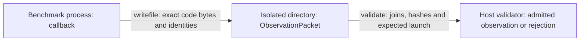

# backend-nvptx — architecture

The GPU leg of the LLVM backend: `crates/backends/llvm/src/func/{gpu,resident,retain}.rs`,
`crates/backends/llvm/src/profile.rs` (device facts, rung table), `crates/mapal-rt/gpu/mapal_gpu.c`
(the transmissions). Plan of record: `plans/plan-s41-the-nvptx-leg.md` (S52 revision) and
`plans/plan-s54-fusion-placement.md`. FRAMEWORK.md terms throughout (§4.1 atoms, §4.2 placement
as a span, §4.5 laws).

Created S54 (2026-10-21). Before this file the component had a plan and a STATUS but no model of
what a *multi-computation* program looks like at the device: five parts measured
(`benches/results-s54-gpu/baseline-tables.md`) and nothing fused except the closed-form prologue.
Every per-cell consumer of a tile site ran on the host behind a whole copy-out; chains paid a
copy-out and a copy-in; independent sites ran one after another.

Built realizations are mapped in [IMPLEMENTATION.md](IMPLEMENTATION.md). Selection acceptance
and current validation state belong in [STATUS.md](STATUS.md); historical measurements below
motivate the placement rules but do not certify the final integrated build.

## 1. Why model it categorically

Because the expensive thing is not a kernel, it is a **transmission** the program never asked
for. On every probe the kernels alone are 0.62–1.39× the best library leg and the whole chain is
1.5–42× slower (`baseline-tables.md` §Multi-computation probes). The difference is `Trm`s —
`d2h`, `h2d`, host passes — placed where no fact required them. FRAMEWORK §4.5 law 1 says what
is required: a transformation reads data present at its location, delivered by a `Trm` or
materialised there. Fusion is what is left when no `Trm` is placed without a reason.

So: **fusion is not a pass** (plan-s41 S52 amendment 9). There is one placement rule (§5) over
the IR's facts, and a kernel boundary is where the rule had to place a `launch`.

## 2. `Dat` — the objects of a multi-computation program

Nothing here is new to the GPU leg: the IR's objects are immutable, sized statically, every
read is a morphism. The facts the placement reads are all deduced by `mapal-ir` (ADR-0032: no
machine fact enters the IR).

| Object | Semantics | Fact (file:symbol) |
| --- | --- | --- |
| array `x: [T; n]` | immutable, static `n` | `Ty::Array` |
| tile site `S` | `out[i,j] = fold_k a·b` with affine reads, `k > 0` | `algo.rs:TileSite`, `TileRead{ci,clane,ck}` |
| strided one-row site | `out[j] = fold_k a[k]·b[j·s + k]`, `s ≠ 1` (`q·Kᵀ`) | **`tile_plan_strided` (S54)**; `tile_plan` (the CPU's) refuses it |
| per-cell morphism `m` | a `Map` with no inner fold whose cell `t` reads a fixed set of cells | `algo.rs:ElemSrc::Apply` (law), **`cell_plan` (S54: the read footprint)** |
| row fold `R` | a `Map` over rows whose body is one in-order `Fold` of one affine read `base + ci·i + ck·k`, step `acc ⊕ e` (`+ − ×`, or a compare-select: max/min) | **`algo.rs:row_fold` → `RowFoldSite{rows, k, a, op, seed}` (S54)** |
| exact use count | every reader of `x`: the `Pair`s out of `x` and the morphisms their products feed | `out_edges` (`rowfold.rs:only_reader`) |
| element read | a host `Index` at a proven constant | `BoundsProof::proven` |
| carried state | a loop-state component and the rows one iteration writes | `LoopPlan`, `write_delta → Delta::Rows` |
| delta of a derived object | a captures-0 map of a `Rows` value changes only in those rows | **`write_delta`'s Same consumers (S54)**, keyed by the image |
| death | the position after which no morphism reads `x` | `LastUsePlan::death`, `escapes` |
| independence | two sites with no dependency path | `PathPlan.tasks` |

The **footprint** is the one fact that existed in pieces and nowhere whole. For a reader `R` of
`x` and output cell `t`:

| footprint | meaning | who has it |
| --- | --- | --- |
| `Same` | `x[t]` | a captures-0 `Map` over `x`; a captured `x[t]` |
| `Row(c)` / `Col(c)` | `x[t ÷ c]` / `x[t % c]` | a bias, a per-row scale |
| `Const(k)` | one cell | a host `Index` at a constant |
| `Panel` | a row or column of `x` | a tile site operand (`TileRead`), a row fold |
| `Whole` | everything, in order | a whole-array fold; anything unrecognized |

`cell_plan : (fn) → MorphismId ↦ CellSite{extent, reads: [(slot, Footprint)], body}` is the
S54 query, ~120 lines beside `move_plan`, geometry only. Its gate is `gen_law`'s (a clean leaf
body, no `Call`/`Map`/`Fold`, no float `%`) plus every `Index` proven.

## 3. `Trn` — the transformations

| `Trn` | `t_from → t_to` | realizations (`TrnLoc` rows) |
| --- | --- | --- |
| tile site | `(a, b) → out` | host nest (`tile.rs`); device `naive` / `tiled` / `mma` / `wgmma` (`gpu.rs`) |
| per-cell morphism | `(x₁…xₙ) → out` | host loop (`bulk.rs:emit_map`); `devgen` kernel (captures 0, closed form); **S54: epilogue in a site's store; `cell` kernel (`resident.rs:Cell`, the host body called with device pointers); `cell-law`: a closed-form `Same` capture evaluated in the cell (`fnN_cell`, the capture as a value)** |
| row fold | `x → r` | host nest; **S54: `rowfold` kernel (`gpu.rs:rowfold_kernel_text`), one thread per row, `k` in order, the host's step instruction** |
| whole float fold | `x → scalar` | host only (ADR-0028 D4: one in-order chain; one device thread is slower than the copy-out) |
| element read | `x → T` | host load; one-element `d2h` (`resident.rs:Use::Elem`) |
| restricted site | the site over the rows `Δ` says changed | `retain.rs:Retained.row`; **S54: launched into the output's resident buffer at the row's offset (`resident.rs:emit_row_resident`)** |

One `Trn` placed twice is two `TrnLoc` rows and may be two texts (FRAMEWORK §4.2). The rule
that keeps them the same *value*: a per-cell body is emitted once (`drive.rs`) and the device
text is the host's text — the same `fmul`/`fadd` with no `contract` flag on the exact face,
`llc -nvptx-fma-level=0` as the belt (`bundle.sh`). Placement is therefore numerics-free: the
exact face is bit-identical to the interpreter wherever a morphism runs (S53 differential
238–246/238–246 on five parts).

## 4. `Loc` and `Trm`

`Loc`: `Host` (the frame arena), `Gmem` (device global, per-object slot `%d<k>`; under `arena`
a straight-line object's slot is a compile-time offset of the function's one allocation), `Smem` (one
block's shared memory), `Reg` (one thread). Adjacency: `Host ↔ Gmem` over PCIe; `Gmem → Smem →
Reg` inside an SM; `Reg → Gmem` by a store. A value in `Reg` is visible to one thread, in `Smem`
to one block, in `Gmem` to a consumer **after producer writes are ordered before that consumer**.

| `Trm` | `c_from → c_to` | carries | cost fact (S52/S54 traces) |
| --- | --- | --- | --- |
| `h2d` | `Host → Gmem` | a whole array, or (S54) the rows `Δ` wrote | 64 MB: 3–5 ms pageable; `cuMemcpyHtoD` |
| `d2h` | `Gmem → Host` | a whole array, or one element | 64 MB: 3.2–7.3 ms; synchronous (S54: on the producer's stream, `cuMemcpyDtoHAsync` + that stream's sync) |
| `launch` | `Host → Gmem` (control) | a kernel and its pointer arguments | 5–10 µs; asynchronous on a stream |
| `g2s` (stage) | `Gmem → Smem` | a panel | `cp.async` / vector loads; completed by `barrier0` |
| `s2r` | `Smem → Reg` | a fragment | `ld.shared` / `ldmatrix` |
| store | `Reg → Gmem` | an output tile | one vector store per `lanes` columns; **S54 `rowfold-layout`: per `lanes` rows of a column (column-major)** |

Law 2: each of these crosses a boundary; a same-location flow (the host loop, the register
step) is a `Trn`. Producer-before-consumer ordering within the shared `Gmem` location is
control, not an array transmission: one stream provides launch order, and cross-stream
dependencies use an event (`mapal_gpu_event`). That event records and waits without moving
the array; the implementation map names this ordering separately from data copies.
Law 1: the host fold reads `d` at `Host`, so `d` is delivered by `d2h` or the
fold does not run — there is no third option, which is why the whole-sum programs keep their
copy-out until ADR-0028's canonical tree exists.

## 5. The placement rule

Every morphism of a function is placed in topo order by the first clause that holds. The rule
reads the facts of §2 and the device facts of `profile.rs` (`sms`, `max_blocks_per_sm`,
`smem_per_sm`, `l2_bytes`), never a workload name.

- **R0 (anchor).** A tile site with `k > 0` and plain affine reads is a device site
  (`gpu.rs:gpu_site`). Its output cell exists in the owning thread's `Reg` before the store.
  A strided one-row site is one too (`gpu.rs:tile_plan`, rung `lane-stride`): the
  one-thread-per-cell kernel addresses any affine read. Its step keeps the host map's
  `fmul` + `fadd` on the contract face, where the CPU does not tile it.
  A row fold whose read array a device site produced is a device site (one thread per row, `k`
  in order; `rowfold.rs:rowfold_sites`); a fold over a host array stays on the host — moving the
  array in is the copy the rule removes. Every other `Trn` starts at `Host`.
- **R0′ (store order, S54 `rowfold-layout`).** When a device row fold is the *only* reader of a
  tile site's output (the exact use count) and reads it in row order, the site stores the output
  column-major (`o[j·rows + i]`) and the fold reads `c[i + k·rows]`: the fold's threads are the
  rows, so a warp's reads are consecutive words. No other reader exists to see the layout. The
  tile kernel then runs its lanes and its grid down the rows too. Measured (S54,
  `rowfold-*.txt`): the strided fold it replaces costs only 0.01–0.1 ms at 4096 (L1 serves each
  sector to a thread's next steps) and the column-major tile store costs 0–4% (GDDR) to 8–22%
  (H100). Selection is per profile and face: the current table enables this layout on RTX 4090
  Contract and A100 Exact and disables it on the other measured classes. Final acceptance is
  recorded in STATUS; the placement condition remains the sole-reader proof.
- **R1 (fold into the store).** A per-cell morphism `m` runs **inside** device kernel `S`,
  between the accumulator and the store, when every operand of `m` is (i) `S`'s output at
  footprint `Same`, (ii) a member of `S`'s group already (a chain `x → y → z` composes by
  `elem_plan` to one law), or (iii) an array complete in `Gmem` before `S` launches, read at a
  footprint that is a function of the cell only (`Same`, `Row`, `Col`, `Const`): a bias, a
  residual, the other site of a fan-in. No `launch`, no `Gmem` for `m`'s input. The group
  stores each member some outside reader needs; a member with none never exists in memory.
- **R2 (per-cell device site).** Otherwise `m` is its own one-thread-per-cell kernel when every
  operand is in `Gmem` (device-produced, carried, or closed-form and so `devgen`-able) and every
  reader of its output is a device site, an element read, or a member of a later group. A reader
  that needs the whole array at `Host` (a whole fold, a print, an escape) forces `d2h`; then `m`
  runs where the bytes it moves are fewest — on the device when its operands are already there
  (one `d2h` either way), on the host when they are not.
  *As built (`resident.rs:cell_sites`)*: "already there" = a site's or an earlier cell's
  output, a carried state, a tile site's operand (copied in for it anyway), or closed-form; the
  device is taken when some operand lives only there or no host reader needs the output whole
  (an all-closed-form `ew` read whole stays on the host, byte for byte). Cells and carries decide
  each other, so the pair is the greatest fixed point from every candidate. A capture that is
  closed-form and read only at the cell's own index (`Same`) is evaluated in the cell, never
  stored (`cell-law`): `ew` is one kernel that reads nothing.
- **R3 (kernel boundary).** A reader whose footprint is `Panel` or `Whole` of a device output
  needs every producer block's store: `Gmem` plus producer-before-consumer ordering at the next
  `launch`. This is amendment 9's
  sentence with the fact that decides it. The output stays in `Gmem` (`resident`); the reader
  launches on it.
- **R4 (host).** A whole-array float fold (ADR-0028 D4), an unproven index (device traps are
  not modelled), a body outside `gen_law`'s leaf gate, a morphism in a guard arm or loop its
  producer is not in: `Host`, delivered by `d2h`.
- **R5 (retention, part of object).** Inside a loop, a device site over carried `x` whose
  iteration wrote rows `Δ` (`write_delta`), with `w` invariant and row-local reads, recomputes
  only `Δ` into its **resident** output (`retain.rs` rule, on the `resident` buffer: the whole
  site on a loop entry's first pass, then the row kernel at the row's offset; rung
  `retain-resident`). `Δ` passes through `Same` consumers (a captures-0 map of `x` has `x`'s
  `Δ`) and stops at the first `Panel` reader. A host-written array with `Δ::Rows` that a
  device site reads uploads `Δ`, not the array, after one whole upload per loop entry (rung
  `delta-h2d`); a retained output a host reader needs crosses as its new row the same way. A
  retained output that is a carried state's next is not retained (the back edge swaps its
  buffer).
- **R6 (residency and death).** An object a device site reads is copied in once after its
  producer; a device output is copied out only for a host reader, whole or one element; every
  buffer is freed at `death` (`resident.rs`). Device-only objects get no host slot and live in
  one arena laid out at compile time from death positions.
- **R7 (concurrency).** Device sites on different `PathPlan` tasks launch on different streams;
  a cross-task edge is an event. Streams are opened only when the union of the concurrent grids
  is under one wave (`blocks < sms · max_blocks_per_sm`, from the launch geometry): a filled part
  has nothing to overlap. On sm_90+ a dependent launch in one stream may begin its prologue
  before the producer's grid drains (`griddepcontrol`).
  *As built (S54 `streams`, `resident.rs:chains`):* straight-line sites are covered by chains in
  topo order (a site continues the chain whose last site is a `PathPlan` ancestor). Streams open
  only when (a) every one of those sites' outputs stays in `Gmem` — a whole `d2h` puts the host
  between the chains (diamond and mlp2 with a host join ran 0.60–0.96× on streams on every part,
  indep flipped sign between sessions) — and (b) the general form of "under one wave", read off
  the launch geometry's own residency: two independent grids of `b` blocks on a part holding
  `w = sms · blocks_per_sm` save a wave when their last waves fit one,
  `t_a/w_a + t_b/w_b ≤ 1`, `t = b − w(⌈b/w⌉ − 1)` (A100 at 2048, ~1.2 waves each: 3 waves
  instead of 4, measured 21–27% faster on device-only sites in two sessions). (The first build
  also deferred chained copy-outs to their host reader; those programs measured 8–37% slower and
  no longer open streams.) With streams open, frees between
  the first and last chained launch move after the last (one device wait), every chained buffer
  is allocated before the first chained launch, a one-element `d2h` runs on its producer's
  stream, and a chain stream joins program order (the legacy stream) at each launch by an event
  the runtime records only when legacy work was enqueued since. After R1/R2 fold the joins onto
  the device, indep/diamond/mlp2 take the device-only shape (`twin`). The current table enables
  streams only on A100. S56's two integrated RTX 5090 hosts favor OFF in every changed cell;
  [the selection report](../../performance/s54-per-arch-selection.md) records this decision and
  its evidence. `pinned`: a host array
  copied inside a loop is page-locked once before its first copy (a copy that runs once never
  repays the registration). `pdl`: every tile kernel opens with
  `griddepcontrol.wait; griddepcontrol.launch_dependents`, and a kernel launched right behind
  another on its stream is a programmatic dependent launch.

**Kernel boundaries are the consequence.** A program's launches are exactly the R0/R2 sites
after R1's groups. R4/R6 determine host/device array transmissions, while R3/R7 determine
ordering between device producers and consumers; launches and intra-device staging/stores
use the boundary transmissions listed in §4.
"Fuse" is never spelled in the code; the probes' static counts (`benches/gpu/fusion_report.py`)
and the trace (`MAPAL_GPU_TRACE`) are what say whether a boundary exists.

| probe (`gen_tiles.py`) | shape | today (base) L / d2h / h2d | after R1–R7 |
| --- | --- | --- | --- |
| epi, bias, residual | site → per-cell → corners | 1 / whole / 0, host map | 1 / 8 B / 0 |
| ew | three per-cell maps, closed-form inputs | 0, four host passes | 1 gen / 8 B / 0 |
| pro | per-cell → site | 1 / 8 B / 0 (devgen) | unchanged |
| mlp | site → per-cell → site | 2 / whole / whole | 2 / 8 B / 0 |
| indep, diamond | sites ∥ → per-cell join | 2–3 serial / whole | 2–3, join in the last store; streams under one wave |
| fanout | one output, three readers | 2 / 3 × whole | 2 / whole once (the host reads `c`) |
| rowsum | site → per-row fold | 1 / whole | 2 / 8 B (the two printed cells; S54 `rowfold`, built and measured) |
| softmax_rows | site → row max, per-cell exp, row sum, per-cell quotient | 1 / whole | 2 / whole `c` + 16 KB `mx` (S54 `rowfold`: the max on the device; the sum folds a host array); R2 takes the rest |
| loop | `x ← relu(x @ w)` × 8 | 8 / 8 × whole / 8 × whole | 8 / 0 / 0 |
| decode | carried rows, invariant weights | 3 whole launches per step, 1 MB each way | row launches, 1 KB each way |

## 6. The coherence laws this must satisfy (§4.5)

1. **Placement honesty.** R1's condition (iii) *is* law 1: an epilogue operand must be complete
   in `Gmem` before the launch — a fan-in's first site is topo-before the second (one stream)
   or joined by an event (R7). Reading a staged panel before `barrier0` is the same law failing
   one level down (STATUS.md's `__syncthreads` note).
2. **Transmission well-typing.** Every `Trm` row above carries a typed datum; a one-element
   `d2h` carries `T`, a delta `h2d` carries `[T; stride]`. The host loop and the register step
   are `Trn`, never `Trm`.
3. **Placement totality.** Every morphism has a `TrnLoc` after R0–R7; the fallthrough is R4,
   which is always defined. A `CellSite` the kernel cannot address falls to R4, not to a panic.
4. **Dependency mediation.** A device reader of a host-produced array is mediated by `h2d`
   (R6); a host reader of a device output by `d2h`. Device streams share `Gmem`, so their
   dependency needs ordering rather than a new data transmission; an event supplies that
   ordering. The trace and static report expose the corresponding runtime calls.
5. **Composition soundness.** A group (R1) is the composite of its members: its stores are the
   union of the members' outside-needed outputs, nothing redescribed. The device unit's text for
   the group is the host bodies' text, so `data(C) = ⊎ data(members)`.
6. **`runsAt` is a relation.** A per-cell body has up to three `TrnLoc` rows (host loop,
   epilogue, cell kernel); the differential checks all of them against one oracle.

## 7. What a rung is here

Every placement clause has a measurement arm (`GpuRungs` field, `emit --gpu-off=<name>`,
an arm in `bundle.sh`). Rungs default ON; a matching `GPU_RUNGS_OFF` row disables one for its
profile, fill and face, with a citation to the supporting measurement: `epilogue` (R1), `devmap` and `cell-law` (R2), `rowfold`
and `rowfold-layout` (R0 for folds, the store order), `lane-stride` (R0 for strided one-row
sites), `retain-resident` and `delta-h2d` (R5),
`arena` (R6), `streams`, `pinned`, `pdl` (R7), `raster` and `l2-window` (the grid order and L2
policy from `l2_bytes`; `l2-gate` is `raster`'s measurement arm, the derivation without its L2
gate). An OFF arm disables that rung while preserving the other selected rungs; it is not a
historical compiler baseline. Neither `raster` nor `l2-window` is a `Trn` or a `Trm`:
the grid order is how one realization walks its blocks, the window a cache policy on a `launch`
over `Gmem` the graph proves is read again — `l2-window`'s output case is R6's residency seen from
the L2 (a chain's intermediate, read by the next launch). A rung's fill key belongs to
its launch context (`profile.rs:Fill`). For a tile, `gpu.rs:launch` derives the key from
the preliminary `profile.rs:TargetProfile::gpu_tile` query with wide/fill disabled,
before `rungs_at`; it queries geometry again after selecting those rungs. Thus changing
geometry admission may also change the selected realization of the same tile `Trn` over
`Gmem`, `Smem` and `Reg`. This is an existing selection dependency, not a new semantic
object. Other contexts use the host kernel for an epilogue, its own grid for a cell
kernel, or the union for streams. The [S60 audit](../../performance/s60-parallel-preparation.md)
records the caller proof and isolated counterexamples to a simple profitability filter.

The table is a rung too (`arch-rungs`; `emit --gpu-off=arch-select`): OFF bypasses the table and
enables every rung, including S54 mechanisms, so ON vs OFF prices the per-part selection on
every kernel and probe. It is not S52 or a placement-disabled baseline. A row's face
key is the kernel the rung folds into: `Exact`, `Contract` (the FMA tile, and TF32 with it — a
contract face), `Tf32` (the `mma` kernel alone; S54: the 3090's `.minnctapersm` pays on the FMA
tile and costs 11% on `mma`). `benches/gpu/rungs.py` decides a rung measured for the first time
by the plan's rule (ON iff some size is > 1% faster in every session) and flips a decided row only
when every session measures the other sign; host-read rungs (`gpu.rs:host_rungs`) key fill `Any`.

**R1 as built** (`epilogue`, branch `s54/epilogue`): `mapal-ir` `cell_plan` gives each `Map` its
`CellSite`; `resident.rs:epilogues` forms the groups before the residency plan (sites in
execution order; a member's group value read only at `Same`, every other operand complete in
`Gmem` at a cell-only footprint, the same loop phase as the site); members are skipped on the
host and their reads are device uses, so `keep`, `devgen` and the loop carry follow unchanged.
`gpu.rs:store_cells` evaluates the chain at each of the four store sites (`naive`, `tiled`,
`mma`, `wgmma`) with the host body, or its `_cell` variant (a captured `Same` read from a
one-cell buffer, which SROA turns into a register); `mapal_gpu_launchv` passes the extra
pointers. Static counts: `benches/results-s54-gpu/epilogue-fusion-report.txt`.

**The rules together** (S54 integration, `s54/arch-select`). R1 runs before R2: a per-cell
morphism an epilogue group takes is never also a cell kernel. One `ResidentPlan` holds every
device output — sites', row folds', cells' and the stored group members' — and `uses` /
`carries` see all of them as device-produced. Law 1 across streams: a launch on a chain's stream
waits for every operand on another chain's stream, an epilogue's complete operands included
(`mapal_gpu_event`); R7 opens streams only when no launch the chains do not order (a fold, an
unchained site, a cell kernel, all on the legacy stream) reads a chained output. The arena
reuses bytes by topo position, which concurrent streams do not follow, so a function that opens
streams keeps per-object buffers; the L2 window is not carried by a `launchv` (a group or a chain
launch). Static before/after on five parts: `benches/results-s54-gpu/arch-select-fusion-report.txt`.

R7's grouped-member guarantee is realized by the
[S58 ordering correction](../../performance/s58-parallel-development.md): stream selection
resolves canonical aliases through the grouped physical writer, and the legacy-consumer
veto uses that same relation. The correction adds no Dat, Loc or Trm and leaves the arena
guard intact. Four old-code regression failures, unchanged device LLVM, runtime/API
completion evidence and 200 ordinary GPU processes on each revision support this boundary
(FRAMEWORK §4.5 laws 1, 4 and 5). Both revisions passed the GPU outputs; no observed race
failure or performance improvement is claimed. Removing allocations remains a separate
proof duty because an existing free can also supply completion.

## 8. What is not placed here

The standalone executed-image observer is a measurement prototype, outside production
placement. `Dat ObservationPacket` consists of exact PTX/cubin bytes, callback identities
and a completed-harness receipt. `Trn callback` copies callback-owned code into an isolated
directory before its lifetime ends (`Trm writefile`, benchmark-process Loc → filesystem
Loc); `Trn validate` deduces module/function/launch joins and checks exact expected geometry.
The implementation map names these symbols. This satisfies the local model's ownership
and composition obligations (FRAMEWORK §4.5 laws 1, 2, 5); actual Linux/GPU callback behavior
remains an open proof duty. A successful driver launch is submission evidence; completion
and numerical correctness must come from the separately reviewed harness. Instrumented
observations never supply ordinary timing.

| Measurement morphism | Domain → codomain | Realization |
| --- | --- | --- |
| `writefile` (`Trm`) | callback-owned bytes/identities → isolated ObservationPacket | `capture.cpp:writefile`, called by `capture.cpp:callback` |
| `validate` (`Trn`) | ObservationPacket + harness receipt → admission/rejection | `validate.py:validate`; no GPU numerical proof is inferred |

- Joint CPU/GPU cost-based placement and concurrent CPU task execution remain open questions.
  `Host` and `Gmem` are existing `Loc`; `Emission` carries separate host/device modules.
  In the built `emit_detailed` transformation, GPU profiles disable CPU task parallelism,
  inherit generic host profile facts, and `emit_tiled_map_realize` selects eligible GPU
  sites before CPU fallbacks. Host LLVM still receives ordinary optimization. This is a
  current realization limit, not evidence that host work is unoptimized or that moving a
  particular operation would improve performance (FRAMEWORK §4.5 laws 1, 4 and 6).
- Paged placement of retained `Dat` and cross-request shared-block ownership remain open
  questions. Existing `Arena` offsets, retained rows and `Trm` readiness do not implement
  a runtime page map, reference counts or completion-aware page retirement. A proposed
  placement must preserve values, bounds, aliases, writes and all consumers' completion
  before reuse (FRAMEWORK §4.5 laws 1, 4 and 5); no paging gain is established here.
- The whole float sum on the device (ADR-0028 D4; the canonical-tree re-pin is Sapir's call).
- Precision placement (ADR-0039 is a candidate; no storage type, no flag deletion).
- Demand-restricted sites (every reader `Const(k)` → compute only those rows): correct and
  derivable, but it would hollow the timed probes (their outputs are read at the corners) into
  two-row GEMMs. It waits for a program that needs it and a harness that keeps a whole reader.
