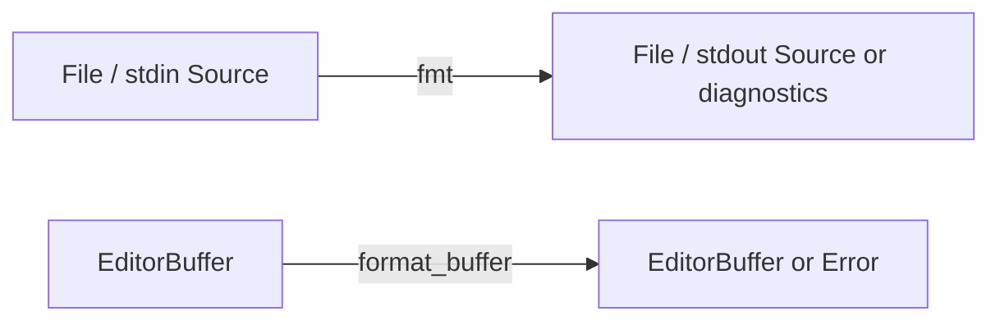

# Component: cli

## Source formatting and editor ports (2026-10-28)

Extend `Dat Source` and the existing driver with `Trn fmt`; share the syntax
crate's formatting operation rather than maintaining separate editor rules
(FRAMEWORK §3, §4.5 composition soundness).

| Morphism | Signature | Partiality | Semantics |
| --- | --- | --- | --- |
| `fmt` | `Source × Mode → Source ⊕ Diagnostic*` | Partial on syntax and I/O success | Explicit paths are written in place; `--check` only reports drift; `-` reads stdin and writes stdout; `--stdout` previews one file |
| `format_buffer` | `EditorBuffer → EditorBuffer ⊕ Error` | Partial on successful CLI execution | Both plugins send the complete buffer, applying output only on success and to the same buffer version |

`Loc` sites are the editor process, CLI process and filesystem. `Trm` stdin/stdout
pipes carry source between editor and CLI; file reads/writes carry source between
disk and CLI. Diagnostics use stderr. Editors do not overwrite a buffer on CLI
failure. Realizations: `crates/mapal-cli/src/fmt.rs:run`, the `main` dispatcher,
`editors/nvim/lua/mapal/format.lua`, and `editors/vscode/extension.js`.
The operation requires no LLVM toolchain or GPU. File lists are explicit: no
recursive project discovery. All inputs are validated before any requested file
replacement; read-only preview/check modes never write files.

`mapal build|run|dump-ir|test|fmt` — a driver over the existing crates. It makes no
codegen decision: every optimization in its output is derived inside
`mapal-backend-llvm` from the IR artifacts against the named `TargetProfile`.
The CLI routes `EmitOpts` (the shared parser `mapal_backend_llvm::flags`, so
every rung's OFF arm is reachable from the product binary) and runs the
toolchain. Diagnostics are rendered here and only here (syntax I5 / C3).

## Categorical model (Dat + Trn)

Objects:

| Object | Meaning |
| --- | --- |
| `Source` | the `.mapal` text |
| `Program` | the parsed tree (`mapal_syntax::Program`) |
| `CategoryIr(lowered)` | sealed, checked IR — the oracle's input |
| `CategoryIr(rewritten)` | the compiled arm's input |
| `Emission{host, device?, profile}` | the translation unit(s) and the resolved profile |
| `Ptx` | the device unit after `opt -O3 ∘ llc -O3 -mcpu=<profile.gpu.arch> -nvptx-fma-level=0` |
| `Executable` | host unit + `libmapal_rt.a` (+ `mapal_gpu.c`, libcuda on a GPU profile) |
| `Observable(stdout?, exit)` | what a run shows: stdout byte for byte (absent on a trap) and the exit code |

Morphisms:

| Morphism | Signature |
| --- | --- |
| `parse` | `Source → Program ⊕ Diagnostic*` |
| `lower` | `Source × Program → CategoryIr(lowered) ⊕ Diagnostic*` |
| `check` | `Source × Program × CategoryIr → Diagnostic*` (empty = accept) |
| `rewrite` | `CategoryIr(lowered) → CategoryIr(rewritten)` (skipped by `--no-rewrite`) |
| `emit` | `CategoryIr × EmitOpts → Emission ⊕ EmitError` |
| `opt∘llc` | `Emission.device → Ptx` (GPU profile only) |
| `link` | `Emission.host (× Ptx) → Executable` |
| `exec` | `Executable (× MAPAL_PTX) → Observable` |
| `interp` | `CategoryIr × Budget × FoldOrder* → Observable ⊕ Diverged` (`mapal_interp::run_ordered` then `native_observable`; no orders = `run` on the lowered IR) |
| `render` | `Diagnostic → 𝕊` (`file:line:col severity[CODE] (stage) message`) |

`test` is the equalizer check `exec∘link∘emit∘rewrite ≡ interp` on `Observable`,
on the fixed face (ADR-0040 D3: separate steps, the compiled partition order,
which the oracle replays from `Emission.orders` on the rewritten IR) or `--exact`.
The default, contract and reduced faces are bound-checked (ADR-0040 D2), not
bit-equal, so `test` rejects their flags (`--contract`, `--order=free`,
`--order=sequential` with fma steps, `--precision=tf32`). A diverged oracle is no verdict (exit 1,
`SKIP`); a missing toolchain is exit 3, never PASS/FAIL.

Exit codes: 0 ok · 1 rejected program / failed tool / FAIL · 2 usage · 3 toolchain
missing (clang, opt/llc, libmapal_rt.a, CUDA) · otherwise the program's own
(101 trap, 102 GPU driver).
