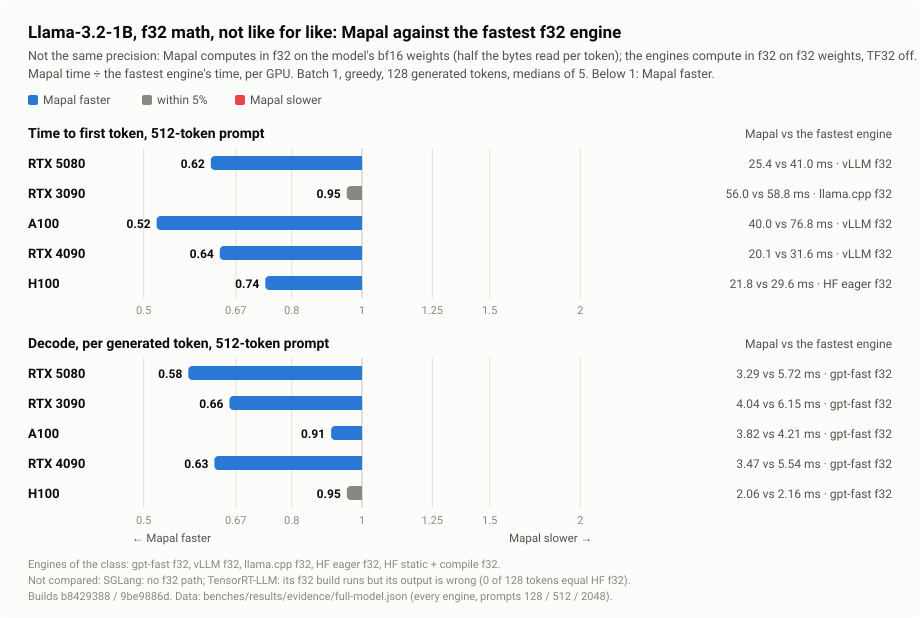
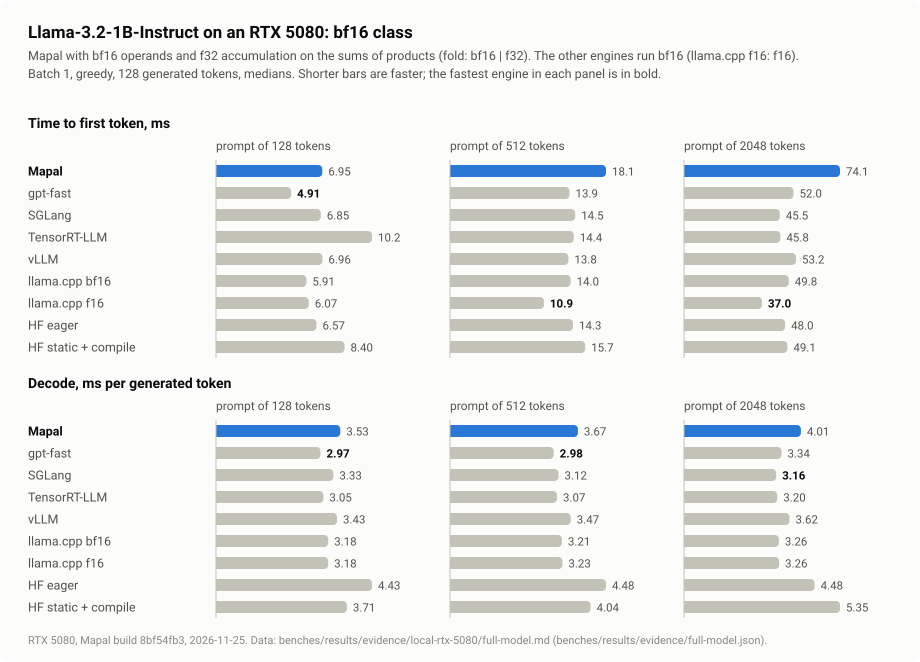
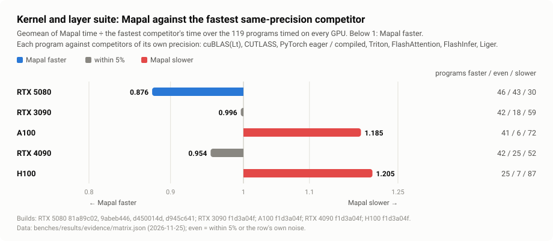
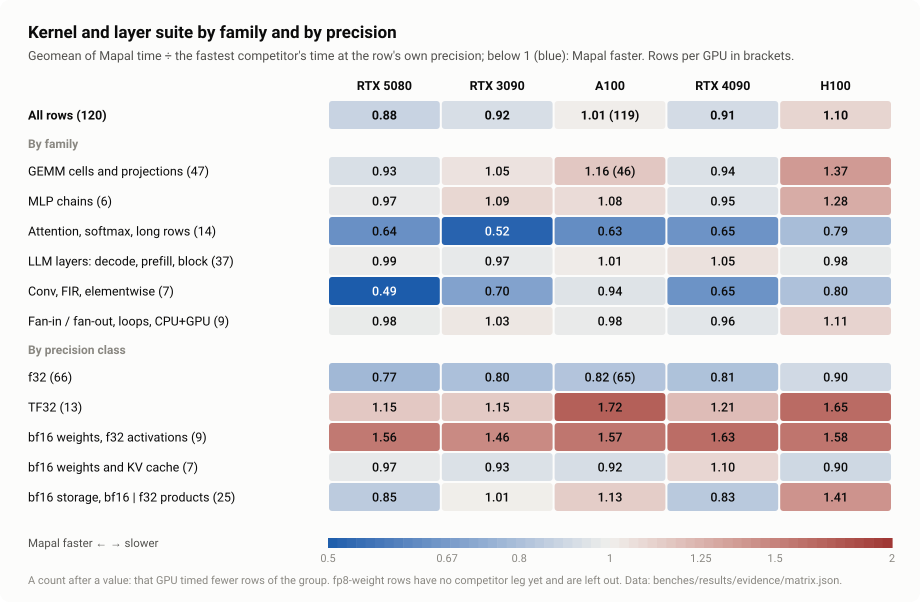

# Current results

Every number behind the README's charts: how the round was run, how correctness was checked, the generated headline
tables, the full model and the kernel suite. Back to the [README](../../README.md#results); the performance index:
[`docs/performance/`](README.md).

Five GPUs, 2026-11-26: an RTX 5080 at home and an RTX 3090, A100, RTX 4090 and H100 rented. The full model on all
five and the kernel suite on the rented four ran this round's final build (`b8429388`, re-timed on `9be9886d`'s
runtime); the RTX 5080's suite column is the gapfix integration's (`d945c641`). Type against type: the f32 program
against engines computing in f32, the bf16 program against bf16 engines, each suite row against competitors at its
own precision. No gain is claimed across precisions.

**Correctness.** Every timed program passes its value gate on every GPU before it is timed: within the stated error
bound on the default face, in any order of operations, and bit for bit with the interpreter in the development modes
([ADR-0049](../decisions/ADR-0049-correctness-is-the-flow-and-the-bound.md)). One bf16 program
(`px_llm_blkdec_b2_l16_bf16`) first read as outside its bound on the rented GPUs: the compiled result was right — bit
for bit the program with the bf16 stores its `: bf16 | f32` permits — and the gate's bound was the unsound part, so
the gate now checks a bound composed through every operation of the program
([ADR-0041](../decisions/ADR-0041-compute-precision-permission-candidate.md)). The model's generated tokens are
checked against the Hugging Face reference of the same class, run on the same box.

<!-- results-headline:start -->

**Kernel and layer suite**: Mapal ÷ the fastest competitor at the program's own precision, geomean over the 119 programs timed on every GPU, both sides timed at the program boundary.

| GPU | Mapal ÷ fastest | programs faster / even / slower |
| --- | ---: | ---: |
| RTX 5080 | **0.876** | 46 / 44 / 30 |
| RTX 3090 | **0.920** | 39 / 30 / 51 |
| A100 | 1.006 | 57 / 11 / 51 |
| RTX 4090 | **0.911** | 49 / 25 / 46 |
| H100 | 1.101 | 30 / 8 / 82 |

**Llama-3.2-1B, the full model**: Mapal ÷ the fastest engine of the same class, prompts 128 / 512 / 2048 (batch 1, 128 generated tokens, medians of 5).

| GPU | class | time to first token | decode per token | at 512: Mapal vs the fastest engine |
| --- | --- | ---: | ---: | --- |
| RTX 5080 | f32 | **0.62** / **0.62** / **0.53** | **0.55** / **0.58** / **0.58** | 25.4 vs 41.0 ms (vLLM f32); 3.29 vs 5.72 ms / token (gpt-fast f32) |
| RTX 5080 | bf16 | 1.13 / 1.05 / 1.15 | 1.10 / 1.10 / 1.06 | 14.1 vs 13.5 ms (llama.cpp bf16); 3.29 vs 2.98 ms / token (gpt-fast) |
| RTX 3090 | f32 | 1.04 / 0.95 / **0.82** | **0.65** / **0.66** / **0.67** | 56.0 vs 58.8 ms (llama.cpp f32); 4.04 vs 6.15 ms / token (gpt-fast f32) |
| RTX 3090 | bf16 | 1.55 / 1.17 / 1.30 | 1.23 / 1.23 / 1.25 | 23.8 vs 20.4 ms (SGLang); 4.01 vs 3.27 ms / token (gpt-fast) |
| A100 | f32 | **0.73** / **0.52** / **0.43** | **0.86** / **0.91** / **0.89** | 40.0 vs 76.8 ms (vLLM f32); 3.82 vs 4.21 ms / token (gpt-fast f32) |
| A100 | bf16 | 1.87 / 1.44 / 2.12 | 1.56 / 1.55 / 1.57 | 16.1 vs 11.1 ms (SGLang); 3.69 vs 2.38 ms / token (gpt-fast) |
| RTX 4090 | f32 | **0.72** / **0.64** / **0.53** | **0.62** / **0.63** / **0.63** | 20.1 vs 31.6 ms (vLLM f32); 3.47 vs 5.54 ms / token (gpt-fast f32) |
| RTX 4090 | bf16 | 1.44 / 1.16 / 1.24 | 1.18 / 1.19 / 1.19 | 11.9 vs 10.3 ms (gpt-fast); 3.47 vs 2.93 ms / token (gpt-fast) |
| H100 | f32 | 1.04 / **0.74** / **0.50** | **0.93** / 0.95 / 0.95 | 21.8 vs 29.6 ms (HF eager f32); 2.06 vs 2.16 ms / token (gpt-fast f32) |
| H100 | bf16 | 1.30 / 1.88 / 2.37 | 1.49 / 1.56 / 1.51 | 7.60 vs 4.04 ms (gpt-fast); 2.06 vs 1.32 ms / token (gpt-fast) |
| H100, `wgmma` (another box) | bf16 | **0.75** / 1.25 / 1.58 | 1.49 / 1.49 / 1.45 | 5.60 vs 4.47 ms (gpt-fast); 2.00 vs 1.34 ms / token (gpt-fast) |

Below 1: Mapal faster; bold: faster by more than 5%. Type to type: the **f32 class** is the program as written (f32 activations on the bf16 weights) against gpt-fast, vLLM, llama.cpp and Hugging Face computing in f32 with TF32 off (SGLang has no f32 path and TensorRT-LLM's f32 output is wrong: neither is compared); the **bf16 class** (`fold: bf16 | f32`, bf16 KV cache) against gpt-fast, vLLM, SGLang, TensorRT-LLM, llama.cpp and Hugging Face in bf16. llama.cpp in f16 is another 16-bit format and is not compared. The H100 `wgmma` row is the round's code plus the 16-bit warpgroup tiles, measured on another H100 SXM against gpt-fast on that box (the H100's fastest bf16 engine in the round); the other engines were not rerun there.

<!-- results-headline:end -->

## The full model

The readable [`examples/llama.mapal`](../../examples/llama.mapal) on all five GPUs against gpt-fast, vLLM, SGLang,
TensorRT-LLM, llama.cpp and Hugging Face (eager, and static cache + `torch.compile`), in each precision class. Each
bar is Mapal's time over the fastest engine of its class on that GPU; the leader is named on the right.

<picture>
  <source media="(prefers-color-scheme: dark)" srcset="../../benches/results/charts/llm-f32-dark.svg">
  
</picture>

<picture>
  <source media="(prefers-color-scheme: dark)" srcset="../../benches/results/charts/llm-bf16-dark.svg">
  
</picture>

- **f32 class** (the program as written: f32 activations on the bf16 weights): ahead of every f32 engine on decode
  on all five GPUs (0.55–0.95×) and on time to first token from a 512-token prompt up (0.43–0.95×); at 128 tokens
  4 % behind on the RTX 3090 and H100. Its generated tokens equal the Hugging Face f32 reference's, 128 of 128, at
  every prompt length on every GPU. Peak GPU memory 2.7–3.5 GB, against 5.1 GB and more for every f32 engine.
- **bf16 class** (`fold: bf16 | f32`, bf16 KV cache): behind the fastest bf16 engine on every GPU, closest on the
  RTX 5080 (1.05–1.15× to the first token, 1.06–1.10× decode) and furthest on the A100 and H100 (up to 2.12× and
  2.37× to the first token at 2048, 1.49–1.57× decode), where gpt-fast's CUDA-graph decode and the TensorRT-LLM /
  SGLang prefill are strongest. Since this round the H100's 16-bit tiles run on its warpgroup matrix instruction
  (`wgmma`): on another H100 SXM, against gpt-fast on the same box, the first token at 128 / 512 / 2048 went from
  1.09 / 1.66 / 2.17× to 0.75 / 1.25 / 1.58× (2.70 / 5.60 / 18.11 ms against 3.58 / 4.47 / 11.45), decode unchanged
  ([wgmma-16bit](../../benches/results/evidence/hopper/wgmma-16bit.md)). Its tokens leave the bf16 reference after a near
  tie, as the bf16 engines' do among themselves (on the RTX 5080, 7 to 89 equal tokens at 512); on the RTX 5080 and
  A100 they can vary from run to run, because the tensor tile adds partial sums in arrival order. Peak memory
  2.7–3.3 GB, level with llama.cpp and HF eager, against 8.8–47 GB for the pooled servers (vLLM, SGLang,
  TensorRT-LLM).
- llama.cpp in f16 is another 16-bit format: recorded, compared with neither class. SGLang has no f32 path, and
  TensorRT-LLM's f32 build gives wrong tokens: neither is in the f32 class.

Every engine at every prompt length, the tokens and the peaks:
[`full-model.json`](../../benches/results/evidence/full-model.json); the RTX 5080 with where each side's time goes and
what is next: [`full-model.md`](../../benches/results/evidence/local-rtx-5080/full-model.md); the rented GPUs:
[`cross-arch`](../../benches/results/evidence/cross-arch/README.md#b8429388--9be9886d-five-gpu-round-bf16-integration-every-competitor-leg-at-the-program-boundary-the-full-model).

## The kernel and layer suite

GEMMs and projections, MLP chains, attention and softmax, LLM layers, convolution and FIR, fan-in / fan-out and
loops, on every GPU of the round, each program against the fastest of cuBLAS, cuBLASLt, CUTLASS, PyTorch eager and
`torch.compile` (with and without CUDA graphs), SDPA, FlashAttention-2/3, FlashInfer, hand-written Triton, Liger
and hand-written CUDA.

Both sides are timed at the program boundary: the device idle, then the host clock around the call, its dispatch
and launches inside. Against the kernel-event bracket of earlier rounds this moves every GPU 5–11 % in Mapal's
favour (launch-bound torch legs); on that old bracket the rented GPUs read 1.011 / 1.134 / 0.964 / 1.233 (RTX 3090 /
A100 / RTX 4090 / H100) against the previous round's 0.997 / 1.185 / 0.954 / 1.204 (`f1d3a04f`). Attention,
softmax, convolution and elementwise chains lead on every GPU. GEMM cells and projections are the weak family:
behind on the RTX 3090, A100 and H100 (1.05 / 1.16 / 1.37), and the TF32 rows (mostly GEMMs, against cuBLAS) and
the bf16-weight rows (LLM layers, against `torch.compile`) trail on every GPU (1.15–1.72).

<picture>
  <source media="(prefers-color-scheme: dark)" srcset="../../benches/results/charts/suite-gpus-dark.svg">
  
</picture>

<picture>
  <source media="(prefers-color-scheme: dark)" srcset="../../benches/results/charts/suite-groups-dark.svg">
  
</picture>

Every row, its legs and its leader: [`matrix.md`](../../benches/results/evidence/matrix.md). The rented GPUs, their
boxes and rounds: [`cross-arch`](../../benches/results/evidence/cross-arch/README.md). Earlier results (CPU against
NumPy and OpenBLAS, the October four-GPU table, plan-cost, tile efficiency):
[`docs/performance/earlier-readme-results.md`](earlier-readme-results.md). Method and history:
[`docs/performance/`](README.md).

The charts and the table above are generated. To refresh them after a run, update
[`matrix.json`](../../benches/results/evidence/matrix.json) (`benches/local/matrix.py`) and
[`full-model.json`](../../benches/results/evidence/full-model.json), then run
`python3 benches/results/charts/make_charts.py`: it redraws the charts and rewrites the tables between the
`results-headline` markers in this file.
